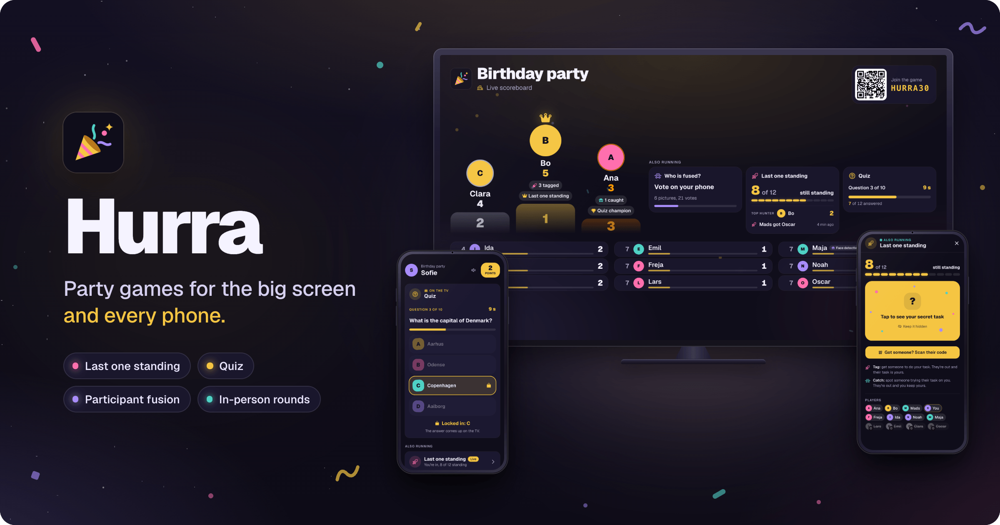
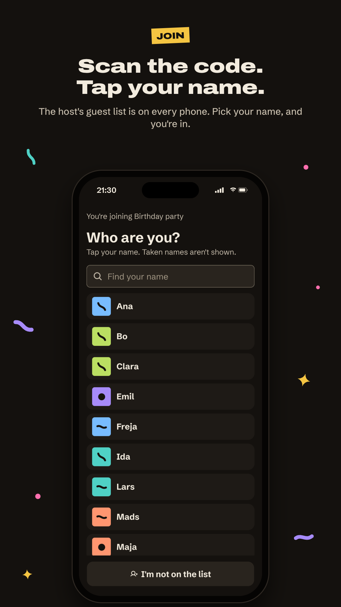
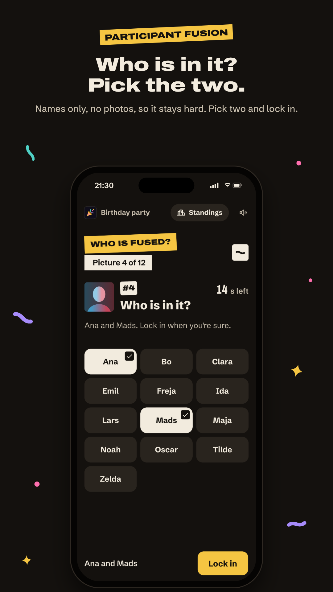
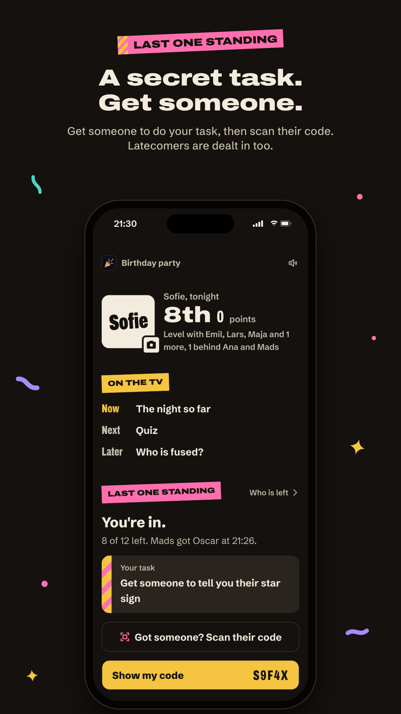
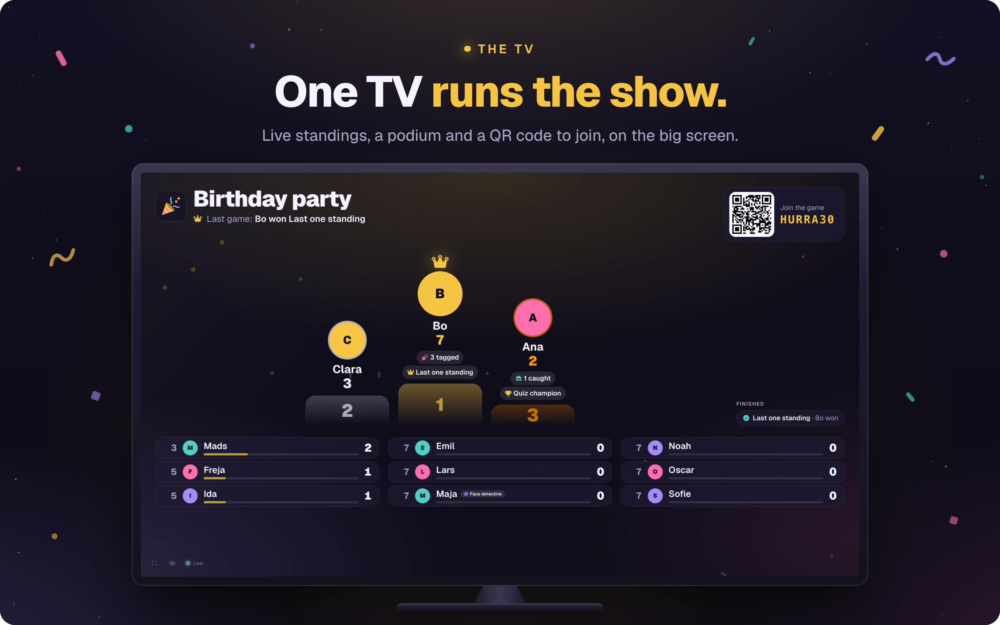
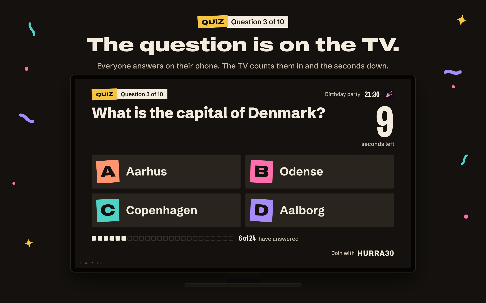
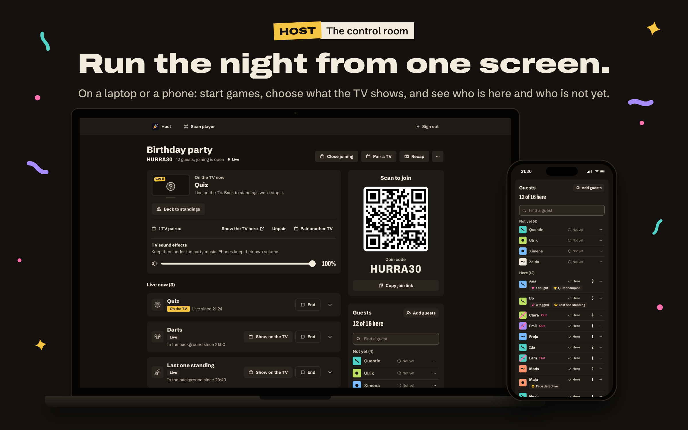

  

  <strong>Live party games for a room full of friends.</strong>
  Everyone plays on their own phone, and one TV runs the show.

  Free&nbsp;&nbsp;·&nbsp;&nbsp;No app to install&nbsp;&nbsp;·&nbsp;&nbsp;Up to 45 players&nbsp;&nbsp;·&nbsp;&nbsp;Four games, several at once&nbsp;&nbsp;·&nbsp;&nbsp;Made in Copenhagen

## Screenshots

  
  
  
  
  

  
   
  Between games, the TV shows the podium, everyone's points and the code to join.

  
   
  Answers come in live, with the top 5 and the background games beside the question.

  
   
  When a game on the stage finishes, its final screen stays up for 3 minutes.

  
   
  The race, one part of the recap: the top 8 and their points through the night.

  
   
  The control room runs on a laptop or a phone. Pair a TV, start games and find any guest.

## What's new

**Version 2**&nbsp;&nbsp;·&nbsp;&nbsp;November 2026

- **Several games at once.** A long game runs in the background while short
  ones take the TV.
- **A live quiz.** Questions on the TV, answers on every phone. Faster right
  answers score more.
- **Participant fusion.** AI portraits of two fused guests, hidden until each
  is asked: the TV picks the next one with a little suspense, then you pick
  the two names on your phone and lock in. The name search works like an
  autocomplete, so "soren" finds Søren.
- **The night's recap.** The host previews and publishes it, the TV plays it,
  and every guest finds their own night on their phone.
- **The TV from your own browser.** No second device for the TV? *Show the TV
  here* opens it in a tab of the host's browser, ready to cast.
- **Sound effects under the music.** The host sets how loud the TV plays
  its sound effects, from off to full, so they sit under the party's music.
- **Games that finish by themselves.** The quiz, fusion and Last one standing
  end the moment they have their winner.
- **A TV that can't peek.** The TV pairs with a code and reads what a guest
  reads, never more.
- **New phone, same player.** A code from the host brings a guest's player
  back.
- **Ready for a full room.** Designed and load-tested for up to 45 guests.
  Even 45 answers at once all land.

## Games

| Game | Where it plays | What it's like |
| --- | --- | --- |
| **Last one standing** | All night, in the background | Everyone gets a secret task and one life. Get someone to do your task and they're out, and their task becomes yours. Or catch someone trying theirs on you. Scan their code to knock them out. The TV keeps count of who is still standing, and the last one standing wins. |
| **Quiz** | On the TV | The host runs the questions and everyone answers on their phone. Right answers score more the faster they come. Time's up reveals the answer, a leaderboard follows, and the host crowns the winner. |
| **Participant fusion** | On the TV | AI images fuse two guests into one portrait. The pictures stay hidden on the TV (a "?" over a drawn head and shoulders) until the host asks them one by one; the TV picks each with a little suspense, and everyone picks the two names in it on their phone (names only, no photos) and locks in before time runs out. The reveal shows who it was, with their own photos. Everyone guesses every picture, the two in it too. The host crowns the sharpest eye. |
| **In-person round** | In the room | Points for anything that happens in the room, like a round of beer pong. The host gives them by hand, by scanning the guest's code. |

Several games run at once: a long one in the background while short ones take
the TV. A game finishes by itself in the moment it has its winner, except an
in-person round, which runs until the host ends it. The host can always end
one early.

These four are built, and more is planned.

## How it works

1. **Scan.** Guests scan the join QR on the TV and pick a name. Their phone
   remembers them, so closing the tab is fine: they come back as the same
   player. On a new phone, a code from the host brings their player back.
2. **Play.** The host runs the night from a laptop or a phone. They open
   joining, add and start games on the TV or in the background, and move the
   night along. Every guest also has a personal QR code. The host scans it to
   give points for things that happen in the room.
3. **Watch the TV.** The TV shows the day's leaderboard and the join QR. A
   game started on the TV takes the stage, with the games running in the
   background as cards beside it. A game that finishes on the stage, or while
   the stage is free, gets a final screen for 3 minutes.
4. **Relive the night.** At the end of the night, the host publishes a recap
   and the TV plays it.

The TV is a laptop the host pairs with a code. With no second device, *Show the
TV here* opens it in a tab of the host's own browser instead: cast that tab, or
move it to the TV as a second screen. Either way the TV reads what a guest
reads, never more.

## Information

<table>
  <tr>
    <td><strong>Category</strong></td>
    <td>Party games</td>
  </tr>
  <tr>
    <td><strong>Players</strong></td>
    <td>Up to 45 guests, designed and load-tested. One host and one TV.</td>
  </tr>
  <tr>
    <td><strong>Devices</strong></td>
    <td>Guests use their own phones, in the browser. The host uses a laptop or a phone. The TV is a paired laptop, or a tab of the host's browser on the big screen.</td>
  </tr>
  <tr>
    <td><strong>Language</strong></td>
    <td>English</td>
  </tr>
  <tr>
    <td><strong>Price</strong></td>
    <td>Free. Nothing to install, and no sign-up for guests.</td>
  </tr>
  <tr>
    <td><strong>Made for</strong></td>
    <td>One particular night, a 30th birthday party on 28 November 2026, with about two dozen guests</td>
  </tr>
  <tr>
    <td><strong>Built with</strong></td>
    <td>React, Vite, Tailwind and shadcn/ui on Netlify, with Supabase. Every game is a plugin on a homemade engine.</td>
  </tr>
  <tr>
    <td><strong>Version</strong></td>
    <td>2, live since 15 November 2026</td>
  </tr>
  <tr>
    <td><strong>Name</strong></td>
    <td>Named after the Danish birthday cheer, Hurra, hurra, hurra!</td>
  </tr>
</table>

## For developers

The technical side lives in three guides. The core never changes for a new
game: every game is a plugin.

- **[Developing Hurra](docs/developing.md)**: how it fits together, the data
  model, the pages and their routes, writing a game, local development,
  production and the sound effects.
- **[Engine v2](docs/engine-v2.md)**: the engine's design and build contract.
- **[User flows](docs/user-flows.md)**: how every screen connects, for guests,
  the host and the TV.
- **[Identity](docs/identity.md)**: the Running Order look for engineers: the
  colour jobs, surfaces, type, radius, motion and the tests that guard them.

## Credits

- Sound effects generated with [ElevenLabs](https://elevenlabs.io).
- Icons by [Phosphor](https://phosphoricons.com), components from
  [shadcn/ui](https://ui.shadcn.com), type in
  [Archivo](https://fonts.google.com/specimen/Archivo) and
  [Schibsted Grotesk](https://fonts.google.com/specimen/Schibsted+Grotesk).

Hurra, hurra, hurra!

