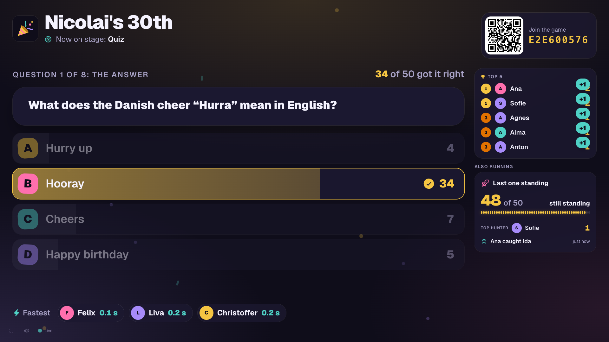
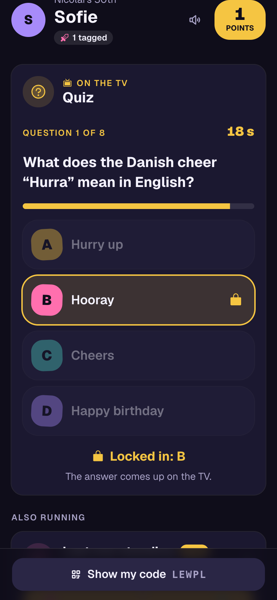
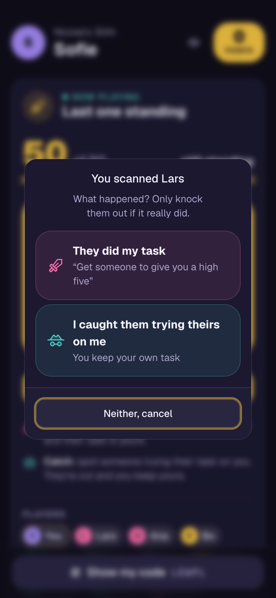
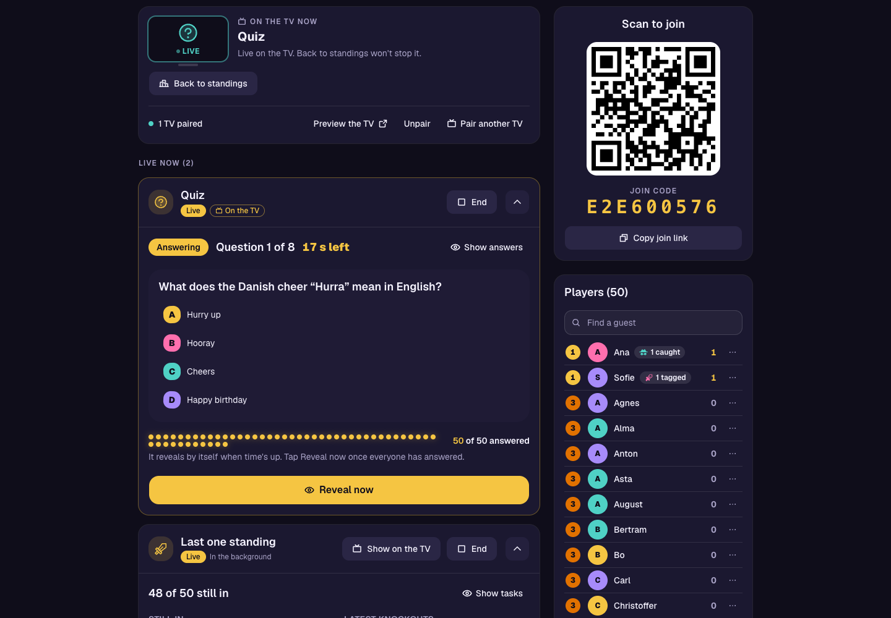
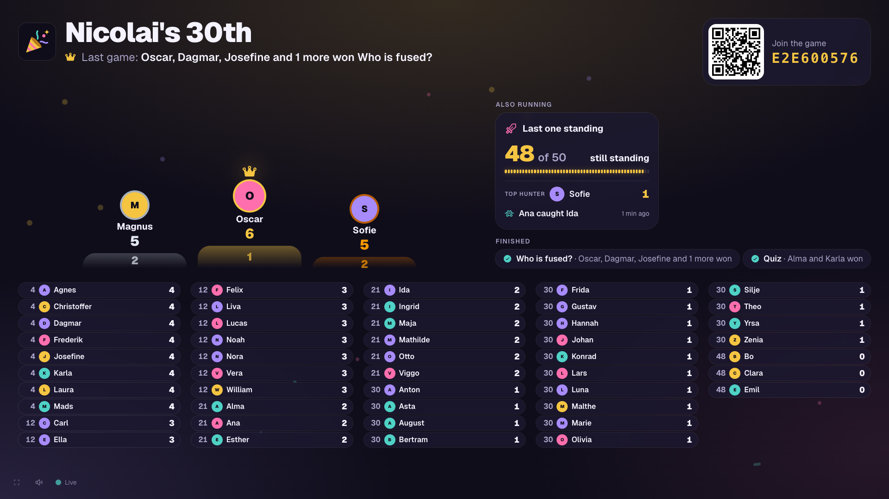

<p align="center">
  
</p>

<h1 align="center">Hurra</h1>

<p align="center">
  Live party games for a room full of friends. Guests play on their phones,
  a TV runs the show, and every game is a plugin on a homemade engine.
</p>

<p align="center"><em>Named after the Danish birthday cheer: Hurra, hurra, hurra!</em></p>

<p align="center">
  
</p>

<p align="center">
  
  &nbsp;
  
  &nbsp;
  
</p>

Built for one particular night: a 30th birthday party on 28 November 2026,
with about 45 guests, one host and one TV. There is nothing to install. Guests
scan a QR code, pick a name and they're in.

## How a party works

- **Guests** scan the join QR on the TV and pick a name. Their phone remembers
  them, so closing the tab is fine: they come back as the same player. Every
  guest also has a personal QR code, used for scoring things that happen in
  the room.
- **The host** runs the party from a laptop or a phone: opens joining, adds and
  starts games, and gives points by scanning a guest's code.
- **The TV** shows the day's leaderboard and the join QR. While a game runs, it
  can take over the screen, with announcements and sound effects for the room.

## Games

- **Last one standing**, all night long. Everyone gets a secret task and one
  life. Get someone to do your task and they're out (their task becomes
  yours), or catch someone trying theirs on you. Scan their code to knock them
  out; the TV keeps count of who is still standing.
- **In-person round.** The host gives points by hand for anything that happens
  in the room.
- **Coming next:** a live quiz on the TV with the answers on everyone's phone,
  and *Participant fusion*, where guests guess who was fused together in AI
  images printed around the room.

<p align="center">
  
</p>

How every screen connects, for guests, the host and the TV:
[docs/user-flows.md](docs/user-flows.md).

## How it fits together

- **Frontend:** React + Vite + Tailwind + [shadcn/ui](https://ui.shadcn.com),
  hosted on Netlify as a single-page app. shadcn components live in
  [src/components/ui](src/components/ui) and are ours to edit; add more with
  `npx shadcn@latest add <component>`. The theme (dark, gold primary) is the
  CSS variables in [src/index.css](src/index.css).
  Icons are [Phosphor](https://phosphoricons.com) (`@phosphor-icons/react`,
  bold by default via `IconContext` in [src/main.tsx](src/main.tsx)). The
  scoreboard animates with `motion`, loaded only on that page. The app icon is
  [public/favicon.svg](public/favicon.svg); the PNGs next to it are rendered from it.
- **Backend:** Supabase, plus one Netlify Function for game logic. The design
  doc is [docs/engine-v2.md](docs/engine-v2.md).
  - **Postgres** holds parties, players, games and their state, the points
    ledger and an event log of the whole night, all from one init file
    ([supabase/migrations](supabase/migrations)) that checks its own grants
    and policies and aborts if one is missing.
  - **Anonymous auth** gives every phone a user on its first visit. The
    session lives in the browser's localStorage, so reopening the page brings
    the guest back as the same player.
  - **Row level security:** guests read only their own party, their own
    private views, answers and toasts. Game settings (quiz answers, who is in a
    picture), full game states and the event log are for hosts only.
  - **Prompts:** answers and votes go from the phone straight to Postgres
    (`submit_answer`), one round trip, never through the engine, so 45 answers
    at once all land.
  - **Realtime:** every save sends one tiny Broadcast ping on a private topic
    (the party, the stage, or one player), and screens then read one
    `session_snapshot`. No table is published to Postgres Changes.
- **Netlify Functions:**
  - [game](netlify/functions/game.mts) (`POST /api/game`) is the game engine
    ([netlify/lib/engine.ts](netlify/lib/engine.ts)): two database round trips
    per request, `game_load` then `game_commit`, around the pure `step()` in
    [src/games/core/runtime.ts](src/games/core/runtime.ts). It runs with the
    Supabase secret key, so players can't cheat and games can keep secrets.
  - [keep-alive](netlify/functions/keep-alive.mts) runs daily and calls
    `rpc/keep_alive`, because free Supabase projects pause after a week
    without activity (the app then can't log anyone in).

### Data model

| Table | What it is |
| --- | --- |
| `sessions` | A party. `join_code` is in the join QR; `status` open/closed controls joining; `spotlight_game_id` is the game on the TV. |
| `players` | A guest in a party, tied to their auth user. `code` is in their personal QR. |
| `session_games` | A game in a party: `game_type` picks the plugin, `public_state` is what everyone sees, `wake_at` when it wants a timer sync. Several can be `active` at once. |
| `game_settings` | A game's settings (quiz questions and answers): hosts only, frozen into the state at start. |
| `game_states` | A game's full state, its round and the settings it started with; written by the engine, read by hosts. |
| `game_player_views` | Each player's private view of a game (a secret task); readable only by that player. |
| `game_scores` | Points per player from a game's `scores()`. |
| `score_events` | The points ledger: host awards and games' one-off bonuses or penalties. |
| `scoreboard` | View: the day's total per player (`score_events` + `game_scores`). |
| `session_feed` | Announcements from games: a banner on the TV and toasts on phones, or only for some players. |
| `game_prompts`, `game_submissions` | Questions everyone answers from their phone, and one answer per player. |
| `event_log` | Everything that happened, written in the same transaction as the change; hosts only, the raw material of the recap. |
| `session_screens`, `screen_codes` | TVs the host paired with a code: they read what a guest reads and send timer syncs. |
| `player_transfers` | One-off codes to move a player to a new phone. |
| `session_recaps` | The recap the host published. |
| `hosts` | User ids of host accounts. |

`players.profile` and `sessions.data` hold public per-game data, one section per
game type, written through game effects. Uploaded fusion pictures go to the
public `game-media` bucket (hosts upload; JPEG only).

### Pages

| Path                     | Who    | What                                           |
| ------------------------ | ------ | ---------------------------------------------- |
| `/join/:code`            | Guest  | Join QR target: pick a name                    |
| `/play/:code`            | Guest  | Points, the live game, and their own QR code   |
| `/p/:playerCode`         | Anyone | Player QR target: the scoring screen for hosts |
| `/host`                  | Host   | Sessions                                       |
| `/host/s/:id`            | Host   | Join QR, open/close joining, games, players    |
| `/host/s/:id/scoreboard` | Host   | Full-screen live scoreboard for the TV         |
| `/host/scan`             | Host   | Camera scanner for player QR codes             |

## Writing a game

A game is a folder in `src/games/<name>/`. The core never changes for a new
game: everything goes through the SDK in [src/games/core](src/games/core).
[elimination](src/games/elimination) (*Last one standing*) is the full example;
[in-person](src/games/in-person) is the smallest.

**`logic.ts`**: a class extending `Game` from
[src/games/core/Game.ts](src/games/core/Game.ts). It runs on the server, as pure
functions of the state:

| Method | What it does |
| ------ | ------------ |
| `setup(ctx)` | Deals the initial state when the host starts (or restarts) the game. |
| `parseAction(input)`, `handleAction(state, action, playerId, ctx)` | Checks a move from a phone and applies it. Throw `GameError` to refuse; the message is shown as is. |
| `parseHostAction`, `handleHostAction` | Optional host controls (Next, Reveal). |
| `wakeAt(state, info)`, `onWake(state, ctx)` | Optional timers: when the state wants a sync, and what happens then. |
| `onPlayerJoin`, `onPlayerLeave` | Optional: someone joined or left while the round runs. |
| `isFinished`, `winners`, `onEnd(state, ctx, by)` | Optional: the game finishes itself in the same save; the default winners are the top of this round's points. |
| `scores(state, info)` | Points per player. Added to the day's scoreboard. |
| `publicState(state, info)` | What everyone may see. No secrets. |
| `playerView(state, playerId, info)` | What one player may see, e.g. their own task. |
| `recap(round)` | Optional highlights for the recap, for finished rounds only. |

Every method reads the party through `info` and `ctx`: the session and its
shared data, the players, the day's scoreboard, the settings the round started
with, the database clock (`now`), and this round's prompts and their closed
answers. Hooks also cause effects, saved in the same transaction as the new
state, once per tap even when a phone resends it: `awardPoints`,
`updateProfile`, `updateSessionData`, `announce` (with `detail`, `to`, `sound`,
`icon`, `tone`, and `interrupt` for a winner), `openPrompt`, `closePrompt`,
`revealPrompt` and `record` (a fact for the recap).

The rules:

- Use `ctx.now` and `ctx.random()`, never `Date`, `Math.random` or `crypto`
  (a lint rule checks `logic.ts` and `bot.ts`): a hook may run again when a
  save is retried and must give the same result.
- Never rely on object key order in the state: Postgres (jsonb) reorders keys.
  Keep order in arrays.
- `publicState` and prompt specs are public: never put a secret or an answer
  in them. Show each player theirs in `playerView`.
- Big inputs from everyone (answers, votes) are prompts, never actions.
- Host actions carry the step they were made for; one whose step has passed
  returns the state unchanged, which the engine answers as skipped.
- `onWake` must move `wakeAt` forward or to null.
- The deciding change announces the result; `onEnd(..., 'game')` stays quiet.
- `recap()` reveals only what the finished round showed the room.

**Screens**, typed against the logic in [src/games/types.ts](src/games/types.ts):
`PlayerView` (with the player's `view`, `myAnswers`, `act(action)` and
`submit(key, answer)`), and optionally a `PlayerCard`, a `ResultView`, a
`HostView` (the full `state`, the `config` and host `act`), a `TvView`, a
`FinalTvView`, a `TvStatus` for the TV rail and a `ConfigEditor`. A game that
sets `acceptsScans` also receives guest QR codes scanned with the phone's own
camera. Shared building blocks: `QrScanner`, `ScanSheet`, `SecretCard` and
`PlayerQr` in [src/components](src/components).

**`index.ts`**: `defineGameModule({ logic, name, description, icon, PlayerView, ... })`,
with `profileBadges` to show the game's profile data as badges. **`bot.ts`**:
the game's rehearsal bot ([src/games/core/bot.ts](src/games/core/bot.ts)).

**Register** the logic in [src/games/logic.ts](src/games/logic.ts), the module
in [src/games/registry.ts](src/games/registry.ts) and the bot in
[src/games/bots.ts](src/games/bots.ts); `registry.test.ts` checks the lists
match and runs the contract over every game, played by its bot. Unit-test the
rules with `createGameContext`, `testInfo` and `answersOf`, play whole rounds
through the real engine step with `simulateParty`, and check the game's own
example with `checkGameContract` (it must include a join and a leave).

## Local development

Requires Docker.

```sh
npm install
supabase start                # local Postgres, Auth, Realtime and Storage
cp .env.example .env.development.local  # paste the publishable and secret keys from `supabase status`
npm run dev                   # also serves netlify/functions/* at /api/*
```

```sh
npm test                      # unit tests: the SDK, the engine step and the game rules
npm run check                 # types, lint and unit tests
npm run test:integration      # the engine, prompts, secrecy and Realtime against the local stack
npm run db:smoke              # a quick check that the schema, private Realtime and Storage work together
```

Make yourself a local host: set `DEV_HOST_EMAIL` and `DEV_HOST_PASSWORD` in
`.env.development.local` (local values only) and run `npm run dev:setup`. It
also adds a demo party with 6 guests. Run it again after `supabase db reset`.

The dev server also listens on your LAN IP, so you can open the join page
from a phone. The camera scanner needs HTTPS (or localhost), so test scanning
on the deployed site.

## Production

The app runs on Netlify (the static site plus the two functions) with a
Supabase project. Netlify needs `VITE_SUPABASE_URL` and
`VITE_SUPABASE_PUBLISHABLE_KEY`, plus `SUPABASE_SECRET_KEY` as a secret for the
game engine.

The database is built from the one init file. Moving production from v1 to v2
is a wipe and rebuild, with its exact steps and checks in
[docs/engine-v2.md](docs/engine-v2.md), section 11.

Auth settings were set in the Supabase dashboard (Authentication), not from
`config.toml`: anonymous sign-ins on, anonymous sign-in limit 300/hour
(guests on the same Wi-Fi share one IP), and Site URL = the Netlify URL.
Don't run `supabase config push`: it would overwrite them with the local values.

To add a host, create the user under Authentication → Users → Add user (tick
*Auto confirm*), then run this in the SQL editor:

```sql
insert into public.hosts (user_id)
select id from auth.users where email = 'you@example.com';
```

## Credits

- Sound effects generated with [ElevenLabs](https://elevenlabs.io); the
  prompts are in [src/games/core/sounds.ts](src/games/core/sounds.ts) and
  `npm run sounds` makes new ones.
- Icons by [Phosphor](https://phosphoricons.com), components from
  [shadcn/ui](https://ui.shadcn.com), type in [Geist](https://vercel.com/font).
