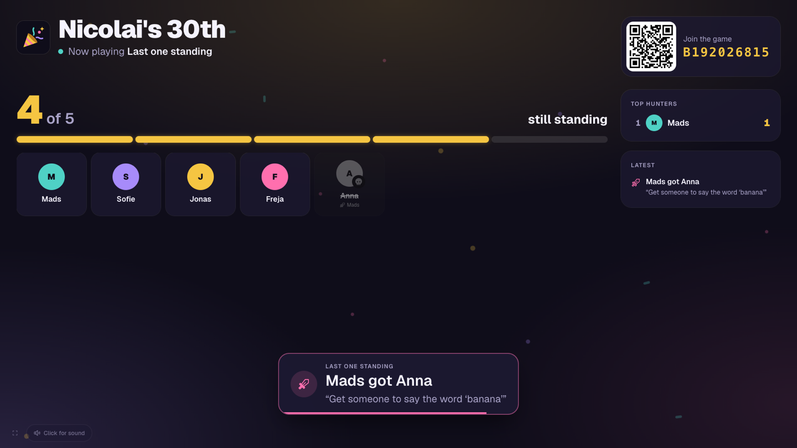
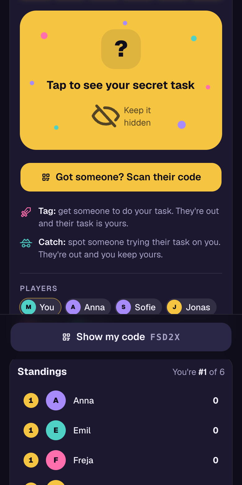
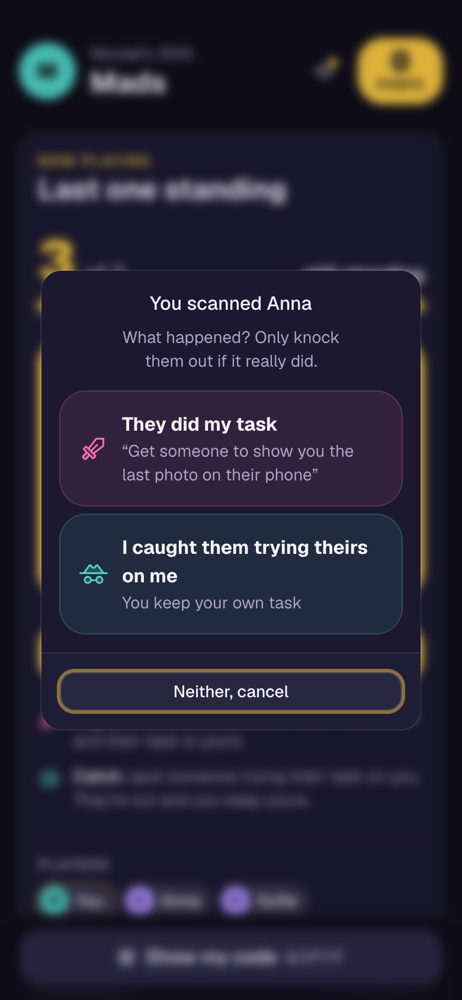
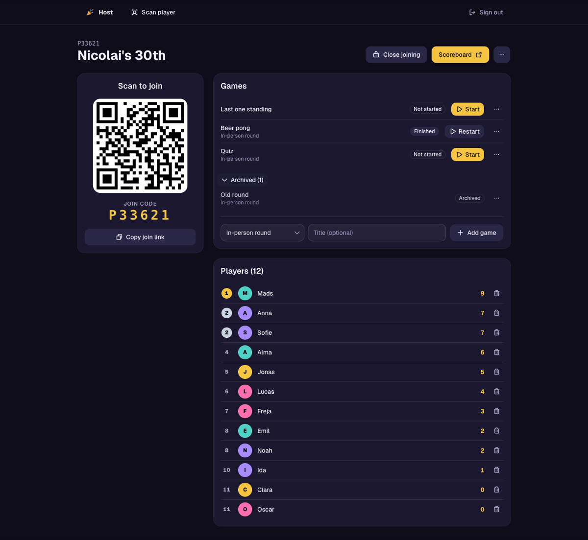
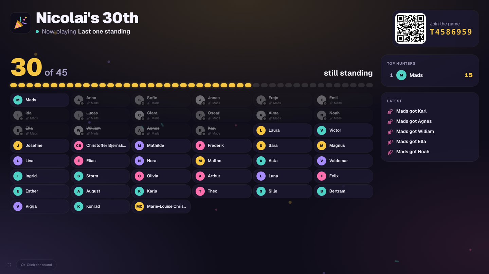

<p align="center">
  
</p>

<h1 align="center">Hurra</h1>

<p align="center">
  Live party games for a room full of friends. Guests play on their phones,
  a TV runs the show, and every game is a plugin on a homemade engine.
</p>

<p align="center"><em>Named after the Danish birthday cheer: Hurra, hurra, hurra!</em></p>

<p align="center">
  
</p>

<p align="center">
  
  &nbsp;
  
  &nbsp;
  
</p>

Built for one particular night: a 30th birthday party on 28 November 2026,
with about 45 guests, one host and one TV. There is nothing to install. Guests
scan a QR code, pick a name and they're in.

## How a party works

- **Guests** scan the join QR on the TV and pick a name. Their phone remembers
  them, so closing the tab is fine: they come back as the same player. Every
  guest also has a personal QR code, used for scoring things that happen in
  the room.
- **The host** runs the party from a laptop or a phone: opens joining, adds and
  starts games, and gives points by scanning a guest's code.
- **The TV** shows the day's leaderboard and the join QR. While a game runs, it
  can take over the screen, with announcements and sound effects for the room.

## Games

- **Last one standing**, all night long. Everyone gets a secret task and one
  life. Get someone to do your task and they're out (their task becomes
  yours), or catch someone trying theirs on you. Scan their code to knock them
  out; the TV keeps count of who is still standing.
- **In-person round.** The host gives points by hand for anything that happens
  in the room.
- **Coming next:** a live quiz on the TV with the answers on everyone's phone,
  and *Participant fusion*, where guests guess who was fused together in AI
  images printed around the room.

<p align="center">
  
</p>

How every screen connects, for guests, the host and the TV:
[docs/user-flows.md](docs/user-flows.md).

## How it fits together

- **Frontend:** React + Vite + Tailwind + [shadcn/ui](https://ui.shadcn.com),
  hosted on Netlify as a single-page app. shadcn components live in
  [src/components/ui](src/components/ui) and are ours to edit; add more with
  `npx shadcn@latest add <component>`. The theme (dark, gold primary) is the
  CSS variables in [src/index.css](src/index.css).
  Icons are [Phosphor](https://phosphoricons.com) (`@phosphor-icons/react`,
  bold by default via `IconContext` in [src/main.tsx](src/main.tsx)). The
  scoreboard animates with `motion`, loaded only on that page. The app icon is
  [public/favicon.svg](public/favicon.svg); the PNGs next to it are rendered from it.
- **Backend:** Supabase, plus one Netlify Function for game logic.
  - **Postgres** holds sessions, players, games and the points ledger
    (see [supabase/migrations](supabase/migrations)).
  - **Anonymous auth** gives every phone a user on its first visit. The
    session lives in the browser's localStorage, so reopening the page brings
    the guest back as the same player.
  - **Row level security:** guests can read the party but can only join (via
    the `join_session` function) and read their own private game views. Only
    hosts can create sessions, set up games and give points by hand.
  - **Realtime** pushes changes to phones and the scoreboard.
- **Netlify Functions:**
  - [game](netlify/functions/game.mts) (`POST /api/game`) is the game engine
    ([netlify/lib/engine.ts](netlify/lib/engine.ts)). It runs game logic with
    the Supabase secret key, so players can't cheat and games can keep secrets.
  - [keep-alive](netlify/functions/keep-alive.mts) runs daily and queries
    Supabase, because free Supabase projects pause after a week without
    activity (the app then can't log anyone in).

### Data model

| Table           | What it is                                                                 |
| --------------- | -------------------------------------------------------------------------- |
| `sessions`      | A party. `join_code` is in the join QR; `status` open/closed controls joining. |
| `players`       | A guest in a session, tied to their auth user. `code` is in their personal QR. |
| `session_games` | A game in a session. `game_type` picks the plugin, `config` holds its settings, `public_state` what everyone sees. At most one is `active`. |
| `game_states`   | A game's full state, written by the engine; only hosts can read it.        |
| `game_player_views` | Each player's private view of a game (e.g. a secret task); readable only by that player. |
| `game_scores`   | Points per player from a game's `scores()`.                                 |
| `score_events`  | The points ledger: host awards and games' one-off bonuses or penalties.   |
| `scoreboard`    | View: the day's total per player (`score_events` + `game_scores`).          |
| `session_feed`  | Announcements from games, shown on the TV and phones.                      |
| `hosts`         | User ids of host accounts.                                                 |

`players.profile` and `sessions.data` hold public per-game data, one section per
game type, written through game effects.

### Pages

| Path                     | Who    | What                                           |
| ------------------------ | ------ | ---------------------------------------------- |
| `/join/:code`            | Guest  | Join QR target: pick a name                    |
| `/play/:code`            | Guest  | Points, the live game, and their own QR code   |
| `/p/:playerCode`         | Anyone | Player QR target: the scoring screen for hosts |
| `/host`                  | Host   | Sessions                                       |
| `/host/s/:id`            | Host   | Join QR, open/close joining, games, players    |
| `/host/s/:id/scoreboard` | Host   | Full-screen live scoreboard for the TV         |
| `/host/scan`             | Host   | Camera scanner for player QR codes             |

## Writing a game

A game is a folder in `src/games/<name>/`. The core never changes for a new
game. [elimination](src/games/elimination) (*Last one standing*) is the full
example; [in-person](src/games/in-person) is the smallest.

**`logic.ts`**: a class extending `Game` from
[src/games/core/Game.ts](src/games/core/Game.ts). It runs on the server, as pure
functions of the state:

| Method | What it does |
| ------ | ------------ |
| `setup(ctx)` | Deals the initial state when the host starts the game. |
| `parseAction(input)` | Checks what a phone sent. |
| `handleAction(state, action, playerId, ctx)` | Applies a move and returns the new state. Throw `GameError` to reject it; the message is shown to the player. |
| `scores(state, info)` | Points per player. Added to the day's scoreboard. |
| `publicState(state, info)` | What everyone may see. No secrets. |
| `playerView(state, playerId, info)` | What one player may see, e.g. their own task. |

Every method can read the party through `info`/`ctx`: the session and its
shared `data`, all players with their profiles, the day's scoreboard, the
game's `config` (`defaultConfig` merged with the host's settings) and the time.
`setup` and `handleAction` can also cause effects, which are saved in the same
transaction as the new state:

- `ctx.awardPoints(playerId, points, reason)`: a bonus or penalty on the day's scoreboard
- `ctx.updateProfile(playerId, patch)`: the game's section of a player's public profile
- `ctx.updateSessionData(patch)`: the game's section of the session's shared data
- `ctx.announce(message, options)`: an event for the room, shown as a banner
  on the TV and a toast on phones. Options: `detail` (a second, quieter line),
  `to` (only these players' phones show it), `sound` (one of the app's sounds in
  [src/games/core/sounds.ts](src/games/core/sounds.ts)), `icon` and `tone`.
  The feed is readable by every guest, so announcements never carry secrets.

`onEnd(state, ctx)` is optional: it runs when the host ends the game early, so
the game can wrap up (Last one standing announces how many were still standing).

**Screens**, typed against the logic: `PlayerView` (props include the player's
`view`, the `publicState` and `act(action)` to make a move), and optionally a
`HostView` (gets the full `state`), a `ConfigEditor` (the game's settings) and
a `TvView`, which takes over the TV while the game runs. A game that sets
`acceptsScans` also receives guest QR codes scanned with the phone's own camera.
Shared building blocks: `QrScanner`, `ScanSheet` (scan / show my code),
`SecretCard` (tap to reveal) and `PlayerQr` in [src/components](src/components).

**`index.ts`**: `defineGameModule({ logic, name, description, PlayerView, ... })`,
with `profileBadges` to show the game's profile data as badges.

**Register** the logic in [src/games/logic.ts](src/games/logic.ts) and the
module in [src/games/registry.ts](src/games/registry.ts); a test checks both
lists match. Unit-test the rules with `createGameContext` and `testInfo`, as
[elimination/logic.test.ts](src/games/elimination/logic.test.ts) does.

## Local development

Requires Docker.

```sh
npm install
supabase start                # local Postgres/Auth/Realtime; prints the URL and keys
cp .env.example .env.development.local  # paste the publishable and secret keys
npm run dev                   # also serves netlify/functions/* at /api/*
```

```sh
npm test                      # unit tests (game rules)
npm run test:integration      # the engine against the local Supabase stack
npm run check                 # types, lint and unit tests
```

Make yourself a host. Create a user in Studio (http://127.0.0.1:54323,
Authentication → Add user, tick *Auto confirm*), then run this in the SQL
editor:

```sql
insert into public.hosts (user_id)
select id from auth.users where email = 'you@example.com';
```

The dev server also listens on your LAN IP, so you can open the join page
from a phone. The camera scanner needs HTTPS (or localhost), so test scanning
on the deployed site.

## Production

The app runs on Netlify (the static site plus the two functions) with a
Supabase project. Netlify needs `VITE_SUPABASE_URL` and
`VITE_SUPABASE_PUBLISHABLE_KEY`, plus `SUPABASE_SECRET_KEY` as a secret for the
game engine.

```sh
supabase link --project-ref <your-project-ref>
supabase db push --linked     # apply new migrations first
netlify deploy --build --prod # then build and deploy the site and functions
```

Auth settings were set in the Supabase dashboard (Authentication), not from
`config.toml`: anonymous sign-ins on, anonymous sign-in limit 300/hour
(guests on the same Wi-Fi share one IP), and Site URL = the Netlify URL.
Don't run `supabase config push`: it would overwrite them with the local values.

To add a host, create the user under Authentication → Users → Add user (tick
*Auto confirm*), then run the `insert into public.hosts` SQL above in the SQL
editor.

## Credits

- Sound effects generated with [ElevenLabs](https://elevenlabs.io); the
  prompts are in [src/games/core/sounds.ts](src/games/core/sounds.ts) and
  `npm run sounds` makes new ones.
- Icons by [Phosphor](https://phosphoricons.com), components from
  [shadcn/ui](https://ui.shadcn.com), type in [Geist](https://vercel.com/font).
