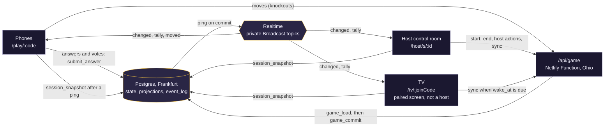

# Hurra engine v2: build spec

The design and build contract for Hurra v2: several live games at once, a live
quiz, Participant fusion, an event log of the whole night with a recap, and
games that finish by themselves. Written on Sunday 8 November 2026 and revised
on Monday 9 November, before the build starts, to resolve the critic's review
of the first version (appendix 12.5 maps each finding to its fix). The party is
Saturday 28 November 2026: about 45 guests on their phones, one host and one
TV.

It merges three engine designs from the design round (evolve, event-first and
realtime-native), the verified engine review and its critique, the critic's
review of this spec, and the screen flows in [user-flows.md](user-flows.md). It
stays in the repo as the engine's design doc.

**How to use it**

- Sections 2 to 6 are contracts: table, column, function, type and hook names,
  argument lists and JSON shapes. Build exactly these. If you must deviate, say
  so in your final report; the main engineer updates this doc. Don't edit this
  file yourself.
- Section 10 says which files each work package owns and how the packages work
  side by side (one git worktree each). Never edit a file you don't own.
- Section 11 is for the main engineer only.

**Ground rules**

- **Games are plugins.** The core stays generic. Game rules live only in
  `src/games/<name>/` and reach the party only through the SDK in
  `src/games/core`. A new capability is always generic.
- **Host, never admin**, in code, routes, the database and the UI.
- **Phosphor icons only, no emoji, and no en or em dashes** in UI copy or docs.
- **The quiz has an original look.** No Kahoot shapes, colours, music or layout.
- **Keep** the logo (the party popper), the sound library in `public/sounds`
  (never run `npm run sounds`), the visual style (night sky `#0f0d1a`, gold
  `#f5c542`, confetti pink `#ff6fae`, teal `#4fd1c5` and violet `#a78bfa`, the
  Geist font, the hopping confetti loader), and what already works: the loader,
  `QueryGate`, `Callout` and toasts, the sound policy, the error and not-found
  screens, and the TV fit logic (`fitGrid`, the standings row layouts).
- **Never touch production.** No `supabase db push`, nothing with `--linked`, no
  deploys, no Supabase or Netlify MCP write tools, no `git push`. Never print
  values from `.env` files. Use only the local Supabase stack. The production
  steps in section 11 belong to the main engineer alone, on the switch-over
  days, with the owner's go-ahead.

## Contents

0. [Decisions at a glance](#0-decisions-at-a-glance)
1. [Architecture overview](#1-architecture-overview)
2. [Database: the init file](#2-database-the-init-file)
3. [SDK v2: src/games/core](#3-sdk-v2-srcgamescore)
4. [Engine: netlify/](#4-engine-netlify)
5. [Client data layer: src/lib](#5-client-data-layer-srclib)
6. [Game module API: src/games/types.ts](#6-game-module-api-srcgamestypests)
7. [Screens and behaviour](#7-screens-and-behaviour)
8. [The four games](#8-the-four-games)
9. [Testing plan](#9-testing-plan)
10. [Work packages and file ownership](#10-work-packages-and-file-ownership)
11. [Switch-over notes](#11-switch-over-notes)
12. [Appendix](#12-appendix)

## 0. Decisions at a glance

Every open point from the design round, decided. "Source" names the design the
idea comes from.

| Question | Decision | Source |
| --- | --- | --- |
| Event sourcing? | No. The game state row is the truth; projections are derived from it on every save. An append-only `event_log` is written in the same transaction as every change. Nothing is ever replayed from it. | all three |
| Schema migration | One fresh init file, `20261109000000_hurra_v2.sql`. No compatibility with the old schema or old phone bundles. | owner |
| Who reads the log | Hosts only. The room sees a recap the host publishes. A round still running gets only a generic "Still running" chapter; a game's own highlights come from finished rounds. | evolve, event-first, critique |
| Burst input (quiz answers, fusion votes) | Prompts and sealed submissions: phones call `submit_answer` straight to Postgres. It takes a share lock on the prompt row, never the game state row. | realtime-native |
| Seeing all answers at a reveal | Closing a prompt is an update that waits for answers in flight. The engine closes prompts in `game_load` (due deadlines always, and the keys a host action names), then the plugin gets the final answers in `info.answers`. | realtime-native |
| Timers | `wakeAt` and `onWake`. `session_games.wake_at` is public. One shared scheduler, `useWakeSync`, sends a `sync` from the TV 250 ms after it and from the host page 1.5 s after it, at most one per game every 2 s, with backoff after failures. Early or repeated syncs save nothing. A wake that doesn't move `wakeAt` forward is dropped and logged (`game.wake_stuck`). | evolve, critique |
| Realtime | Broadcast pings on private topics (`room:`, `stage:`, `player:`), then one `session_snapshot` read. No table is in the Postgres Changes publication. Phones also poll every 10 s while a game has an open prompt or a timer, and every screen notices when pings stop arriving. | realtime-native, critique |
| Several live games | No more one-live-game index. A start never ends other games. `stage` on the start request (default from the game's `presentation`) decides whether it takes the TV. | realtime-native, evolve |
| TV stage | One column, `sessions.spotlight_game_id`, plus `spotlight_at`. A finishing game takes a free stage. The final screen shows for 3 minutes from `max(finished_at, spotlight_at)`. `sessions.tv_scene = 'recap'` plays the recap. | evolve, realtime-native |
| Secret settings | `game_settings` (hosts only), frozen into `game_states.config` at start. No public config column. | all three |
| Request ids | One id per call, reused only for that call's own retries. The claim is the first write, unique on `(user_id, request_id)`. `game_load` reports `claimed`, so a copy never reruns the plugin. Host actions also name the step they were made for, so a double tap or a race with a timer does nothing. | realtime-native, critique |
| Finishing | `isFinished` after every change. The same save runs `onEnd(..., 'game')` and sets `finished_at`, `finished_by` and `winners`. End always ends. Default winners: the top of this round's points (its scores plus its awards); nobody when the top is 0. | all three, critique |
| Players who leave | Effects and scores for them are skipped. Optional `onPlayerJoin` and `onPlayerLeave` hooks run from a member list kept in `game_states.members`. | review, event-first |
| Read scope | Row level security scopes every read to members of the party and hosts. Joining looks a party up through `session_by_code`. | first review (C8) |
| Player codes | Stay readable by members of the same party. Cheating by player id stays possible; close joining once everyone is in. | all three (C5 deferred) |
| The TV | A paired screen, never a host. The host page issues a 6-character code; the TV laptop opens the public `/tv/:joinCode`, signs in anonymously and types it. A screen reads what a guest reads, hears the TV's pings and sends timer syncs, nothing else. | critique |
| Quiz scoring | Quiz points (500 to 1,000 for a right answer, by speed) rank the quiz. The day's scoreboard gets right answers times `pointsPerRight` (default 1). | event-first |
| Quiz flow | The host taps Next. Time's up reveals by itself (timer), or the host taps Reveal now. The leaderboard follows 7 s later by itself. The host crowns the winner. | merged |
| Fusion answer key | Optional in the settings; also settable on the night with a `setKey` host action until that picture is revealed. | event-first, realtime-native |
| Fusion images | Optional, in a public `game-media` Storage bucket; only hosts upload. The prints are on the wall, so an image is not a secret, but who is in it is. The browser re-encodes every upload (a 1600 px JPEG of about 300 KB plus a 400 px thumbnail, all metadata dropped); phones load only the thumbnails. | new, critique |
| Announcements from background games | A quiet ticker on the TV while another game holds the stage, unless the game marks one `interrupt` (a winner). | critique |
| "Everyone answered" | No automatic early close. The host page shows "45 of 45 answered" and the host taps Reveal now. | decided |
| Undo of game moves | Not built. Host awards keep their Undo. | decided |
| Engine hosting | Netlify Free, Ohio. Two database round trips per request. No edge port and no Netlify Pro before the party. | all three |
| Keep-alive | Calls `rpc/keep_alive`, the only function anon may execute. | new |

## 1. Architecture overview

### 1.1 The parts



### 1.2 The four paths

1. **A move** (a knockout in Last one standing): the phone posts to
   `/api/game`. The engine verifies the token locally (`getClaims`), reads one
   snapshot with `game_load`, runs the plugin with the pure `step()` from
   `src/games/core/runtime.ts`, and saves state, projections, effects, log rows
   and one ping with `game_commit`. Two database round trips from Ohio, about
   0.4 to 0.9 s.
2. **An answer or a vote**: the phone calls `submit_answer` directly
   (PostgREST, one round trip, about 40 to 80 ms from Copenhagen). It never
   touches the engine or the game state row. 45 answers at once take about
   0.2 s in total.
3. **A host action or a timer**: the host page posts `host-action` (Next,
   Reveal, Lock voting) or the TV posts `sync` when `wake_at` is due (the host
   page sends a backup). Same path as a move. A host action may name prompts to
   close first, so it sees their final answers, and it names the step it was
   made for, so a stale copy does nothing.
4. **A screen refresh**: every committed change sends one tiny Broadcast ping
   per audience. Screens then read one `session_snapshot` (row level security
   decides what each screen gets). Phones jitter that read by up to 300 ms,
   except when a prompt just opened. Polls back the pings up (section 5.4).

### 1.3 Truth, projections, log, recap

- **Truth:** `game_states` (state, round, version, frozen config, members), the
  ordinary tables (`sessions`, `players`, `session_games`, `score_events`,
  `game_prompts`, `game_submissions`), and `game_settings`.
- **Projections**, rewritten by every save from the state: `session_games.public_state`,
  `game_player_views`, `game_scores`, `session_games.winners` and `wake_at`.
- **The event log** (`event_log`): append-only, hosts only, written in the same
  transaction as every change (by the engine, by `submit_answer`, and by
  triggers for what hosts and guests change directly). It is the night's story:
  what happened, when and by whom. It is not replayed: a replay would slow every
  tap and break the history whenever a game's code changes.
- **The recap**: built in the host's browser from `session_recap()` plus each
  game's `recap()` hook, then published as one room-safe JSON document in
  `session_recaps`. The TV plays it and every phone shows "Your night".

### 1.4 Clocks

- Every time a game sees (`info.now`, prompt times, answer times) is the
  database clock, read once per request by `game_load` and kept for that
  request's retries.
- Deadlines are checked by the database (`submit_answer` refuses after
  `closes_at`).
- Screens correct their own clock with `snapshot.now` (server time offset),
  for countdowns and the 3-minute final screen.

### 1.5 What it costs

| Moment | Database round trips | Realtime events (45 phones, TV, host) |
| --- | --- | --- |
| A knockout | 2 (engine) | 48 |
| One quiz answer | 1 (RPC) | 3 (tally to TV and host) |
| A quiz question (next, 45 answers, reveal, leaderboard) | 3 engine requests and 45 RPCs | about 330 |
| A fusion vote | 1 (RPC) | 3 |
| A guest joins | 1 (RPC) | 3 |
| A host award | 1 (insert) | 5 |

The Free plan allows about 100 Realtime events per second averaged over 5 s
buckets. The worst plausible bucket (45 answers plus a reveal) is about 46 per
second. See appendix 12.1.

## 2. Database: the init file

`supabase/migrations/20261109000000_hurra_v2.sql` creates the whole v2 schema
from scratch. It replaces all six existing migration files, which are deleted.
The main engineer wipes production and rebuilds it from this file (section 11),
so there is no data migration.

### 2.1 Rules for the file

- **Privileges.** This project's default privileges grant anon and
  authenticated everything on new tables and EXECUTE on new functions, and
  Postgres grants EXECUTE to PUBLIC. So every table gets `enable row level
  security` and `revoke all ... from anon, authenticated` followed by exact
  grants, and every function gets `revoke execute ... from public, anon,
  authenticated` followed by exact grants. Section 2.12 checks this and aborts
  the migration if anything is missing.
- **Never rely on grants a wipe can remove.** The schema's usage grants and the
  default privileges are attached to the `public` schema itself, so a wipe that
  drops and recreates it loses them. The file therefore states every grant it
  needs (section 2.5): usage on schema `public` for anon, authenticated and
  service_role, and service_role's table privileges. It also turns the default
  privileges off for the future, so a party-week hotfix migration can't open a
  new table or function by accident:

  ```sql
  alter default privileges for role postgres in schema public
    revoke all on tables from anon, authenticated;
  alter default privileges for role postgres in schema public
    revoke all on sequences from anon, authenticated;
  alter default privileges for role postgres in schema public
    revoke all on functions from anon, authenticated;
  -- Postgres grants EXECUTE to PUBLIC globally, and a per-schema revoke can't
  -- undo a global grant, so this one has no "in schema".
  alter default privileges for role postgres revoke execute on functions from public;
  ```

  A hotfix migration states its own grants and ends with a copy of the
  self-check block (2.12).
- **Functions** all use `set search_path = ''` and fully qualified names.
  `security definer` only where a function must read or write past row level
  security; those are owned by `postgres`.
- **Errors** for clients use custom SQLSTATEs that PostgREST maps to HTTP
  status codes: `PT400`, `PT401`, `PT403`, `PT404`, `PT409`. The machine code
  goes in `DETAIL` (for example `using errcode = 'PT409', detail = 'not_running'`).
  Version conflicts use `PT409` with detail `stale`. **Changed during build:**
  not `40001`. PostgREST retries a transaction that fails with SQLSTATE 40001,
  and a version conflict fails the same way on every retry, so on the local
  stack a lost race looped about 3,500 times a second and the request never
  answered. No function may raise 40001. Postgres still raises `40P01` for a
  real deadlock, which the engine retries too (4.3).
- **The engine flag.** `game_commit` runs `set_config('hurra.engine', 'on',
  true)` first. The logging triggers stay quiet while it is on, because the
  engine logs and pings exactly once itself.
- **Fail open.** Logging and ping trigger bodies are wrapped in
  `begin ... exception when others then raise warning ... end`, so a logging
  bug can never block a join, an award or a removal. Guards (section 2.9) are
  the exception: they are meant to refuse.
- **Idempotent where Supabase owns the object.** Statements on
  `storage.buckets`, `storage.objects` and `realtime.messages` use
  `on conflict (id) do update` (so a bucket left over from an earlier attempt
  gets this file's settings) and `drop policy if exists` first, because the
  production wipe keeps those schemas.
- **No data.** No host row, no user ids, no emails, no project refs: the repo
  is public.

### 2.2 Order of the file

1. Header comment (what the file is, the rules above in two lines).
2. Schema usage grants and the default privileges (2.1).
3. Helpers that need no tables: `random_code`, `epoch_ms`, `try_uuid`.
4. Tables, in this order: `hosts`, `sessions`, `players`, `session_games`,
   `game_settings`, `game_states`, `game_player_views`, `game_scores`,
   `score_events`, `session_feed`, `game_prompts`, `game_submissions`,
   `event_log`, `player_transfers`, `session_screens`, `screen_codes`,
   `session_recaps`.
5. Helpers that read tables: `is_host`, `my_player_ids`, `my_session_ids`,
   `session_exists`.
6. Row level security, policies and grants per table.
7. The `scoreboard` view, then service_role's grants (2.5), which come after
   every table and view so that `on all tables` covers them all.
8. Realtime: `ping`, `ping_session`, `ping_player`, `can_listen`, the
   `realtime.messages` policy.
9. Trigger functions and triggers.
10. Client RPCs: `session_by_code`, `join_session`, `check_answer`,
    `submit_answer`, `prompt_tallies`, `session_snapshot`, `session_recap`,
    `host_issue_transfer`, `claim_player`, `host_issue_screen_code`,
    `claim_screen`, `keep_alive`.
11. Engine RPCs: `game_load`, `game_commit`.
12. Storage: the `game-media` bucket and its policies.
13. One block of function grants and revokes.
14. Self-checks.

### 2.3 Helpers

| Function | Kind | What it does |
| --- | --- | --- |
| `random_code(len int) returns text` | volatile, invoker | Random code from `ABCDEFGHJKLMNPQRSTUVWXYZ23456789` (as today). Column default for join codes, player codes and transfer codes. |
| `epoch_ms(t timestamptz) returns bigint` | immutable | Milliseconds since epoch; null in, null out. |
| `try_uuid(t text) returns uuid` | immutable | The uuid, or null when the text isn't one. Topic names come from clients. |
| `is_host() returns boolean` | stable, definer | `exists (select 1 from public.hosts where user_id = auth.uid())` |
| `my_player_ids() returns uuid[]` | stable, definer | The caller's player ids (one per party joined). |
| `my_session_ids() returns uuid[]` | stable, definer | The sessions the caller is a player in, or a paired screen of (`session_screens`). Every "member" rule below therefore covers paired TVs too; anything tied to a player (`my_player_ids`) does not. |
| `session_exists(p_session_id uuid) returns boolean` | stable, definer | Whether the party exists, whoever asks. Lets a removed guest tell "removed" from "party deleted". |
| `moved_away(p_session_id uuid) returns boolean` | stable, definer | **Added during integration.** Whether the caller's player in the party moved to another phone: a `player.moved` row with the caller as `data.from_user`. Feeds the snapshot's `moved` (2.7). |

Policies call these wrapped in `(select ...)` so Postgres evaluates them once
per query. All eight are granted to `authenticated` (policies and the
invoker function `session_snapshot` run as the caller) and to `service_role`;
none to anon.

### 2.4 Tables

```sql
create table public.hosts (
  user_id uuid primary key references auth.users (id) on delete cascade
);

create table public.sessions (
  id uuid primary key default gen_random_uuid(),
  name text not null check (char_length(name) between 1 and 80),
  join_code text not null unique default public.random_code(6)
    check (join_code ~ '^[A-Z0-9]{4,12}$'),
  status text not null default 'open' check (status in ('open', 'closed')),
  -- Each game type's shared data, written through game effects.
  data jsonb not null default '{}' check (jsonb_typeof(data) = 'object'),
  -- The game on the TV stage, live or finished. No foreign key on purpose: a
  -- second sessions/session_games relationship makes PostgREST embeds
  -- ambiguous. Triggers clear it when that game is archived or deleted.
  spotlight_game_id uuid,
  -- Set by a trigger whenever spotlight_game_id changes (database clock).
  spotlight_at timestamptz,
  tv_scene text not null default 'live' check (tv_scene in ('live', 'recap')),
  archived_at timestamptz,
  created_at timestamptz not null default now()
);

create table public.players (
  id uuid primary key default gen_random_uuid(),
  session_id uuid not null references public.sessions (id) on delete cascade,
  user_id uuid not null references auth.users (id) on delete cascade,
  name text not null check (char_length(name) between 1 and 40),
  code text not null unique default public.random_code(5) check (code ~ '^[A-Z0-9]{5}$'),
  profile jsonb not null default '{}' check (jsonb_typeof(profile) = 'object'),
  created_at timestamptz not null default now(),
  unique (session_id, user_id),
  unique (id, session_id)
);
create unique index players_session_name_key on public.players (session_id, lower(name));
create index players_user_idx on public.players (user_id);

create table public.session_games (
  id uuid primary key default gen_random_uuid(),
  session_id uuid not null references public.sessions (id) on delete cascade,
  game_type text not null check (game_type ~ '^[a-z][a-z0-9-]{1,39}$'),
  title text not null check (char_length(title) between 1 and 80),
  position int not null default 0,
  status text not null default 'pending' check (status in ('pending', 'active', 'finished')),
  public_state jsonb,                      -- null until the first start
  started_at timestamptz,
  finished_at timestamptz,
  finished_by text check (finished_by in ('game', 'host')),
  winners uuid[] not null default '{}',     -- set when it finishes; no foreign key
  wake_at timestamptz,                      -- when the game wants a sync; public
  archived_at timestamptz,
  created_at timestamptz not null default now(),
  unique (id, session_id),
  check ((status = 'finished') = (finished_at is not null)),
  check (finished_by is null or status = 'finished')
);
create index session_games_session_idx on public.session_games (session_id, position, created_at);
create index session_games_live_idx on public.session_games (session_id) where status = 'active';

-- Host-only settings (quiz questions and answers, who is in each picture).
create table public.game_settings (
  game_id uuid primary key references public.session_games (id) on delete cascade,
  config jsonb not null default '{}'
    check (jsonb_typeof(config) = 'object' and pg_column_size(config) < 262144),
  updated_at timestamptz not null default now()
);

-- A game's full state. Written only by game_commit; hosts read it.
create table public.game_states (
  game_id uuid primary key references public.session_games (id) on delete cascade,
  round int not null default 1 check (round >= 1),   -- bumped by every (re)start
  version int not null default 1,                     -- bumped by every save
  state jsonb not null,
  config jsonb not null default '{}',                 -- the settings this round started with
  members uuid[] not null default '{}',               -- players the game knows about
  updated_at timestamptz not null default now()
);

create table public.game_player_views (
  game_id uuid not null references public.session_games (id) on delete cascade,
  player_id uuid not null references public.players (id) on delete cascade,
  view jsonb not null,
  primary key (game_id, player_id)
);
create index game_player_views_player_idx on public.game_player_views (player_id);

create table public.game_scores (
  game_id uuid not null references public.session_games (id) on delete cascade,
  player_id uuid not null,
  session_id uuid not null,
  points int not null,
  primary key (game_id, player_id),
  foreign key (player_id, session_id) references public.players (id, session_id) on delete cascade
);
create index game_scores_session_idx on public.game_scores (session_id);
create index game_scores_player_idx on public.game_scores (player_id);

-- The points ledger: host awards and games' one-off bonuses (awarded_by null).
create table public.score_events (
  id bigint generated always as identity primary key,
  session_id uuid not null references public.sessions (id) on delete cascade,
  player_id uuid not null,
  game_id uuid,
  points int not null check (points <> 0),
  reason text check (char_length(reason) <= 200),
  awarded_by uuid default auth.uid() references auth.users (id) on delete set null,
  created_at timestamptz not null default now(),
  foreign key (player_id, session_id) references public.players (id, session_id) on delete cascade,
  foreign key (game_id, session_id) references public.session_games (id, session_id) on delete set null (game_id)
);
create index score_events_session_idx on public.score_events (session_id);
create index score_events_player_idx on public.score_events (player_id, created_at desc);
create index score_events_game_idx on public.score_events (game_id) where game_id is not null;

-- Announcements: toasts on phones, the banner on the TV.
create table public.session_feed (
  id bigint generated always as identity primary key,
  session_id uuid not null references public.sessions (id) on delete cascade,
  game_id uuid references public.session_games (id) on delete set null,
  message text not null check (char_length(message) between 1 and 280),
  detail text check (char_length(detail) <= 280),
  audience uuid[],                          -- null: everyone; else only these players (and hosts) can read it
  sound text check (char_length(sound) <= 40),
  icon text check (char_length(icon) <= 40),
  tone text check (char_length(tone) <= 20),
  interrupt boolean not null default false, -- the TV banners it even from a background game
  created_at timestamptz not null default now()
);
create index session_feed_session_idx on public.session_feed (session_id, id desc);

-- Questions everyone answers from their phone (a quiz question, a fused picture).
create table public.game_prompts (
  game_id uuid not null references public.session_games (id) on delete cascade,
  key text not null check (key ~ '^[A-Za-z0-9_.:-]{1,64}$'),
  round int not null,
  spec jsonb not null check (jsonb_typeof(spec) = 'object' and pg_column_size(spec) < 32768),
  opened_at timestamptz not null default clock_timestamp(),
  closes_at timestamptz,                    -- deadline by the database clock; null for none
  closed_at timestamptz,
  revealed_at timestamptz,
  primary key (game_id, key)
);

-- One answer per player and prompt. Written only by submit_answer.
create table public.game_submissions (
  game_id uuid not null,
  key text not null,
  player_id uuid not null references public.players (id) on delete cascade,
  payload jsonb not null,
  first_at timestamptz not null default clock_timestamp(),
  at timestamptz not null default clock_timestamp(),
  changes int not null default 0 check (changes between 0 and 20),
  primary key (game_id, key, player_id),
  foreign key (game_id, key) references public.game_prompts (game_id, key) on delete cascade
);

-- The night's story. Append-only (section 2.5), hosts only, never published to Realtime.
create table public.event_log (
  id bigint generated always as identity primary key,
  session_id uuid not null references public.sessions (id) on delete cascade,
  at timestamptz not null default clock_timestamp(),
  kind text not null check (kind ~ '^[a-z][a-z_]*(\.[a-z][a-z_]*)+$'),
  game_id uuid,                             -- no foreign keys: the log outlives a deleted game
  game_type text,
  round int,
  actor text not null check (actor in ('player', 'host', 'game', 'timer', 'system')),
  player_id uuid,                           -- or a removed guest
  user_id uuid,
  request_id uuid,                          -- the tap's id: the claim
  cause_id bigint,                          -- the row this one follows from
  about uuid[] not null default '{}',       -- players it is about
  data jsonb not null default '{}'
    check (jsonb_typeof(data) = 'object' and pg_column_size(data) < 262144)
);
create index event_log_session_idx on public.event_log (session_id, id);
create index event_log_game_idx on public.event_log (game_id, id) where game_id is not null;
create unique index event_log_request_key on public.event_log (user_id, request_id)
  where request_id is not null;

-- Move a player to a new phone (gap G4). Only the two RPCs touch it.
create table public.player_transfers (
  code text primary key default public.random_code(6),
  player_id uuid not null unique references public.players (id) on delete cascade,
  expires_at timestamptz not null default now() + interval '15 minutes'
);

-- TVs the host paired (section 7.2): anonymous users with a guest's read access
-- and the right to send timer syncs. Rows come only from claim_screen; hosts
-- read and delete them (Unpair).
create table public.session_screens (
  user_id uuid not null references auth.users (id) on delete cascade,
  session_id uuid not null references public.sessions (id) on delete cascade,
  created_at timestamptz not null default now(),
  primary key (user_id, session_id)
);
create index session_screens_session_idx on public.session_screens (session_id);

-- Pairing codes, the player_transfers pattern. Only the two RPCs touch it.
create table public.screen_codes (
  code text primary key default public.random_code(6),
  session_id uuid not null unique references public.sessions (id) on delete cascade,
  expires_at timestamptz not null default now() + interval '15 minutes'
);

-- The recap the host published: room-safe facts only.
create table public.session_recaps (
  session_id uuid primary key references public.sessions (id) on delete cascade,
  data jsonb not null check (jsonb_typeof(data) = 'object' and pg_column_size(data) < 1048576),
  published_at timestamptz,                 -- set to now() by touch_recap whenever it is written non-null
  updated_at timestamptz not null default now()
);
```

### 2.5 Row level security and grants

Every table: `alter table ... enable row level security;` then
`revoke all on ... from anon, authenticated;` then the grants below. "Member"
means `session_id = any ((select public.my_session_ids())::uuid[])`; "host" means
`(select public.is_host())`. **Changed during build:** the `::uuid[]` cast is
needed. Without it Postgres reads `= any ((select ...))` as a subquery whose
rows are `uuid[]` and refuses the policy (`operator does not exist: uuid = uuid[]`).

| Table | Grants to authenticated | Policies |
| --- | --- | --- |
| `hosts` | none | none (read only through `is_host()`) |
| `sessions` | `select, delete`; `insert (name, join_code)`; `update (name, status, archived_at, spotlight_game_id, tv_scene)` | select: host or `id = any (my_session_ids())`. insert, update, delete: host. |
| `players` | `select, delete`; `update (name)` | select: host or member. update, delete: host. Inserts only through `join_session`. |
| `session_games` | `select, delete`; `insert (session_id, game_type, title, position)`; `update (title, position, archived_at)` | select: host or member. insert, update, delete: host. |
| `game_settings` | `select, insert, update, delete` | all: host. |
| `game_states` | `select` | select: host. |
| `game_player_views` | `select` | `player_id = any ((select public.my_player_ids())::uuid[])` or host. |
| `game_scores` | `select` | host or member. |
| `score_events` | `select, delete`; `insert (session_id, player_id, game_id, points, reason)` | select: host or member. insert, delete: host. (`awarded_by` keeps its default, so it can't be spoofed.) |
| `session_feed` | `select` | host, or member and (`audience is null` or `audience && (select public.my_player_ids())`). |
| `game_prompts` | `select` | host, or `game_id in (select id from public.session_games where session_id = any ((select public.my_session_ids())::uuid[]))`. |
| `game_submissions` | `select` | `player_id = any ((select public.my_player_ids())::uuid[])` or host. |
| `event_log` | `select` | select: host. |
| `player_transfers` | none | none. |
| `session_screens` | `select, delete` | select, delete: host. Inserts only through `claim_screen`. |
| `screen_codes` | none | none. |
| `session_recaps` | `select, insert, update, delete` | select: host, or `published_at is not null` and member. insert, update, delete: host. |

**Schema usage**, stated explicitly (2.1): `grant usage on schema public to
anon, authenticated, service_role`. Anon needs it for `keep_alive` only.

**service_role (the engine, the tests and the scripts)** gets explicit grants
instead of relying on the defaults:

```sql
grant select, insert, update, delete on all tables in schema public to service_role;
grant usage, select on all sequences in schema public to service_role;
revoke update, delete, truncate on public.event_log from service_role;
```

So the engine's `game_load` and `game_commit` (security invoker, run as
service_role) work even on a database whose default privileges are gone, and
service_role can only select and insert log rows. Nothing outside the
`postgres` role can change a log row. Deleting a party still removes its log
through the foreign key cascade.

Engine-owned columns (`status`, `public_state`, `started_at`, `finished_*`,
`winners`, `wake_at` on `session_games`; `data` and `spotlight_at` on
`sessions`; `profile` on `players`) are never in a client grant, and neither
are `players.user_id`, `players.session_id` and `score_events.awarded_by`.

### 2.6 The scoreboard view

```sql
create view public.scoreboard with (security_invoker = true) as
select p.session_id, p.id as player_id, p.name, p.code,
  (coalesce((select sum(e.points) from public.score_events e where e.player_id = p.id), 0)
   + coalesce((select sum(g.points) from public.game_scores g where g.player_id = p.id), 0))::int as points,
  p.profile
from public.players p;
revoke all on public.scoreboard from anon, authenticated;
grant select on public.scoreboard to authenticated;
```

### 2.7 Client RPCs

All are `set search_path = ''`, revoked from `public, anon` and granted to
`authenticated` (except where said).

**`session_by_code(p_join_code text) returns jsonb`**, stable, definer.
Returns `{ id, name, join_code, status, archived_at }` (`archived_at` as epoch
ms or null) for `upper(btrim(p_join_code))`, or null. Null when
`auth.uid()` is null. The only way a non-member finds a party.

**`join_session(p_join_code text, p_name text) returns public.players`**,
definer. As today, plus: refuses an archived party (`PT409` "This party is
over", detail `archived`). Errors: `PT401` signed out; `PT404` "No party with
code X"; `PT409` "This party is closed for new players" (detail `closed`);
`PT400` name length; `PT409` "Someone already joined as "X". Try another
name." (detail `name_taken`). Returns the caller's existing player when they
rejoin from the same browser.

**`check_answer(p_spec jsonb, p_payload jsonb, p_session_id uuid, p_player_id uuid) returns jsonb`**,
stable. Internal: revoked from every client role. Validates and normalises an
answer against a prompt spec, as in the tested sketch:

- `choice`: payload `{ "choice": string | string[] }`. Every value must be one
  of `spec.options`, or a player id of the party when `options` is
  `"players"` (minus the caller when `exclude_self`). No repeats. Count between
  `min` and `max` (both default 1). Returns `{ "choice": [...] }` sorted.
- `number`: payload `{ "value": number }` within `min` and `max`, whole if
  `integer`. Returns `{ "value": n }`.
- `text`: payload `{ "text": string }`, trimmed, 1 to `max_length` (default
  80) characters. Returns `{ "text": "..." }`.
- Payloads over 2 KB, or not an object, are refused.
- Errors, all `PT400` (detail `answer_invalid`): "That answer is not valid",
  "Pick an option", "That is not one of the options", "Pick each option only
  once", "Pick 2" or "Pick 1 to 3", "Enter a number", "That number is out of
  range", "Answers are 1 to 80 characters", "This question takes no answers".

**`submit_answer(p_game_id uuid, p_key text, p_payload jsonb, p_request_id uuid) returns jsonb`**,
volatile, definer. The hot path, in this order:

1. `auth.uid()` is null: `PT401` "Not signed in".
2. `select ... from public.game_prompts where game_id = p_game_id and key = p_key for share`.
   Not found: `PT409` "This question is not open" (detail `closed`).
3. `closed_at` set, or `closes_at <= clock_timestamp()`: `PT409` "Too late,
   answers are closed" (detail `closed`).
4. The game is not `active`, or archived: `PT409` "This game is not running"
   (detail `not_running`).
5. The caller has no player in the game's party: `PT403` "You're not a player
   in this party" (detail `not_player`).
6. `v_answer := check_answer(spec, p_payload, session, player)`.
7. The claim: `insert into public.event_log (kind 'prompt.answered', actor
   'player', player_id, user_id, request_id = p_request_id, about = {player},
   data = { key, answer, ms, round })` with `on conflict (user_id, request_id)
   where request_id is not null do nothing`. If nothing was inserted, this tap
   was already saved: return the stored submission as
   `{ accepted: true, replayed: true, answer, at, ms }`.
8. Insert the submission. If one exists:
   - the same normalised payload: return `{ accepted: true, replayed: true, ... }`
     (a resend from a reload counts as success);
   - `spec.final` is true: `PT409` "You already answered" (detail
     `already_answered`);
   - `changes` would pass 20: `PT409` "That's enough changes for this one";
   - otherwise update `payload`, `at = clock_timestamp()`, `changes + 1`.
9. If this was a new submission, count the prompt's submissions and
   `ping('stage:' || session_id, 'tally', { game, key, count })`.
10. Return `{ accepted: true, answer, at, ms }`: `at` is epoch ms of `first_at`
    and `ms` is `first_at - opened_at`.

Any refusal rolls back the claim row with it.

**Changed during build:** two checks run earlier. Right after step 2, a
request id this user already saved returns the stored submission as
`{ accepted: true, replayed: true, ... }` before the closed check, so a retry
after a lost reply never says "Too late" for an answer that counted. And just
before the claim, the same normalised answer already saved returns replayed
without claiming, so a repeat with a new request id adds no `prompt.answered`
row and the recap's answer count stays true.

**`prompt_tallies(p_session_id uuid) returns jsonb`**, stable, definer.
`{ "<game id>": { "<key>": count } }` for prompts of the party's active games
that are not revealed yet. Empty unless the caller is a host or a member.
Counts only: no answer leaves the database.

**`session_snapshot(p_session_id uuid, p_screen text) returns jsonb`**, stable,
**invoker** (row level security decides what each screen gets). `p_screen` is
`'phone'`, `'tv'` or `'host'`. All times are epoch milliseconds (numbers), so
phones never parse timestamps. Returns:

```jsonc
{
  "now": 1795900000000,                   // epoch ms, database clock
  "member": true,                         // is_host(), a player of this party or a paired screen
  "exists": true,                         // session_exists(p_session_id)
  "session": { "id", "name", "join_code", "status", "data", "spotlight_game_id",
               "spotlight_at", "tv_scene", "archived_at", "created_at" } ,  // null if not readable
  "games": [ { "id", "game_type", "title", "position", "status",
               "public_state",            // "shown games" only, else null (below)
               "started_at", "finished_at", "finished_by", "winners", "wake_at",
               "archived_at", "created_at" } ],   // order by position, created_at
  "prompts": [ { "game_id", "key", "spec", "opened_at", "closes_at", "closed_at",
                 "revealed_at" } ],      // prompts of active games
  "tallies": { "<game id>": { "<key>": 31 } },            // prompt_tallies()
  "game_points": { "<game id>": { "<player id>": 7 } },   // game_scores + score_events per game, shown games
  "players": [ { "id", "name", "code", "profile", "created_at" } ],   // by created_at, id
  "standings": [ { "player_id", "name", "code", "points", "profile" } ], // points desc, name
  "feed": [ { "id", "game_id", "message", "detail", "audience", "sound", "icon",
              "tone", "interrupt", "created_at" } ],
      // newest 12 the caller may read; 'tv' and 'host': audience is null only
  "me": { "player_id", "views": { "<game id>": view },     // shown games
          "answers": { "<game id>": { "<key>": payload } } },   // active games only
      // 'phone' only; null if not a player
  "states": { "<game id>": { "state", "config", "round", "members" } },  // 'host' and is_host() only, active games
  "screens": 1,                           // 'host' and is_host() only: paired screens of this party; else null
  "recap": { "published_at": 1795900000000 }                    // null when nothing is published
}
```

**Shown games** are the active games, the spotlit game, games finished in the
last 60 minutes, and the most recently finished game (not archived), so the
phone's result card always has its data however long ago it finished (5.5).
`public_state`, `game_points` and `me.views` cover exactly these games;
`prompts` and `me.answers` cover active games only.

**Changed during build:** `game_points` counts this round only: a game's
`score_events` created at or after its `started_at`, the same rule as `awards`
in `game_load`, so the TV's "this game's top 5" and the default winners agree
after a restart. A `'phone'` screen's feed holds the caller's own targeted rows
only (also for a host who joined as a guest), and an unknown `p_screen` is
`PT400` (`bad_request`).

When the caller is not a member (a removed guest, an old phone after "Move to
a new phone", an unpaired TV), it returns `{ now, member: false, exists,
session: null }` with empty lists. A deleted party returns `exists: false`.

**Changed during build (integration):** the snapshot also carries `moved`:
true for a `'phone'` caller that is not a member because its player moved to
another phone, false otherwise. `moved_away(p_session_id)` (stable, definer,
executable by authenticated) looks for a `player.moved` row whose `data` holds
the caller as `from_user`, which the `players` trigger now writes. So an old
phone that slept through its `moved` ping still shows "Your player moved to
another phone" when it wakes, not "You're no longer in X" (5.4, 7.1).

**`session_recap(p_session_id uuid) returns jsonb`**, stable, plpgsql,
invoker. Hosts only: anyone else gets `PT403` "Only hosts can read this". The
raw material for the recap builder (section 5.7):

```jsonc
// Every time in this object is epoch ms or null.
{
  "session": { "id", "name", "created_at", "archived_at" },
  "players": [ { "id", "name", "joined_at", "removed_at", "profile" } ],
      // everyone who ever joined: current players, plus removed ones from player.removed log rows
  "games": [ { "id", "title", "game_type", "position", "status" } ],
  "rounds": [ { "game_id", "round", "started_at", "finished_at", "finished_by",
                "config", "state", "public_state", "scores", "points", "winners" } ],
      // one per game.started row, joined to its game.finished row; an unfinished
      // round (finished_at null) uses the current game_states row. Its state and
      // config hold live secrets: the recap builder never publishes them (5.7)
  "log": [ { "id", "at", "kind", "game_id", "game_type", "round", "actor",
             "player_id", "about", "data" } ],
      // the whole log in id order, without the data of game.started and game.finished rows
  "standings": [ { "player_id", "name", "points" } ]
}
```

**`host_issue_transfer(p_player_id uuid) returns text`**, definer. Hosts only
(`PT403` otherwise). Deletes the player's old code and every expired code,
inserts a new 6-character code valid for 15 minutes, returns it.

**`claim_player(p_code text) returns public.players`**, definer. `PT401` when
signed out. Deletes the matching unexpired code (`upper(btrim(p_code))`);
none: `PT404` "That code is wrong or has expired. Ask the host for a new one."
If the caller already has a player in that party: `PT409` "This phone already
has a player in this party". Otherwise sets `players.user_id = auth.uid()` and
returns the player. The `players` trigger logs `player.moved` and pings the
old phone.

**`host_issue_screen_code(p_session_id uuid) returns text`**, definer. Hosts
only (`PT403` "Only hosts can do that" otherwise). Deletes the party's old
code and every expired code, inserts a new 6-character code valid for 15
minutes, returns it.

**`claim_screen(p_code text) returns uuid`**, definer. Pairs the caller's
browser as a TV of the party and returns the party's id. `PT401` when signed
out. Deletes the matching unexpired code (`upper(btrim(p_code))`); none:
`PT404` "That code is wrong or has expired. Get a new one from the host page."
Inserts `(auth.uid(), session_id)` into `session_screens` (`on conflict do
nothing`, so a second claim on the same browser is harmless). The
`session_screens` trigger logs `screen.paired` and pings stage, so the host
page shows "1 TV paired". A screen can read what a guest reads, listen on
`room:` and `stage:`, and send syncs (2.8); it has no player, so it can't
answer, vote or move.

**`keep_alive() returns boolean`**, stable, invoker: `select true`. Granted to
`anon` and `authenticated`: the one function anon may run.

**Changed during build:** the DETAIL codes the spec left open. `join_session`:
`not_signed_in`, `not_found`, `archived`, `closed`, `bad_name`, `name_taken`
(it also retries a clash on the random player code). `host_issue_transfer` and
`host_issue_screen_code`: `not_host`, and `not_found` for a missing player or
party. `claim_player` and `claim_screen`: `not_signed_in`, `bad_code` (PT404),
`already_player` (PT409). The archive guard (2.9): `active`.

### 2.8 Engine RPCs

Both are `security invoker` (they run as `service_role`), revoked from
`public, anon, authenticated` and granted to `service_role` only.

**`game_load(p_game_id uuid, p_user_id uuid, p_close text[] default '{}', p_request_id uuid default null) returns jsonb`**,
volatile.

1. If `p_close` is not empty **and `p_user_id` is a host**: `update
   public.game_prompts set closed_at = clock_timestamp() where game_id =
   p_game_id and closed_at is null and key = any (p_close)`. Ignored for
   anyone else, so a guest can never close a question.
2. `update public.game_prompts set closed_at = closes_at where game_id =
   p_game_id and closed_at is null and closes_at <= clock_timestamp()`.
   Both updates wait for answers in flight (they hold share locks), so the
   read below sees every accepted answer, and nothing can be accepted after.
   If either update closed anything, `ping_session(session, 'room', { game })`
   once, so phones learn of the close even when the request then skips or is
   refused.
3. One `select` (one statement, so one snapshot) returning, or null when the
   game doesn't exist:

```jsonc
{
  "now": 1795900000000,                 // epoch ms of clock_timestamp()
  "claimed": false,                     // p_request_id already in event_log for p_user_id
  "game": { "id", "session_id", "game_type", "title", "status", "archived_at", "wake_at" },
  "settings": { },                      // game_settings.config, or {}
  "current": { "state", "version", "round", "config", "members" },   // null before the first start
  "session": { "id", "name", "data", "spotlight_game_id" },
  "players": [ { "id", "name", "profile" } ],   // the party now, by created_at, id
  "caller": { "player_id": "..." , "is_host": false, "is_screen": false },
      // is_screen: p_user_id is a paired screen of this game's party
  "scoreboard": { "<player id>": 12 },
  "awards": { "<player id>": 3 },
      // this round's score_events with this game_id (host awards and game bonuses),
      // created at or after the round's started_at; {} before the first start
  "prompts": { "<key>": { "spec", "opened_at", "closes_at", "closed_at", "revealed_at",
                          "submissions": [ { "player_id", "answer", "first_at", "at", "ms", "changes" } ] } }
      // this round's prompts; "submissions" only for closed and unrevealed prompts, else null;
      // submissions in first_at order
}
// Every time in this object is epoch ms (database clock) or null.
```

**`game_commit(p jsonb) returns jsonb`**, volatile. One jsonb argument, so new
fields never change the signature. `p` is the `CommitPayload` from section 3.3.
In order, in one transaction:

1. `set_config('hurra.engine', 'on', true)`.
2. Lock the game row: `select ... from public.session_games where id = ... for
   no key update`. Missing: `PT404` "Game not found" (`not_found`).
3. Lock the state row `for update` (null before the first start). The round is
   `coalesce(state.round, 0) + 1` for a start, else `state.round`.
4. **The claim**, the first write: insert the cause row into `event_log`
   (kind by request type: `game.start`, `game.end`, `game.action`,
   `game.host_action`, `game.sync`; `actor`, `player_id`, `user_id`,
   `request_id`; `data` by type: start `{ stage }`, end `{}`, action
   `{ action }`, host-action `{ action, close }`, sync `{ woke }`) with
   `on conflict (user_id, request_id) where request_id is not null do
   nothing`. Nothing inserted: return `{ "replayed": true }`. A copy that races
   its original waits for it (at the row lock in step 2), then returns
   replayed; if the original rolled back, the copy goes ahead.
5. **Checks**, each raising (which rolls the claim back):
   - start on an archived game: `PT409` "Unarchive this game before starting
     it" (`archived`);
   - start on an active game: `PT409` "This game is already running"
     (`already_running`);
   - anything else on a game that isn't active, or has no state: `PT409` "This
     game is not running" (`not_running`);
   - `expected_round` differs from the state's round: `PT409` "The game was
     restarted" (`restarted`);
   - `expected_version` differs: `PT409` "Game state changed concurrently"
     (`stale`). **Changed during build:** not `40001` (2.1).
6. **State.** Start: upsert `game_states` with the new round, `version + 1`
   (or 1), `config`, `members`, and delete the game's old prompts (their
   submissions cascade; the log keeps every answer). Otherwise: update `state`,
   `version + 1`, `members`.
7. **Projections**, each skipped when its key is absent from `p` (End's fail
   open path, section 3.3):
   - `game_player_views`: upsert joined to `players` on id and session, so a
     player removed meanwhile is skipped; only rows whose view changed
     (`is distinct from`); remember which players changed.
   - `game_scores`: delete rows not in `p.scores`, upsert the rest joined to
     `players`; compute each player's change (new minus old) for the log.
8. **Effects**: `score_events` (`awarded_by` null, joined to players);
   profile patches into each player's `profile -> game_type` (only when it
   changes); the session data patch into `sessions.data -> game_type` (only
   when it changes); announcements into `session_feed` with their `interrupt`
   flag (a targeted one keeps only players still present, and is dropped when
   none are); records as `game.record` rows in `event_log` (`cause_id`,
   `about`).
9. **Prompts**: insert opened prompts (`round`, `opened_at =
   clock_timestamp()`, `closes_at` from ms); set `closed_at` on closed ones and
   `closed_at`, `revealed_at` on revealed ones (each `coalesce`d, so repeats
   are harmless). On a finish, close every open prompt of the game. Closing
   waits for answers in flight.
10. **The game row**, only when a value changes: `public_state` (if present),
    `status`, `started_at` (start: now), `finished_at` (finish: now; start:
    null), `finished_by`, `winners` (finish: `p.winners`; start: `{}`),
    `wake_at` (finish: null; else `p.wake_at`).
11. **Log rows** (all with `cause_id`):
    - `game.effects` when anything happened: announcements, points, profile
      patches, session data, score changes, prompts opened, closed and
      revealed, members who joined or left, wakes run;
    - on a start, `game.started` with `title`, `game_type`, `config`, `state`,
      `public_state`, `members`;
    - on a finish, `game.finished` with `title`, `game_type`, `by`, `winners`,
      `state`, `public_state`, `scores` and `points` (game scores plus this
      round's `score_events` for this game, the same sum as `awards` in
      `game_load`);
    - `game.wake_stuck` with `{ wake_at }` when `p.log.wake_stuck` is true
      (3.3, step 7).
12. **The stage**:
    - Start with `stage = 'take'`: `spotlight_game_id = this game` and
      `tv_scene = 'live'`; log `stage.changed` (`reason: 'start'`). Start with
      `'keep'` while this game is the spotlight (a restart of a game whose final
      screen is up): clear the spotlight.
    - Finish: take the stage when it is free or already this game's. Free
      means no spotlight, or the spotlit game is missing or archived, or it is
      finished and `now > max(finished_at, spotlight_at) + 3 minutes`, or
      (**changed during build**, the spec didn't say) it is pending, since the
      TV then shows the standings. Taking it
      logs `stage.changed` (`reason: 'finish'`). Otherwise (another game is
      live on the stage) leave it: the TV rail shows a "Finished" chip and the
      host can put it on the TV.
13. **One ping.** If anything the room sees changed (status, public state,
    `wake_at`, winners, scores, points, profiles, session data, a public
    announcement, a prompt opened, closed or revealed, the stage),
    `ping_session(session, 'room', { game })`, with `prompt: true` added when
    this save opened a prompt (phones then read at once, without their jitter,
    so every countdown starts together). Otherwise ping each player whose view
    changed or who got a targeted announcement (`ping_player`; a room ping
    instead when more than 10), plus `ping_session(session, 'stage')` for the
    host's view of the full state.
14. Return `{ "replayed": false, "version", "round", "now" }`.

**Changed during build:** every log row and every bonus `score_events` row of
one save carries the save's own clock (`clock_timestamp()` at its start), so a
round's points include bonuses awarded in its own start save, and all rows of
one save sort together.

### 2.9 Triggers

| Table | Trigger | What it does |
| --- | --- | --- |
| `sessions` | `before update of spotlight_game_id` | `touch_spotlight()`: sets `spotlight_at = now()` when the value changes. Runs for the engine too. |
| `sessions` | `after insert` | Logs `session.created`. No ping. |
| `sessions` | `after update of name, status, archived_at, spotlight_game_id, tv_scene` | Logs `session.renamed`, `session.opened` or `session.closed`, `session.archived` or `session.unarchived`, `stage.changed` (actor host), `session.tv_scene`. Pings room. |
| `sessions` | `after delete` | `ping('room:' \|\| id, 'changed', { session, deleted: true })`, so open screens learn the party is gone. |
| `players` | `after insert` | Logs `player.joined` (`data.name`). Pings stage (the TV and host page; phones see the newcomer at the next room ping or poll). |
| `players` | `after update of name, user_id` | Name: logs `player.renamed`, pings room. User: logs `player.moved` (with the old user as `data.from_user`, for `moved_away`), sends `moved` on `player:<id>` (the old phone hears it), pings stage. |
| `players` | `after delete` | Skipped when the party itself is being deleted. Logs `player.removed` (`data.name`), pings room. |
| `score_events` | `after insert or delete` | Skipped while `hurra.engine` is on (the engine logs its own points). Logs `points.awarded` or `points.undone` (`player_id`, `points`, `reason`, `game_id`, `score_event_id`); skipped when the player is being removed. Pings stage and that player. |
| `session_games` | `before update of archived_at` | Guard, not fail open: archiving an active game raises `PT409` "End the game before archiving it". |
| `session_games` | `after insert or update of title, position, archived_at or delete` | Logs `game.added`, `game.renamed`, `game.archived`, `game.unarchived`, `game.deleted` (skipped while the party is being deleted). Archiving or deleting the spotlit game clears `sessions.spotlight_game_id`. Pings room for a delete, an archive, or a rename of a live game; else stage. |
| `game_settings` | `after insert or update` | Logs `game.settings_changed` (never the values). No ping. |
| `session_screens` | `after insert or delete` | Skipped when the party itself is being deleted. Logs `screen.paired` or `screen.unpaired` (`data.user_id`). Pings stage: the host page counts screens, and an unpaired TV reads `member: false` (on this ping, or at its next poll) and shows its pairing screen. |
| `session_recaps` | `before insert or update` | `touch_recap()`: `updated_at = now()`, and `published_at = now()` whenever the new value isn't null. So every Publish and every Update carries the database clock, and the revision screens follow (`snapshot.recap.published_at`) changes each time. |
| `session_recaps` | `after insert or update` (**changed during build:** any update, comparing `published_at`, so an Update that sent only `data` still counts) | Logs `recap.published` (every Publish and Update) or `recap.unpublished` when `published_at` changed. Pings room. |

Trigger functions: `touch_spotlight`, `log_session_change`,
`ping_session_deleted`, `log_player_change`, `log_score_change`,
`guard_game_archive`, `log_game_change`, `log_settings_change`,
`log_screen_change`, `touch_recap`, `log_recap_change`. All revoked from every
client role. The logging ones are `security definer`, so they can write the
log and ping. Actor: `host` when `is_host()`, `player` when the caller has a
player in the party, else `system`.

### 2.10 Realtime

No table is added to the `supabase_realtime` publication: screens never use
Postgres Changes. Pings are Broadcast messages from the database
(`realtime.send`), on private topics:

| Topic | Who may listen | Events | Payload |
| --- | --- | --- | --- |
| `room:<session id>` | hosts, players of that party, and its paired screens | `changed` | `{ session, game?, prompt?, deleted?, at }` (`prompt: true` when a prompt just opened) |
| `stage:<session id>` | hosts, and the party's paired screens | `changed`, `tally` | `{ session, at }`; tally: `{ game, key, count, at }` |
| `player:<player id>` | the user who owns that player | `changed`, `moved` | `{ player, at }` |

Functions, all `security definer` and owned by `postgres`. The three ping
functions are revoked from `public, anon, authenticated` and granted to
`service_role` explicitly (not left to default privileges, 2.1), because
`game_load` and `game_commit` run as `service_role` and call them:

- `ping(p_topic text, p_event text default 'changed', p_payload jsonb default '{}')`:
  calls `realtime.send(p_payload || { at }, p_event, p_topic, true)`. At most
  one `changed` per topic per transaction, tracked in the transaction-local
  setting `hurra.pinged`. Other events always go out. `realtime.send` never
  raises; a failure is only a database warning. Screens heal by polling and
  notice pings that stop arriving (5.4).
- `ping_session(p_session_id uuid, p_audience text, p_payload jsonb default '{}')`:
  `p_audience` is `'room'` or `'stage'`. A stage ping is skipped when the room
  was already pinged in this transaction.
- `ping_player(p_session_id uuid, p_player_id uuid, p_event text default 'changed')`:
  a `changed` ping is skipped when the room was already pinged.
- `can_listen(p_topic text) returns boolean`, stable, granted to
  `authenticated` (Realtime evaluates it as the connecting user):
  `room:<id>` for hosts, players of that party and its paired screens;
  `stage:<id>` for hosts and the party's paired screens; `player:<id>` for that
  player's user. Malformed topics are false.

The policy, created after `drop policy if exists`:

```sql
create policy "Hurra screens receive their pings" on realtime.messages
  for select to authenticated
  using (realtime.messages.extension = 'broadcast'
         and (select public.can_listen((select realtime.topic()))));
```

There is no insert policy, so clients can't send on these topics. A ping is
written to `realtime.messages` inside the saving transaction, so it is
delivered only after the commit and never after a rollback. v2 uses private
channels only, so production turns off the Realtime setting "Allow public
access" (section 11).

### 2.11 Storage

```sql
insert into storage.buckets (id, name, public, file_size_limit, allowed_mime_types)
values ('game-media', 'game-media', true, 2097152, array['image/jpeg'])
on conflict (id) do update set
  public = excluded.public,
  file_size_limit = excluded.file_size_limit,
  allowed_mime_types = excluded.allowed_mime_types;
```

2 MB and JPEG only, because the browser re-encodes every upload before sending
it (5.8): a full image of about 300 KB and a thumbnail of about 30 KB.

Policies on `storage.objects` (each after `drop policy if exists`), all
`to authenticated` with `bucket_id = 'game-media' and (select
public.is_host())`: "Hosts read game media" (select), "Hosts upload game media"
(insert), "Hosts change game media" (update) and "Hosts delete game media"
(delete). Storage needs the select policy before an update or a delete can
find the object. Everyone else reads through the bucket's public URL, which
needs no policy. Paths are `<session id>/<game id>/<random uuid>.jpg` with the
thumbnail beside it as `<random uuid>.thumb.jpg`, so a file name never says who
is in a picture.

### 2.12 Self-checks

The last statement is a `do $$ ... $$` block that raises (and so aborts the
migration) when:

- any table in `public` has row level security off;
- anon, authenticated or service_role lacks usage on schema `public`;
- anon has any privilege on any table, view or sequence in `public`;
- anon can execute any function in `public` other than `keep_alive`
  (functions that belong to an extension, found through `pg_depend` with
  `deptype = 'e'`, are skipped here and in every other function check);
- authenticated can execute `game_load`, `game_commit`, `ping`,
  `ping_session`, `ping_player`, `check_answer` or any trigger function;
- authenticated has any privilege on `hosts`, `player_transfers` or
  `screen_codes`, or can insert into `players` or `session_screens`;
- authenticated can insert into or update `event_log`, `game_states`,
  `game_player_views`, `game_scores`, `session_feed`, `game_prompts` or
  `game_submissions`;
- authenticated can insert or update any column listed as never in a client
  grant (2.5), checked one by one with `has_column_privilege`;
- service_role can't execute `game_load`, `game_commit`, `ping`,
  `ping_session` or `ping_player` (the engine needs them);
- service_role lacks what the engine uses: select on every table and view in
  `public`; insert, update and delete on `game_states`, `game_player_views`,
  `game_scores`, `game_prompts`; insert on `score_events`, `session_feed` and
  `event_log`; update on `sessions`, `players` and `session_games`;
- authenticated or service_role can update, delete or truncate `event_log`;
- the `realtime.messages` policy is missing;
- any `public` table is in the `supabase_realtime` publication;
- the `game-media` bucket is missing, isn't public, or its limit or types
  differ from 2.11, or one of its four policies is missing;
- there is not exactly one foreign key between `sessions` and `session_games`.

### 2.13 Host bootstrap

The file creates no host. After a rebuild the main engineer adds the one host
row in the SQL editor (section 11):

```sql
insert into public.hosts (user_id)
select id from auth.users where email = '<the host account email>';
select count(*) from public.hosts;  -- expect 1
```

The auth user survives a wipe of the public schema. If it is missing, create
it under Authentication, Users, Add user (tick Auto confirm), then run the
insert. Locally, `npm run dev:setup` (section 10) makes a local host with the
email and password in `DEV_HOST_EMAIL` and `DEV_HOST_PASSWORD` from the
gitignored `.env.development.local`; the script refuses to run without them,
so no password ever sits in the repo.

### 2.14 Event log reference

| Kind | Written by | Actor | `data` |
| --- | --- | --- | --- |
| `game.start` | game_commit (the claim) | host | `{ stage }` (the players are in `game.started`'s `members`) |
| `game.end` | game_commit | host | `{}` |
| `game.action` | game_commit | player | `{ action }` (the parsed action) |
| `game.host_action` | game_commit | host | `{ action, close }` |
| `game.sync` | game_commit | timer | `{ woke }` |
| `game.wake_stuck` | game_commit | game | `{ wake_at }`: a sync whose wake loop left `wakeAt` at or before now; `wake_at` was cleared |
| `game.effects` | game_commit | game | `{ announcements, points, profiles, session_data, scores, prompts: { opened, closed, revealed }, members: { joined, left } }` |
| `game.record` | game_commit (`ctx.record`) | game | `{ type, ...data }` |
| `game.started` | game_commit | game | `{ title, game_type, config, state, public_state, members }` |
| `game.finished` | game_commit | game or host | `{ title, game_type, by, winners, state, public_state, scores, points }` |
| `stage.changed` | game_commit or trigger | game or host | `{ game_id, title, reason }` |
| `prompt.answered` | submit_answer (the claim) | player | `{ key, answer, ms, round }` |
| `session.created`, `session.renamed`, `session.opened`, `session.closed`, `session.archived`, `session.unarchived`, `session.tv_scene` | triggers | host or system | the changed values |
| `player.joined`, `player.renamed`, `player.moved`, `player.removed` | triggers | player, host or system | `{ name, player_id }`; `player.moved` also `from_user` (the old phone's user, hosts only like every log row) |
| `points.awarded`, `points.undone` | trigger (host awards only) | host | `{ player_id, points, reason, game_id, score_event_id }` |
| `game.added`, `game.renamed`, `game.archived`, `game.unarchived`, `game.deleted`, `game.settings_changed` | triggers | host | `{ title, game_type }` |
| `screen.paired`, `screen.unpaired` | trigger | system or host | `{ user_id }` |
| `recap.published` (every Publish and Update), `recap.unpublished` | trigger | host | `{}` |

About 2,000 to 3,000 rows for the night, a few MB with the start and finish
states.

## 3. SDK v2: src/games/core

Every new member is optional or additive: today's games compile against v2
with no change and then adopt what they need. Files in `src/games/core` and
`src/games/*/logic.ts` are bundled into the Netlify function, and
`src/games/*/bot.ts` and `src/games/bots.ts` run in the rehearsal under Node:
relative imports only, no React, no browser globals.

### 3.1 Game.ts

```ts
import type { SoundName } from './sounds'

export type PlayerId = string
export type Scores = Record<PlayerId, number>
/** Public per-game data on a player or the session, keyed by game type. */
export type GameData = Record<string, Record<string, unknown>>
export type GamePlayer = { id: PlayerId; name: string; profile: GameData }
export type GameSession = { id: string; name: string; data: GameData }

// ANNOUNCEMENT_ICONS, AnnouncementIcon and Tone: unchanged.

export type AnnouncementOptions = {
  /** A second, quieter line under the message. */
  detail?: string
  /** Only these players (and hosts) can read it; their phones toast it. Everyone, and the TV, when left out. */
  to?: PlayerId[]
  sound?: SoundName
  icon?: AnnouncementIcon
  tone?: Tone
  /**
   * The TV shows it as a banner with its sound even while another game holds
   * the stage (a background game's announcements otherwise go to a quiet
   * ticker). Only for results the whole room should hear, such as a winner.
   */
  interrupt?: boolean
}

/** Where a game shows by default when the host starts it. */
export type Presentation = 'stage' | 'background'

/** Who caused the call. */
export type Actor =
  | { readonly kind: 'player'; readonly playerId: PlayerId }
  | { readonly kind: 'host' }
  /** A time from wakeAt() has passed. */
  | { readonly kind: 'timer' }
  /** Someone joined the party or left it: onPlayerJoin and onPlayerLeave always run with this actor. */
  | { readonly kind: 'system' }

/** What an answer to a prompt may be. The database checks every answer against it. */
export type PromptSpec =
  | {
      readonly kind: 'choice'
      /** The allowed values, or 'players' for the party's player ids. */
      readonly options: readonly string[] | 'players'
      readonly min?: number // default 1
      readonly max?: number // default 1
      /** The first answer counts (a quiz). Otherwise it may change until the prompt closes (a vote). */
      readonly final?: boolean
      /** With 'players': a player can't pick themselves. */
      readonly exclude_self?: boolean
    }
  | { readonly kind: 'number'; readonly min: number; readonly max: number; readonly integer?: boolean; readonly final?: boolean }
  | { readonly kind: 'text'; readonly max_length?: number; readonly final?: boolean }

/** An answer as the database normalised it: choices sorted, text trimmed. */
export type AnswerPayload =
  | { readonly choice: readonly string[] }
  | { readonly value: number }
  | { readonly text: string }

/** A prompt of this round. Times are ms since epoch, database clock. */
export type Prompt = {
  readonly key: string
  readonly spec: PromptSpec
  readonly openedAt: number
  readonly closesAt: number | null
  readonly closedAt: number | null
  readonly revealedAt: number | null
}

/** One player's answer to a closed prompt. `ms` is how long after the prompt opened it first arrived. */
export type Answer = {
  readonly playerId: PlayerId
  readonly answer: AnswerPayload
  readonly firstAt: number
  readonly at: number
  readonly ms: number
  readonly changes: number
}

/** Read-only facts, available to every method. */
export type GameInfo<Config> = {
  readonly gameId: string
  /** 1 for the first start, 2 after a restart, and so on. */
  readonly round: number
  readonly session: GameSession
  /** The party's players right now. Effects aimed at anyone else are dropped. */
  readonly players: readonly GamePlayer[]
  /** The day's scoreboard: each player's total across all games. */
  readonly scoreboard: Readonly<Record<PlayerId, number>>
  /** The settings this round started with (checked by parseConfig). Never changes during a round. */
  readonly config: Config
  /** Ms since epoch by the database clock, fixed for the whole request, retries included. */
  readonly now: number
  /** This round's prompts, by key. */
  readonly prompts: Readonly<Record<string, Prompt>>
  /** Answers to prompts that are closed but not revealed yet, by key, in arrival order. */
  readonly answers: Readonly<Record<string, readonly Answer[]>>
}

export type RecordOptions = {
  /** The players it is about, for "Your night" in the recap. */
  about?: PlayerId[]
}

/**
 * What the hooks can do beyond returning new state. Effects are saved in the
 * same transaction as the state, once per tap even when the phone resends it.
 */
export type GameContext<Config> = GameInfo<Config> & {
  readonly actor: Actor
  /** Use this, never Math.random: a hook may run again when a save is retried. */
  random(): number
  /** A bonus or penalty on the day's scoreboard. Skipped for players who left. */
  awardPoints(playerId: PlayerId, points: number, reason: string): void
  /** Shallow-merges into this game's section of the player's public profile. Skipped for players who left. */
  updateProfile(playerId: PlayerId, patch: Record<string, unknown>): void
  /** Shallow-merges into this game's section of the session's shared data. */
  updateSessionData(patch: Record<string, unknown>): void
  /** A banner on the TV and a toast on phones; with `to`, only those players. `to` is filtered to present players and dropped when empty. */
  announce(message: string, options?: AnnouncementOptions): void
  /** Opens a prompt everyone answers from their phone, straight to the database. `closesAt` (ms) is a deadline. */
  openPrompt(key: string, spec: PromptSpec, options?: { closesAt?: number }): void
  /** Stops accepting answers. The game sees them in info.answers on its next request. */
  closePrompt(key: string): void
  /** Closes it and marks it revealed: its answers leave info.answers. Call it when you score them. */
  revealPrompt(key: string): void
  /** A fact for the event log and the recap (hosts only until the recap is published). */
  record(type: string, data: Record<string, unknown>, options?: RecordOptions): void
}

/** A rule the player broke, e.g. "You're already out". Shown to them as is. */
export class GameError extends Error {
  name = 'GameError'
}

/** One event_log row, as recap() sees it. */
export type LogEntry = {
  readonly id: number
  readonly at: number
  readonly kind: string
  readonly round: number | null
  readonly actor: 'player' | 'host' | 'game' | 'timer' | 'system'
  readonly playerId: PlayerId | null
  readonly about: readonly PlayerId[]
  readonly data: Readonly<Record<string, unknown>>
}

/** One round of a game, as recap() gets it. */
export type RecapRound<State, Config> = {
  readonly gameId: string
  readonly title: string
  readonly round: number
  /** The recap builder passes only finished rounds to recap(); a hook must still return [] when this is false. */
  readonly finished: boolean
  readonly startedAt: number
  readonly finishedAt: number | null
  readonly finishedBy: 'game' | 'host' | null
  readonly config: Config
  /** The final state, or the latest for a round still running. */
  readonly state: State
  readonly winners: readonly PlayerId[]
  /** Everyone who was ever in the party, with the name they had. */
  readonly players: readonly { readonly id: PlayerId; readonly name: string }[]
  /** This round's points per player: its scores plus its bonus points. */
  readonly points: Readonly<Record<PlayerId, number>>
  /** This game's log rows for this round, in order. */
  readonly log: readonly LogEntry[]
}

/** One line of the recap, drawn by the app. */
export type Highlight = {
  title: string
  detail?: string
  players?: PlayerId[]
  at?: number
  icon?: AnnouncementIcon
  tone?: Tone
  weight?: 'headline' | 'highlight' | 'line'
}

/**
 * A game plugin. Methods are pure functions of their arguments: state goes in,
 * new state comes out, and everything else happens through the context.
 */
export abstract class Game<State, Action, PublicState, PlayerView, Config, HostAction = never> {
  /** Stored in session_games.game_type; also the key for profile and session data. */
  abstract readonly type: string
  /** Merged under the saved settings. Ships in the browser bundle, so it is public. */
  abstract readonly defaultConfig: Config
  /** 'stage' (default) takes the TV when started; 'background' runs beside the stage game. */
  readonly presentation?: Presentation

  /** Checks defaultConfig merged with the saved settings, once, at start. Throw GameError to refuse. */
  parseConfig?(input: Record<string, unknown>): Config
  /** Deals the initial state when the host starts (or restarts) the game. */
  abstract setup(ctx: GameContext<Config>): State
  /** Checks untrusted input from a phone. Throw GameError if it's malformed. */
  abstract parseAction(input: unknown): Action
  /** Applies a player's move. Throw GameError to refuse it. Not called once finished. */
  abstract handleAction(state: State, action: Action, playerId: PlayerId, ctx: GameContext<Config>): State

  /**
   * Host controls (Next, Reveal). A separate path: a guest can never send one.
   * Each action names the step it was made for; one whose step has passed
   * returns the state unchanged, which the engine answers as skipped (3.5).
   */
  parseHostAction?(input: unknown): HostAction
  handleHostAction?(state: State, action: HostAction, ctx: GameContext<Config>): State

  /** When this state wants a sync (ms), or null. Public as session_games.wake_at. */
  wakeAt?(state: State, info: GameInfo<Config>): number | null
  /**
   * Runs once wakeAt has passed. Must move wakeAt later or to null: a sync
   * that leaves it at or before now clears wake_at and logs game.wake_stuck.
   */
  onWake?(state: State, ctx: GameContext<Config>): State

  /** Someone joined the party while this round runs. */
  onPlayerJoin?(state: State, player: GamePlayer, ctx: GameContext<Config>): State
  /** The host removed someone (or they moved away). They are already gone from ctx.players. */
  onPlayerLeave?(state: State, playerId: PlayerId, ctx: GameContext<Config>): State

  /** True once the game has its result. The same save finishes it (finished_by 'game'). */
  isFinished?(state: State, info: GameInfo<Config>): boolean
  /**
   * Who won, for the TV, phones, the log and the recap. Default: the top of
   * this round's points (scores() plus this game's awards and bonuses), all
   * tied ones. Return [] when nobody scored; the default does too.
   */
  winners?(state: State, info: GameInfo<Config>): PlayerId[]
  /**
   * Runs exactly once per finish: right after the deciding change ('game') or
   * when the host ends it ('host'). The deciding change already announced the
   * result, so stay quiet for 'game'.
   */
  onEnd?(state: State, ctx: GameContext<Config>, by: 'game' | 'host'): State

  /** Points each player has earned in this game. Added to the day's scoreboard. */
  abstract scores(state: State, info: GameInfo<Config>): Scores
  /** What everyone may see. Never put secrets here. */
  abstract publicState(state: State, info: GameInfo<Config>): PublicState
  /** What one player may see. Called for every player in the party, including ones the game doesn't know. */
  abstract playerView(state: State, playerId: PlayerId, info: GameInfo<Config>): PlayerView

  /**
   * This game's highlights for the recap. Pure; runs in the host's browser.
   * Called only for finished rounds, and reveals only what the finished round
   * showed the room (3.5). Returns [] for a round that isn't finished.
   */
  recap?(round: RecapRound<State, Config>): Highlight[]
}

export type AnyGame = Game<unknown, unknown, unknown, unknown, unknown, unknown>
```

### 3.2 context.ts

```ts
export type GameEffects = {
  points: { player_id: PlayerId; points: number; reason: string }[]
  profiles: Record<PlayerId, Record<string, unknown>>
  session_data?: Record<string, unknown>
  announcements: ({ message: string } & AnnouncementOptions)[]
  records: { type: string; data: Record<string, unknown>; about: PlayerId[] }[]
  prompts: { open: { key: string; spec: PromptSpec; closes_at?: number }[]; close: string[]; reveal: string[] }
}

export type ContextOptions = {
  actor?: Actor // default { kind: 'host' }
  /** 'throw' (default, for tests) treats an effect for an unknown player as a bug; 'skip' (the engine) drops it and reports it. */
  unknownPlayers?: 'throw' | 'skip'
  /** Collect into these effects instead of new ones: step() runs the member hooks in a second context (actor system) that shares the request's effects. */
  effects?: GameEffects
}

export function createGameContext<Config>(
  info: GameInfo<Config>,
  random?: () => number,
  options?: ContextOptions,
): { ctx: GameContext<Config>; effects: GameEffects; skipped: string[] }

export function emptyEffects(): GameEffects
export function hasEffects(effects: GameEffects): boolean
/** Fisher-Yates with an injectable random source. Unchanged. */
export function shuffle<T>(items: readonly T[], random: () => number): T[]
```

- Text is cut by code points, as today (`message` and `detail` 280, `reason`
  200), so an emoji in a guest's name is never split.
- `awardPoints` throws for a points value that isn't a whole number.
- `openPrompt` throws (a bug, not a `GameError`) for a key outside
  `^[A-Za-z0-9_.:-]{1,64}$` or one already used in this round.
- `closePrompt` and `revealPrompt` throw for a key this round never opened.

### 3.3 runtime.ts

The engine's decisions as one pure function. `netlify/lib/engine.ts` only does
I/O around it, and the tests and `simulate()` run exactly the same code.

```ts
/** What game_load returns (section 2.8), typed. */
export type Loaded = {
  now: number
  claimed: boolean
  game: { id: string; session_id: string; game_type: string; title: string; status: 'pending' | 'active' | 'finished'; archived_at: number | null; wake_at: number | null }
  settings: Record<string, unknown>
  current: { state: unknown; version: number; round: number; config: unknown; members: PlayerId[] } | null
  session: { id: string; name: string; data: GameData; spotlight_game_id: string | null }
  players: GamePlayer[]
  caller: { player_id: PlayerId | null; is_host: boolean; is_screen: boolean }
  scoreboard: Record<PlayerId, number>
  /** This round's score_events for this game: host awards and game bonuses. */
  awards: Record<PlayerId, number>
  prompts: Record<string, {
    spec: PromptSpec; opened_at: number; closes_at: number | null; closed_at: number | null; revealed_at: number | null
    submissions: { player_id: PlayerId; answer: AnswerPayload; first_at: number; at: number; ms: number; changes: number }[] | null
  }>
}

export type EngineRequest =
  | { type: 'start'; gameId: string; requestId: string; stage?: boolean }
  | { type: 'end'; gameId: string; requestId: string }
  | { type: 'action'; gameId: string; requestId: string; action: unknown }
  | { type: 'host-action'; gameId: string; requestId: string; action: unknown; close?: string[] }
  | { type: 'sync'; gameId: string; requestId: string }

/** What game_commit takes (section 2.8). */
export type CommitPayload = {
  game_id: string
  request: { id: string; user_id: string; type: EngineRequest['type']; actor: 'player' | 'host' | 'timer' | 'system'; player_id: PlayerId | null; action?: unknown; close?: string[] }
  expected_version: number | null // null on start
  expected_round: number | null // null on start
  status: 'active' | 'finished' | null
  finished_by: 'game' | 'host' | null
  winners?: PlayerId[] // on finish
  stage: 'take' | 'keep' | null // start only
  state: unknown
  config?: unknown // start only: the frozen settings
  members: PlayerId[]
  public_state?: unknown // left out: keep the stored one (End's fail-open path)
  player_views?: Record<PlayerId, unknown>
  scores?: Record<PlayerId, number>
  wake_at: number | null
  effects: GameEffects
  log: { joined: PlayerId[]; left: PlayerId[]; woke: number; wake_stuck?: true }
}

export type ErrorCode =
  | 'bad_request' | 'rule' | 'not_signed_in' | 'not_host' | 'not_player' | 'not_found'
  | 'already_running' | 'not_running' | 'archived' | 'restarted' | 'busy'
  | 'unknown_game_type' | 'unavailable' | 'internal'

export type StepEnv = {
  userId: string
  /** The first attempt's loaded.now, kept for every retry. */
  now: number
  random: () => number
  /** The first attempt's loaded.current.round, kept for every retry; null on the first attempt and on a start. */
  round: number | null
}

export type Step =
  | { kind: 'commit'; commit: CommitPayload; view?: unknown }
  /** Nothing changed (an early sync, a no-op): no save, no log row, no ping. */
  | { kind: 'skip'; view?: unknown }
  | { kind: 'refuse'; status: 400 | 403 | 409; code: ErrorCode; message: string }

export const MAX_WAKES = 10

export function step(logic: AnyGame, loaded: Loaded, request: EngineRequest, env: StepEnv): Step

/** The projections for every audience. Scores only for present players, whole numbers only. */
export function project(logic: AnyGame, info: GameInfo<unknown>, state: unknown): {
  publicState: unknown
  playerViews: Record<PlayerId, unknown>
  scores: Record<PlayerId, number>
}

/** JSON with object keys in jsonb order, for "did anything change" comparisons. */
export function canonicalJson(value: unknown): string
```

What `step()` does, in order:

1. **Who may.** start, end and host-action need `caller.is_host` (else 403
   `not_host` "Only hosts can do that"). action needs `caller.player_id` (else
   403 `not_player` "You're not a player in this party"). sync needs
   `is_host`, `player_id` or `is_screen` (else 403 `not_player`). So a paired
   screen can send syncs and nothing else.
2. **Status.** start: archived is 409 `archived`, active is 409
   `already_running`. sync on a game that isn't active: `skip`. Anything else
   on a game that isn't active, or without state: 409 `not_running`. When
   `env.round` is set and differs from `current.round` (a restart came in
   between two attempts of this request): 409 `restarted`.
3. **Settings.** start: `parseConfig(defaultConfig merged with settings)`, or
   the merge as is. Otherwise `current.config`.
4. **Info.** `round` (start: `current.round + 1`, or 1), `players` (the party
   now), `now` = `env.now`, `prompts` and `answers` from `loaded.prompts`
   (both empty on a start).
5. **Context.** `createGameContext(info, env.random, { actor, unknownPlayers: 'skip' })`.
   Actor: player for action, host for start, end and host-action, timer for a
   sync.
6. **Membership** (not on a start): who left is `current.members` minus the
   present players, who joined is the reverse, in player order. Run
   `onPlayerLeave` for each leaver, then `onPlayerJoin` for each joiner, in a
   second context with actor `{ kind: 'system' }` that shares the request's
   effects and random source (`ContextOptions.effects`). These hooks fail
   open: if one throws, keep the state from before it and drop only its
   effects. `members` becomes the present player ids.
7. **The hook.** start: `setup`. end: `onEnd(state, ctx, 'host')`, then status
   finished by host. action: `parseAction` then `handleAction`. host-action:
   `parseHostAction` then `handleHostAction` (400 "This game has no host
   controls" when the game has none); a stale host action returns the state
   unchanged and step 12 turns it into a skip. sync: when the stored
   `game.wake_at` is set and at or before now, run `onWake` while
   `wakeAt(state) <= now`, at most `MAX_WAKES` times. If `wakeAt(state)` is
   still at or before now after the loop, commit `wake_at` null and set
   `log.wake_stuck`: the game stops asking for syncs until a later save gives
   it a new `wakeAt`, and screens never loop on it. **Changed during build:**
   a sync never re-arms a wake that is already past. `wakeAt` is a function of
   the state, so after a stuck wake the next sync computed the same past time
   and stored it again; now a sync that computes a `wakeAt` at or before now
   keeps `wake_at` null (a skip when nothing else changed). A move or a host
   action may still set a past `wakeAt`, which the next sync runs.
8. **Self-finish.** If the status is still unchanged and `isFinished(state,
   info)`, run `onEnd(state, ctx, 'game')` and finish by game. If `onEnd`
   throws, the game still finishes: keep the state from before it and drop
   only `onEnd`'s own effects (the deciding move's announcements stay).
9. **End always ends.** For an end, if `onEnd` or `project` throws, commit
   status finished with the stored state, no `public_state`, `player_views` or
   `scores` keys (game_commit keeps the stored ones), and no effects.
10. **Projections, winners, wake.** `project()`. On a finish, `winners` is
    `logic.winners?.(state, info)`, or by default the players with the most
    points this round: the projected scores plus `loaded.awards` plus this
    save's own `awardPoints`, all tied ones, and none when that top is 0 or
    below (an in-person round scores only through awards; a round ended before
    anyone scored crowns nobody). `wake_at` is null on a finish, else
    `wakeAt(state, info)` (or null after a stuck wake, step 7).
11. **Refusals.** A `GameError` from any hook becomes 400 `rule` with its
    message. Any other throw propagates (500 `internal`).
12. **Skip.** No status change, the state, members and `wake_at` unchanged
    (`canonicalJson`), and no effects: `skip`.
13. **Commit.** `stage` on a start: `'take'` when `request.stage` is true, or
    when it is left out and `presentation` isn't `'background'`; else
    `'keep'`. `expected_round` is `env.round ?? current.round` (null on a
    start). `view` is the caller's own projection.

### 3.4 Testing helpers

**testing.ts**

```ts
/** Info with players named after their ids, round 1, no prompts, an empty scoreboard and a fixed clock. */
export function testInfo<Config>(config: Config, playerIds: PlayerId[], overrides?: Partial<GameInfo<Config>>): GameInfo<Config>
/** A deterministic stand-in for Math.random. Unchanged. */
export function seededRandom(seed?: number): () => number
/**
 * The value as Postgres gives it back: object keys in jsonb order (shorter
 * keys first, then bytewise), undefined object fields dropped. strict (the
 * default) throws on undefined in arrays, NaN, Infinity, Set, Map, Date,
 * functions, NUL characters and lone surrogates, which jsonb refuses or changes.
 */
export function jsonbRoundTrip<T>(value: T, options?: { strict?: boolean }): T
/** Builds info.answers entries in tests: [player, answer, ms after opening]. */
export function answersOf(openedAt: number, entries: [PlayerId, AnswerPayload, number][]): Answer[]
```

**contract.ts**

```ts
export type ContractExample = {
  config: Record<string, unknown>
  players: number
  steps: ContractStep[]
}
export type ContractStep =
  | { kind: 'action'; player: number; action: unknown }
  | { kind: 'host'; action: unknown; close?: string[] }
  | { kind: 'answer'; player: number; key: string; answer: AnswerPayload; afterMs?: number }
  | { kind: 'tick'; ms: number }
  | { kind: 'sync' }
  /** A new guest joins the party, then a sync runs, so onPlayerJoin runs. */
  | { kind: 'join' }
  | { kind: 'leave'; player: number }
  | { kind: 'end' }
/** Runs the example through simulate() and returns the problems found (empty when fine). */
export function checkGameContract(logic: AnyGame, example: ContractExample): string[]
```

The contract checks, after every step: projections are identical before and
after a strict jsonb round trip of the state; `publicState`, every
`playerView` and `scores` survive a strict round trip; `playerView` works for a
player the game never knew, and for one who joined mid-round; scores are whole
numbers; hooks don't mutate their input (the state is deep-frozen); after
every sync, `wakeAt` is null or later than now; while the round runs,
`recap()` (when the game has one) returns [] for a round with `finished`
false; a finished game refuses further actions with 409 `not_running`. Each
game's own test calls it with its example, which must include a `join` and a
`leave`.

**simulate.ts**

```ts
/** A request as a test writes it: the request id is made when left out. */
export type Unsent<R> = R extends unknown ? Omit<R, 'requestId'> & { requestId?: string } : never

export function simulateParty(options: { games: AnyGame[]; players: number; start?: number }): FakeParty

export class FakeParty {
  now: number
  readonly hostUser: string
  /** A paired TV: sync() sends from this user. */
  readonly screenUser: string
  players: GamePlayer[]
  log: LogEntry[]
  /** 'room', 'stage <key>', 'player <id>' in the order they were sent. */
  pings: string[]
  spotlight: string | null
  userOf(playerId: PlayerId): string
  addGame(id: string, type: string, title: string, settings?: Record<string, unknown>): void
  /** One request through the real step(), with game_load and game_commit rules in memory. */
  send(userId: string, request: Unsent<EngineRequest>): Step & { replayed?: boolean }
  /** submit_answer's rules in memory. Throws an error with .code ('closed', 'already_answered', ...). */
  submit(gameId: string, key: string, playerId: PlayerId, answer: AnswerPayload, afterMs?: number): { accepted: true; replayed?: true; ms: number }
  tick(ms: number): void
  /** What the TV does at wake_at: a sync from the paired screen's user. */
  sync(gameId: string): Step
  addPlayer(name: string): GamePlayer
  removePlayer(playerId: PlayerId): void
  game(id: string): { status: string; finishedBy: string | null; winners: PlayerId[]; publicState: unknown; views: Record<PlayerId, unknown>; scores: Record<PlayerId, number>; wakeAt: number | null; round: number }
  recapRounds(gameId: string): RecapRound<unknown, unknown>[]
}
```

Every save in `FakeParty` stores the state and projections through
`jsonbRoundTrip`, so games meet Postgres-shaped data in tests.

**Changed during build** (additive): `FakeParty` also hands every hook
deep-frozen input, so a hook that mutates its input throws at once, and gives
players uuid-shaped ids from a seeded source, so jsonb key order differs from
join order as it does in Postgres. Extra members: `sessionId`, `feed`,
`sessionData`, `spotlightAt`, `tvScene`, `codeOf`, `setSettings`,
`archiveGame`, `setSpotlight`, `award` (a host award), `stateOf`, `promptsOf`,
`answersOf`, `talliesOf` and `infoOf`. A tally ping is `stage <prompt key>`.
`simulate.ts` also exports `FakeDbError` (what `submit` throws), `checkAnswer`
(`check_answer` in TypeScript) and `deepFreeze`. `contract.ts` also exports
`botExample(logic, bot)`, which records a round a game's bot plays (with a join
and a leave) as a `ContractExample`, and `botSight` and `hostBotSight`.
`runtime.ts` also exports `defaultWinners`, `context.ts` `PROMPT_KEY` and
`testing.ts` `jsonbKeyOrder`. `FakeParty`
re-implements `game_load` and `game_commit` in memory, so a conformance test
(9.2) checks it against the SQL.

**probe.ts**

`ProbeGame` (type `'probe'`): a tiny game for the SDK's own tests and the
conformance test, never registered. It has a prompt with a deadline and a
`wakeAt` that reveals it, a host action that names its step, member hooks
that record who joined and left, and `isFinished` after a given number of
moves.

### 3.5 Rules for game authors

These go into the README's "Writing a game" section.

- Use `ctx.now` and `ctx.random()` only. A lint rule bans `Date`,
  `Math.random` and `crypto` in `src/games/*/logic.ts`: a hook may run twice
  when a save is retried, and must give the same result.
- Never rely on object key order in state (jsonb reorders keys). Keep order in
  arrays.
- `publicState` never holds a secret. Put secrets in the state and show each
  player theirs in `playerView`.
- **Prompt specs are public**: every member reads `game_prompts.spec`. Never
  put an answer in one.
- Throw `GameError` to refuse; the message is shown as is.
- A tap counts once, even when the phone resends it: plugins never need to
  make a resend idempotent. Two taps are two requests, though, so:
- **Host actions carry the step they were made for** (a question index, a
  picture number). An action whose step has passed returns the state
  unchanged; the engine answers it as skipped, with no error and no save. A
  double tap on Next, or Reveal now racing the timer, then does nothing. Views
  disable a button while its `act` or `submit` is pending.
- Big inputs from everyone (answers, votes) are prompts, never actions.
- A prompt's answers arrive in `info.answers` once it is closed: by its
  deadline, by a host action's `close` list, or by an earlier
  `ctx.closePrompt()`.
- `onWake` must move `wakeAt` forward (or to null). A sync that leaves it at or
  before now clears `wake_at` and logs `game.wake_stuck`; the contract test
  catches it first.
- The deciding change announces the result; `onEnd(..., 'game')` stays quiet.
  Mark a winner's room-wide announcement `interrupt`, so the TV banners it even
  while another game holds the stage. Nothing else uses `interrupt`.
- `winners()` returns [] when nobody scored.
- Results that reach everyone at once (a quiz reveal, a fusion reveal) come to
  each phone through `playerView`, never as one targeted announcement per
  player: 45 rows would push everything else out of the 12-row feed. The view
  plays the moment's sound once, remembered in `sessionStorage` (keyed by game
  id, `started_at` and the step), so opening the sheet or reloading never
  replays it.
- **`recap()` reveals only what the finished round showed the room**: never a
  question that wasn't asked, a picture that wasn't revealed, or a secret that
  is still in play. The recap builder calls it only for finished rounds, and it
  returns [] for a round with `finished` false.
- Settings are frozen at start. Data that changes during a round (like the
  fusion key) lives in the state and changes through host actions.
- Every game ships a `bot.ts` (3.6) so the rehearsal can play it without
  knowing its rules.

### 3.6 bot.ts: rehearsal bots

The rehearsal (9.3) plays every game through these, so the script knows no
game's rules. `src/games/core/bot.ts` (CORE-SDK) holds the types; each game
exports `bot` from `src/games/<folder>/bot.ts`; `src/games/bots.ts` (CORE-SDK)
maps game types to bots, like `src/games/logic.ts`. A bot file follows the
logic rules: relative imports only, no React, no browser globals, randomness
only from `sight.random`.

```ts
/** What a guest bot sees: what its phone sees. */
export type BotSight = {
  readonly playerId: PlayerId
  readonly players: readonly { readonly id: PlayerId; readonly name: string; readonly code: string }[]
  readonly publicState: unknown
  readonly view: unknown
  /** This game's prompts this round. */
  readonly prompts: readonly Prompt[]
  readonly myAnswers: Readonly<Record<string, AnswerPayload>>
  /** Ms since epoch by the database clock. */
  readonly now: number
  readonly random: () => number
}

/** What the scripted host sees: the host page's view of the game. */
export type HostBotSight = Omit<BotSight, 'playerId' | 'view' | 'myAnswers'> & {
  readonly state: unknown
  readonly config: unknown
  readonly tallies: Readonly<Record<string, number>>
}

export type BotMove =
  | { readonly kind: 'action'; readonly action: unknown }
  | { readonly kind: 'answer'; readonly key: string; readonly answer: AnswerPayload }
  | null

export type GameBot = {
  /** Settings for a scripted round, given the party's player ids. Default {}. */
  settings?(playerIds: readonly PlayerId[]): Record<string, unknown>
  /** A guest's next move, or null to wait. Called about once a second per bot and live game. */
  move(sight: BotSight): BotMove
  /** The scripted host's next action, or null to wait (timers move the game on). */
  hostMove?(sight: HostBotSight): { action: unknown; close?: string[] } | null
}
```

## 4. Engine: netlify/

### 4.1 HTTP API

`POST /api/game` with `Authorization: Bearer <access token>` and a JSON body:

```ts
type Body =
  | { type: 'start'; gameId: string; requestId: string; stage?: boolean }
  | { type: 'end'; gameId: string; requestId: string }
  | { type: 'action'; gameId: string; requestId: string; action: unknown }
  | { type: 'host-action'; gameId: string; requestId: string; action: unknown; close?: string[] }
  | { type: 'sync'; gameId: string; requestId: string }
```

- `gameId` and `requestId` must be UUIDs (400 `bad_request` otherwise). A
  missing `requestId` gets one made by the engine (tests); every app call
  sends one.
- `close` holds at most 50 prompt keys.
- **Changed during build** (additive): an `action` whose JSON passes 16 KB is
  refused (400 `bad_request` "That action is too big"), before it reaches the
  log.
- Success: `200 { view?: unknown, replayed?: true, skipped?: true }`. `view`
  is the caller's own new player view, when they have one. `skipped` covers an
  early sync and a stale host action; clients treat it as success.
- Failure: `{ error: string, code: ErrorCode }` with the status below.
- Every response carries `Server-Timing: auth;dur=..., load;dur=...,
  step;dur=..., commit;dur=..., attempts;desc=N` for the rehearsal.

### 4.2 Request handling

`netlify/functions/game.mts` (thin wrapper):

1. Anything but POST: 405.
2. Missing `VITE_SUPABASE_URL` or `SUPABASE_SECRET_KEY`: 500 "The game server
   isn't configured".
3. A service client: `createClient(url, secretKey, { auth: { persistSession:
   false, autoRefreshToken: false } })`.
4. The token: `db.auth.getClaims(token)`. It verifies ES256 tokens locally
   with the cached JWKS. No token, or an invalid one: 401 `not_signed_in`. A
   network failure fetching the JWKS (`AuthRetryableFetchError`): 503
   `unavailable` "Couldn't check your sign-in. Try again."
5. `parseGameRequest(body)`, then `handleGameRequest(db, userId, request)`,
   then the error mapping in 4.4.

`netlify/lib/engine.ts`:

```ts
export class HttpError extends Error { status: number; code: ErrorCode }
export function parseGameRequest(input: unknown): EngineRequest
export async function handleGameRequest(
  db: SupabaseClient,
  userId: string,
  request: EngineRequest,
  options?: {
    random?: () => number
    now?: number
    /** Tests only (the conformance test's probe game). Default: the registry in src/games/logic.ts. */
    logicFor?: (gameType: string) => AnyGame | undefined
  },
): Promise<{ view?: unknown; replayed?: true; skipped?: true }>
```

`handleGameRequest`, per request:

1. `game_load(gameId, userId, close, requestId)`; `close` only for
   host-action. Null: 404 `not_found`.
2. `claimed`: answer `{ replayed: true }` without running the game. A copy
   of a knockout that already saved is never refused as "Bo is already out".
3. The logic for `game.game_type` from `src/games/logic.ts` (or
   `options.logicFor`); none: 409 `unknown_game_type` "This app doesn't know
   the game type X".
4. `now` and `round` are the first attempt's `loaded.now` and
   `loaded.current.round`, kept for every retry.
5. `step(logic, loaded, request, { userId, now, random, round })`, with
   `round` null on the first attempt. `refuse`: throw `HttpError`. `skip`:
   answer `{ skipped: true, view }`.
6. `game_commit(commit)`. `replayed`: answer `{ replayed: true }`. Otherwise
   `{ view }`.
7. Retries: see 4.3.

### 4.3 Retries and timing

- `PT409` `stale` (a version conflict) and `40P01` (a deadlock) from
  `game_commit`: wait `10 + random() * min(160, 20 * 2^attempt)` ms, then load
  and step again. At most 6 attempts within 4 s, then 409 `busy` "The game is
  busy. Try again." **Changed during build:** the version conflict is
  `PT409` `stale`, not `40001` (2.1); `lostRace()` in `engine.ts` is the one
  test for both.
- A retry keeps the first attempt's round (`env.round`). If a restart came in
  between, `step()` refuses with 409 `restarted` "The game was restarted"
  before anything is saved, so a knockout from round 1 never lands in round 2.
  (`game_commit` checks `expected_round` as well, for a restart that lands
  between this attempt's load and its commit.)
- The engine never retries anything else. The Supabase client calls are RPCs
  (POST), which postgrest-js never retries itself.
- No `waitUntil`: everything finishes before the response.

### 4.4 Errors

| Status | `code` | When | Message (shown as is) |
| --- | --- | --- | --- |
| 400 | `bad_request` | malformed body, a bad UUID, an unknown type, no host controls | "gameId is required", "requestId must be a UUID", "This game has no host controls" |
| 400 | `rule` | a `GameError` from the game | the game's message, e.g. "Bo is already out" |
| 401 | `not_signed_in` | no token, or an invalid one | "Not signed in" |
| 403 | `not_host` | start, end or host-action by a guest or a paired screen | "Only hosts can do that" |
| 403 | `not_player` | an action from someone without a player in the party (a screen included), or a sync from someone who is neither host, player nor screen | "You're not a player in this party" |
| 404 | `not_found` | the game is gone | "Game not found" |
| 405 | | not POST | "Method not allowed" |
| 409 | `already_running` | start on a live game | "This game is already running" |
| 409 | `not_running` | anything else on a game that isn't live | "This game is not running" |
| 409 | `archived` | start on an archived game | "Unarchive this game before starting it" |
| 409 | `restarted` | a request held across a restart | "The game was restarted" |
| 409 | `busy` | 6 lost races or 4 s | "The game is busy. Try again." |
| 409 | `unknown_game_type` | the bundle lacks that game | "This app doesn't know the game type X" |
| 503 | `unavailable` | the JWKS or the database can't be reached | "Couldn't check your sign-in. Try again." or "The party database didn't answer. Try again." |
| 500 | `internal` | a bug (logged with the request id) | "Something went wrong" |

The engine maps `PT4xx` errors by their HTTP number and takes `code` from the
error's `details`.

### 4.5 Timers and sync

- A game with `wakeAt` gets `session_games.wake_at` (public).
- **One scheduler, two screens.** DATA's `useWakeSync({ delayMs })` (5.10) is
  the only code that sends timer syncs. The TV mounts it with 250 ms, the host
  control room with 1500 ms as a backup. Phones never send syncs. For each live
  game with `wake_at`, it sends a `sync` at `wake_at + delayMs` by the
  corrected clock, under these rules:
  - one sync in flight per game, and at most one per game every 2 s;
  - a sync answered `skipped` while `wake_at` is unchanged is retried once,
    2 s later (clock skew);
  - after a failure (no answer, 409 `busy`, 5xx) it backs off 2, 5, 10, then
    every 30 s until a sync succeeds or `wake_at` changes;
  - any other refusal (404, 409 `not_running`, 403) stops syncs for that game
    until its `wake_at` changes;
  - after 3 failures in a row it reports the game, and the host page shows a
    warning (7.3);
  - after a successful sync it calls `refresh()`, so a lost ping never stalls
    the screen that acted.
- **The host page** also sends a `sync` to every live game right after it
  removes a player, so `onPlayerLeave` and `isFinished` run at once.
- Racing syncs are settled by the version check; the loser finds nothing due
  and skips.
- **No loops.** A sync whose wake loop leaves `wakeAt` at or before now commits
  `wake_at` null and logs `game.wake_stuck` (3.3, step 7), so the screens stop
  asking; a later sync never re-arms that past time (changed during build,
  3.3). A buggy `onWake` costs one extra commit, and with the 2 s limit per
  screen it can never become a stream of room pings.

### 4.6 Keep-alive

`netlify/functions/keep-alive.mts` stays `@daily` and posts to
`${VITE_SUPABASE_URL}/rest/v1/rpc/keep_alive` with the publishable key as
`apikey`. It logs the HTTP status. Free Supabase projects pause after a week
without activity.

## 5. Client data layer: src/lib

### 5.1 Files

DATA owns these. Screens and game views never import `@/lib/supabase`
directly: every read and write goes through the functions below.

| File | What it holds |
| --- | --- |
| `types.ts` | Row and snapshot shapes (5.2). |
| `supabase.ts` | The app's client (unchanged, with its signed-in read guard). |
| `auth.ts` | `ensureSignedIn` (now with 429 retries), `currentUser`, `isHost`, plus `signInHost`, `signOut` (5.9). |
| `gameApi.ts` | `createGameApi` for any client, `newRequestId`, `GameCallError` (5.3). |
| `live.ts` | `createLiveSession` for any client: pings, snapshot reads, polling, ping health, server clock (5.4). |
| `useLive.tsx` | `LiveSessionProvider` (live, or a fixture), `useLive` and the adapted hooks (5.4, 5.6). |
| `stage.ts` | Pure helpers: TV scene, phone layout, final screen window (5.5). |
| `queries.ts` | One-off reads and every write, including the app's `callGame` and `submitAnswer` and the recap calls (5.3, 5.6, 5.7). |
| `useLiveQuery.ts` | The existing loader hook, minus Postgres Changes (5.6). |
| `recap.ts` | The recap types and the pure `buildRecapDoc` (5.7). |
| `media.ts` | Image re-encoding, upload and URLs (5.8). |
| `wakeSync.ts` | `createWakeScheduler` and `useWakeSync`: the only code that sends timer syncs (5.10). |
| `fixtures.ts` | Typed sample snapshots for every scene, for building screens before the data is live (5.11). |

`types.ts`, `gameApi.ts`, `live.ts`, `stage.ts` and `recap.ts` import only
relative paths and npm packages and touch no DOM, Vite or `import.meta`
globals, so the rehearsal's bots run them under Node (9.3). They never import
`supabase.ts`: the client comes in as an argument, and `live.ts` gets the
browser-only events (visibility, online) through its `environment` option.

UI-only helpers stay as they are and no package edits them: `announcement.tsx`,
`callout.ts`, `fitGrid.ts`, `format.ts`, `loader.ts`, `sound.ts`,
`soundPolicy.ts`, `toast.tsx`, `useElementSize.ts`, `utils.ts`, `urls.ts`,
`storage.ts`.

### 5.2 types.ts

```ts
export type GameData = Record<string, Record<string, unknown>>
export type GameStatus = 'pending' | 'active' | 'finished'

/** Snapshot times are numbers: ms since epoch, database clock. */
export type Session = {
  id: string; name: string; join_code: string; status: 'open' | 'closed'; data: GameData
  spotlight_game_id: string | null; spotlight_at: number | null; tv_scene: 'live' | 'recap'
  archived_at: number | null; created_at: number
}
/** What session_by_code returns to someone who isn't in the party yet. */
export type PublicSession = Pick<Session, 'id' | 'name' | 'join_code' | 'status' | 'archived_at'>

export type Player = { id: string; name: string; code: string; profile: GameData; created_at: number }
/** A players row read directly (PlayerCard, joining): ISO times, with its session and user. */
export type PlayerRow = { id: string; session_id: string; user_id: string; name: string; code: string; profile: GameData; created_at: string }

export type SessionGame = {
  id: string; game_type: string; title: string; position: number; status: GameStatus
  /** Null outside the snapshot's shown games (2.7): pending games, and older finished ones. */
  public_state: unknown
  started_at: number | null; finished_at: number | null; finished_by: 'game' | 'host' | null
  winners: string[]; wake_at: number | null; archived_at: number | null; created_at: number
}

export type ScoreRow = { player_id: string; name: string; code: string; points: number; profile: GameData }
export type ScoreEvent = { id: number; session_id: string; player_id: string; game_id: string | null; points: number; reason: string | null; awarded_by: string | null; created_at: string }
export type FeedItem = { id: number; game_id: string | null; message: string; detail: string | null; audience: string[] | null; sound: string | null; icon: string | null; tone: string | null; interrupt: boolean; created_at: number }

// Relative, not '@/': the rehearsal type-checks and runs this file under Node (5.1).
export type { AnswerPayload, PromptSpec } from '../games/core/Game'
export type PromptState = { game_id: string; key: string; spec: PromptSpec; opened_at: number; closes_at: number | null; closed_at: number | null; revealed_at: number | null }
/** What submit_answer returns (section 2.7). */
export type SubmitResult = { accepted: true; replayed?: true; answer: AnswerPayload; at: number; ms: number }
/** Answer counts of unrevealed prompts: game id, then prompt key. */
export type Tallies = Record<string, Record<string, number>>

export type Snapshot = {
  now: number
  member: boolean
  exists: boolean
  session: Session | null
  games: SessionGame[]
  prompts: PromptState[]
  tallies: Tallies
  game_points: Record<string, Record<string, number>>
  players: Player[]
  standings: ScoreRow[]
  feed: FeedItem[]
  me: { player_id: string; views: Record<string, unknown>; answers: Record<string, Record<string, AnswerPayload>> } | null
  states: Record<string, { state: unknown; config: unknown; round: number; members: string[] }> | null
  /** Paired screens of this party: the host screen only, else null. */
  screens: number | null
  recap: { published_at: number } | null
}
```

### 5.3 gameApi.ts

```ts
export type EngineRequest =
  | { type: 'start'; gameId: string; stage?: boolean }
  | { type: 'end'; gameId: string }
  | { type: 'action'; gameId: string; action: unknown }
  | { type: 'host-action'; gameId: string; action: unknown; close?: string[] }
  | { type: 'sync'; gameId: string }
export type EngineResponse = { view?: unknown; replayed?: true; skipped?: true }

/** A refusal or a failure, with the server's own words. */
export class GameCallError extends Error {
  status: number // 0 when the server never answered
  code: string   // the engine's ErrorCode, or the RPC's detail
}

export function newRequestId(): string

export type GameApi = {
  callGame(request: EngineRequest): Promise<EngineResponse>
  submitAnswer(gameId: string, key: string, answer: AnswerPayload): Promise<SubmitResult>
}
/**
 * The calls for one signed-in client. The app makes one for its shared client
 * (queries.ts); each rehearsal bot makes its own with an absolute endpoint.
 */
export function createGameApi(
  client: SupabaseClient,
  options?: { endpoint?: string /* default '/api/game' */; fetch?: typeof fetch },
): GameApi
```

The app's own calls, bound to the shared client, are exported from
`queries.ts`: `callGame(request)` and `submitAnswer(gameId, key, answer)`.
Screens import them from there; game views get them only through props.

- **One request id per call**, made with `crypto.randomUUID()` or, when that
  is missing (the plain-http LAN dev URL, iOS before 15.4), a v4 UUID from
  `crypto.getRandomValues`. It is reused only for that call's own automatic
  retries, never for a later tap, even one that looks the same.
- **Retries**, with the same id: after 0.5 s and 1.5 s, on a network error, an
  8 s timeout (an `AbortController` with `setTimeout`, not
  `AbortSignal.timeout`, which needs iOS 16), or HTTP 502, 503 or 504. A 4xx is
  an answer and is never retried. A 500 is a bug and is not retried.
- When every attempt failed to reach the server: `GameCallError` with status
  0 and "Couldn't reach the game. Check your connection and try again."
- `submitAnswer` follows the same rules over `rpc('submit_answer',
  { p_game_id, p_key, p_payload, p_request_id })`. PostgREST refusals come back
  as `GameCallError` with the database's message ("Too late, answers are
  closed") and the `details` code.
- The phone's `act` and `submit` wrappers (built by PHONE around these
  functions) call `useLive().refresh()` after a success, because a phone gets
  no ping for its own answer. The host page's `act` wrapper (HOST) and
  `useWakeSync` do the same after their own successful calls, so a lost ping
  never stalls the screen that acted.

### 5.4 live.ts and useLive.tsx

```ts
// live.ts
export type Screen = 'phone' | 'tv' | 'host'
export type LiveState = {
  snapshot?: Snapshot
  /** Only while there is no snapshot yet. */
  error?: Error
  /** Highest count seen per game and prompt, settled by reads. */
  tallies: Tallies
  /** Every channel joined. */
  connected: boolean
  /** 'unhealthy' when changes arrive that no ping announced (below). */
  pings: 'ok' | 'unhealthy'
  /** This phone's player moved to another phone. */
  moved: boolean
}
/** Browser-only events, passed in by useLive.tsx; the rehearsal's bots pass none. */
export type LiveEnvironment = {
  onVisible?: (listener: () => void) => () => void
  onOnline?: (listener: () => void) => () => void
}
export function createLiveSession(
  client: SupabaseClient,
  options: { sessionId: string; screen: Screen; playerId?: string | null; environment?: LiveEnvironment },
  onChange: (state: LiveState) => void,
): { refresh(): void; serverNow(): number; close(): void }
/** The parts of a snapshot that change only with a ping this screen hears (ping health, below). */
export function pingedFingerprint(screen: Screen, snapshot: Snapshot): string
```

How it behaves:

- **Reads.** `rpc('session_snapshot', { p_session_id, p_screen })`. One read in
  flight and at most one queued, so an older answer never lands over a newer
  one. A failed read keeps what is on screen and retries after 1, 2, 5, then
  every 10 s.
- **Channels**, joined once a read says `member: true` (so the channel carries
  the signed-in user's token and rights, not anon's), and left when a read says
  `member: false`, so a removed guest or an unpaired TV never retries refused
  joins, and a TV that has just been paired joins at once. Each has
  `config: { private: true }`: phone: `room:<session>` and
  `player:<own player>`; TV and host: `room:<session>` and
  `stage:<session>`. realtime-js returns the existing
  channel when a topic is asked for twice (`client.channel()` reuses it), so
  StrictMode's double mount, or the award page's provider beside another one,
  would share a channel and tear it down under each other. live.ts therefore
  keeps one channel per client and topic in a module-level map with a
  reference count, passes each event to every subscriber, and leaves the
  channel only when the last subscriber closes.
- **On `changed`**: read again; phones wait a random 0 to 300 ms first, except
  for a ping with `prompt: true` (a question just opened), which every phone
  reads at once so the countdowns start together; the TV and host page never
  wait. **On `moved`**: set `moved` and read at once (a read whose snapshot
  says `moved` sets it too, for a phone that slept through the ping). **On `tally`**: keep the
  highest count per game and key, and read once 400 ms after the last tally
  (pinged counts can undercount when answers arrive together).
- **Healing.** Read on channel join and rejoin, when the tab becomes visible,
  when the device comes back online, and on a safety poll:
  - phones every 60 s, or every 10 s while a live game has an open prompt or
    a `wake_at` (about 4.5 reads a second for 45 phones, no Realtime cost);
  - phones also read once 2 s after each `wake_at` and `closes_at` they know
    of, by `serverNow()`, plus 0 to 1 s of jitter;
  - the TV and host page every 30 s;
  - every 5 s while a channel has failed to join 3 times in a row, or while
    pings are unhealthy, until a ping arrives.
- **Ping health.** `realtime.send` never raises, so a missing partition, a
  Realtime incident or a half-open socket after Wi-Fi roaming fails silently
  while the channels still look joined. After each safety poll, live.ts
  compares `pingedFingerprint()` with the previous read's. If it changed, no
  ping arrived since that read, and none arrives within 3 s, `pings` becomes
  `'unhealthy'` (the live dot turns grey, 5 s polling starts) until the next
  ping. The fingerprint holds only what changes with a ping this screen hears:
  - phones: the session's name, status, spotlight, `tv_scene` and
    `archived_at`; for each active or finished game its status,
    `finished_at`, `archived_at` and `wake_at`, plus `public_state` while it
    is active; each prompt's key, `closed_at` and `revealed_at`; the newest feed id;
    `me.views` of active games; the recap's `published_at`. Never players,
    standings, game points, tallies or pending games, which change with
    stage-only pings, and never anything that leaves the snapshot by time
    alone (the 60-minute window);
  - the TV and host page: the same, plus players, standings, game points,
    tallies, `states` and `screens` (they hear the stage pings too).
- **Mass rejoin.** After the socket reconnects, `room:` rejoins at once and a
  phone re-creates its `player:` channel after a random 0 to 3 s, so 45 phones
  coming back from a Wi-Fi blip stay well under the Free plan's 100 joins a
  second.
- **Server clock.** `offset = snapshot.now - (sentAt + receivedAt) / 2`;
  `serverNow() = Date.now() + offset`.

```tsx
// useLive.tsx
export function LiveSessionProvider(props: {
  sessionId: string
  screen: Screen
  playerId?: string | null
  /** Render this snapshot with no network (5.11): refresh does nothing, serverNow runs from fixture.now. */
  fixture?: Snapshot
  children: ReactNode
}): JSX.Element

export type LiveValue = {
  /** For QueryGate: undefined while loading, null when the party doesn't exist, else the snapshot. */
  query: LiveQuery<Snapshot | null>
  snapshot: Snapshot | undefined
  tallies: Tallies
  connected: boolean
  pings: 'ok' | 'unhealthy'
  moved: boolean
  serverNow: () => number
  refresh: () => void
}
/** The nearest provider's live session. Throws outside a provider. */
export function useLive(): LiveValue
/** Re-renders every `ms` (default 1000) with the current server time: countdowns, the final screen window. */
export function useServerNow(ms?: number): number
```

`query.data` is null only when `exists` is false. A removed guest gets a
snapshot with `member: false`, which the phone shows as "You're no longer in
the party".

### 5.5 stage.ts

Pure functions of a snapshot and the server time, shared by the phone, the TV
and the host page so they always agree.

```ts
export const FINAL_SCREEN_MS = 180_000

export type TvScene =
  | { kind: 'recap' }                                          // tv_scene 'recap' and a published recap
  | { kind: 'over' }                                           // the party is archived: final standings
  | { kind: 'live'; game: SessionGame }                       // the spotlit game is live
  | { kind: 'final'; game: SessionGame; until: number }       // the spotlit game finished, inside its 3 minutes
  | { kind: 'standings'; lastGame: SessionGame | null }       // with "Last game: Mads won X"

export function tvScene(s: Snapshot, now: number): TvScene
/** max(finished_at, spotlight_at) + 3 minutes, or null when the game isn't a finished spotlight. */
export function finalScreenEndsAt(s: Snapshot, gameId: string): number | null
/** Live, not archived, newest start first. */
export function liveGames(s: Snapshot): SessionGame[]
/** Live games off the stage: the TV's status cards. */
export function backgroundGames(s: Snapshot): SessionGame[]
/** Finished in the last `withinMs` (default 10 minutes) and not on the stage: the TV's chips. */
export function recentlyFinished(s: Snapshot, now: number, withinMs?: number): SessionGame[]

export type PhoneLayout = {
  main:
    | { kind: 'game'; game: SessionGame; onStage: boolean }
    | { kind: 'result'; game: SessionGame }
    | { kind: 'lobby' }
    | { kind: 'over' }
  alsoRunning: SessionGame[]
  finishedLately: SessionGame[]
}
export function phoneLayout(s: Snapshot, now: number): PhoneLayout
/** Which live game gets a camera scan: the main game if it accepts scans, else the newest that does. */
export function scanTarget(s: Snapshot, acceptsScans: (gameType: string) => boolean, now: number): SessionGame | null

export function promptsOf(s: Snapshot, gameId: string): PromptState[]
export function talliesOf(tallies: Tallies, gameId: string): Record<string, number>
export function gamePointsOf(s: Snapshot, gameId: string): Record<string, number>
export function myAnswersOf(s: Snapshot, gameId: string): Record<string, AnswerPayload>
```

Rules:

- **`tvScene`**, first match wins: `recap` when `session.tv_scene` is
  `'recap'` and `snapshot.recap` is set; `over` when the party is archived;
  `live` when the spotlit game is active and not archived; `final` when the
  spotlit game is finished, not archived, and `now <
  max(finished_at, spotlight_at) + FINAL_SCREEN_MS`; otherwise `standings`, whose
  `lastGame` is the most recently finished game that finished after the newest
  start of any other game.
- **`phoneLayout`**: `over` when archived. Otherwise `main` is the spotlit
  live game (`onStage: true`), else the newest live game, else a `result` card
  for the most recently finished game (not archived) when no other game has
  started since it finished, else `lobby`. So the result stays until the next
  game starts, as in user-flows 7.4, and the snapshot always carries its data
  (the shown games, 2.7). `alsoRunning` is every other live game, newest start
  first. `finishedLately` is every other game finished in the last 30 minutes.

### 5.6 queries.ts and the adapted hooks

**One-off reads and writes** (all throw `Error` with the server's message):

```ts
// The engine and answer calls, bound to the app's client (5.3)
export async function callGame(request: EngineRequest): Promise<EngineResponse>
export async function submitAnswer(gameId: string, key: string, answer: AnswerPayload): Promise<SubmitResult>

export async function sessionByCode(joinCode: string): Promise<PublicSession | null>
export async function partyExists(joinCode: string): Promise<boolean>
export async function loadMembership(joinCode: string): Promise<{ session: PublicSession; player: PlayerRow | null } | null>
/** join_session. No retry of its own: PostgREST has no rate limit; the 429 comes from sign-in (5.9). */
export async function joinSession(joinCode: string, name: string): Promise<PlayerRow>
export async function claimPlayer(code: string): Promise<PlayerRow>
/** claim_screen: pairs this browser as a TV of the party. Returns the party's id. */
export async function claimScreen(code: string): Promise<string>
export async function getPlayerByCode(code: string): Promise<(PlayerRow & { session: PublicSession }) | null>

// Host
export function useSessions(): LiveQuery<HostSessionRow[]>   // the host's list: 30 s poll and on focus
export async function createSession(name: string, joinCode?: string): Promise<{ id: string }>
export async function renameSession(sessionId: string, name: string): Promise<void>
export async function setJoining(sessionId: string, open: boolean): Promise<void>
export async function archiveSession(sessionId: string, archived: boolean): Promise<void>  // archiving also closes joining
export async function deleteSession(sessionId: string): Promise<void>
export async function setSpotlight(sessionId: string, gameId: string | null): Promise<void>
export async function setTvScene(sessionId: string, scene: 'live' | 'recap'): Promise<void>
export async function addGame(sessionId: string, gameType: string, title: string, position: number): Promise<{ id: string }>
export async function renameGame(gameId: string, title: string): Promise<void>
export async function moveGame(gameId: string, position: number): Promise<void>
export async function archiveGame(gameId: string, archived: boolean): Promise<void>
export async function deleteGame(gameId: string): Promise<void>
export async function readGameSettings(gameId: string): Promise<Record<string, unknown> | null>
export async function saveGameSettings(gameId: string, config: Record<string, unknown>): Promise<void>
export async function renamePlayer(playerId: string, name: string): Promise<void>
/** Deletes the player, then sends a sync to every live game of the party. */
export async function removePlayer(sessionId: string, playerId: string): Promise<void>
export async function issuePlayerTransfer(playerId: string): Promise<{ code: string; expiresAt: number }>
/** host_issue_screen_code: a 6-character code for pairing a TV, valid 15 minutes. */
export async function issueScreenCode(sessionId: string): Promise<{ code: string; expiresAt: number }>
/** Deletes every paired screen of the party; each TV falls back to its pairing screen. */
export async function unpairScreens(sessionId: string): Promise<void>
export async function awardPoints(input: { sessionId: string; playerId: string; gameId: string | null; points: number; reason: string | null }): Promise<void>
export async function undoPoints(eventId: number): Promise<void>
/** The award page's history; refetches whenever `revision` changes (pass snapshot.now). */
export function usePlayerEvents(playerId: string, revision: number): LiveQuery<ScoreEvent[]>
```

`HostSessionRow` is `{ id, name, join_code, status, archived_at, created_at }`
with ISO times.

**`useLiveQuery`** keeps its name, its `LiveQuery<T>` type (which `QueryGate`
imports), one request at a time, keep-data-on-error with backoff, and reloads on
visibility and coming back online. Its second parameter changes from watches to
`options?: { pollMs?: number }`; Postgres Changes are gone.

**The existing hooks, adapted.** They keep their names and parameters and read
from the nearest `LiveSessionProvider`. Each throws a clear error when no
provider for that session is mounted.

| Hook (v1) | v2 source | Returns |
| --- | --- | --- |
| `useSession(sessionId)` | `snapshot.session` | `LiveQuery<Session \| null>` |
| `useSessionGames(sessionId)` | `snapshot.games` | `LiveQuery<SessionGame[]>` |
| `usePlayers(sessionId)` | `snapshot.players` | `LiveQuery<Player[]>` |
| `useScoreboard(sessionId)` | `snapshot.standings` | `LiveQuery<ScoreRow[]>` |
| `usePlayerPoints(playerId)` | `snapshot.standings` | `LiveQuery<number>` |
| `useFeed(sessionId, { limit, everyoneOnly })` | `snapshot.feed` (at most 12) | `LiveQuery<FeedItem[]>` |
| `usePlayerGameView(gameId, playerId)` | `snapshot.me.views[gameId]` | `LiveQuery<unknown>` (null when none) |
| `useGameState(gameId)` | `snapshot.states[gameId].state` (host screen) | `LiveQuery<unknown>` |
| `useSessions()` | one-off query, 30 s poll | `LiveQuery<HostSessionRow[]>` |
| `usePlayerEvents(playerId)` | one-off query, now also takes `revision` | `LiveQuery<ScoreEvent[]>` |
| `getSessionByCode(code)` | renamed `sessionByCode` | `PublicSession \| null` |
| `sessionExists(id)` | replaced by `partyExists(joinCode)` and `snapshot.exists` | |

New selector hooks, all reading the provider: `useTallies(gameId)`,
`usePrompts(gameId)`, `useGamePoints(gameId)`, `useMyAnswers(gameId)`.

### 5.7 recap.ts

```ts
/** session_recap() output (section 2.7). Every time is epoch ms. */
export type RawRecap = {
  session: { id: string; name: string; created_at: number; archived_at: number | null }
  players: { id: string; name: string; joined_at: number; removed_at: number | null; profile: GameData }[]
  games: { id: string; title: string; game_type: string; position: number; status: GameStatus }[]
  rounds: {
    game_id: string; round: number; started_at: number; finished_at: number | null; finished_by: 'game' | 'host' | null
    config: unknown; state: unknown; public_state: unknown
    scores: Record<string, number>; points: Record<string, number>; winners: string[]
  }[]
  log: { id: number; at: number; kind: string; game_id: string | null; game_type: string | null; round: number | null
         actor: LogEntry['actor']; player_id: string | null; about: string[]; data: Record<string, unknown> }[]
  standings: { player_id: string; name: string; points: number }[]
}

export type RecapDoc = {
  version: 1
  session: { id: string; name: string }
  generatedAt: number
  numbers: { guests: number; games: number; answers: number; moves: number; awards: number }
  chapters: {
    gameId: string; gameType: string; title: string; round: number
    startedAt: number; finishedAt: number | null; finishedBy: 'game' | 'host' | null
    winners: { id: string; name: string }[]
    highlights: Highlight[]
  }[]
  /** The race: cumulative totals of the final top 8, sampled to at most 120 points. */
  race: { at: number; totals: Record<string, number> }[]
  leadChanges: { at: number; playerId: string; name: string }[]
  podium: { playerId: string; name: string; points: number }[]
  standings: { playerId: string; name: string; points: number; rank: number }[]
  players: Record<string, {
    name: string; rank: number; points: number
    byGame: { gameId: string; title: string; points: number }[]
    moments: Highlight[]
  }>
  timeline: { at: number; text: string; detail?: string; icon?: AnnouncementIcon; gameId?: string }[]
}

// recap.ts: pure, no client (the rehearsal imports it under Node)
export function buildRecapDoc(raw: RawRecap, logic: ReadonlyMap<string, AnyGame>): RecapDoc

// queries.ts: the calls
export async function fetchRawRecap(sessionId: string): Promise<RawRecap>   // hosts only
/** Upserts data with published_at set, so every Publish and Update logs, pings the room and changes the revision. */
export async function publishRecap(sessionId: string, doc: RecapDoc): Promise<void>
export async function unpublishRecap(sessionId: string): Promise<void>
/** The published recap; refetches when `revision` (snapshot.recap.published_at) changes. Null when nothing is published. */
export function usePublishedRecap(sessionId: string, revision: number): LiveQuery<RecapDoc | null>
```

`publishRecap` always sends a non-null `published_at`; the `touch_recap`
trigger replaces it with the database clock (2.9). An Update that rewrote only
`data` would otherwise leave every screen on the old recap.

`buildRecapDoc`, pure and unit-tested:

- **Secrets stay out.** The doc is room-safe even when built mid-party, while
  rounds still run with live tasks and answer keys. `logic.recap()` runs only
  for finished rounds (`finished: true`), and the raw `state` and `config` of a
  round never go into the doc.
- **Chapters**: one per round, in start order. A finished round's highlights
  come from `logic.recap?.(round)`; without a hook, one generic line: "Mads won
  X" (or "X is over" when it has no winners). A round still running gets a
  generic chapter instead: its title, "Still running", and "Leading so far:
  Ana with 7" from its points; no game hook sees it.
- **Race**: replay the log in order, adding `game.effects.scores` changes,
  `game.effects.points` and `points.awarded` or `points.undone`.
- **Lead changes**: whenever the leader changes, ignoring ties and the first
  15 minutes.
- **Players**: each player's rank, points, points by game, and moments: every
  highlight that names them, plus "Your best game".
- **Timeline**: game starts and finishes with their winners, lead changes and
  the highlights that have a time. At most 60 entries.
- **Numbers**: players who ever joined, rounds started, `prompt.answered`
  rows, `game.action` rows, `points.awarded` rows.

### 5.8 media.ts

```ts
export const GAME_MEDIA_BUCKET = 'game-media'
/** The re-encoding: canvas drawing drops every metadata block (EXIF, GPS, PNG text chunks). */
export async function prepareImage(file: File): Promise<{ full: Blob; thumb: Blob }>
/** prepareImage, then uploads <session>/<game>/<uuid>.jpg and <uuid>.thumb.jpg (no upsert). Returns the full image's path for the settings. */
export async function uploadGameMedia(sessionId: string, gameId: string, file: File): Promise<string>
export function gameMediaUrl(path: string, size?: 'full' | 'thumb'): string   // default 'full'
/** Pure helpers, unit-tested: the target size, and whether JPEG bytes still hold an EXIF (APP1) or comment (COM) segment. */
export function fitWithin(width: number, height: number, longEdge: number): { width: number; height: number }
export function jpegHasMetadata(bytes: Uint8Array): boolean
```

Fusion images go to 45 phones over the venue's one connection, so nothing is
uploaded raw:

- The browser decodes the file (JPEG, PNG, WebP, and HEIC where the browser
  can read it, as Safari can), draws it onto a canvas and encodes a JPEG: a
  1600 px long edge at quality 0.82, stepping down to 0.6 until it is under
  400 KB (about 300 KB typically), and a 400 px thumbnail (about 30 KB).
- Drawing onto a canvas drops all metadata: AI images often carry the prompt
  or the input file names (and so who is in the picture) in EXIF or PNG text
  chunks.
- A file the browser can't decode is refused before any upload: "This image
  can't be read here. Use a JPEG or PNG."
- Phones show only the thumbnails, with `loading="lazy"` and their width and
  height set; the TV shows the full image. 12 pictures cost about 16 MB across
  45 phones instead of 1.6 to 5.4 GB.

### 5.9 auth.ts

```ts
/**
 * Returns the signed-in user, creating an anonymous one on the first visit
 * (concurrent callers share one sign-in, as today). On HTTP 429 from
 * signInAnonymously it calls onBusy once and retries with jitter (1 to 3 s,
 * growing) for up to about 30 s, then throws "Lots of guests are arriving.
 * Try again in a minute."
 */
export function ensureSignedIn(options?: { onBusy?: () => void }): Promise<User>
```

Guests share the venue's one IP, so when the host says "scan now", guests past
the Auth bucket get 429 from the anonymous sign-in, not from `join_session`
(PostgREST has no rate limit). Join, Play and the TV page show a calm "Lots of
guests arriving, one moment" with the loader while `onBusy` has fired, never
the error notice.

Unchanged: `currentUser`, `isHost`. New: `signInHost(email, password):
Promise<void>` (signs out again and throws "This account isn't a host" when
`is_host()` is false, as the login page does today) and `signOut():
Promise<void>`.

### 5.10 wakeSync.ts

```ts
export type WakeFailure = { gameId: string; failures: number; message: string }

/** The scheduling rules of 4.5 as a plain object with injected time, so they are unit-tested with fake timers. */
export function createWakeScheduler(options: {
  delayMs: number
  now: () => number                                   // serverNow
  call: (gameId: string) => Promise<EngineResponse>   // a sync through callGame
  onSynced: () => void                                // refresh()
  onFailing: (failing: WakeFailure[]) => void         // games with 3 or more failures in a row
}): { update(games: SessionGame[]): void; stop(): void }

/** Mounts the scheduler on the nearest LiveSessionProvider. TV: 250. Host page: 1500. */
export function useWakeSync(options: { delayMs: number }): { failing: WakeFailure[] }
```

`update()` receives every snapshot's games and keeps one timer per live game
with `wake_at` (active, not archived). The rules are exactly those of 4.5.
Tests with fake timers: one sync in flight per game; never two for one game
within 2 s; the skipped retry once after 2 s; the 2, 5, 10, 30 s backoff and
its reset on success; a stop on 404 or `not_running`; `onFailing` after 3
failures; a new `wake_at` replacing the old timer.

### 5.11 fixtures.ts

```ts
export type FixtureScene =
  | 'lobby' | 'quiz-question' | 'quiz-reveal' | 'quiz-leaderboard'
  | 'fusion-voting' | 'fusion-locked' | 'fusion-reveal'
  | 'final' | 'background' | 'removed' | 'archived'
/** A typed snapshot of that scene as the given screen reads it ('phone' as one guest, with `me`). */
export function fixtureSnapshot(scene: FixtureScene, screen: Screen): Snapshot
```

Lands in phase 0, so PHONE, TV, HOST and the game views build against real
shapes from day 1 and switch to live data later. `background` has two
background games (Last one standing and fusion voting) beside a quiz on the
stage; `final` is a finished game inside its 3 minutes; `removed` has
`member: false`. Game data in the fixtures (`public_state`, views, `states`)
is sample JSON in the shapes of section 8, for screens only: no core code
reads it. In dev builds (`import.meta.env.DEV`), the phone, TV and host pages
read `?fixture=<scene>` and pass `fixtureSnapshot(scene, screen)` to their
provider.

## 6. Game module API: src/games/types.ts

```ts
import type { Icon } from '@phosphor-icons/react'
import type { ComponentType } from 'react'
import type { AnswerPayload, AnyGame, Game, PlayerId } from '@/games/core/Game'
import type { FeedItem, Player, PromptState, ScoreRow, Session, SessionGame, SubmitResult } from '@/lib/types'

/** The types a game declares. */
type Parts<G> =
  G extends Game<infer State, infer Action, infer PublicState, infer PlayerView, infer Config, infer HostAction>
    ? { state: State; action: Action; publicState: PublicState; playerView: PlayerView; config: Config; hostAction: HostAction }
    : never

/** What every screen of a game gets. */
export type GameScreenProps<G extends AnyGame = AnyGame> = {
  session: Session
  game: SessionGame
  players: Player[]
  publicState: Parts<G>['publicState']
  /** This game's prompts (this round). */
  prompts: PromptState[]
  /** Now by the database clock: use it for every countdown. */
  serverNow: () => number
  /** The public URL of a game-media path. Phones use 'thumb' (with loading="lazy"); the TV uses 'full'. */
  mediaUrl: (path: string, size?: 'full' | 'thumb') => string
}

export type PlayerViewProps<G extends AnyGame = AnyGame> = GameScreenProps<G> & {
  /** The player holding this phone. */
  player: Player
  /** Their private view: undefined while loading, null if they have none (e.g. joined later). */
  view: Parts<G>['playerView'] | null | undefined
  /** Their own answers this round, by prompt key, read back after a reload. */
  myAnswers: Readonly<Record<string, AnswerPayload>>
  /** Whether this game is on the TV. */
  onStage: boolean
  /** Sends a move to the engine; rejects with the game's message. */
  act: (action: Parts<G>['action']) => Promise<void>
  /** Answers a prompt straight to the database; rejects with the reason ("Too late, answers are closed"). */
  submit: (key: string, answer: AnswerPayload) => Promise<SubmitResult>
  /** For games with acceptsScans: a player code scanned with the camera app. Call onScanHandled once used. */
  scannedCode?: string
  onScanHandled?: () => void
}

/** A compact card for a game that runs while another holds the main card. `open` shows the full PlayerView. */
export type PlayerCardProps<G extends AnyGame = AnyGame> = PlayerViewProps<G> & { open: () => void }

/** A finished game's result on a phone: "You won", "Mads won. Sofie caught you". */
export type ResultViewProps<G extends AnyGame = AnyGame> = {
  session: Session
  game: SessionGame
  player: Player
  players: Player[]
  publicState: Parts<G>['publicState']
  view: Parts<G>['playerView'] | null | undefined
  gamePoints: Readonly<Record<PlayerId, number>>
}

export type HostViewProps<G extends AnyGame = AnyGame> = GameScreenProps<G> & {
  /** The full state (hosts only): undefined while loading, null before the first start. */
  state: Parts<G>['state'] | null | undefined
  /** The settings this round started with (hosts only), e.g. the quiz's right answers. */
  config: Parts<G>['config'] | null | undefined
  /** Answers in so far, by unrevealed prompt key. */
  tallies: Readonly<Record<string, number>>
  gamePoints: Readonly<Record<PlayerId, number>>
  /**
   * Sends a host action. `close` names prompts to close first, so the action
   * sees their final answers. Resolves on success and on a skip (a stale
   * action); disable the button while it is pending.
   */
  act: (action: Parts<G>['hostAction'], options?: { close?: string[] }) => Promise<void>
}

export type TvViewProps<G extends AnyGame = AnyGame> = GameScreenProps<G> & {
  /** The day's standings. */
  scores: ScoreRow[]
  gamePoints: Readonly<Record<PlayerId, number>>
  tallies: Readonly<Record<string, number>>
  /** This game's newest room-wide announcements. */
  feed: FeedItem[]
  /** True while the TV shows this game's final screen. */
  finished: boolean
}

/** A small card in the TV rail for a game running in the background. */
export type TvStatusProps<G extends AnyGame = AnyGame> = {
  game: SessionGame
  players: Player[]
  publicState: Parts<G>['publicState']
  gamePoints: Readonly<Record<PlayerId, number>>
  tallies: Readonly<Record<string, number>>
  serverNow: () => number
}

export type ConfigEditorProps<G extends AnyGame = AnyGame> = {
  config: Parts<G>['config']
  onChange: (config: Parts<G>['config']) => void
  session: Session
  game: SessionGame
  /** The party's players, e.g. to pick who is in a picture. */
  players: Player[]
  /** Re-encodes and uploads to the public game-media bucket (hosts only, 5.8). */
  media: { upload: (file: File) => Promise<string>; url: (path: string, size?: 'full' | 'thumb') => string }
}

/** A badge on a player's profile, shown on phones, the host page and the TV. Unchanged. */
export type ProfileBadge = { icon: Icon; label: string; tone?: 'gold' | 'pink' | 'teal' | 'violet' }

export type GameModule<G extends AnyGame = AnyGame> = {
  logic: G
  name: string
  description: string
  /** A Phosphor icon for lists, title cards and recap chapters. Default: GameControllerIcon. */
  icon?: Icon
  /** The full game on a phone. Draws its content only: the phone draws the card and its header. */
  PlayerView: ComponentType<PlayerViewProps<G>>
  /** The compact card while another game holds the main card. Default: title, Live and Open. */
  PlayerCard?: ComponentType<PlayerCardProps<G>>
  /** The phone's result card once finished. Default: "Mads won X" and my points. */
  ResultView?: ComponentType<ResultViewProps<G>>
  /** The game's panel in the host control room. */
  HostView?: ComponentType<HostViewProps<G>>
  /** The TV stage while live (load it lazily). Default: the standings with "Now playing". */
  TvView?: ComponentType<TvViewProps<G>>
  /** The TV's final screen (lazily). Default: TvView with finished, else a generic winners screen. */
  FinalTvView?: ComponentType<TvViewProps<G>>
  /** The TV rail card while in the background. Default: title, live time, this game's leader. */
  TvStatus?: ComponentType<TvStatusProps<G>>
  /** The settings editor; saves to game_settings (hosts only). */
  ConfigEditor?: ComponentType<ConfigEditorProps<G>>
  /** The PlayerView takes player codes; camera scans of player QR codes land here. */
  acceptsScans?: boolean
  /** How this game's announcements show while it is live on the TV stage. 'sound-only' when its TvView shows the moment itself. Default 'banner'. */
  stageBanners?: 'banner' | 'sound-only'
  /** Turns this game's section of a profile into badges. */
  profileBadges?: (data: Record<string, unknown>) => ProfileBadge[]
}

/** Type-checks a module against its own game, then widens it for the registry. Unchanged. */
export function defineGameModule<G extends AnyGame>(module: GameModule<G>): GameModule
```

Every v1 prop still exists, so today's views compile unchanged. Game views
import only React, Phosphor, `motion`, `@/components/*`, `@/games/core/*`,
`@/games/types`, their own folder, `@/lib/types` (types only) and the UI-only
helpers in section 5.1. Never `@/lib/supabase`, `@/lib/queries`,
`@/lib/live`, `@/lib/useLive`, `@/lib/media` or `@/lib/gameApi`'s functions:
everything comes through props. Views may use `sessionStorage` (in a
try/catch) to play a moment's sound only once (3.5). Every button that calls
`act` or `submit` is disabled while that call is pending.

**Changed during build** (the merge of the game packages): the packages read
the card contract three ways, so it is fixed here, and the comments in
`src/games/types.ts` say the same.

- `PlayerCard` and `TvStatus` each draw a **whole card** in place of the
  generic one: the chrome (the phone's `Card`; on the TV a `section` with
  `rounded-3xl bg-card/80 p-5 ring-1 ring-foreground/10`), the game's icon and
  title, and on the phone the Live badge and a header that calls `open` when
  there is more to see. The phone's Also running list and the TV's rail stack
  them as they are: no wrapper and no second title. The generic cards look the
  same.
- `PlayerView` and `ResultView` draw their content only (7.1).
- A refused `act` or `submit` on a phone is the **view's** toast: the view
  catches the rejection and shows its message. The phone's wrappers reject
  with the message, show no toast of their own, and call `refresh()` after a
  success. On the host page it is the other way round (7.3): HOST's wrapper
  shows the toast, and the views catch the rejection and stay quiet.

## 7. Screens and behaviour

### 7.1 Phone (`/play/:joinCode`)

**Loading.** `loadMembership(code)` (unchanged flow: not a player goes to
`/join/:code`). Then `<LiveSessionProvider sessionId screen="phone"
playerId>`. The loader holds until the first snapshot; while the sign-in
waits out a 429, it says "Lots of guests arriving, one moment" (5.9). In dev
builds, `?fixture=<scene>` renders a fixture instead (5.11).

**Layout**, top to bottom:

1. **Header** (as today): avatar, name, badges, sound toggle, points.
2. **Main card** (`phoneLayout().main`):
   - `game`: a card with the eyebrow "On the TV" (when `onStage`) or "Now
     playing", the game's title and its icon, and the module's `PlayerView`.
   - `result`: eyebrow "Finished", the title, the module's `ResultView` (or the
     generic one: winners, or "{title} is over" when it has none, and "You
     scored N"), then "Waiting for the next game". It stays until the next
     game starts.
   - `lobby`: "You're in! The host will start the next game soon." with the
     faces of the latest joiners.
   - `over`: "That's a wrap!", plus "Your night" once a recap is published.
3. **Also running**: one compact card per other live game: the module's
   `PlayerCard`, or the generic card (title, "Live", Open). Open shows the full
   `PlayerView` in a full-screen sheet with a close button. **Changed during
   build:** a module's `PlayerCard` is the whole card (6), so the phone stacks
   it without a wrapper.
4. **Finished lately**: a slim row per other recently finished game ("Mads
   won Last one standing"); tap shows its `ResultView` in the sheet.
5. **Your night** (when a recap is published): the player's rank, points by
   game and moments.
6. **Standings** card (as today).
7. **Show my code** bar (as today), hidden once the party is archived.

**Behaviour.**

- **Toasts**: new feed rows, as today. Rows aimed at this player replace the
  room-wide one of the same moment, and the strongest sound of the batch plays.
- **Camera scans** (`?scanned=CODE`): go to `scanTarget()`. If that game is the
  main game, its `PlayerView` gets `scannedCode`; otherwise its sheet opens
  with it. No game takes scans: a toast says whose code it is.
- **Removed**: `snapshot.member` false and `exists` true: "You're no longer in
  {party}" with Join again. With `moved`: "Your player moved to another phone".
  `exists` false: Party not found.
- **Answers**: `submit()` calls `submitAnswer`; on success the view shows it
  ("Locked in: B") until the snapshot confirms it in `myAnswers`. A refusal is
  a toast with the database's words.
- **Moves**: `act()` calls `callGame`. A `replayed` answer is treated as
  success. A `GameCallError` is a toast with its message.
- **Changed during build:** the game view shows both toasts (6). The phone's
  `act` and `submit` reject with the message, show no toast themselves, and
  call `refresh()` after a success.

**Join** (`/join/:joinCode`): as today, but through `sessionByCode` and
`joinSession`, with the calm busy state while the sign-in waits out a 429.
"Joining is closed" polls `sessionByCode` every 5 s and lets the guest in when
the host reopens. New: a "Got a code from the host?" link opens a 6-character
code field; `claimPlayer(code)` then goes to `/play/:code`. The taken-name
error links to it: "Is that you on another phone? Ask the host for a code."

**Home** (`/`): as today, with `sessionByCode` for "Continue in {party}".

**PlayerCard** (`/p/:playerCode`): as today. For a host it renders
`<AwardPoints playerId={player.id} sessionId={player.session_id} />` (HOST's
component mounts its own provider, 7.3). A guest of another party, or an
unknown code, now reads "Unknown code: this code isn't from your party, or it
is wrong."

**Changed during build (PHONE):**

- Toasts: a row aimed at this phone replaces only the room-wide row of the
  same moment (same game, within 5 s), not every room-wide row of the batch.
  Rows more than 2 minutes older than `snapshot.now` (a phone waking up) are
  skipped, and at most 3 room-wide toasts show per batch.
- "Got a code from the host?" is also on the start page, and on Join's Party
  not found when the typed code has 6 characters (a host code typed as a party
  code). The party is found from the claimed player.
- The main card scrolls into view when a new game or a new question opens,
  never while the sheet is open.
- The moved notice offers "Join with a new name"; the removed notice keeps
  "Join again". It also shows after a sleep, from the snapshot's `moved` (2.7).
- "The host removed X" also covers a game deleted while its sheet is open.
- Dev builds: `/play/<any>?fixture=<scene>` renders a fixture through a lazy
  chunk, so production bundles carry none of it.

### 7.2 TV (`/tv/:joinCode`)

A public route, outside `RequireHost`. The TV laptop is a paired screen, never
a host, so nothing in that room can open the control room or read a secret,
even with devtools: it reads exactly what a guest reads.

**Pairing** (the page, `Scoreboard.tsx`):

1. `ensureSignedIn()` (anonymous, with the busy state of 5.9) and
   `sessionByCode(joinCode)`; none: Party not found.
2. `<LiveSessionProvider sessionId screen="tv">`. When the snapshot says
   `member: true`, the TV scene below.
3. Otherwise the pairing screen (pattern reference: the Xbox TV code screen,
   12.3): the logo, the party name, "Pair this screen", a 6-character code
   field, and "On the host page, tap Pair a TV and type the code shown
   there." `claimScreen(code)`, then `refresh()`: the read says `member: true`
   and the channels join (5.4). A wrong or expired code shows the RPC's words
   under the field. A TV the host unpairs falls back to this screen by itself
   (its next read says `member: false`).
4. A host's own browser skips pairing (`member` is true through `is_host()`)
   and shows a small "Host preview" label in the corner. At the party, the TV
   laptop is never signed in as the host.
5. In dev builds, `?fixture=<scene>` renders a fixture instead (5.11).

**Layout** at 1920 by 1080 (and 1440 by 900 with the `short` variant):

- **Header**: logo, party name, and a scene line: "Now on stage: Quiz",
  "Final result: Last one standing", "Last game: Mads won Quiz", "Live
  scoreboard" or "Final standings". The join card (QR and code) while joining
  is open.
- **Main area** by `tvScene()`:
  - `live`: a 3 s title card the first time a game takes the stage ("Hurra
    presents" over the game's icon, name and description; fades only with
    reduced motion), then the module's `TvView`, or the standings with "Now
    playing" when it has none. This is the only title card: games don't draw
    their own.
  - `final`: the module's `FinalTvView`, else its `TvView` with
    `finished`, else the generic final screen (title, the winners' avatars
    with a crown, or "{title} is over" when it has no winners, this game's top
    5, its last room-wide announcement). It switches to the standings by
    itself when the 3 minutes are over.
  - `standings`: the podium and standings, exactly as today (`rowLayout`, the
    compact podium over 27 players).
  - `over`: final standings, as today.
  - `recap`: the recap scene (below).
- **Rail** (a right column, about 24rem) when a game holds the stage (`live`
  or `final`): the day's top 5 with gain bubbles, then "Also running": the
  module's `TvStatus` for each background game (or the generic card), then
  "Finished" chips for `recentlyFinished()`. When the main area shows the
  standings, the status cards and chips sit in a strip under the header
  instead, and the rail is gone. **Changed during build:** a module's
  `TvStatus` is the whole card (6), so the rail and the strip stack it as it
  is.
- **Banner** (bottom, as today: 8 s, one sound): announcements from the stage
  game, or from any game while the standings show. A stage game with
  `stageBanners: 'sound-only'` plays only the sound. Announcements from
  background games while a game holds the stage go to a quiet one-line ticker
  in the rail, without sound, except those marked `interrupt` (a winner),
  which get the banner and their sound. The core never looks at icons to
  decide.
- **Corner**: full screen, sound, and a live dot: teal when `connected` and
  `pings` is `'ok'`, grey otherwise (polling).

**Timers.** `useWakeSync({ delayMs: 250 })` (5.10, 4.5): the TV's sync for
each live game at `wake_at + 250 ms`, with the shared rate limit and backoff.

**Recap scene** (`tv_scene 'recap'`): slides that advance every 8 s and loop,
from the published `RecapDoc`: (1) "{party}: the night in numbers", (2) the
race: an animated bar race of the top 8 over the night, about 12 s,
(3) one slide per chapter with its winners and up to 3 highlights, (4) lead
changes, (5) the final podium with confetti. Reduced motion: no bar race
animation, fades only.

**Changed during build (TV):**

- **The strip.** While the standings show, the status cards and Finished
  chips sit in a strip beside the podium, in the band right under the header,
  not in a full-width row: a full-width row left 1440 by 900 too short for 45
  guests. The podium narrows while the strip shows, and cards that don't fit
  become small Live chips.
- **The rail.** Game cards stack from the top, oldest start first (the
  evening-long game stays on top), as many as fit by measurement; the rest
  become Live chips on the "Also running" line. At most 3 Finished chips sit
  at the rail's bottom.
- **The ticker** is one line in the bottom gutter under the rail's column,
  shown without sound for 20 s.
- **Announcements:** one with no game (`game_id` null) gets the banner even
  while a game holds the stage; during the recap only `interrupt` ones show;
  the banner's winner glow follows `interrupt`, never the icon.
- **The recap:** every slide 8 s, the race 12 s (10 s of animation, then it
  holds); the podium's fanfare plays once per published version; the TV reads
  the recap only while its scene is on, and shows the scene underneath while
  it loads.
- **The title card** shows when the stage was taken in the last 10 s (the
  later of `spotlight_at` and `started_at`), once per round on each TV, under
  the banner.
- **Pairing** with another party's code pairs the browser with that party;
  the TV then says "That code pairs a TV for another party. Get a new code
  from this party's host page."
- **The live dot** is also grey while the browser itself is offline:
  realtime-js took 45 s or more to notice a dropped network.
- A host's own preview tab also sends the TV's timer syncs: harmless
  duplicates, which the engine skips.
- Dev builds: `?fixture=` takes any fixture scene, plus `recap`, `standings`,
  `between`, `pong`, `pong-final` and `empty`, with `&players=8|24|45`,
  `&fresh=1`, `&later=<seconds>`, `&news=banner|ticker|interrupt|stage|points`,
  `&host=1` and `&slide=<n>`.

### 7.3 Host control room (`/host/s/:sessionId`)

`<LiveSessionProvider screen="host">`. From the top:

1. **Header**: join code, party name, Close or Open joining, Pair a TV,
   Recap (to `/host/s/:id/recap`), the session menu, and a live dot like the
   TV's.
2. **On the TV now**: the current `tvScene()` in words, with:
   - Back to standings (clears the spotlight); during a final screen it shows
     the countdown ("The TV goes back in 2:59").
   - Show the recap on the TV, or Back to the party (`setTvScene`), once a
     recap is published.
   - The screens line: "1 TV paired" (`snapshot.screens`) with Unpair
     (`unpairScreens`, with a confirm), or "No TV paired yet" with Pair a TV.
   - **Pair a TV** (`issueScreenCode`): a dialog with "On the TV laptop, open
     {origin}/tv/{join code} and type this code", the code in large type, and
     the time left. It closes by itself when `screens` goes up. Preview the TV
     opens the same route in a new tab of this browser (Host preview).
3. **Live games**: one card per live game, newest first: title, type icon,
   Live and "On the TV" badges, the module's `HostView` (fed `state`, `config`,
   `tallies`, `gamePoints`, `act`), Show on the TV (when it isn't), and End
   (with a confirm: "End {title}? It finishes now and shows how it stood.").
   HOST's `act` wrapper calls `callGame` with a `host-action`, treats
   `skipped` and `replayed` as success, refreshes after a success, and shows a
   refusal as a toast with the server's words.
4. **Games** (pending, finished, archived), each row with:
   - pending: a split button, Start on the TV or Start in the background; the
     default side follows the game's `presentation`;
   - finished: the winners chip, Show on the TV, and in the menu Restart
     (confirm: "It starts again and its points start over. Points you gave by
     hand stay.");
   - the menu: Settings (the `ConfigEditor`, loaded with `readGameSettings`,
     saved with `saveGameSettings`, hidden while live), Archive (disabled while
     live), Delete (type the name);
   - Add game: type and title, as today.
5. **Players**: rank, avatar, name, badges, points; the name links to the
   award page; the row menu has Move to a new phone and Remove.
   - **Move to a new phone**: `issuePlayerTransfer` and a dialog with the code
     in large type, the time left, and "On the new phone, open the join link,
     tap Got a code from the host, and type this code."
   - **Remove**: confirm, then `removePlayer` (which syncs every live game).
6. **Join card** (as today).

**Timers.** `useWakeSync({ delayMs: 1500 })` (5.10): the backup sync for each
live game. When it reports a failing game, a warning sits above the live games:
"{title}'s timer isn't getting through. Use its buttons to move on by hand."

**Award page** (`/p/:code` for a host): `AwardPoints({ playerId, sessionId })`
mounts its own `<LiveSessionProvider sessionId screen="host">`, so it works
wherever PHONE's `PlayerCard` renders it. "For game" defaults to the stage
game if live, else the newest live game. New: Move to a new phone.

**Host home** (`/host`): as today, through `useSessions`, `createSession`,
`archiveSession` and `deleteSession`.

### 7.4 Recap page (`/host/s/:sessionId/recap`)

1. **Build**: `fetchRawRecap`, then `buildRecapDoc(raw, gameLogic)`, where
   `gameLogic` comes from the registry's modules. Rebuilt on demand
   (Refresh); works any time, also mid-party: rounds still running show as
   "Still running" chapters without the game's highlights, so publishing early
   never reveals a live task or an answer key (5.7).
2. **Preview**: the numbers, the race chart (a line chart of the top 8), the
   chapters with their highlights, the timeline, and a player picker showing
   any guest's "Your night".
3. **Actions**: Publish (or Update) with `publishRecap`, which reaches every
   screen each time; Unpublish; Show on the TV and Back to the party
   (`setTvScene`); Download the night (the raw recap as JSON, hosts only, for
   memories before guests are anonymised).

**Changed during build (HOST), 7.3 and 7.4:**

- **The award page** takes `?game=<id>` to pick "For game", which `/host/scan`
  carries through to `/p/:code`. In-person's Scan a player sends its own game
  id, so two live in-person rounds each get their own points (G9 in
  user-flows.md, closed during integration).
- **HostViewProps.act** sends `close` only when it isn't empty, treats
  `skipped` and `replayed` as success, reads the snapshot again after a
  success, and on a refusal shows the server's words as a toast, then rejects
  (the views catch it).
- **Settings** upload images through `uploadGameMedia`; a problem `parseConfig`
  would refuse at start shows when the settings are saved ("Before you start:
  ...").
- **Rename** for the party, a game and a player, from their menus. `SessionMenu`
  reports `onChanged(change)` with the name, status, archived or deleted.
- `Confirm` gains `open`, `onOpenChange`, `variant` and `cancelLabel`; its
  trigger is optional.
- The recap page's chart is a step line of the top 8 with a legend, a
  crosshair readout on pointer or arrow keys, and a table view. It says when
  more has happened since the last publish, ignoring its own publish and TV
  switches.
- The router loads the host pages on demand (React Router `lazy`), with the
  loader as `hydrateFallbackElement`. Dev builds: `/host/s/<id>?fixture=<scene>`
  and `/host/s/<id>/recap?fixture=<scene>` render fixtures.

### 7.5 From the winning move to the next game, with several games

| Moment | Host | TV | Phones that played | Others |
| --- | --- | --- | --- | --- |
| The winning move | The card shows the winner chip | The game's screen shows the winner; banner and one fanfare | Winner: toast and fanfare. Last one out: out state, sad sound | Toast |
| Finished, a moment later | The card moves to Games as Finished, with Show on the TV; On the TV shows Back to standings with the countdown | If it held the stage or the stage was free: the final screen. If another game holds the stage: a Finished chip in the rail | The main card turns into the result card, unless another game is main; then a Finished row | The generic result card or row |
| Back to standings, or 3 minutes | The countdown goes away | The standings with "Last game: Mads won X" | No change | No change |
| The host starts a game on the TV | That game is live and on the TV | The title card, then its screen | Its card becomes main | Same |
| The host restarts the finished game | Live again, a new round | Its screen if started on the TV | Dealt in again | Dealt in |
| The host archives the party | Archived badge | Final standings, or the recap if shown | That's a wrap!, Your night when published | Same |

## 8. The four games

### 8.1 Last one standing (elimination), ported

- **Presentation**: `'background'`: it runs all evening beside the other
  games.
- **Rules**: unchanged. Everyone gets a secret task and one life; tag (do my
  task, I take theirs) or catch (caught trying theirs, I keep mine); scan the
  code; the last one standing wins.
- **Config** (`game_settings`): `{ tasks: string[], pointsPerTag, pointsPerCatch }`,
  defaults as today. `parseConfig`: tasks trimmed, empty ones dropped, 1 to
  200 tasks of at most 200 characters; points whole numbers from 0 to 100.
- **State**: unchanged (`tasks`, `playerIds`, `knockouts`).
- **New in the logic**:
  - export `standing(state, info)` (dealt-in players who still have a task and
    are still in the party) and `winnerOf(state, info)`; the host view uses
    them;
  - `publicState.alive` follows `playerIds` order, not object keys (jsonb
    reorders keys); **changed during build:** done in the core's port, since
    the contract test over every registered game failed without it;
  - `handleAction` refuses a target who left the party ("{name} left the
    party"); **changed during build:** it reads "That player left the party",
    because the engine keeps no name for a player who left. The phone's
    knockout flow checks the scanned player first and names them ("Bo is
    already out", "Bo joined after this round started");
  - `onPlayerLeave`: drops the leaver's task; if exactly one player is left
    standing, announces "{name} is the last one standing!" (crown, fanfare,
    `interrupt`) and the personal one;
  - the deciding knockout's "{name} is the last one standing!" is marked
    `interrupt` too, so the TV banners it while the quiz holds the stage;
  - `isFinished`: one standing and more than one dealt in; `winners`: that
    player;
  - `onEnd(by)`: quiet for `'game'`; for `'host'`, "Last one standing is over"
    with "N still standing" (gong), as today;
  - `recap` (finished rounds only, [] otherwise): "{name} was the last one
    standing" (headline); "Top hunter: {name}" with N knockouts; "First out:
    {name}" with how many minutes in and by whom; "Deadliest task" when one
    task knocked out more than one player. Spent tasks only: they were public
    once used. **Changed during build:** a round the host ended adds "N
    still standing when it ended" with their names, since it has no headline;
  - **changed during build:** a removal that crowns the winner also adds
    `wins + 1` to their profile, like the deciding knockout; End with nobody
    standing says "Nobody is left standing";
- **Scoring**: unchanged (points per tag and per catch).
- **Views**:
  - `PlayerView`: as today, minus its own "Now playing" header.
  - `PlayerCard` (new): "You're in, 17 of 45 standing", the task behind
    `SecretCard` with its new `compact` prop (GAME-elimination owns
    `SecretCard.tsx` for the build and adds the prop; the default look stays),
    and Got someone? Scan (the `ScanSheet` and knockout dialog, so knockouts
    work during the quiz). The knockout button is disabled while its `act` is
    pending.
  - `ResultView` (new): "You're the last one standing!", or "You're out: Mads
    got you with 'hum a tune'. Ana won.", or "Ana won" for spectators.
  - `HostView`: as today, using `standing` and `winnerOf`.
  - `TvView`: as today; with `finished`, the winner header and "Final result".
    No `FinalTvView`: the TV's default (`TvView` with `finished`) is the final
    screen.
  - `TvStatus` (new): a slim `SurvivorMeter` ("17 of 45 still standing"), the
    top hunter, the latest knockout.
  - `ConfigEditor`: points capped at 100, the task limits.
- **Bot** (`bot.ts`): while standing, now and then (about one chance in 20 per
  call) tags or catches a random other standing player; no `hostMove`;
  default settings.
- `acceptsScans: true`; `profileBadges` unchanged; `icon: SwordIcon`.

### 8.2 In-person rounds, ported

- **Presentation**: `'stage'` (the host can start one in the background, for
  example beer pong in the kitchen during the quiz). Several can run at once.
- **Logic**: unchanged. Players can't act; the host gives points by scanning
  codes (`score_events` with this `game_id`). No `isFinished`: the host ends
  it. No `winners()`: the default takes the top of this round's awards, so
  "Ana won beer pong" shows after End, and nobody when no points were given.
  New `recap` (finished rounds only): "Top scorer in {title}: {name}" from
  `round.points`.
- **Changed during build:** `presentation` is set to `'stage'` explicitly, and
  `parseConfig` always returns `{}`, so a stray `game_settings` row never
  becomes frozen config. The recap's headline carries "7 points" as its
  detail; ties read "Top scorers in Beer pong: Ana and Cy" with "4 points
  each"; nothing when nobody scored. End makes no announcement: `GameInfo` has
  no awards, so `onEnd` can't name the winner; the TV's generic final screen
  and the phones' result card show who won.
- **Views**: `PlayerView` without its own header ("Played in person. When you
  score, show your code to the host."); `PlayerCard`: the same in one line;
  `HostView`: unchanged (Scan a player); `TvStatus` (new): "Played in person,
  Ana leads with 7" from `gamePoints`; `ResultView` (new): "Top scorer: Ana
  (+7). You scored 3." `icon: UsersThreeIcon`.
- **Bot** (`bot.ts`): no moves and no `hostMove`; the rehearsal gives its
  points through the ordinary award path.

### 8.3 Quiz (new)

**The idea**: the host runs questions on the TV; everyone answers on their
phone; right answers score more the faster they came; a leaderboard between
questions; the host crowns the winner.

- **Presentation**: `'stage'`. `stageBanners: 'sound-only'`.
- **Config** (`game_settings`, hosts only):

  ```ts
  export type QuizQuestion = { text: string; options: string[]; correct: number; seconds?: number }
  export type QuizConfig = { questions: QuizQuestion[]; seconds: number; pointsPerRight: number }
  defaultConfig = { questions: [], seconds: 20, pointsPerRight: 1 }
  ```

  `parseConfig`: 1 to 50 questions; text 1 to 200 characters; 2 to 4 distinct
  options of 1 to 80 characters; `correct` a valid index; seconds 5 to 60 (per
  question, else the default); `pointsPerRight` a whole number from 0 to 10.
- **State**:

  ```ts
  type QuizPhase = 'lobby' | 'question' | 'reveal' | 'leaderboard' | 'done'
  type QuizResult = {
    index: number; correct: number; counts: number[]
    answers: Record<PlayerId, { choice: number; ms: number; points: number }>
  }
  export type QuizState = {
    phase: QuizPhase
    index: number                       // -1 before the first question
    openedAt: number | null
    endsAt: number | null               // what screens count down to
    revealedAt: number | null
    results: QuizResult[]
    quizPoints: Record<PlayerId, number>
    right: Record<PlayerId, number>
  }
  ```

- **Constants**: `GRACE_MS = 1000` (answers are taken 1 s past the
  countdown), `REVEAL_HOLD_MS = 7000`, `MAX_QUIZ_POINTS = 1000`. Question
  `index` i (from 0) has the prompt key `'q' + (i + 1)`, so keys run `q1` to
  `qN`.
- **Host actions** (`QuizHostAction`). Each names the step the host page
  showed (3.5); one whose step has passed returns the state unchanged, which
  the engine answers as skipped:
  - `{ type: 'next', from: number }` (`from` is `state.index` as the page
    showed it, -1 in the lobby): unchanged unless `from === state.index`. In
    lobby, reveal or leaderboard: opens question `from + 1`.
    `openPrompt(key, { kind: 'choice', options: ['0', ..], final: true },
    { closesAt: now + seconds * 1000 + GRACE_MS })`, phase `question`,
    `openedAt = now`, `endsAt = now + seconds * 1000`. After the last
    question: `GameError` "That was the last question. Crown the winner." In
    question: `GameError` "Reveal this question first".
  - `{ type: 'reveal', index }`, sent with `close: [key]` ("Reveal now"):
    unchanged unless the phase is `question` and `index === state.index` (the
    timer may have revealed it already). Needs `info.answers[key]` (else
    `GameError` "The question is still open"). Scores it, `revealPrompt`,
    phase `reveal`, `revealedAt = now`.
  - `{ type: 'leaderboard', index }`: unchanged unless the phase is `reveal`
    and `index === state.index` (the 7 s timer may have moved on already).
    Phase `leaderboard`.
  - `{ type: 'finish' }` in lobby, reveal or leaderboard: phase `done`;
    announces "{name} wins the quiz!" (crown, fanfare, `interrupt`) and "You
    won the quiz!" to the winner; `updateProfile(winner, { wins: wins + 1 })`.
    With no quiz points on the board: "The quiz is over", no winner. In
    question: `GameError` "Reveal this question first". A second finish finds
    the game finished: the engine's 409 `not_running`, which the disabled
    button never sends.
- **Timers**: `wakeAt` is `endsAt + GRACE_MS` in question (by then
  `game_load` has closed the prompt) and `revealedAt + REVEAL_HOLD_MS` in
  reveal; else null. `onWake`: question goes to the reveal (same scoring);
  reveal goes to the leaderboard. So the host only taps Next, and Crown at the
  end. **Changed during build:** in question, `wakeAt` is `endsAt + GRACE_MS +
  WAKE_MARGIN_MS` (250 ms). `game_load` closes due prompts with one clock
  reading and reports `now` from a later one, so a sync landing exactly on the
  deadline could count as due while the prompt is still open. If `onWake`
  ever finds the answers missing, it closes the prompt and leaves the state
  unchanged, so Reveal now still works; it never scores an empty answer list.
- **Scoring** at the reveal, from each answer's `ms` (database clock):
  right: `round(1000 * (1 - min(1, ms / (seconds * 1000)) / 2))`, so 500 to
  1,000 quiz points; wrong or none: 0. `right[player] += 1` for a right
  answer. `scores()` (the day's scoreboard) is `right * pointsPerRight`.
  `winners`: the top `quizPoints` (all tied ones), and nobody when the top is
  0 (a quiz ended before anyone scored).
- **isFinished**: phase `done`. `onEnd('host')`: "The quiz is over" with the
  leader (trophy). `onEnd('game')`: quiet. **Changed during build:**
  `onEnd('host')` crowns like Crown the winner: "The quiz is over" with
  "{names} won with N quiz points" (trophy, fanfare, `interrupt`), "You won
  the quiz!" to the winners and the Quiz champion badge; an open question
  stays unscored. With no scorer: "Nobody scored this time" (gong).
- **publicState** (never the right answer before its reveal):

  ```ts
  export type QuizPublicState = {
    phase: QuizPhase
    index: number
    total: number
    question: { key: string; text: string; options: string[]; endsAt: number } | null
    reveal: { correct: number; counts: number[]; answered: number; rightCount: number; fastest: { playerId: PlayerId; ms: number }[] } | null
    leaderboard: { playerId: PlayerId; points: number; gained: number; rank: number }[]   // top 10 quiz points
  }
  ```

- **playerView**: `{ quizPoints, rank, right, last: { index, choice, correct, points } | null }`.
  The player's own pick during a question comes from `myAnswers`.
- **Changed during build:** in the public state, `question` is null in the
  lobby and once done, and `reveal` is filled during the reveal and the
  leaderboard after it; `leaderboard` holds players still in the party with
  points, ties broken by join order and sharing a rank. In the player view,
  `rank` is null until the player scores and `last.correct` is the index of
  the right option. Each reveal writes a `revealed` log record (`index`,
  `key`, `answered`, `right`, `fastest`), which the recap uses for its
  fastest answer and hardest question.
- **recap** (finished rounds only, [] otherwise; asked and revealed questions
  only, never one the host didn't get to, which a later quiz round may still
  use): "{name} won the quiz" (headline, quiz points); "Fastest right answer:
  {name}, 1.2 s on question 3"; "Hardest question: '{text}', 4 of 40 knew
  '{answer}'"; "Perfect score: {names}" when someone got every asked one
  right.
- **Badges**: `wins` as "Quiz champion" (`TrophyIcon`, gold). `icon:
  QuestionIcon`.

**The look: original, Hurra's own.** Not Kahoot's shapes, colours, music or
layout: no 2 by 2 grid of four coloured answer tiles, no triangle, diamond,
circle and square symbols, no red, blue, yellow and green, no purple backdrop,
no circular countdown, no music. Instead:

- the question is a large dark card (`bg-card`) on the night sky backdrop with
  the falling confetti; the countdown is a gold bar draining along the bottom
  edge of that card, turning pink in the last 5 s;
- the 2 to 4 options are full-width rows stacked under the question, each a
  dark card with a letter badge (A to D) and the option text. The four
  confetti colours (gold, pink, teal, violet) colour the letter badges only;
- the answered count is a row of small circles, one per guest, filling in gold
  as answers arrive, with "31 of 45" beside it. Counts only: the circles carry
  no names or faces, so nobody can tell who hasn't answered;
- sounds come only from the library and are played by the views, once per
  question (3.5): whoosh when a question appears and drumroll at the reveal
  (TV), coin for your right answer and sad for a wrong one or none (phone).
  The winner's fanfare comes with the finish announcement;
- no title card of its own: the core's "Hurra presents" card (7.2) opens the
  game, and the lobby phase shows "N questions. Answer on your phone."

**Screens.**

- **TV** (`TvView`): lobby: "N questions. Answer on your phone." Question:
  "Question 3 of 10", the question card with its draining bar, the option
  rows, the circles. When the countdown ends: "Time's up". Reveal: each option
  row fills like a bar to its count, the right one gold with a check, the
  wrong ones dimmed; the 3 fastest right answers with their times.
  Leaderboard: the top 5 quiz points with "+850" gains and animated rank
  changes. `FinalTvView`: the top 3 on a podium with confetti and "Hurra!".
- **Phone** (`PlayerView`): lobby: "Quiz time! Watch the TV." Question: the
  options as big full-width buttons with their letters and texts (phones show
  the text, not only the letter) and the countdown bar; the buttons are
  disabled while the answer is being sent, then lock with "Locked in: B".
  Time's up without an answer: "Time's up". Reveal (from `view.last`): "Right!
  +850" with coin, or "Not this time. It was C." with sad, then "You're #4
  with 2,350". `ResultView`: "You won the quiz!" or "#4 of 45, 2,350 points".
- **Host** (`HostView`): the current question, "31 of 45 answered", and one
  big button for the next step, disabled while its `act` is pending: Start the
  first question, Reveal now, Show the leaderboard, Next question, Crown the
  winner. Each sends the step it was made for (`from`, `index`). The right
  answer, and the list of all questions with their answers, sit behind a Show
  answers toggle (off by default, like elimination's Show tasks), because the
  host's phone is out in the room.
- **Settings** (`ConfigEditor`): a list of questions (text, 2 to 4 options, a
  radio for the right one, optional seconds), the default seconds, points per
  right answer. Paste-friendly: one question per block.
- **Bot** (`bot.ts`): `settings` makes 10 rehearsal questions of 10 s with 4
  options; `move` answers an open, unanswered question with a random option,
  at a random moment inside its countdown; `hostMove`: Next from the lobby and
  the leaderboard, nothing during a question (the timer reveals) unless every
  player has answered, then Reveal now; nothing in the reveal (the leaderboard
  follows by itself); Crown the winner after the last question.

### 8.4 Participant fusion (new)

**The idea**: before the party, an image model fuses two guests' faces into
one portrait per print. The prints hang on the wall, numbered. Guests vote on
their phones for who is in each print. The host locks voting and reveals the
prints one by one on the TV. A point per right person.

- **Presentation**: `'background'` while voting; the host shows it on the TV
  for the reveal. `stageBanners: 'sound-only'`.
- **Config** (`game_settings`, hosts only):

  ```ts
  export type FusionPicture = { label: string; image?: string; people?: [PlayerId, PlayerId] }
  export type FusionConfig = { pictures: FusionPicture[]; pointsPerPerson: number }
  defaultConfig = { pictures: [], pointsPerPerson: 1 }
  ```

  `parseConfig`: 1 to 40 pictures; `label` 1 to 20 characters (default `#n`);
  `image` an optional game-media path; `people`, when given, two different
  players; `pointsPerPerson` a whole number from 0 to 10. People can be set
  here before the start (needs those guests to have joined) or later with
  `setKey`. **Changed during build:** `bonusForBoth` (a whole number from 0
  to 10, default 0) adds points for getting both people of a picture right,
  so `defaultConfig` is `{ pictures: [], pointsPerPerson: 1, bonusForBoth: 0 }`;
  with the default, scoring is exactly a point per right person.
  `parseConfig` treats a blank label as `#n`, refuses a pair with one person,
  and takes only plain `.jpg` game-media paths.
- **State**:

  ```ts
  export type FusionState = {
    phase: 'voting' | 'locked' | 'done'
    key: Record<string, [PlayerId, PlayerId]>       // by picture number; secret until revealed
    revealed: number[]                              // in reveal order
    results: Record<string, { both: number; one: number; none: number; voters: number; hits: Record<PlayerId, number> }>
    totals: Record<PlayerId, number>
    lastReveal: { n: number; at: number } | null
  }
  ```

  **Changed during build:** `names` (player id to name) keeps the names of the
  people in the key, so a reveal still names someone who has left.
- **Setup**: checks that everyone in a preset key is in the party; opens
  `p1` to `pN`, each `{ kind: 'choice', options: 'players', min: 2, max: 2,
  exclude_self: true }` with no deadline and changeable votes; announces "Who
  is fused? N pictures on the wall. Vote on your phone." (detective, chime).
- **Host actions**. Each names its step (3.5): a picture number, or a phase
  that has passed:
  - `{ type: 'setKey', n, people }`: n valid and not revealed (else
    `GameError` "#n is already revealed"); two different players in the
    party.
  - `{ type: 'lock' }`: in voting, `closePrompt` for every picture; phase
    `locked`; announces "Voting is closed" (megaphone, drumroll). The next
    request sees every vote in `info.answers`. In locked or done: unchanged
    (a double tap).
  - `{ type: 'reveal', n }`: in voting, `GameError` "Lock voting first". In
    locked: unchanged when n is already revealed (a double tap on Reveal
    next); needs `key[n]` (else `GameError` "Set who is in #n first"). For
    each vote: people in the picture don't score on it; `hits` is how many of
    the two the voter got; `totals += hits * pointsPerPerson`.
    `revealPrompt('p' + n)`; announces "#3 was Mads and Anna!" with "14 of 38
    got both" (detective, gotcha); `lastReveal = { n, at: now }`.
  - `{ type: 'finish' }` in locked: phase `done`; announces "{name} has the
    sharpest eye!" (crown, fanfare, `interrupt`) and the personal one;
    `updateProfile(top, { detective: n + 1 })`. With no points on the board:
    "Participant fusion is over", no winner. In voting: `GameError` "Lock
    voting first".
- **isFinished**: phase `done`. `onEnd('host')`: "Participant fusion is over"
  (trophy). `scores()`: `totals`. `winners`: the top totals, and nobody when
  the top is 0.
- **publicState** (never a key before its reveal):

  ```ts
  export type FusionPublicState = {
    phase: FusionState['phase']
    pictures: { n: number; key: string; label: string; image: string | null
                revealed: { people: [PlayerId, PlayerId]; both: number; one: number; none: number; voters: number } | null }[]
    top: { playerId: PlayerId; points: number }[]   // top 5
    lastReveal: { n: number; at: number } | null
  }
  ```

- **Changed during build:** a revealed picture also carries `names: [string,
  string]`, and `scoring: { perPerson, bothBonus }` lets phones show "+N"; both
  are optional in the type. The host view and the bot send each reveal with
  `close: ['p' + n]`. Lock, and Crown while pictures are unrevealed, ask for a
  confirm.
- **playerView**: `{ points, hits: Record<string, number> }` (own guesses come
  from `myAnswers`).
- **recap** (finished rounds only, [] otherwise; revealed pictures only, so a
  picture the host never revealed keeps its people secret): "Best disguise:
  #4 fooled the room" (only 3 of 40 got both); "Sharpest eye: {name}";
  "Perfect eye: {names}" for anyone who got both people of every revealed
  picture.
- **Badges**: `detective` as "Face detective" (`DetectiveIcon`, violet).
  `icon: DetectiveIcon`.

**Screens.**

- **Phone** (`PlayerView`): a grid of the pictures (label, the thumbnail when
  there is an image, through `mediaUrl(path, 'thumb')` with
  `loading="lazy"`, the two faces you picked, or "Not voted yet"), "5 of 12
  voted". Tap a picture: a people picker (search by name, an avatar grid
  without yourself, pick 2), Save (disabled while it is being sent).
  Changeable until locked. Locked: "Voting is closed. Watch the TV." After a
  reveal, that picture shows the right people and "You got 1 of 2 (+1)" from
  `view.hits`, with coin, played once per reveal. `PlayerCard`: "Vote on the
  pictures: 5 of 12 done" and Vote.
- **TV** (`TvView`, on the stage for the reveal): a grid of the pictures with
  their numbers; revealed ones show the two faces and names. On a new
  `lastReveal`: the picture fills the stage (its full image, or its large
  number) for 2 s, then the two avatars and names spring in with confetti and
  the counts. `TvStatus` (background): "Who is fused? 12 pictures, 214 votes"
  (the sum of `tallies`). `FinalTvView`: the top 3 face detectives.
  **Changed during build:** under the game's title the rail card reads "Vote
  on your phone" with "12 pictures, 214 votes", then the reveal's progress.
- **Host** (`HostView`): per picture: label, thumbnail, "Who is it?" with two
  player selects (sends `setKey`), the vote count, and Reveal (after the lock).
  Buttons, each disabled while its `act` is pending: Lock voting (before),
  Reveal next (the lowest unrevealed, sent with its `n`), Crown the face
  detective (after the lock). The people per picture sit behind a Show who
  toggle, off by default.
- **Settings** (`ConfigEditor`): number of pictures, a label and an optional
  image per picture (re-encoded and uploaded with `media.upload`), optional
  people, points per person.
- **Bot** (`bot.ts`): `settings` makes 4 pictures whose people are pairs of
  the first 8 players; `move` votes on every open picture it hasn't voted on
  with 2 random other players; `hostMove`: Lock voting once every player has
  voted on every picture (from `tallies`) or 60 s after the start, then
  Reveal next until all are revealed, then Crown the face detective.

## 9. Testing plan

### 9.1 Unit tests (vitest, `npm test`)

| Package | Tests |
| --- | --- |
| CORE-SDK | `context.test.ts`: clipping, skip mode, prompt key rules, shared effects. `runtime.test.ts`: permissions (a screen may only sync), status rules, frozen config, the member hooks with actor system and their fail-open, self-finish with a throwing `onEnd`, End's fail-open, skip on a no-op and on a stale host action, the wake loop cap and the stuck guard (`wake_at` null, `log.wake_stuck`), `env.round` refusing a request held across a restart, default winners from scores plus awards (an in-person round; nobody when the top is 0), stage defaults. `contract.test.ts`: the contract runner on the probe game, with its join, wake and recap checks. `simulate.test.ts`: claims, versions, prompts, the stage rules, `jsonbRoundTrip` on saves, the screen's sync. `testing.test.ts`: `jsonbRoundTrip` key order and strict refusals. `registry.test.ts`: four game types, and logic, modules and bots match. **Changed during build:** `registry.test.ts` is also the jsonb round-trip contract over every registered game: default settings survive a strict round trip, `parseAction` refuses garbage with `GameError`, and `checkGameContract` passes on a round the game's own bot plays (`botExample`). A placeholder whose setup says "This game isn't ready yet" is skipped until its game lands. `netlify/lib/engine.test.ts` covers parsing, retries, the replay and skip paths and the error mapping with a fake client. |
| REHEARSE | `rehearse.test.ts`: flag parsing and every guard: a non-local URL refused without `--target production`; a `--confirm` that doesn't match the URL's project ref refused; no secret key use in production except `--cleanup`. |
| DATA | `gameApi.test.ts` (a mocked fetch): one id per call, the same id on retries, no retry on 4xx or 500, the offline message, an injected client and endpoint. `live.test.ts` (a fake client): one read in flight, the tally settle, jitter, no jitter for `prompt: true`, the 10 s poll while a prompt or timer is live, the deadline reads, the offset, polling fallback, ping health (an unannounced change turns it unhealthy, a ping heals it, and none of the stage-only changes alters a phone's fingerprint), two sessions on one topic with one closed, the delayed `player:` rejoin. `wakeSync.test.ts` (fake timers): the rules of 4.5 (5.10). `stage.test.ts`: every `tvScene` and `phoneLayout` case, the 3-minute window from `max(finished_at, spotlight_at)`, the result card staying until the next start. `recap.test.ts`: `buildRecapDoc` on a recorded raw recap; a raw recap with a running elimination round and a quiz ended after 3 of 10 questions: no task text, unasked question or answer key appears anywhere in the doc. `media.test.ts`: `fitWithin`, the quality steps with a fake encoder, `jpegHasMetadata` on JPEG bytes built with an EXIF and a comment segment; plus one check in a real browser on the local stack (canvas needs one): a JPEG with an EXIF comment, uploaded through `uploadGameMedia`, downloads again without it (`jpegHasMetadata` false) and under 400 KB. `auth.test.ts` (a mocked client): the 429 retries and `onBusy`. `queries.test.ts` (a mocked client): `publishRecap` always sends `published_at`; `joinSession` doesn't retry. |
| GAME-elimination | Today's tests on v2, plus: removal drops the task and finishes the game with one left; `isFinished`; `onEnd` quiet for game; the winner's announcement is `interrupt`; alive order after a round trip; `recap` on a finished round; the contract (with a join and a leave); the bot playing a round to its end through `simulateParty`. |
| GAME-inperson | The contract; `recap`; the default winners after End (the top of the awards, nobody without awards). |
| GAME-quiz | `parseConfig` refusals; neither the public state nor a prompt spec holds `correct` before its reveal; speed scoring (fastest 1,000, slowest 500); the timer reveal and the auto leaderboard; a duplicated Next opens one question; Reveal now racing the timer scores once with no error; a stale Show the leaderboard is skipped; 45 answers through `simulateParty`; finish and winners (nobody when nobody scored); the recap of an early-ended quiz names no unasked question; the contract; the bot playing a full quiz through `simulateParty`. |
| GAME-fusion | `setKey` rules; lock closes every picture; a second lock and a second reveal of the same n are skipped; people in a picture don't score on it; points per right person; reveal before lock refused; finish (nobody when nobody scored); the recap names no unrevealed picture's people; the contract; the bot playing a round through `simulateParty`. |
| PHONE, TV, HOST | Unit tests for any pure helper they add. Screens are checked against the fixtures (5.11) and then on the local stack; TV also runs the fit checks in 10.4. |

### 9.2 Integration tests (`npm run test:integration`, local stack)

All in `netlify/lib/` (CORE-DB), through the real `/api/game` handler and real
signed-in users, on the full local stack with storage running. Each file
creates its own party and users and deletes them afterwards.
`npm run test:integration` runs the files one at a time
(`--no-file-parallelism`): the local stack has one Realtime tenant capped at
100 events a second, and the 45-answer burst must not starve the realtime
file's pings. **Changed during build:** an answer is held in flight with
`sql()` in `testUsers.ts`, which runs one transaction on the local meta API
(`/pg/query`, local only), and the integration run gets a 30 s test timeout.

- **`engine.integration.test.ts`**: start on stage and in the background; two
  and three live games at once; a move, a copy of it with the same request id
  (`replayed`, one feed row), a copy racing its original; a different move on a
  stale version (`PT409` `stale`, then success); End twice (one "is over"); End with a
  throwing `onEnd` still ends; a move after End (409); start twice at once (one
  deal); restart and a move held across it (409 restarted); a restart between
  two attempts of one request (the retry is refused, nothing lands in the new
  round); self-finish takes a free stage but not a busy one; Back to
  standings; archive refused while live; a removed player mid-move (the move
  saves, no 23503); the member hooks through a sync; `wake_at` and a sync; a
  stuck wake commits `wake_at` null and logs `game.wake_stuck`; default
  winners from host awards; a guest's host-action with `close` (`game_load`
  ignores the close, and the action is refused 403); a screen's sync accepted,
  its action, host-action and start refused (403); a prompt closed by its
  deadline pings the room even when the request then skips; error codes and
  statuses; the event log rows of each path; the `session_recap` shape.
  **Changed during build:** races and restarts are interleaved
  deterministically (a client wrapper runs the other request between one
  request's load and its commit), and `testUsers.ts` also holds two test-only
  plugins served through `logicFor`: `lab` (opens any prompt spec, reveals it,
  keeps a secret setting) and `stuck` (an `onWake` that never moves forward).
  **Conformance**: one scripted round (a probe game started on the stage, a
  second one in the background that finishes by itself, a removal, a timer
  reveal) runs through `FakeParty` and through `handleGameRequest` (with
  `logicFor` serving the probe game), and status, `finished_by`, winners, the
  spotlight and the views must match.
- **`prompts.integration.test.ts`**: every `submit_answer` rule (closed, past
  the deadline, not a player, outsider, anon, a paired screen, invalid
  choices, final, the same answer again, a changeable vote, 20 changes); a
  reveal with `close` sees an answer held in flight, and an answer after the
  close is refused; `prompt_tallies` for an outsider is `{}`; **the burst: 45
  guests answer at once** (45 clients, `Promise.all`): 45 accepted, 0 errors,
  under 2 s locally, tally 45, the reveal sees all 45 and writes 45 views in
  one save.
- **`secrets.integration.test.ts`**, the secrecy matrix (guest, other guest,
  paired screen, outsider signed in, anon, host):
  - a guest and a screen read 0 rows of `game_settings`, `game_states`,
    `event_log`, `player_transfers` and `screen_codes` (permission denied),
    other players' `game_player_views` and `game_submissions`, targeted feed
    rows for others, unpublished `session_recaps`;
  - `session_snapshot` as a guest or a screen passing `'host'` or `'tv'`: no
    `states`, no `screens`, no other player's views or answers, no targeted
    feed rows; `me.views` covers the shown games and `me.answers` active games
    only (2.7);
  - `session_recap` as a guest or a screen: `PT403`;
  - the quiz's `public_state` and prompt specs have no right answer before
    its reveal; the fusion key isn't in any public row before its reveal;
  - an outsider reads 0 rows of the party (sessions, players, games, feed,
    scores, prompts) but finds it with `session_by_code`;
  - anon can execute only `keep_alive`, and has no privilege on any table;
  - a guest can't execute `game_load`, `game_commit`, `ping` or
    `check_answer`; can't write `sessions`, `session_games`, `score_events`,
    `session_feed`, `event_log`, `session_screens`; can't set engine columns
    as a host either;
  - `host_issue_transfer` and `host_issue_screen_code` by a guest: `PT403`;
    `claim_player` and `claim_screen` with a wrong code and an expired one
    (`PT404`); `claim_player` by a phone that already has a player in that
    party (`PT409`); after Unpair, the screen's snapshot says `member: false`;
  - `join_session` on an archived party: `PT409` `archived`;
  - `game-media`: a guest and anon can't upload, update, delete or list; a
    host can do all four;
  - deleting a whole party with games, prompts, submissions, awards, a
    transfer code, a paired screen and log rows succeeds, leaves no rows
    behind, writes no log rows for its parts, and sends one `deleted` ping.
- **`realtime.integration.test.ts`**: private channels with real tokens. A
  member joins `room:<party>`; an outsider is refused; a guest is refused on
  `stage:`; a paired screen joins `room:` and `stage:` but not a `player:`
  topic; a guest gets only their own `player:` topic; a guest's broadcast on
  `room:` or `stage:` reaches nobody; a host write sends one `changed`; a
  save that opens a prompt sends `prompt: true`; an answer sends one `tally`
  to the host; a rolled-back save sends nothing; `moved` reaches the old
  phone; a recap Update (data only) sends a `changed` and a later
  `published_at`.

### 9.3 The end-to-end party test (`npm run rehearse`)

**State on 9 November:** REHEARSE has not landed, so there is no `npm run
rehearse` yet. Until it does, two things stand in (12.8): the main engineer's
local party run through the real screens (a host page, a paired TV and 5
phones in headless Chrome, plus 45 scripted guests running the app's own
`createLiveSession` and `createGameApi` under Node), and `npm run smoke`
(`scripts/smoke.mjs`), a short scripted round through the real API that runs
against any deployment and cleans up after itself (11).

**How it runs.** `npm run rehearse -- <flags>` runs `node
scripts/rehearse.ts`: a small Node script (type stripping, Node built-ins only)
that parses the flags, applies the guards, and starts the party run,
`scripts/rehearse/party.run.ts`, through **vitest** with its own config
(`scripts/rehearse/vitest.config.ts`, no file parallelism, no timeout). Vitest
gives the run TypeScript and the module resolution of `src/`, so it imports the
app's real client code: every bot has its own Supabase client, its own
`createLiveSession` (live.ts) and its own `createGameApi` (gameApi.ts), so the
jitter, settle, ping health and rejoin logic run 45 times, not only on the
human phones. The run knows no game: every guest move and every scripted host
action comes from the games' bots (`src/games/bots.ts`, 3.6), and awards,
transfers, removals and the recap go through the generic paths.

**Flags**: `--party <join code>` (join a party a person runs on the real host
page), `--bots N` (default 45 scripted, 42 with `--party`), `--target local`
(default) or `production`, `--confirm <project ref>`, `--site <url>` (where
`/api/game` lives; default `http://localhost:5173`), `--cleanup <file>`.

**Guards.** Every script that uses the secret key (`rehearse`, `dev-setup`,
`db-smoke`) refuses a Supabase URL that isn't localhost or 127.0.0.1. The one
exception is `rehearse --target production`, which:

- needs `--confirm <project ref>` equal to the ref in `VITE_SUPABASE_URL`;
- takes the URL and the keys from the shell's environment, never from a file;
- never creates users with the secret key (its bots sign in anonymously) and
  uses the secret key only for `--cleanup`.

**Modes.**

- **Scripted** (local, `npm run rehearse`): a host and 45 guests (users created
  with the local secret key, so no Auth rate limits), each guest on its own
  private channels counting deliveries. The program: Last one standing in the
  background with knockouts from its bot; a 10-question quiz on the stage
  played by its bot's settings, moves and host moves; fusion with 4 pictures
  (votes, lock, 4 reveals, finish); an in-person round with 10 host awards;
  one guest moved to a new phone; one removed; the recap built with
  `buildRecapDoc` and published.
- **With people** (local, `npm run rehearse -- --party <join code> --bots
  42`): the bots join a party a person runs from the real host page and play
  every live game through their `move`. The team watches the real TV page and
  3 real phones on the LAN through the whole program. Camera scanning needs
  HTTPS, so on the LAN use typed codes; the camera is checked in the
  production smoke test.
- **Production** (owner-run, Sat 21 Nov, after the party-week Auth settings
  are live): `npm run rehearse -- --target production --confirm <project ref>
  --site <site url> --party <join code> --bots 40`, against a throwaway party
  the owner runs from the real host page, next to the real TV and 8 to 12
  real phones. The bots sign in anonymously spread over 60 s with jitter
  (the real Auth path, through the per-IP limits, from one IP like the
  venue), join and play. The run writes the bot user ids to a file in the
  system temp folder and prints its path. Afterwards the owner runs
  `npm run rehearse -- --target production --confirm <project ref> --cleanup
  <that file>` with the secret key exported in the shell: it deletes those
  users, and their players go with them. Then the owner deletes the
  throwaway party.

**Pass**: 0 lost answers (tallies and the reveal agree), 0 HTTP 5xx, every
guest's snapshot catches up within 2 s of each ping, no screen marks its pings
unhealthy, no 5 s bucket over 60 Realtime events per second (well under the
100 limit), engine p95 under 400 ms locally, the TV scene and phone layouts as
expected at each step. In production also: the Supabase dashboard's Realtime
report shows no errors and a peak well under the limits (events per second,
200 connections), and the engine p95 from the `Server-Timing` headers the run
records stays under 1.5 s from Ohio.

Run it locally only when no other package is testing: the local stack has one
Realtime tenant with the same 100 per second limit for everyone.

### 9.4 The phase-0 gate (`npm run db:smoke`)

The design round's SQL ran on top of the six v1 migrations against stand-ins
for `realtime.send`, `realtime.authorize` and a non-partitioned
`realtime.messages`; none of it has run as a fresh init on the real local
stack, and local Storage was down (`/storage/v1` answered 503). So before DATA
builds on the SQL, CORE-DB passes this gate on Monday:

1. `supabase stop`, then `supabase start` with every service (no `-x`), and
   `supabase status` lists Storage as running.
2. `supabase db reset` (local) applies the init file alone, self-checks
   included.
3. `npm run db:smoke` (`scripts/db-smoke.ts`, local only): with the local
   secret key it creates a host and a guest; as the host, creates a party and
   a game; as the guest, joins with `join_session`; with the secret key opens a
   prompt on that game (a `game_states` and a `game_prompts` row, as
   `game_commit` would); subscribes the host to the private `stage:<party>`
   channel through the real local Realtime; submits an answer as the guest; and
   expects the `tally` with count 1 within 5 s. It also uploads, reads and
   deletes a small JPEG in `game-media` as the host. Then it deletes all it
   made and prints PASS, or the step that failed.

Until the gate passes, DATA and the screens work against the fixtures (5.11).

## 10. Work packages and file ownership

### 10.1 Phases and dates

| When | What |
| --- | --- |
| Mon 9 Nov | **Phase 0, contracts and the gate.** First the main engineer sets up (10.5): the worktrees, the shadcn components `dialog`, `sheet`, `radio-group` and `progress` in `src/components/ui`, and the `package.json` scripts (10.2). Then three commits. (1) **CORE-SDK** lands the shared types, which compile together, so there is no cycle to break: `src/games/core/Game.ts`, `context.ts` (new signatures), a working `testing.ts` (`testInfo`, `seededRandom`, `jsonbRoundTrip`, `answersOf`), `bot.ts`; `src/games/types.ts`; `src/lib/types.ts` (handed to DATA right after); `src/games/logic.ts`, `registry.ts` and `bots.ts`; the placeholder quiz and fusion modules; placeholder `bot.ts` files for all four games; `scripts/**/*.test.ts` added to the vitest `include`, so REHEARSE's tests run in `npm test`. (2) **DATA** lands every function and hook signature in section 5 (bodies may throw "Not built yet" for a few days), `fixtures.ts` and the provider's `fixture` prop. (3) **CORE-DB** lands the init SQL (complete, ported from the tested sketches), deletes the six old migrations and passes the phase-0 gate (9.4). (1) merges first; (2) and (3) in either order after it. |
| Tue 10 Nov | Phase 1 starts. CORE-SDK's first deliverable, by the end of the day: working `runtime.ts`, `simulate.ts` (`simulateParty`), `contract.ts` and `probe.ts`. Until then the GAME packages start with plain unit tests (`testInfo`, `createGameContext`) and add the `simulateParty` and contract tests once those land. |
| Tue 10 to Sun 15 Nov | **Phase 1, build**, all eleven packages in parallel. The screens build against the fixtures (5.11) until the live data works. |
| Mon 16 Nov | Everything merged on main; `npm run check` and `npm run test:integration` green; the first scripted rehearsal. |
| Tue 17 Nov | Fixes; the rehearsal with people on the LAN. |
| Wed 18 Nov | The second rehearsal must pass (9.3); the release candidate; the wipe rehearsed on the local stack (section 11). Cut list decision (12.2). |
| Thu 19 Nov | The main engineer switches production over (section 11). |
| Fri 20 Nov | Production settings and the production smoke test. |
| Sat 21 Nov | The live test with 8 to 12 people and the real TV, plus the owner's run of 40 bots against production (9.3). |
| Sun 22 to Tue 24 Nov | Fixes only. |
| Wed 25 Nov | Freeze. |
| Thu 26 Nov | Content only: quiz questions, fusion pictures and images, printing. |
| Sat 28 Nov | The party. |

In phase 1, main may fail to type-check in page files whose owner hasn't
ported them to v2 yet. **Changed during build:** it doesn't: the core build
kept main compiling with small edits in files other packages own, which they
replace when they port them: `src/pages/Play.tsx`,
`src/pages/host/Scoreboard.tsx` and `src/pages/host/HostSession.tsx` pass the
new props with neutral values (no prompts, `Date.now` as the clock), the host
page's settings editor reads and saves `game_settings`, `AwardPoints` takes
`Pick<Player, 'id' | 'name' | 'code'>`, `queries.ts` reads a player by code as
a `PlayerRow` and finds a party by code through `session_by_code`, and the
v1 `gameApi.ts` accepts `host-action` and `sync`. The
v1 pages still read through Postgres Changes, which v2 no longer publishes,
so they show data but don't update live until DATA, PHONE, TV and HOST land. Judge `tsc -b` by your own files; each UI package ports
its files to compile against v2 first (on day 1 of phase 1).

### 10.2 Ownership

A package may create new files only inside its own paths. Everything not
listed is frozen; ask the main engineer if you need a change there (including
a new shadcn component in `src/components/ui`, or a new npm dependency).

| Package | Owns (edit or create) |
| --- | --- |
| **CORE-DB** | `supabase/` (the new `migrations/20261109000000_hurra_v2.sql`; deletes the six old migration files; `config.toml` only if needed, never its auth settings). `netlify/lib/engine.integration.test.ts`, new `netlify/lib/prompts.integration.test.ts`, `netlify/lib/secrets.integration.test.ts`, `netlify/lib/realtime.integration.test.ts` and `netlify/lib/testUsers.ts`. New `scripts/dev-setup.ts` and `scripts/db-smoke.ts`. `.env.example` (adds empty `DEV_HOST_EMAIL` and `DEV_HOST_PASSWORD`). |
| **CORE-SDK** | `src/games/core/` (all files, new `runtime.ts`, `contract.ts`, `simulate.ts`, `probe.ts` and `bot.ts` with their tests; `sounds.ts` unchanged). `src/games/types.ts`, `src/games/logic.ts`, `src/games/registry.ts`, `src/games/registry.test.ts`, new `src/games/bots.ts`. `netlify/functions/game.mts`, `netlify/functions/keep-alive.mts`, `netlify/lib/engine.ts` and a new unit test beside it (`netlify/lib/engine.test.ts`). `eslint.config.js` (the logic lint rule), the tsconfig, vite and vitest configs if needed, `README.md`. **Phase 0 only**, then handed over: `src/lib/types.ts` (to DATA); the placeholder `src/games/quiz/{logic.ts,index.ts,PlayerView.tsx,bot.ts}` and `src/games/fusion/{logic.ts,index.ts,PlayerView.tsx,bot.ts}` (to GAME-quiz and GAME-fusion); the placeholder `src/games/elimination/bot.ts` and `src/games/in-person/bot.ts` (to their GAME packages). |
| **REHEARSE** | New `scripts/rehearse.ts` and `scripts/rehearse/**` (its vitest config, the party run, the bot driver, `rehearse.test.ts`). |
| **DATA** | `src/lib/types.ts` (from the end of phase 0), `supabase.ts`, `auth.ts`, `gameApi.ts`, `queries.ts`, `useLiveQuery.ts`, and new `live.ts`, `useLive.tsx`, `stage.ts`, `recap.ts`, `media.ts`, `wakeSync.ts` and `fixtures.ts`, with their tests. |
| **GAME-elimination** | `src/games/elimination/**` (logic, tests, index, bot and every view, new `PlayerCard.tsx`, `ResultView.tsx`, `TvStatus.tsx`). `src/components/SecretCard.tsx` for the build: additive changes only (the `compact` prop), the default look unchanged. |
| **GAME-inperson** | `src/games/in-person/**` (new `logic.test.ts`, `PlayerCard.tsx`, `ResultView.tsx`, `TvStatus.tsx`; the bot). |
| **GAME-quiz** | `src/games/quiz/**`, from the end of phase 0. |
| **GAME-fusion** | `src/games/fusion/**`, from the end of phase 0. |
| **PHONE** | `src/pages/Play.tsx`, `src/pages/Join.tsx`, `src/pages/Home.tsx`, `src/pages/PlayerCard.tsx`, `src/components/Standings.tsx`, new `src/components/phone/**` (the game card shell, the sheet, Your night, the claim code form, the busy state). |
| **TV** | `src/pages/host/Scoreboard.tsx` (the whole TV page, pairing included), new `src/components/tv/**` (scene switcher, rail, status card fallback, final screen fallback, title card, ticker, recap scene, live dot, pairing screen). |
| **HOST** | `src/router.tsx`; `src/pages/host/HostSession.tsx`, `HostHome.tsx`, `HostLayout.tsx`, `HostLogin.tsx`, `RequireHost.tsx`, `Scan.tsx`, `SessionMenu.tsx`, `AwardPoints.tsx`, `LazyScoreboard.tsx`; new `src/pages/host/Recap.tsx`; `src/components/Confirm.tsx`, `ConfirmByTyping.tsx`, `StatusBadge.tsx`; new `src/components/host/**` (stage panel, live game card, start split button, move player dialog, pair a TV dialog, recap preview); `docs/user-flows.md` (at the end: close G1, G4, G6; section 7 is built). |
| **Main engineer** | `docs/engine-v2.md`; `package.json` and `package-lock.json` (scripts and dependencies); `.gitignore`; the shadcn components added in phase 0 (`src/components/ui/dialog.tsx`, `sheet.tsx`, `radio-group.tsx`, `progress.tsx`); the worktrees and `.design/`; the merges; the local wipe rehearsal; deploys, production, `git push`. |

The scripts the main engineer adds to `package.json` in phase 0:

```json
"dev:setup": "node scripts/dev-setup.ts",
"db:smoke": "node scripts/db-smoke.ts",
"rehearse": "node scripts/rehearse.ts",
"test:integration": "INTEGRATION=1 vitest run integration --no-file-parallelism"
```

`dev-setup.ts`, `db-smoke.ts` and `rehearse.ts` run under plain Node (type
stripping): Node built-ins, npm packages and relative imports with their `.ts`
extension only. `dev-setup` and `db-smoke` read `.env.development.local` with
`process.loadEnvFile`; `rehearse` does so only for `--target local`.

Frozen for every package: `src/components/*` not listed above (Avatar,
AvatarBadge, AnnouncementIconView, Callout, EditableList, Logo, PlayerQr,
ProfileBadges, Qr, QrScanner, QueryGate, RankBadge, ScanSheet, SoundToggle,
layout), `src/components/ui/*` (after the main engineer's phase-0 additions),
the UI-only helpers in `src/lib` (5.1), `src/pages/NotFound.tsx`,
`src/App.tsx`, `src/main.tsx`, `src/index.css`, `index.html`, `public/**`,
`sound-takes/**`, `scripts/generate-sounds.ts`.

### 10.3 Interfaces between packages

| From | To | Interface | Where specified |
| --- | --- | --- | --- |
| CORE-DB | DATA | RPCs `session_by_code`, `join_session`, `submit_answer`, `prompt_tallies`, `session_snapshot`, `session_recap`, `host_issue_transfer`, `claim_player`, `host_issue_screen_code`, `claim_screen`; table access for hosts (2.5); topics, events and payloads (2.10); the bucket and its paths (2.11) | 2.5 to 2.11 |
| CORE-DB | CORE-SDK | `game_load` and `game_commit`: arguments, the `Loaded` JSON, the `CommitPayload`, the errors | 2.8, 3.3 |
| CORE-SDK | DATA, REHEARSE | `POST /api/game`: body, responses, `code` values | 4.1, 4.4 |
| CORE-SDK | GAME-* | `Game`, `GameContext`, `GameInfo`, `PromptSpec`, `AnswerPayload`, `RecapRound`, `Highlight`, `GameBot`; `createGameContext`, `shuffle`; `testInfo`, `seededRandom`, `jsonbRoundTrip`, `answersOf`, `checkGameContract`, `simulateParty` | 3.1 to 3.4, 3.6 |
| CORE-SDK | GAME-*, PHONE, TV, HOST | `GameModule` and every props type; `defineGameModule`; `gameModules`, `getGameModule` (registry); `gameLogic` (logic.ts) | 6 |
| CORE-SDK | CORE-DB, REHEARSE | `handleGameRequest` with `logicFor`, `ProbeGame` and `simulateParty` (the conformance test); `gameBots` (bots.ts) | 3.4, 3.6, 4.2 |
| CORE-SDK | DATA | `src/lib/types.ts` as landed in phase 0; DATA owns it from then on | 5.2 |
| DATA | PHONE, TV, HOST | `LiveSessionProvider` (with `fixture`), `useLive`, `useServerNow`, the adapted hooks and selectors; `stage.ts`; `queries.ts` (with `callGame`, `submitAnswer`, `claimScreen`, `issueScreenCode`, `unpairScreens` and the recap calls); `GameCallError`; `recap.ts`; `media.ts`; `auth.ts`; `useWakeSync`; `fixtureSnapshot` | 5 |
| DATA | REHEARSE | `createLiveSession`, `createGameApi`, `buildRecapDoc` and the types, all safe under Node | 5.1, 5.3, 5.4, 5.7 |
| GAME-* | PHONE, TV, HOST | Their modules through the registry only: `PlayerView`, `PlayerCard`, `ResultView`, `HostView`, `TvView`, `FinalTvView`, `TvStatus`, `ConfigEditor`, `acceptsScans`, `stageBanners`, `profileBadges`, `icon` | 6, 8 |
| GAME-* | CORE-SDK | The names the registries import, which never change: `elimination`, `inPerson`, `quiz`, `fusion` from `src/games/<folder>/index.ts`; `EliminationGame`, `InPersonGame`, `QuizGame`, `FusionGame` from `src/games/<folder>/logic.ts`; `bot` from `src/games/<folder>/bot.ts` (folders `elimination`, `in-person`, `quiz`, `fusion`) | 10.4 |
| HOST | PHONE | `AwardPoints({ playerId, sessionId })`, the default export of `src/pages/host/AwardPoints.tsx`, rendered by `PlayerCard` for hosts; it mounts its own `LiveSessionProvider` | 7.1, 7.3 |
| HOST | TV | The public route `/tv/:joinCode` (outside `RequireHost`) renders `LazyScoreboard`, which renders the default export of `Scoreboard.tsx`. The old `/host/s/:sessionId/scoreboard` route is removed | 7.2 |
| Main engineer | everyone | `dialog`, `sheet`, `radio-group` and `progress` in `src/components/ui`; the `package.json` scripts; the worktrees | 10.2, 10.5 |

### 10.4 Package briefs

Each package is done when its own tests pass, `tsc -b` and `eslint` are clean
for its files, and the behaviour in its sections works on the local stack.

- **CORE-DB** (about 3.5 agent-days): the init SQL (2), with the screen
  tables and RPCs, the explicit grants and the extended self-checks; the
  phase-0 gate and `db-smoke` (9.4); the four integration test files with
  every case in 9.2, the conformance test included; `testUsers.ts`;
  `dev-setup` (a local host user from `DEV_HOST_EMAIL` and
  `DEV_HOST_PASSWORD`, and a demo party with 6 bot guests). Port from the
  tested sketches (12.3): `game_commit`, `game_load`, `submit_answer`,
  `check_answer`, the ping functions and `can_listen` from realtime-native;
  the log triggers' coverage and `session_recap` ideas from evolve. Those
  sketches ran against stand-ins (9.4), so the gate comes first.
- **CORE-SDK** (about 3.5 agent-days): phase 0's shared types and
  placeholders (10.1); then the SDK (3), with `runtime.ts`, `simulate.ts`,
  `contract.ts` and `probe.ts` working on day 1 of phase 1; the engine (4);
  `bots.ts`; the lint rule; the README ("Writing a game" v2 with the rules of
  3.5, the data model, the pages, the local host setup, the worktree setup).
  `jsonbRoundTrip` key order from event-first. **The phase 0 placeholders**:
  `QuizGame` (type `'quiz'`) and `FusionGame` (type `'fusion'`) with the
  default configs from 8.3 and 8.4, a `setup` that throws `GameError` "This
  game isn't ready yet", a `parseAction` that throws, empty scores and views;
  `index.ts` exports `quiz` and `fusion` through `defineGameModule` with a
  `PlayerView` that says "Coming soon"; each placeholder `bot.ts` exports a
  `bot` whose `move` returns null. `src/games/logic.ts` lists all four logic
  classes, `src/games/registry.ts` all four modules and `src/games/bots.ts`
  all four bots, in the order in-person, elimination, quiz, fusion.
- **REHEARSE** (about 1.5 agent-days): 9.3 in full: the CLI and its guards,
  the vitest-run party, the bot driver over `gameBots`, the scripted program,
  the people and production modes, `--cleanup`, the pass report. It builds
  against fakes until DATA's `createLiveSession` and `createGameApi` and the
  games' bots land, and runs for real from Mon 16 Nov.
- **DATA** (about 5 agent-days): section 5 in full, with its unit tests;
  phase 0's signatures and `fixtures.ts`.
- **GAME-elimination** (about 1.5 agent-days): 8.1, its bot, and
  `SecretCard`'s `compact` prop.
- **GAME-inperson** (about 0.5 agent-days): 8.2 and its bot.
- **GAME-quiz** (about 3 agent-days): 8.3, every screen, its bot.
- **GAME-fusion** (about 2.5 agent-days): 8.4, every screen, its bot.
- **PHONE** (about 3 agent-days): 7.1, against the fixtures first.
- **TV** (about 3.5 agent-days): 7.2 with pairing, against the fixtures
  first, with the fit checks at 8, 24 and 45 players at 1920 by 1080 and 1440
  by 900, with and without the rail.
- **HOST** (about 4 agent-days): 7.3 with Pair a TV, 7.4, the router,
  `AwardPoints` with its own provider, and the user-flows update at the end.

The single CORE package of the first version carried about 6 agent-days in a
6-day phase, with every other package waiting on it. Split three ways, the
longest package is DATA at about 5, and nobody waits past Tuesday for the SDK.

### 10.5 Working agreements

- **One git worktree per package**, because a `git checkout` by one agent
  would rewrite files under the others. In phase 0 the main engineer creates
  them from the main checkout:

  ```sh
  git worktree add ../hurra-<pkg> -b v2/<pkg>
  cp .env.development.local ../hurra-<pkg>/   # local values only
  cp -R .design ../hurra-<pkg>/               # the design sources (12.3)
  (cd ../hurra-<pkg> && npm ci)
  ```

  `<pkg>` is `core-db`, `core-sdk`, `rehearse`, `data`, `game-elimination`,
  `game-inperson`, `game-quiz`, `game-fusion`, `phone`, `tv` or `host`. Each
  package works only in its own worktree, and never runs `git checkout` or
  `git switch` anywhere else.
- **Dev server ports**: `npm run dev -- --port <port>`: core-db 5174,
  core-sdk 5175, rehearse 5176, data 5177, game-elimination 5178,
  game-inperson 5179, game-quiz 5180, game-fusion 5181, phone 5182, tv 5183,
  host 5184. The main checkout keeps 5173.
- **Merges**: the main engineer merges each branch into main from the main
  checkout. Phase 0: CORE-SDK first, then DATA and CORE-DB; then the rest as
  they are ready. File ownership is disjoint, so merges don't conflict; each
  package rebases on main daily.
- **The local stack is shared.** Only CORE-DB and the main engineer run
  Supabase CLI commands, and only local ones (`start`, `stop`, `status`,
  `db reset`, `migration up`). CORE-DB runs `supabase db reset` from its own
  worktree (where its newest SQL is), only in phase 0 or after announcing it,
  because it wipes every package's test data. Worktrees have no
  `supabase/.temp`, so they aren't linked to production: never copy it in.
  Tests create and delete their own data. Never delete data you didn't
  create.
- Commit messages say what changed and end with the attribution lines in use.
- Use the Mobbin references (12.3) for layout patterns only: borrow the
  pattern, never the look.

## 11. Switch-over notes

For the main engineer. Production holds only test data, so it is wiped and
rebuilt from the init file. Everyone reloads and rejoins by QR afterwards.
Never put ids, keys, emails or URLs of production into a committed file.

**The wipe**, used in steps 4 and 6. It drops every v1 object but keeps
the `public` schema itself, so the schema's grants survive (the init file
states them again anyway, 2.1). No `cascade`: if anything unexpected depends
on these objects, the transaction fails and nothing is dropped.

```sql
begin;
drop view if exists public.scoreboard;
-- join_session returns the players row type, so it goes before the tables.
drop function if exists public.join_session(text, text);
drop function if exists public.apply_game_state(uuid, int, jsonb, jsonb, jsonb, jsonb, jsonb, text);
drop table if exists
  public.session_feed, public.game_scores, public.game_player_views,
  public.game_states, public.score_events, public.session_games,
  public.players, public.sessions, public.hosts;
-- The tables' policies use is_host and their defaults use random_code, so these go last.
drop function if exists public.is_host();
drop function if exists public.random_code(int);
delete from supabase_migrations.schema_migrations
where version in ('20261025120000', '20261108120000', '20261108130000',
                  '20261108140000', '20261108150000', '20261108160000');
commit;

-- Then, read-only: each must return 0.
select count(*) from pg_class where relnamespace = 'public'::regnamespace;
select count(*) from pg_proc p
where p.pronamespace = 'public'::regnamespace
  and not exists (select 1 from pg_depend d where d.objid = p.oid and d.deptype = 'e');
select count(*) from supabase_migrations.schema_migrations;
```

Dropping the tables also takes them out of the `supabase_realtime`
publication, and their policies, indexes and sequences go with them. v1 made
no Storage or `realtime.messages` policies. This exact block was dry-run
against the local v1 schema on 9 November inside a rolled-back transaction:
every object dropped and the three counts were 0.

**Before (Wed 18 Nov)**

1. The release candidate is on main: `npm run check`, `npm run
   test:integration` and the second rehearsal passed.
2. Tag the current production source `v1-final` (commit `c9b501e`) and the
   candidate `v2-rc1`.
3. Netlify continuous deployment and the Supabase GitHub integration stay off
   until 29 Nov, so nothing deploys or migrates on a push.
4. **Rehearse the switch on the local stack**, when no package is testing:
   - `git worktree add ../hurra-v1 v1-final`, copy `.env.development.local`
     into it, and run `supabase db reset` there: the local database now holds
     the v1 schema and its six history rows, as production does. Add a host,
     a party and two players with the v1 app or SQL.
   - From the main checkout (the release candidate): run the wipe above with `psql`
     against the local database URL that `supabase status` prints, then
     `supabase migration up` (local), which applies the one pending file and
     records it, as `db push` will in production.
   - Run the read-only checks of step 7 and `npm run test:integration`.
   - `supabase db reset` from the main checkout to return to the normal local
     state, and `git worktree remove ../hurra-v1`.

**Rebuild (Thu 19 Nov)**

5. Back up production (schema, data and the auth users) to a private place
   outside the repo.
6. With the owner's go-ahead: run the wipe above in the production SQL editor,
   check that its three counts are 0, then `supabase migration list --linked`
   (the local file only, nothing remote) and `supabase db push --linked` from a
   clean checkout of `v2-rc1`. It applies `20261109000000_hurra_v2.sql` as the
   only migration, in one transaction; the file aborts by itself if a
   privilege or policy check fails (2.12), and then nothing is applied.
7. Check, read-only: one migration in the history; RLS on for every public
   table; schema usage for anon, authenticated and service_role; the
   `realtime.messages` policy "Hurra screens receive their pings" exists; the
   `game-media` bucket is public with a 2 MB limit and `image/jpeg` only, and
   has its four policies; anonymous sign-ins are still on; the host's auth
   user still exists.
8. **Re-add the host** in the SQL editor:
   `insert into public.hosts (user_id) select id from auth.users where email = '<host email>';`
   then `select count(*) from public.hosts` returns 1. If the auth user is
   gone, create it under Authentication, Users, Add user (Auto confirm) first.

**Settings (dashboard only, never `supabase config push`)**

9. Auth: Site URL is the production Netlify URL; redirect URLs include it and
   `http://localhost:5173`; anonymous sign-ins on. Asymmetric JWT signing keys
   on (the JWKS endpoint serves an ES256 key), so the engine verifies tokens
   without an Auth call.
10. Party-week limits (guests share the venue's one IP), from Fri 20 Nov to
    Sun 29 Nov: anonymous sign-ins 3,600 per hour; token refreshes 1,000 per 5
    minutes; sign-ups and sign-ins 300 per 5 minutes; access token lifetime 12
    hours (43,200 s), so nobody needs a refresh during the party. A refused
    refresh after a token expired deletes an anonymous guest's session and
    their player with it. Revert all of these on Sun 29 Nov (lifetime back to
    3,600 s).
11. Realtime: turn off "Allow public access" (Realtime settings). v2 uses only
    private channels, so nothing can listen without passing `can_listen`.
12. Netlify environment: `VITE_SUPABASE_URL`, `VITE_SUPABASE_PUBLISHABLE_KEY`,
    and `SUPABASE_SECRET_KEY` as a secret. A database wipe doesn't rotate
    keys; check they still match the project. Functions stay in the default
    region on the Free plan.

**Deploy**

13. Build from a clean checkout of the tag (with `node_modules` as a real
    directory, never a symlink), deploy as a draft, check that the draft's
    `/api/game` answers 401 without a token, then publish it.
14. Keep-alive: run the scheduled function once from the Netlify UI and check
    it logs HTTP 200 from `rpc/keep_alive`.

**Smoke test (Fri 20 Nov, owner-approved, throwaway party)**

First the scripted round, from a checkout of the tag with the production
values exported in the shell (never from a file): `API_URL=<project URL>
PUBLISHABLE_KEY=... SECRET_KEY=... SITE=<site URL> CONFIRM=<project ref> npm
run smoke`. It makes a throwaway host, party, 3 guests and a TV, checks the
site, the engine's 401, joining, pairing, pings, the secrets, Last one
standing, a quiz to its crown with the final-screen spotlight, fusion, an
award and its undo, moving a player, the recap, an image upload and
unpairing, and deletes everything it made, even after a failed step; PASS
or FAIL. Then by hand, with people:

15. Sign in as host on the real site; create a party "Smoke"; join with one
    real phone and one browser. On the TV laptop, in a browser that has never
    signed in as the host, open the link from Pair a TV and type the code: the
    TV shows the party, the host page says "1 TV paired", and the live dot is
    teal.
16. Rename the party on the host page: the phone shows the new name within
    2 s, without a reload. This proves pings arrive, not only polls.
17. Last one standing in the background: one knockout by camera scan. The quiz
    on the stage with 2 questions: answer from both phones; the timer reveals
    by itself; the leaderboard follows; Crown the winner; the final screen
    shows; Back to standings works, and the 3-minute rule by waiting once.
18. Fusion with 1 picture: upload a phone photo taken with location on; the
    stored file is a JPEG under 400 KB with no EXIF or GPS data (download it
    and check with `exiftool`). Set its key, vote from both phones, lock,
    reveal on the TV, finish.
19. Move the browser's player to a new browser with a host code. Build and
    publish the recap; show it on the TV; Update it once, and the TV and the
    phone show the new version.
20. Unpair the TV: it falls back to its pairing screen by itself.
21. Delete the smoke party while no guests are connected.

**Live test (Sat 21 Nov)**: 8 to 12 people, the real TV, and the owner's run
of 40 bots against production next to them (9.3), then `--cleanup`.

**Rollback** (only before the party): v1 can't run on the v2 schema. Rolling
back means dropping the v2 objects the same way (every table, view and
function the init file made, its Storage and `realtime.messages` policies, and
its history row), then `supabase db push --linked` from a checkout of
`v1-final`, restoring the backup if wanted, and publishing the v1 deploy.

**After the party (Sun 29 Nov)**: publish the recap if not done; download the
night (the recap page); revert the Auth settings; then delete or anonymise the
guests, and delete the TV's anonymous user (the repo is public, the data
never goes in it).

## 12. Appendix

### 12.1 Realtime budget

45 phones, the TV and the host page: 47 screens. An event counts once for the
send and once per delivery.

| Moment | Today (v1) | v2 |
| --- | --- | --- |
| A knockout | 329 (measured) | 48 |
| One quiz answer | 49, and about a quarter of answers lost | 3 |
| 45 answers within 5 s | about 2,200 | 135 (27 per second for that bucket) |
| A reveal changing 30 scores and 45 views | 1,549 (measured) | 96 (the close in `game_load`, then the reveal: one room ping each) |
| A whole quiz question | about 3,750 | about 330 |
| A guest joins | 94 | 3 |
| A host award | about 94 | 5 |
| Pairing a TV | not in v1 | 3 |
| Deleting a 45-player party | about 6,900 | 48 |
| The worst plausible 5 s bucket (45 answers and a reveal) | over the limit | about 46 per second |

Channel joins: each phone joins 2 topics. After a Wi-Fi blip the 47 `room:`
channels rejoin at once and the 45 `player:` channels over the next 3 s, well
under the Free plan's 100 joins a second.

Reads: 47 `session_snapshot` reads per room ping, about 5 ms each in SQL and
16 KB before compression. While a game has an open prompt or a timer, phones
also poll every 10 s (about 4.5 reads a second) and read once after each
deadline; none of it costs Realtime events.

Images: 12 fusion pictures cost about 16 MB of thumbnails across 45 phones and
3.6 MB on the TV, instead of 1.6 to 5.4 GB raw.

### 12.2 Risks and the cut list

| Risk | Mitigation |
| --- | --- |
| Private channels misconfigured: no pings | Tested through `realtime.authorize` in integration; the 5 s poll fallback after 3 failed joins; ping health and the live dot on the TV and host page; smoke test step 16. |
| `realtime.send` fails silently (a missing daily partition, an outage, a half-open socket after Wi-Fi roaming) | Ping health notices changes no ping announced, turns the dot grey and polls every 5 s; phones poll every 10 s while a prompt or timer is live and read after each deadline; reads on rejoin, visibility and online. |
| Engine latency from Ohio, 0.4 to 0.9 s, plus cold starts | Fine for knockouts and host taps; answers and votes never go through it. Host actions name their step, so an impatient second tap does nothing. |
| The TV sits in the room all night | A paired screen with a guest's read access, never a host session: no control room, no secrets, even with devtools. The host page's answers sit behind Show answers. |
| A recap published mid-party | Only finished rounds reach a game's `recap()`; a running round gets a generic chapter; tested with live tasks and an early-ended quiz. |
| Fusion images over the venue's one connection | Re-encoded in the browser without metadata, a 2 MB bucket limit, thumbnails on phones. |
| A timer loop from a buggy `onWake` | One scheduler with a 2 s limit and backoff; the stuck guard clears `wake_at`; the contract checks that wakes move forward. |
| Two games saving at once deadlock on the same players' profiles (40P01) | Retried like a stale version (changed during build: `PT409` `stale`, never 40001, 2.1). |
| Determinism: a hook reading `Date` or `Math.random` | The lint rule and the contract test. |
| Cheating by player id with devtools | Close joining once everyone is in. |
| Shared venue Wi-Fi and Auth limits | The party-week settings (section 11); the sign-in's jittered retries for up to 30 s with a calm busy state; the staggered rejoin; the 40-bot run against production on Sat 21 Nov. |
| The fresh init works locally but not on the wiped production database | Explicit schema and service_role grants; the extended self-checks; the exact wipe, rehearsed on the local stack on Wed 18 Nov. |
| The schedule | CORE split three ways; fixtures from day 1; the cut list below, decided on Wed 18 Nov. |

**Cut list**, in this order, if behind on Wed 18 Nov:

1. The TV recap animations: static slides instead.
2. Fusion images: numbers only.
3. The compact `PlayerCard`s: the generic card and the sheet.
4. The quiz's automatic leaderboard: the host taps it.
5. The Move to a new phone UI: re-award points by hand before removing the
   old player.
6. "Your night" on phones: the TV recap only.
7. TV pairing: the TV runs the host-signed page in Chrome's kiosk mode (no
   URL bar), out of the guests' reach, and the Show answers toggle stays.

Never cut: the init SQL, the engine, the quiz, the prompts, the live data
layer with ping health, the step names on host actions, the final screen and
spotlight rule, the party-week Auth settings, the live test and the bot run
against production.

### 12.3 Sources from the design round

In the gitignored `.design/` folder of the main checkout, copied into each
worktree (10.5). Never commit it, and never copy a path from it into a
committed file.

- The requirements: `.design/engine-v2/requirements.md`.
- The three designs: `.design/engine-v2/designs/{evolve,event-first,realtime-native}.md`.
- Tested SQL and checks:
  `.design/engine-v2/realtime-native/sql/m1_event_log_and_live.sql` (with
  `run.sh`, `out/run.out.txt` and `prelude.sql`, the stand-ins that 9.4 is
  about), `.design/engine-v2/evolve/sql/` and `.design/engine-v2/event-first/`
  (`e1_event_log.sql`, `e2_live_together.sql`, `run.out.txt`).
- SDK sketches: `.design/engine-v2/realtime-native/sdk/` (core, engine with
  `simulate.ts`, client `live.ts` and `gameApi.ts`, games),
  `.design/engine-v2/evolve/ts/src/` (runtime, quiz and fusion logic, tests),
  `.design/engine-v2/event-first/sdk/` (`runtime.ts` for jsonb key order) and
  the judges' copy in `.design/engine-v2/judge-sdk/`.
- The verified review and plan: `.design/engine-v2/review.json`
  (`result.verification`, `result.critique`).
- Layout references: the private Mobbin collection "Hurra inspiration" (25
  screens; board and screens in `.design/brand/mobbin/`): the Runna spotlight
  moment, the Transit podium, the Vimeo live studio for the control room, the
  Luma guest list, the Lapse show-and-scan code screen, the Xbox TV code
  screen for pairing the TV, and the Deezer quiz timer for the idea of time
  draining (the quiz draws it as a bar). More in `.design/brand/online/` and
  `.design/brand/audit/`.

### 12.4 Glossary

- **Stage**: the TV's main area. The **spotlight** is the game on it.
- **Background game**: live, but not on the stage; a status card on the TV and
  a compact card on phones.
- **Round**: one start of a game; a restart is a new round.
- **Prompt**: a question everyone answers from their phone. A
  **submission** is one player's answer.
- **Claim**: the first log row of a request, unique per user and request id,
  so a resent tap counts once.
- **Ping**: a tiny Broadcast message meaning "something changed"; screens then
  read a **snapshot**. **Ping health** is a screen noticing changes that no
  ping announced.
- **Shown games**: the games whose public state, points and views the
  snapshot carries (2.7).
- **Screen**: a TV paired by the host: an anonymous user with a guest's read
  access that may send timer syncs.
- **Members**: the players a game knows about, kept to notice who joined or
  left.
- **Fixture**: a typed sample snapshot for building a screen before the live
  data works (5.11).

### 12.5 Revision 2: the critic's findings and where they are fixed

| Finding | Fix |
| --- | --- |
| The phase-0 type cycle; no SDK test helpers in phase 0 | CORE-SDK lands every shared type in one commit, `src/lib/types.ts` included; `testing.ts` works in phase 0, the runtime, simulator and contract on Tue 10 Nov (10.1) |
| CORE as the only critical path | Split into CORE-DB, CORE-SDK and REHEARSE; the phase-0 gate (9.4, 10) |
| Eight agents in one checkout | One worktree each, with env, design sources and ports (10.5) |
| Grants and the wipe for the fresh init | Explicit schema and service_role grants, default privileges off, the extended self-checks, the exact wipe rehearsed locally, Realtime public access off (2.1, 2.5, 2.12, 11) |
| The host-signed TV in the room | Paired screens: `session_screens`, `claim_screen`, `/tv/:joinCode`; Show answers on the host page (0, 2, 3.3, 7.2, 7.3) |
| A mid-party recap leaking live tasks and keys | `recap()` for finished rounds only; generic running chapters; tests (3.1, 3.5, 5.7) |
| Raw fusion images | Browser re-encoding, thumbnails, a 2 MB JPEG-only bucket, the select policy (2.11, 5.8) |
| Lost pings nobody notices | 10 s polls while live, deadline reads, ping health, smoke test step 16 (5.4, 11) |
| Double taps skipping quiz steps | Host actions name their step; stale ones skip; buttons disabled while pending (3.5, 8.3, 8.4) |
| Two timer schedulers, no failure rule | One `useWakeSync` with limits and backoff; the stuck guard; the contract check (4.5, 5.10, 3.3) |
| Missing security tests | The new cases, the `join` contract step, the conformance test, `--no-file-parallelism` (3.4, 9.2) |
| No 45-client run against production | The owner's 40-bot run on Sat 21 Nov (9.3) |
| The `me.views` scope | The shown games (2.7) |
| Recap Update reaching no screen | `touch_recap` sets `published_at` on every publish (2.9, 5.7) |
| The 429 retry on the wrong call | Retries around the anonymous sign-in, with a calm busy state (5.9) |
| Unowned cross-package pieces | `AwardPoints({ playerId, sessionId })`; `SecretCard` to GAME-elimination; the phase-0 shadcn components (7.3, 10.2) |
| Nothing to render for days | `fixtures.ts` and the provider's `fixture` prop (5.11) |
| Channel reuse and mass rejoins | Ref-counted channels; the staggered `player:` rejoin (5.4) |
| The rehearsal hard-coding games | Game bots; Node-safe client code; vitest; the secret-key guards; no password in the repo (2.13, 3.6, 9.3) |
| Pings missing after `game_load` closes; retries across a restart | `game_load` pings the room; `env.round` (2.8, 3.3, 4.3) |
| Wrong default winners | This round's points with awards; nobody when the top is 0 (3.3, 8) |
| The quiz looking like Kahoot | Stacked option rows, a draining gold bar, counting circles, one title card (8.3) |
| Jittered speed points; unclear sound triggers | `prompt: true` pings skip the jitter; sounds from views, once per moment (2.8, 3.5, 5.4) |
| Small contradictions | The result card stays until the next game; member hooks run as system; `game.start` data aligned; prompt specs are public; the `interrupt` flag (2.14, 3.3, 3.5, 5.5, 7.2) |
| Sources only under a temp folder | `.design/`, relative paths (12.3) |

### 12.6 Build notes: the core package, Monday 9 November

What building CORE-DB and CORE-SDK changed or settled, with where it lives.
Each spot is also marked "Changed during build" in place.

- **Version conflicts are `PT409` `stale`, never `40001`** (2.1, 2.8, 4.3,
  12.2). Found on the local stack: PostgREST retries a transaction that fails
  with SQLSTATE 40001, so the spec's version conflict looped about 3,500 times
  a second and the request never answered. No function may raise 40001.
- **The policies cast the helpers**: `= any ((select public.my_session_ids())::uuid[])`
  (2.5). Without the cast the init file doesn't apply.
- **`submit_answer` checks a saved request id before the closed check**, and an
  identical answer before the claim (2.7), so a retry after a lost reply is
  success and the log counts real answers.
- **`game_points` counts this round only**, a phone's feed holds only its own
  targeted rows, and the DETAIL codes the spec left open are named (2.7).
- **A pending spotlit game leaves the stage free** for a finishing game (2.8).
- **One clock per save** for log rows and bonus points (2.8).
- **The recap trigger fires on any update** that changes `published_at` (2.9).
- **A sync never re-arms a past wake**, so the stuck guard holds (3.3, 4.5).
- **Additive SDK helpers** (3.4) and a 16 KB cap on an action (4.1).
- **Elimination's `alive` order** was fixed in the core's port (8.1).
- **The contract over every registered game** is `registry.test.ts`, played by
  each game's bot (9.1); the integration helpers hold answers in flight and
  interleave races deterministically (9.2).
- **main compiles**: small edits in v1 pages and `src/lib` that the UI and DATA
  packages replace (10.1).

Results on the local stack: `supabase db reset` applies the init file alone
from empty, self-checks included, and each deliberate hole tried against the
self-checks in a rolled-back transaction aborts it; `npm run db:smoke` passes
(the gate, 9.4); 45 answers at once: 45 accepted, 0 errors, about 40 ms;
`npm run check` (115 unit tests, 2 skipped for the placeholder quiz and fusion)
and `npm run test:integration` (60 tests in 4 files) pass.

Not in this package: REHEARSE (`scripts/rehearse.ts` and its `npm run
rehearse` script), DATA, the game packages (the quiz and fusion modules and
all four bots are placeholders), and the PHONE, TV and HOST screens.

### 12.7 Build notes: DATA and the four games, Monday 9 November

The main engineer merged DATA, GAME-elimination, GAME-inperson, GAME-quiz and
GAME-fusion into main, in that order. Ownership is disjoint, so nothing
conflicted. What the merge changed or settled, each also marked "Changed
during build" in place:

- **The card contract** (6, 7.1, 7.2): `PlayerCard` and `TvStatus` are whole
  cards, drawn in place of the generic ones. In-person's and fusion's were
  brought in line with elimination's and the quiz's, and fusion's rail card
  says "Vote on your phone" under its title. Refusal toasts belong to the game
  view on phones and to HOST's wrapper on the host page.
- **The games' own changes**: elimination (8.1), in-person (8.2), the quiz's
  wake margin, End and shapes (8.3), fusion's `bonusForBoth`, `names` and
  `scoring` (8.4).
- **A test over the fixtures**: `src/games/views.test.ts` renders every
  registered game's views against every fixture scene (5.11), on the phone,
  the TV and the host page, lazy views included, and each settings editor with
  its defaults. The screens build against those fixtures, so a view that can't
  read them fails here first.
- **The recap test** expects in-person's own headline ("Top scorer in Beer
  pong: Ana") where the hook-less v1 logic gave the generic "Ana won Beer
  pong": a game's hook replaces the generic line (5.7). The recorded raw recap
  stays as DATA recorded it.
- **The phase-0 shadcn components** `dialog`, `sheet`, `radio-group` and
  `progress` are in `src/components/ui` now (10.1), as the shadcn CLI writes
  them for this project's style; `button.tsx` keeps its own sizes. The stock
  sheet sets `data-[side=bottom]:h-auto`, so a taller bottom sheet needs the
  same variant (for example `data-[side=bottom]:h-[90dvh]`).
- **Lint ignores `.claude`, git ignores `.claude/worktrees/`**: the build
  worktrees live inside the main checkout, and ESLint 10 linted each one with
  its own config, which failed every file.
- **DATA's v1 bridges stay until PHONE, TV and HOST merge**, then go: the
  deprecated `callGame` in `gameApi.ts`; `getSessionByCode`, `getOwnPlayer`,
  `sessionExists` and the `V1<...>` types in `queries.ts`; the watches overload
  of `useLiveQuery`. Until then the v1 pages compile, but throw "needs a
  <LiveSessionProvider>" at runtime (5.6).
- **DATA's settled details** (5): `setSpotlight(id, gameId)` also sets
  `tv_scene: 'live'`, so Show on the TV leaves the recap; `issuePlayerTransfer`
  and `issueScreenCode` return `expiresAt` by the device clock; every
  `queries.ts` error is a `GameCallError` (`code` is the DETAIL for `PT4xx`,
  else the SQLSTATE); the server clock comes from the read with the shortest
  round trip of the last 8; phones leave games' `archived_at` out of the ping
  health fingerprint; the TV mounts `useWakeSync({ delayMs: 250 })` and the
  host page `useWakeSync({ delayMs: 1500 })`.
- **For HOST**: wire `media.upload` to `uploadGameMedia` (the v1 host page
  still refuses uploads, so fusion's settings can't take images); lazy-load
  the routes (the main chunk is 549 kB, `motion` already stays in the TV's lazy
  chunks); with two in-person rounds live, AwardPoints' "For game" needs the
  right game picked by hand, which a game id carried from a HostView's Scan a
  player would fix.

Results on the local stack: `npm run check` (591 unit tests in 28 files) and
`npm run test:integration` (65 tests in 5 files) pass.

### 12.8 Build notes: the screens and the integration, Monday 9 November

The main engineer merged PHONE, TV and HOST into main, in that order.
Ownership was disjoint, so nothing conflicted, and `tsc -b`, eslint and the
unit tests passed on the first merged tree. Then, in files no package owns
any more:

- **The transition code is gone.** `PlayerCard` renders `AwardPoints({
  playerId, sessionId })` without a cast, and `AwardPoints` takes only those
  props (10.3). DATA's v1 bridges (12.7) are deleted: the deprecated
  `callGame` in `gameApi.ts`, `getSessionByCode`, `getOwnPlayer`,
  `sessionExists` and the `V1<...>` types in `queries.ts`, and the watches
  overload of `useLiveQuery`.
- **G9 closed:** in-person's Scan a player links to `/host/scan?game=<id>`
  (7.3).
- **The moved notice after a sleep** (PHONE's open issue): the snapshot's
  `moved` and `moved_away()` (2.3, 2.7), set by a read in `live.ts` as well
  as by the ping (5.4), so an old phone that slept through the move still
  says "Your player moved to another phone". The fixture provider passes a
  fixture's `moved` through. Unit and integration tests cover it.
- **Worktrees serve the Geist font:** `vite.config.ts` allows the real path of
  a linked `node_modules`, which PHONE and TV hit (a 403 on the font).
- **`npm run smoke`** (`scripts/smoke.mjs`, 9.3, 11).
- README (the four games, the pages, "Writing a game" for SDK v2, fresh
  screenshots from the party run below) and user-flows.md (C24, C25, P2-11
  done, P2-12 and P2-13 added).

**Results on the local stack**, after `supabase db reset` from the init file
with the change above: `npm run check` (726 unit tests in 40 files),
`npm run test:integration` (65 tests in 5 files), `npm run db:smoke` and
`npm run smoke` pass, and `npm run build` builds. A build with placeholder
`VITE_` values (needed for a real bundle, see below) has a 980 kB main chunk
(277 kB gzipped) and carries no fixture code or data.

**The party, end to end** (the dev server with `/api/game`, headless Chrome,
every step through the real screens, nothing seeded in the database):

- The host signed in and created the party on the host pages, added Last one
  standing, the quiz and fusion with Add game, and saved the quiz's 8 sample
  questions and fusion's 2 pictures through their settings editors.
- One TV at 1920 by 1080 in a browser that never signed in paired with the
  code from Pair a TV; the dialog closed by itself and the page said 1 TV
  paired.
- 5 phones at 390 px joined through the join page. 45 scripted guests signed
  in anonymously with supabase-js and joined through `join_session` in 0.2 s,
  each running the app's own `createLiveSession` (phone) and `createGameApi`
  under Node, on its own `room:` and `player:` topics.
- Last one standing started in the background from the split button. A tag
  (Sofie's camera scan of Lars, They did my task) and a catch (Ana's scan of a
  scripted guest during the quiz's lobby, which opened the game's sheet)
  went through the phones' knockout dialog.
- The quiz started on the TV ("Hurra presents", then its lobby with Last one
  standing in the rail). Question 1: the 45 scripted guests answered within
  1.3 s of the question opening (each after a random wait up to 1.2 s from
  its own read of the open prompt): 45 of 45 accepted, 0 errors, a round trip
  of 5 ms at the median and 36 ms at most; the 5 phones tapped theirs: 50
  rows in `game_submissions`. The TV's own timer sync revealed it ("34 of 50
  got it right", all 50 counted), and the leaderboard followed 7.3 s later by
  itself. Question 2: 30 scripted and 3 phone answers, Reveal now (all 33
  counted), Show the leaderboard, then Crown the winner now: finished by the
  game, the final screen on the TV and its countdown on the host page
  ("The TV goes back in ..."); phones showed Finished lately.
- Fusion started in the background: 90 scripted votes and 3 from phones
  through the picker, picture 2's people set on the night (setKey from the
  host's Show who), Lock voting, Show on the TV, Reveal next twice (48 and 45
  voters), Crown the face detective: finished, its final screen on the TV.
- Back to standings ("Last game: ... won Who is fused?"), then one scripted
  hunter knocked out 46 guests, one a second (engine 18 ms at the median,
  21 ms at p95 locally), and Sofie's camera scan of the hunter was the winning
  knockout: Last one standing finished by itself (`finished_by` game, Sofie
  the winner) and took the free stage: "Final result: Last one standing" on
  the TV, the countdown on the host page, "You're the last one standing!" on
  Sofie's phone and the result card ("You're out ... Sofie won.") on the
  others.
- The recap page built the night (50 guests, 3 games, 176 answers, 49 moves),
  published it and showed it on the TV (the numbers, then the race); Sofie's
  phone showed Your night (#2 of 50). The published doc names no unasked quiz
  question.
- No page error or console error on any screen. Everything the run made (the
  party, 52 users) was deleted afterwards.

**Realtime, counted on every screen** (frames received through the browser's
devtools protocol, and through a counting WebSocket for the scripted guests;
sends read from `realtime.messages` for the party's topics), 52 screens:

| Moment | Host page | TV | Each phone | All deliveries | Database sends | Events |
| --- | --- | --- | --- | --- | --- | --- |
| 50 guests join | 50 | 50 | 0 | 100 | 50 | 150 |
| Last one standing starts | 2 | 2 | 2 | 104 | 2 | 106 |
| The quiz takes the TV, and a catch | 2 | 2 | 2 | 104 | 2 | 106 |
| Question 1: open, 50 answers, timer reveal, leaderboard | 54 | 54 | 4 | 308 | 54 | 362 |
| Question 2: 33 answers, Reveal now, leaderboard | 37 | 37 | 4 | 274 | 37 | 311 |
| Crown the winner | 1 | 1 | 1 | 52 | 1 | 53 |
| Fusion: start, 93 votes, setKey | 95 | 95 | 1 | 240 | 95 | 335 |
| Fusion: lock, on the TV, 2 reveals, crown | 5 | 5 | 5 | 260 | 5 | 265 |
| 46 knockouts, one a second | 47 | 47 | 47 | 2,444 | 47 | 2,491 |
| The winning knockout | 1 | 1 | 1 | 52 | 1 | 53 |
| The recap published and shown | 2 | 2 | 2 | 104 | 2 | 106 |

"Each phone" holds for the 5 real phones and the 45 scripted guests alike.
In all: 4,046 deliveries and 300 sends (4,346 events) in about 3 minutes of
play, and 3,825 snapshot reads. A knockout costs 53 events and a whole quiz
question 362 with 52 screens, in line with 12.1 (48 and about 330 with 47).
The busiest 5 s averaged 65.8 events a second: the 90 scripted fusion votes
sent within 4 s right after a crown (each vote is a tally to the TV and the
host page). The quiz's 50-answer burst peaked at 40.6 a second and the
knockouts at 53. All stay under the Free plan's 100; at the party, votes
spread over minutes and knockouts over the evening.

**Building a bundle locally**: without the production `VITE_` values a
`vite build` succeeds but `supabase.ts` throws while loading, and the
minifier drops everything that depends on it (the bundle looks half the
size). Netlify sets the values; to check a bundle locally, build with
placeholder values.

**Still open**:

- REHEARSE has not landed (`npm run rehearse`, 9.3); the party run above and
  `npm run smoke` stand in.
- user-flows.md P2-12 (Last one standing's final screen beside the rail at
  1440 by 900 with 45 guests is tight) and P2-13 (phones download every
  game's host controls: lazy `HostView` and `ConfigEditor`).
- Real Auth 429s (the busy state) were only forced in a browser; the
  production rehearsal on Sat 21 Nov checks the real limits.
- While a phone's sheet is open, Radix's modal makes toasts untappable; no
  phone toast has an action today.
