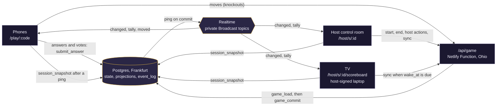

# Hurra engine v2: build spec

The design and build contract for Hurra v2: several live games at once, a live
quiz, Participant fusion, an event log of the whole night with a recap, and
games that finish by themselves. Written on Sunday 8 November 2026 for the
build that starts Monday 9 November. The party is Saturday 28 November 2026:
about 45 guests on their phones, one host and one TV.

It merges three engine designs from the design round (evolve, event-first and
realtime-native), the verified engine review and its critique, and the screen
flows in [user-flows.md](user-flows.md). It stays in the repo as the engine's
design doc.

**How to use it**

- Sections 2 to 6 are contracts: table, column, function, type and hook names,
  argument lists and JSON shapes. Build exactly these. If you must deviate, say
  so in your final report; the main engineer updates this doc. Don't edit this
  file yourself.
- Section 10 says which files each work package owns. Never edit a file you
  don't own.
- Section 11 is for the main engineer only.

**Ground rules**

- **Games are plugins.** The core stays generic. Game rules live only in
  `src/games/<name>/` and reach the party only through the SDK in
  `src/games/core`. A new capability is always generic.
- **Host, never admin**, in code, routes, the database and the UI.
- **Phosphor icons only, no emoji, and no en or em dashes** in UI copy or docs.
- **The quiz has an original look.** No Kahoot shapes, colours, music or layout.
- **Keep** the logo (the party popper), the sound library in `public/sounds`
  (never run `npm run sounds`), the visual style (night sky `#0f0d1a`, gold
  `#f5c542`, confetti pink `#ff6fae`, teal `#4fd1c5` and violet `#a78bfa`, the
  Geist font, the hopping confetti loader), and what already works: the loader,
  `QueryGate`, `Callout` and toasts, the sound policy, the error and not-found
  screens, and the TV fit logic (`fitGrid`, the standings row layouts).
- **Never touch production.** No `supabase db push`, nothing with `--linked`, no
  deploys, no Supabase or Netlify MCP write tools, no `git push`. Never print
  values from `.env` files. Use only the local Supabase stack.

## Contents

0. [Decisions at a glance](#0-decisions-at-a-glance)
1. [Architecture overview](#1-architecture-overview)
2. [Database: the init file](#2-database-the-init-file)
3. [SDK v2: src/games/core](#3-sdk-v2-srcgamescore)
4. [Engine: netlify/](#4-engine-netlify)
5. [Client data layer: src/lib](#5-client-data-layer-srclib)
6. [Game module API: src/games/types.ts](#6-game-module-api-srcgamestypests)
7. [Screens and behaviour](#7-screens-and-behaviour)
8. [The four games](#8-the-four-games)
9. [Testing plan](#9-testing-plan)
10. [Work packages and file ownership](#10-work-packages-and-file-ownership)
11. [Switch-over notes](#11-switch-over-notes)
12. [Appendix](#12-appendix)

## 0. Decisions at a glance

Every open point from the design round, decided. "Source" names the design the
idea comes from.

| Question | Decision | Source |
| --- | --- | --- |
| Event sourcing? | No. The game state row is the truth; projections are derived from it on every save. An append-only `event_log` is written in the same transaction as every change. Nothing is ever replayed from it. | all three |
| Schema migration | One fresh init file, `20261109000000_hurra_v2.sql`. No compatibility with the old schema or old phone bundles. | owner |
| Who reads the log | Hosts only. The room sees a recap the host publishes. | evolve, event-first |
| Burst input (quiz answers, fusion votes) | Prompts and sealed submissions: phones call `submit_answer` straight to Postgres. It takes a share lock on the prompt row, never the game state row. | realtime-native |
| Seeing all answers at a reveal | Closing a prompt is an update that waits for answers in flight. The engine closes prompts in `game_load` (due deadlines always, and the keys a host action names), then the plugin gets the final answers in `info.answers`. | realtime-native |
| Timers | `wakeAt` and `onWake`. `session_games.wake_at` is public. The TV sends a `sync` at that moment, and the host page sends a backup 1.5 s later. Early or repeated syncs save nothing. | evolve |
| Realtime | Broadcast pings on private topics (`room:`, `stage:`, `player:`), then one `session_snapshot` read. No table is in the Postgres Changes publication. | realtime-native |
| Several live games | No more one-live-game index. A start never ends other games. `stage` on the start request (default from the game's `presentation`) decides whether it takes the TV. | realtime-native, evolve |
| TV stage | One column, `sessions.spotlight_game_id`, plus `spotlight_at`. A finishing game takes a free stage. The final screen shows for 3 minutes from `max(finished_at, spotlight_at)`. `sessions.tv_scene = 'recap'` plays the recap. | evolve, realtime-native |
| Secret settings | `game_settings` (hosts only), frozen into `game_states.config` at start. No public config column. | all three |
| Request ids | One id per call, reused only for that call's own retries. The claim is the first write, unique on `(user_id, request_id)`. `game_load` reports `claimed`, so a copy never reruns the plugin. | realtime-native, critique |
| Finishing | `isFinished` after every change. The same save runs `onEnd(..., 'game')` and sets `finished_at`, `finished_by` and `winners`. End always ends. | all three |
| Players who leave | Effects and scores for them are skipped. Optional `onPlayerJoin` and `onPlayerLeave` hooks run from a member list kept in `game_states.members`. | review, event-first |
| Read scope | Row level security scopes every read to members of the party and hosts. Joining looks a party up through `session_by_code`. | first review (C8) |
| Player codes | Stay readable by members of the same party. Cheating by player id stays possible; close joining once everyone is in. | all three (C5 deferred) |
| The TV | A host-signed page on a dedicated laptop. Its snapshot never includes host-only data. | realtime-native, event-first |
| Quiz scoring | Quiz points (500 to 1,000 for a right answer, by speed) rank the quiz. The day's scoreboard gets right answers times `pointsPerRight` (default 1). | event-first |
| Quiz flow | The host taps Next. Time's up reveals by itself (timer), or the host taps Reveal now. The leaderboard follows 7 s later by itself. The host crowns the winner. | merged |
| Fusion answer key | Optional in the settings; also settable on the night with a `setKey` host action until that picture is revealed. | event-first, realtime-native |
| Fusion images | Optional, in a public `game-media` Storage bucket; only hosts upload. The prints are on the wall, so an image is not a secret, but who is in it is. | new |
| "Everyone answered" | No automatic early close. The host page shows "45 of 45 answered" and the host taps Reveal now. | decided |
| Undo of game moves | Not built. Host awards keep their Undo. | decided |
| Engine hosting | Netlify Free, Ohio. Two database round trips per request. No edge port and no Netlify Pro before the party. | all three |
| Keep-alive | Calls `rpc/keep_alive`, the only function anon may execute. | new |

## 1. Architecture overview

### 1.1 The parts



### 1.2 The four paths

1. **A move** (a knockout in Last one standing): the phone posts to
   `/api/game`. The engine verifies the token locally (`getClaims`), reads one
   snapshot with `game_load`, runs the plugin with the pure `step()` from
   `src/games/core/runtime.ts`, and saves state, projections, effects, log rows
   and one ping with `game_commit`. Two database round trips from Ohio, about
   0.4 to 0.9 s.
2. **An answer or a vote**: the phone calls `submit_answer` directly
   (PostgREST, one round trip, about 40 to 80 ms from Copenhagen). It never
   touches the engine or the game state row. 45 answers at once take about
   0.2 s in total.
3. **A host action or a timer**: the host page posts `host-action` (Next,
   Reveal, Lock voting) or the TV posts `sync` when `wake_at` is due. Same path
   as a move. A host action may name prompts to close first, so it sees their
   final answers.
4. **A screen refresh**: every committed change sends one tiny Broadcast ping
   per audience. Screens then read one `session_snapshot` (row level security
   decides what each screen gets). Phones jitter that read by up to 300 ms.

### 1.3 Truth, projections, log, recap

- **Truth:** `game_states` (state, round, version, frozen config, members), the
  ordinary tables (`sessions`, `players`, `session_games`, `score_events`,
  `game_prompts`, `game_submissions`), and `game_settings`.
- **Projections**, rewritten by every save from the state: `session_games.public_state`,
  `game_player_views`, `game_scores`, `session_games.winners` and `wake_at`.
- **The event log** (`event_log`): append-only, hosts only, written in the same
  transaction as every change (by the engine, by `submit_answer`, and by
  triggers for what hosts and guests change directly). It is the night's story:
  what happened, when and by whom. It is not replayed: a replay would slow every
  tap and break the history whenever a game's code changes.
- **The recap**: built in the host's browser from `session_recap()` plus each
  game's `recap()` hook, then published as one room-safe JSON document in
  `session_recaps`. The TV plays it and every phone shows "Your night".

### 1.4 Clocks

- Every time a game sees (`info.now`, prompt times, answer times) is the
  database clock, read once per request by `game_load` and kept for that
  request's retries.
- Deadlines are checked by the database (`submit_answer` refuses after
  `closes_at`).
- Screens correct their own clock with `snapshot.now` (server time offset),
  for countdowns and the 3-minute final screen.

### 1.5 What it costs

| Moment | Database round trips | Realtime events (45 phones, TV, host) |
| --- | --- | --- |
| A knockout | 2 (engine) | 48 |
| One quiz answer | 1 (RPC) | 3 (tally to TV and host) |
| A quiz question (next, 45 answers, reveal, leaderboard) | 3 engine requests and 45 RPCs | about 280 |
| A fusion vote | 1 (RPC) | 3 |
| A guest joins | 1 (RPC) | 3 |
| A host award | 1 (insert) | 5 |

The Free plan allows about 100 Realtime events per second averaged over 5 s
buckets. The worst plausible bucket (45 answers plus a reveal) is about 37 per
second. See appendix 12.1.

## 2. Database: the init file

`supabase/migrations/20261109000000_hurra_v2.sql` creates the whole v2 schema
from scratch. It replaces all six existing migration files, which are deleted.
The main engineer wipes production and rebuilds it from this file (section 11),
so there is no data migration.

### 2.1 Rules for the file

- **Privileges.** This project's default privileges grant anon and
  authenticated everything on new tables and EXECUTE on new functions, and
  Postgres grants EXECUTE to PUBLIC. So every table gets `enable row level
  security` and `revoke all ... from anon, authenticated` followed by exact
  grants, and every function gets `revoke execute ... from public, anon,
  authenticated` followed by exact grants. Section 2.12 checks this and aborts
  the migration if anything is missing.
- **Functions** all use `set search_path = ''` and fully qualified names.
  `security definer` only where a function must read or write past row level
  security; those are owned by `postgres`.
- **Errors** for clients use custom SQLSTATEs that PostgREST maps to HTTP
  status codes: `PT400`, `PT401`, `PT403`, `PT404`, `PT409`. The machine code
  goes in `DETAIL` (for example `using errcode = 'PT409', detail = 'not_running'`).
  Version conflicts use `40001`.
- **The engine flag.** `game_commit` runs `set_config('hurra.engine', 'on',
  true)` first. The logging triggers stay quiet while it is on, because the
  engine logs and pings exactly once itself.
- **Fail open.** Logging and ping trigger bodies are wrapped in
  `begin ... exception when others then raise warning ... end`, so a logging
  bug can never block a join, an award or a removal. Guards (section 2.9) are
  the exception: they are meant to refuse.
- **Idempotent where Supabase owns the object.** Statements on
  `storage.buckets`, `storage.objects` and `realtime.messages` use
  `on conflict do nothing` and `drop policy if exists` first, because a
  production wipe may keep those schemas.
- **No data.** No host row, no user ids, no emails, no project refs: the repo
  is public.

### 2.2 Order of the file

1. Header comment (what the file is, the rules above in two lines).
2. Helpers that need no tables: `random_code`, `epoch_ms`, `try_uuid`.
3. Tables, in this order: `hosts`, `sessions`, `players`, `session_games`,
   `game_settings`, `game_states`, `game_player_views`, `game_scores`,
   `score_events`, `session_feed`, `game_prompts`, `game_submissions`,
   `event_log`, `player_transfers`, `session_recaps`.
4. Helpers that read tables: `is_host`, `my_player_ids`, `my_session_ids`,
   `session_exists`.
5. Row level security, policies and grants per table.
6. The `scoreboard` view.
7. Realtime: `ping`, `ping_session`, `ping_player`, `can_listen`, the
   `realtime.messages` policy.
8. Trigger functions and triggers.
9. Client RPCs: `session_by_code`, `join_session`, `check_answer`,
   `submit_answer`, `prompt_tallies`, `session_snapshot`, `session_recap`,
   `host_issue_transfer`, `claim_player`, `keep_alive`.
10. Engine RPCs: `game_load`, `game_commit`.
11. Storage: the `game-media` bucket and its policies.
12. One block of function grants and revokes.
13. Self-checks.

### 2.3 Helpers

| Function | Kind | What it does |
| --- | --- | --- |
| `random_code(len int) returns text` | volatile, invoker | Random code from `ABCDEFGHJKLMNPQRSTUVWXYZ23456789` (as today). Column default for join codes, player codes and transfer codes. |
| `epoch_ms(t timestamptz) returns bigint` | immutable | Milliseconds since epoch; null in, null out. |
| `try_uuid(t text) returns uuid` | immutable | The uuid, or null when the text isn't one. Topic names come from clients. |
| `is_host() returns boolean` | stable, definer | `exists (select 1 from public.hosts where user_id = auth.uid())` |
| `my_player_ids() returns uuid[]` | stable, definer | The caller's player ids (one per party joined). |
| `my_session_ids() returns uuid[]` | stable, definer | The sessions the caller is a player in. |
| `session_exists(p_session_id uuid) returns boolean` | stable, definer | Whether the party exists, whoever asks. Lets a removed guest tell "removed" from "party deleted". |

Policies call these wrapped in `(select ...)` so Postgres evaluates them once
per query. All seven are granted to `authenticated` (policies and the
invoker function `session_snapshot` run as the caller) and to `service_role`;
none to anon.

### 2.4 Tables

```sql
create table public.hosts (
  user_id uuid primary key references auth.users (id) on delete cascade
);

create table public.sessions (
  id uuid primary key default gen_random_uuid(),
  name text not null check (char_length(name) between 1 and 80),
  join_code text not null unique default public.random_code(6)
    check (join_code ~ '^[A-Z0-9]{4,12}$'),
  status text not null default 'open' check (status in ('open', 'closed')),
  -- Each game type's shared data, written through game effects.
  data jsonb not null default '{}' check (jsonb_typeof(data) = 'object'),
  -- The game on the TV stage, live or finished. No foreign key on purpose: a
  -- second sessions/session_games relationship makes PostgREST embeds
  -- ambiguous. Triggers clear it when that game is archived or deleted.
  spotlight_game_id uuid,
  -- Set by a trigger whenever spotlight_game_id changes (database clock).
  spotlight_at timestamptz,
  tv_scene text not null default 'live' check (tv_scene in ('live', 'recap')),
  archived_at timestamptz,
  created_at timestamptz not null default now()
);

create table public.players (
  id uuid primary key default gen_random_uuid(),
  session_id uuid not null references public.sessions (id) on delete cascade,
  user_id uuid not null references auth.users (id) on delete cascade,
  name text not null check (char_length(name) between 1 and 40),
  code text not null unique default public.random_code(5) check (code ~ '^[A-Z0-9]{5}$'),
  profile jsonb not null default '{}' check (jsonb_typeof(profile) = 'object'),
  created_at timestamptz not null default now(),
  unique (session_id, user_id),
  unique (id, session_id)
);
create unique index players_session_name_key on public.players (session_id, lower(name));
create index players_user_idx on public.players (user_id);

create table public.session_games (
  id uuid primary key default gen_random_uuid(),
  session_id uuid not null references public.sessions (id) on delete cascade,
  game_type text not null check (game_type ~ '^[a-z][a-z0-9-]{1,39}$'),
  title text not null check (char_length(title) between 1 and 80),
  position int not null default 0,
  status text not null default 'pending' check (status in ('pending', 'active', 'finished')),
  public_state jsonb,                      -- null until the first start
  started_at timestamptz,
  finished_at timestamptz,
  finished_by text check (finished_by in ('game', 'host')),
  winners uuid[] not null default '{}',     -- set when it finishes; no foreign key
  wake_at timestamptz,                      -- when the game wants a sync; public
  archived_at timestamptz,
  created_at timestamptz not null default now(),
  unique (id, session_id),
  check ((status = 'finished') = (finished_at is not null)),
  check (finished_by is null or status = 'finished')
);
create index session_games_session_idx on public.session_games (session_id, position, created_at);
create index session_games_live_idx on public.session_games (session_id) where status = 'active';

-- Host-only settings (quiz questions and answers, who is in each picture).
create table public.game_settings (
  game_id uuid primary key references public.session_games (id) on delete cascade,
  config jsonb not null default '{}'
    check (jsonb_typeof(config) = 'object' and pg_column_size(config) < 262144),
  updated_at timestamptz not null default now()
);

-- A game's full state. Written only by game_commit; hosts read it.
create table public.game_states (
  game_id uuid primary key references public.session_games (id) on delete cascade,
  round int not null default 1 check (round >= 1),   -- bumped by every (re)start
  version int not null default 1,                     -- bumped by every save
  state jsonb not null,
  config jsonb not null default '{}',                 -- the settings this round started with
  members uuid[] not null default '{}',               -- players the game knows about
  updated_at timestamptz not null default now()
);

create table public.game_player_views (
  game_id uuid not null references public.session_games (id) on delete cascade,
  player_id uuid not null references public.players (id) on delete cascade,
  view jsonb not null,
  primary key (game_id, player_id)
);
create index game_player_views_player_idx on public.game_player_views (player_id);

create table public.game_scores (
  game_id uuid not null references public.session_games (id) on delete cascade,
  player_id uuid not null,
  session_id uuid not null,
  points int not null,
  primary key (game_id, player_id),
  foreign key (player_id, session_id) references public.players (id, session_id) on delete cascade
);
create index game_scores_session_idx on public.game_scores (session_id);
create index game_scores_player_idx on public.game_scores (player_id);

-- The points ledger: host awards and games' one-off bonuses (awarded_by null).
create table public.score_events (
  id bigint generated always as identity primary key,
  session_id uuid not null references public.sessions (id) on delete cascade,
  player_id uuid not null,
  game_id uuid,
  points int not null check (points <> 0),
  reason text check (char_length(reason) <= 200),
  awarded_by uuid default auth.uid() references auth.users (id) on delete set null,
  created_at timestamptz not null default now(),
  foreign key (player_id, session_id) references public.players (id, session_id) on delete cascade,
  foreign key (game_id, session_id) references public.session_games (id, session_id) on delete set null (game_id)
);
create index score_events_session_idx on public.score_events (session_id);
create index score_events_player_idx on public.score_events (player_id, created_at desc);
create index score_events_game_idx on public.score_events (game_id) where game_id is not null;

-- Announcements: toasts on phones, the banner on the TV.
create table public.session_feed (
  id bigint generated always as identity primary key,
  session_id uuid not null references public.sessions (id) on delete cascade,
  game_id uuid references public.session_games (id) on delete set null,
  message text not null check (char_length(message) between 1 and 280),
  detail text check (char_length(detail) <= 280),
  audience uuid[],                          -- null: everyone; else only these players (and hosts) can read it
  sound text check (char_length(sound) <= 40),
  icon text check (char_length(icon) <= 40),
  tone text check (char_length(tone) <= 20),
  created_at timestamptz not null default now()
);
create index session_feed_session_idx on public.session_feed (session_id, id desc);

-- Questions everyone answers from their phone (a quiz question, a fused picture).
create table public.game_prompts (
  game_id uuid not null references public.session_games (id) on delete cascade,
  key text not null check (key ~ '^[A-Za-z0-9_.:-]{1,64}$'),
  round int not null,
  spec jsonb not null check (jsonb_typeof(spec) = 'object' and pg_column_size(spec) < 32768),
  opened_at timestamptz not null default clock_timestamp(),
  closes_at timestamptz,                    -- deadline by the database clock; null for none
  closed_at timestamptz,
  revealed_at timestamptz,
  primary key (game_id, key)
);

-- One answer per player and prompt. Written only by submit_answer.
create table public.game_submissions (
  game_id uuid not null,
  key text not null,
  player_id uuid not null references public.players (id) on delete cascade,
  payload jsonb not null,
  first_at timestamptz not null default clock_timestamp(),
  at timestamptz not null default clock_timestamp(),
  changes int not null default 0 check (changes between 0 and 20),
  primary key (game_id, key, player_id),
  foreign key (game_id, key) references public.game_prompts (game_id, key) on delete cascade
);

-- The night's story. Append-only (section 2.5), hosts only, never published to Realtime.
create table public.event_log (
  id bigint generated always as identity primary key,
  session_id uuid not null references public.sessions (id) on delete cascade,
  at timestamptz not null default clock_timestamp(),
  kind text not null check (kind ~ '^[a-z][a-z_]*(\.[a-z][a-z_]*)+$'),
  game_id uuid,                             -- no foreign keys: the log outlives a deleted game
  game_type text,
  round int,
  actor text not null check (actor in ('player', 'host', 'game', 'timer', 'system')),
  player_id uuid,                           -- or a removed guest
  user_id uuid,
  request_id uuid,                          -- the tap's id: the claim
  cause_id bigint,                          -- the row this one follows from
  about uuid[] not null default '{}',       -- players it is about
  data jsonb not null default '{}'
    check (jsonb_typeof(data) = 'object' and pg_column_size(data) < 262144)
);
create index event_log_session_idx on public.event_log (session_id, id);
create index event_log_game_idx on public.event_log (game_id, id) where game_id is not null;
create unique index event_log_request_key on public.event_log (user_id, request_id)
  where request_id is not null;

-- Move a player to a new phone (gap G4). Only the two RPCs touch it.
create table public.player_transfers (
  code text primary key default public.random_code(6),
  player_id uuid not null unique references public.players (id) on delete cascade,
  expires_at timestamptz not null default now() + interval '15 minutes'
);

-- The recap the host published: room-safe facts only.
create table public.session_recaps (
  session_id uuid primary key references public.sessions (id) on delete cascade,
  data jsonb not null check (jsonb_typeof(data) = 'object' and pg_column_size(data) < 1048576),
  published_at timestamptz,
  updated_at timestamptz not null default now()
);
```

### 2.5 Row level security and grants

Every table: `alter table ... enable row level security;` then
`revoke all on ... from anon, authenticated;` then the grants below. "Member"
means `session_id = any ((select public.my_session_ids()))`; "host" means
`(select public.is_host())`.

| Table | Grants to authenticated | Policies |
| --- | --- | --- |
| `hosts` | none | none (read only through `is_host()`) |
| `sessions` | `select, delete`; `insert (name, join_code)`; `update (name, status, archived_at, spotlight_game_id, tv_scene)` | select: host or `id = any (my_session_ids())`. insert, update, delete: host. |
| `players` | `select, delete`; `update (name)` | select: host or member. update, delete: host. Inserts only through `join_session`. |
| `session_games` | `select, delete`; `insert (session_id, game_type, title, position)`; `update (title, position, archived_at)` | select: host or member. insert, update, delete: host. |
| `game_settings` | `select, insert, update, delete` | all: host. |
| `game_states` | `select` | select: host. |
| `game_player_views` | `select` | `player_id = any ((select public.my_player_ids()))` or host. |
| `game_scores` | `select` | host or member. |
| `score_events` | `select, delete`; `insert (session_id, player_id, game_id, points, reason)` | select: host or member. insert, delete: host. (`awarded_by` keeps its default, so it can't be spoofed.) |
| `session_feed` | `select` | host, or member and (`audience is null` or `audience && (select public.my_player_ids())`). |
| `game_prompts` | `select` | host, or `game_id in (select id from public.session_games where session_id = any ((select public.my_session_ids())))`. |
| `game_submissions` | `select` | `player_id = any ((select public.my_player_ids()))` or host. |
| `event_log` | `select` | select: host. |
| `player_transfers` | none | none. |
| `session_recaps` | `select, insert, update, delete` | select: host, or `published_at is not null` and member. insert, update, delete: host. |

service_role (the engine): Supabase's default grants stay, except
`revoke update, delete, truncate on public.event_log from service_role` and
`grant select, insert on public.event_log to service_role`. Nothing outside the
`postgres` role can change a log row. Deleting a party still removes its log
through the foreign key cascade.

Engine-owned columns (`status`, `public_state`, `started_at`, `finished_*`,
`winners`, `wake_at` on `session_games`; `data` and `spotlight_at` on
`sessions`; `profile` on `players`) are never in a client grant.

### 2.6 The scoreboard view

```sql
create view public.scoreboard with (security_invoker = true) as
select p.session_id, p.id as player_id, p.name, p.code,
  (coalesce((select sum(e.points) from public.score_events e where e.player_id = p.id), 0)
   + coalesce((select sum(g.points) from public.game_scores g where g.player_id = p.id), 0))::int as points,
  p.profile
from public.players p;
revoke all on public.scoreboard from anon, authenticated;
grant select on public.scoreboard to authenticated;
```

### 2.7 Client RPCs

All are `set search_path = ''`, revoked from `public, anon` and granted to
`authenticated` (except where said).

**`session_by_code(p_join_code text) returns jsonb`**, stable, definer.
Returns `{ id, name, join_code, status, archived_at }` (`archived_at` as epoch
ms or null) for `upper(btrim(p_join_code))`, or null. Null when
`auth.uid()` is null. The only way a non-member finds a party.

**`join_session(p_join_code text, p_name text) returns public.players`**,
definer. As today, plus: refuses an archived party (`PT409` "This party is
over", detail `archived`). Errors: `PT401` signed out; `PT404` "No party with
code X"; `PT409` "This party is closed for new players" (detail `closed`);
`PT400` name length; `PT409` "Someone already joined as "X". Try another
name." (detail `name_taken`). Returns the caller's existing player when they
rejoin from the same browser.

**`check_answer(p_spec jsonb, p_payload jsonb, p_session_id uuid, p_player_id uuid) returns jsonb`**,
stable. Internal: revoked from every client role. Validates and normalises an
answer against a prompt spec, as in the tested sketch:

- `choice`: payload `{ "choice": string | string[] }`. Every value must be one
  of `spec.options`, or a player id of the party when `options` is
  `"players"` (minus the caller when `exclude_self`). No repeats. Count between
  `min` and `max` (both default 1). Returns `{ "choice": [...] }` sorted.
- `number`: payload `{ "value": number }` within `min` and `max`, whole if
  `integer`. Returns `{ "value": n }`.
- `text`: payload `{ "text": string }`, trimmed, 1 to `max_length` (default
  80) characters. Returns `{ "text": "..." }`.
- Payloads over 2 KB, or not an object, are refused.
- Errors, all `PT400` (detail `answer_invalid`): "That answer is not valid",
  "Pick an option", "That is not one of the options", "Pick each option only
  once", "Pick 2" or "Pick 1 to 3", "Enter a number", "That number is out of
  range", "Answers are 1 to 80 characters", "This question takes no answers".

**`submit_answer(p_game_id uuid, p_key text, p_payload jsonb, p_request_id uuid) returns jsonb`**,
volatile, definer. The hot path, in this order:

1. `auth.uid()` is null: `PT401` "Not signed in".
2. `select ... from public.game_prompts where game_id = p_game_id and key = p_key for share`.
   Not found: `PT409` "This question is not open" (detail `closed`).
3. `closed_at` set, or `closes_at <= clock_timestamp()`: `PT409` "Too late,
   answers are closed" (detail `closed`).
4. The game is not `active`, or archived: `PT409` "This game is not running"
   (detail `not_running`).
5. The caller has no player in the game's party: `PT403` "You're not a player
   in this party" (detail `not_player`).
6. `v_answer := check_answer(spec, p_payload, session, player)`.
7. The claim: `insert into public.event_log (kind 'prompt.answered', actor
   'player', player_id, user_id, request_id = p_request_id, about = {player},
   data = { key, answer, ms, round })` with `on conflict (user_id, request_id)
   where request_id is not null do nothing`. If nothing was inserted, this tap
   was already saved: return the stored submission as
   `{ accepted: true, replayed: true, answer, at, ms }`.
8. Insert the submission. If one exists:
   - the same normalised payload: return `{ accepted: true, replayed: true, ... }`
     (a resend from a reload counts as success);
   - `spec.final` is true: `PT409` "You already answered" (detail
     `already_answered`);
   - `changes` would pass 20: `PT409` "That's enough changes for this one";
   - otherwise update `payload`, `at = clock_timestamp()`, `changes + 1`.
9. If this was a new submission, count the prompt's submissions and
   `ping('stage:' || session_id, 'tally', { game, key, count })`.
10. Return `{ accepted: true, answer, at, ms }`: `at` is epoch ms of `first_at`
    and `ms` is `first_at - opened_at`.

Any refusal rolls back the claim row with it.

**`prompt_tallies(p_session_id uuid) returns jsonb`**, stable, definer.
`{ "<game id>": { "<key>": count } }` for prompts of the party's active games
that are not revealed yet. Empty unless the caller is a host or a member.
Counts only: no answer leaves the database.

**`session_snapshot(p_session_id uuid, p_screen text) returns jsonb`**, stable,
**invoker** (row level security decides what each screen gets). `p_screen` is
`'phone'`, `'tv'` or `'host'`. All times are epoch milliseconds (numbers), so
phones never parse timestamps. Returns:

```jsonc
{
  "now": 1795900000000,                   // epoch ms, database clock
  "member": true,                         // is_host() or a player of this party
  "exists": true,                         // session_exists(p_session_id)
  "session": { "id", "name", "join_code", "status", "data", "spotlight_game_id",
               "spotlight_at", "tv_scene", "archived_at", "created_at" } ,  // null if not readable
  "games": [ { "id", "game_type", "title", "position", "status",
               "public_state",            // only for active games, the spotlit game and games
                                          // finished in the last 60 minutes; else null
               "started_at", "finished_at", "finished_by", "winners", "wake_at",
               "archived_at", "created_at" } ],   // order by position, created_at
  "prompts": [ { "game_id", "key", "spec", "opened_at", "closes_at", "closed_at",
                 "revealed_at" } ],      // prompts of active games
  "tallies": { "<game id>": { "<key>": 31 } },            // prompt_tallies()
  "game_points": { "<game id>": { "<player id>": 7 } },   // game_scores + score_events per game,
                                                          // for active, spotlit and recently finished games
  "players": [ { "id", "name", "code", "profile", "created_at" } ],   // by created_at, id
  "standings": [ { "player_id", "name", "code", "points", "profile" } ], // points desc, name
  "feed": [ { "id", "game_id", "message", "detail", "audience", "sound", "icon",
              "tone", "created_at" } ],   // newest 12 the caller may read; 'tv' and 'host': audience is null only
  "me": { "player_id", "views": { "<game id>": view },
          "answers": { "<game id>": { "<key>": payload } } },   // 'phone' only; null if not a player
  "states": { "<game id>": { "state", "config", "round", "members" } },  // 'host' and is_host() only, active games
  "recap": { "published_at": 1795900000000 }                    // null when nothing is published
}
```

When the caller is not a member (a removed guest, an old phone after "Move to
a new phone"), it returns `{ now, member: false, exists, session: null }` with
empty lists. A deleted party returns `exists: false`.

**`session_recap(p_session_id uuid) returns jsonb`**, stable, plpgsql,
invoker. Hosts only: anyone else gets `PT403` "Only hosts can read this". The
raw material for the recap builder (section 5.7):

```jsonc
// Every time in this object is epoch ms or null.
{
  "session": { "id", "name", "created_at", "archived_at" },
  "players": [ { "id", "name", "joined_at", "removed_at", "profile" } ],
      // everyone who ever joined: current players, plus removed ones from player.removed log rows
  "games": [ { "id", "title", "game_type", "position", "status" } ],
  "rounds": [ { "game_id", "round", "started_at", "finished_at", "finished_by",
                "config", "state", "public_state", "scores", "points", "winners" } ],
      // one per game.started row, joined to its game.finished row; an unfinished
      // round uses the current game_states row
  "log": [ { "id", "at", "kind", "game_id", "game_type", "round", "actor",
             "player_id", "about", "data" } ],
      // the whole log in id order, without the data of game.started and game.finished rows
  "standings": [ { "player_id", "name", "points" } ]
}
```

**`host_issue_transfer(p_player_id uuid) returns text`**, definer. Hosts only
(`PT403` otherwise). Deletes the player's old code and every expired code,
inserts a new 6-character code valid for 15 minutes, returns it.

**`claim_player(p_code text) returns public.players`**, definer. `PT401` when
signed out. Deletes the matching unexpired code (`upper(btrim(p_code))`);
none: `PT404` "That code is wrong or has expired. Ask the host for a new one."
If the caller already has a player in that party: `PT409` "This phone already
has a player in this party". Otherwise sets `players.user_id = auth.uid()` and
returns the player. The `players` trigger logs `player.moved` and pings the
old phone.

**`keep_alive() returns boolean`**, stable, invoker: `select true`. Granted to
`anon` and `authenticated`: the one function anon may run.

### 2.8 Engine RPCs

Both are `security invoker` (they run as `service_role`), revoked from
`public, anon, authenticated` and granted to `service_role` only.

**`game_load(p_game_id uuid, p_user_id uuid, p_close text[] default '{}', p_request_id uuid default null) returns jsonb`**,
volatile.

1. If `p_close` is not empty **and `p_user_id` is a host**: `update
   public.game_prompts set closed_at = clock_timestamp() where game_id =
   p_game_id and closed_at is null and key = any (p_close)`. Ignored for
   anyone else, so a guest can never close a question.
2. `update public.game_prompts set closed_at = closes_at where game_id =
   p_game_id and closed_at is null and closes_at <= clock_timestamp()`.
   Both updates wait for answers in flight (they hold share locks), so the
   read below sees every accepted answer, and nothing can be accepted after.
3. One `select` (one statement, so one snapshot) returning, or null when the
   game doesn't exist:

```jsonc
{
  "now": 1795900000000,                 // epoch ms of clock_timestamp()
  "claimed": false,                     // p_request_id already in event_log for p_user_id
  "game": { "id", "session_id", "game_type", "title", "status", "archived_at", "wake_at" },
  "settings": { },                      // game_settings.config, or {}
  "current": { "state", "version", "round", "config", "members" },   // null before the first start
  "session": { "id", "name", "data", "spotlight_game_id" },
  "players": [ { "id", "name", "profile" } ],   // the party now, by created_at, id
  "caller": { "player_id": "..." , "is_host": false },
  "scoreboard": { "<player id>": 12 },
  "prompts": { "<key>": { "spec", "opened_at", "closes_at", "closed_at", "revealed_at",
                          "submissions": [ { "player_id", "answer", "first_at", "at", "ms", "changes" } ] } }
      // this round's prompts; "submissions" only for closed and unrevealed prompts, else null;
      // submissions in first_at order
}
// Every time in this object is epoch ms (database clock) or null.
```

**`game_commit(p jsonb) returns jsonb`**, volatile. One jsonb argument, so new
fields never change the signature. `p` is the `CommitPayload` from section 3.3.
In order, in one transaction:

1. `set_config('hurra.engine', 'on', true)`.
2. Lock the game row: `select ... from public.session_games where id = ... for
   no key update`. Missing: `PT404` "Game not found" (`not_found`).
3. Lock the state row `for update` (null before the first start). The round is
   `coalesce(state.round, 0) + 1` for a start, else `state.round`.
4. **The claim**, the first write: insert the cause row into `event_log`
   (kind by request type: `game.start`, `game.end`, `game.action`,
   `game.host_action`, `game.sync`; `actor`, `player_id`, `user_id`,
   `request_id`, `data = { action, close, stage }`) with `on conflict (user_id,
   request_id) where request_id is not null do nothing`. Nothing inserted:
   return `{ "replayed": true }`. A copy that races its original waits for it
   (at the row lock in step 2), then returns replayed; if the original rolled
   back, the copy goes ahead.
5. **Checks**, each raising (which rolls the claim back):
   - start on an archived game: `PT409` "Unarchive this game before starting
     it" (`archived`);
   - start on an active game: `PT409` "This game is already running"
     (`already_running`);
   - anything else on a game that isn't active, or has no state: `PT409` "This
     game is not running" (`not_running`);
   - `expected_round` differs from the state's round: `PT409` "The game was
     restarted" (`restarted`);
   - `expected_version` differs: `40001` "Game state changed concurrently".
6. **State.** Start: upsert `game_states` with the new round, `version + 1`
   (or 1), `config`, `members`, and delete the game's old prompts (their
   submissions cascade; the log keeps every answer). Otherwise: update `state`,
   `version + 1`, `members`.
7. **Projections**, each skipped when its key is absent from `p` (End's fail
   open path, section 3.3):
   - `game_player_views`: upsert joined to `players` on id and session, so a
     player removed meanwhile is skipped; only rows whose view changed
     (`is distinct from`); remember which players changed.
   - `game_scores`: delete rows not in `p.scores`, upsert the rest joined to
     `players`; compute each player's change (new minus old) for the log.
8. **Effects**: `score_events` (`awarded_by` null, joined to players);
   profile patches into each player's `profile -> game_type` (only when it
   changes); the session data patch into `sessions.data -> game_type` (only
   when it changes); announcements into `session_feed` (a targeted one keeps
   only players still present, and is dropped when none are); records as
   `game.record` rows in `event_log` (`cause_id`, `about`).
9. **Prompts**: insert opened prompts (`round`, `opened_at =
   clock_timestamp()`, `closes_at` from ms); set `closed_at` on closed ones and
   `closed_at`, `revealed_at` on revealed ones (each `coalesce`d, so repeats
   are harmless). On a finish, close every open prompt of the game. Closing
   waits for answers in flight.
10. **The game row**, only when a value changes: `public_state` (if present),
    `status`, `started_at` (start: now), `finished_at` (finish: now; start:
    null), `finished_by`, `winners` (finish: `p.winners`; start: `{}`),
    `wake_at` (finish: null; else `p.wake_at`).
11. **Log rows** (all with `cause_id`):
    - `game.effects` when anything happened: announcements, points, profile
      patches, session data, score changes, prompts opened, closed and
      revealed, members who joined or left, wakes run;
    - on a start, `game.started` with `title`, `game_type`, `config`, `state`,
      `public_state`, `members`;
    - on a finish, `game.finished` with `title`, `game_type`, `by`, `winners`,
      `state`, `public_state`, `scores` and `points` (game scores plus this
      game's `score_events`).
12. **The stage**:
    - Start with `stage = 'take'`: `spotlight_game_id = this game` and
      `tv_scene = 'live'`; log `stage.changed` (`reason: 'start'`). Start with
      `'keep'` while this game is the spotlight (a restart of a game whose final
      screen is up): clear the spotlight.
    - Finish: take the stage when it is free or already this game's. Free
      means no spotlight, or the spotlit game is missing or archived, or it is
      finished and `now > max(finished_at, spotlight_at) + 3 minutes`. Taking it
      logs `stage.changed` (`reason: 'finish'`). Otherwise (another game is
      live on the stage) leave it: the TV rail shows a "Finished" chip and the
      host can put it on the TV.
13. **One ping.** If anything the room sees changed (status, public state,
    winners, scores, points, profiles, session data, a public announcement, a
    prompt opened, closed or revealed, the stage), `ping_session(session,
    'room', { game })`. Otherwise ping each player whose view changed or who
    got a targeted announcement (`ping_player`; a room ping instead when more
    than 10), plus `ping_session(session, 'stage')` for the host's view of the
    full state.
14. Return `{ "replayed": false, "version", "round", "now" }`.

### 2.9 Triggers

| Table | Trigger | What it does |
| --- | --- | --- |
| `sessions` | `before update of spotlight_game_id` | `touch_spotlight()`: sets `spotlight_at = now()` when the value changes. Runs for the engine too. |
| `sessions` | `after insert` | Logs `session.created`. No ping. |
| `sessions` | `after update of name, status, archived_at, spotlight_game_id, tv_scene` | Logs `session.renamed`, `session.opened` or `session.closed`, `session.archived` or `session.unarchived`, `stage.changed` (actor host), `session.tv_scene`. Pings room. |
| `sessions` | `after delete` | `ping('room:' || id, 'changed', { session, deleted: true })`, so open screens learn the party is gone. |
| `players` | `after insert` | Logs `player.joined` (`data.name`). Pings stage (the TV and host page; phones see the newcomer at the next room ping or poll). |
| `players` | `after update of name, user_id` | Name: logs `player.renamed`, pings room. User: logs `player.moved`, sends `moved` on `player:<id>` (the old phone hears it), pings stage. |
| `players` | `after delete` | Skipped when the party itself is being deleted. Logs `player.removed` (`data.name`), pings room. |
| `score_events` | `after insert or delete` | Skipped while `hurra.engine` is on (the engine logs its own points). Logs `points.awarded` or `points.undone` (`player_id`, `points`, `reason`, `game_id`, `score_event_id`); skipped when the player is being removed. Pings stage and that player. |
| `session_games` | `before update of archived_at` | Guard, not fail open: archiving an active game raises `PT409` "End the game before archiving it". |
| `session_games` | `after insert or update of title, position, archived_at or delete` | Logs `game.added`, `game.renamed`, `game.archived`, `game.unarchived`, `game.deleted` (skipped while the party is being deleted). Archiving or deleting the spotlit game clears `sessions.spotlight_game_id`. Pings room for a delete, an archive, or a rename of a live game; else stage. |
| `game_settings` | `after insert or update` | Logs `game.settings_changed` (never the values). No ping. |
| `session_recaps` | `after insert or update of published_at` | Logs `recap.published` or `recap.unpublished`. Pings room. |

Trigger functions: `touch_spotlight`, `log_session_change`,
`ping_session_deleted`, `log_player_change`, `log_score_change`,
`guard_game_archive`, `log_game_change`, `log_settings_change`,
`log_recap_change`. All revoked from every client role. The logging ones are
`security definer`, so they can write the log and ping. Actor: `host` when
`is_host()`, `player` when the caller has a player in the party, else
`system`.

### 2.10 Realtime

No table is added to the `supabase_realtime` publication: screens never use
Postgres Changes. Pings are Broadcast messages from the database
(`realtime.send`), on private topics:

| Topic | Who may listen | Events | Payload |
| --- | --- | --- | --- |
| `room:<session id>` | hosts, and players of that party | `changed` | `{ session, game?, deleted?, at }` |
| `stage:<session id>` | hosts | `changed`, `tally` | `{ session, at }`; tally: `{ game, key, count, at }` |
| `player:<player id>` | the user who owns that player | `changed`, `moved` | `{ player, at }` |

Functions, all `security definer` and owned by `postgres`. The three ping
functions are revoked from `public, anon, authenticated` and keep their
`service_role` grant, because `game_commit` runs as `service_role` and calls
them:

- `ping(p_topic text, p_event text default 'changed', p_payload jsonb default '{}')`:
  calls `realtime.send(p_payload || { at }, p_event, p_topic, true)`. At most
  one `changed` per topic per transaction, tracked in the transaction-local
  setting `hurra.pinged`. Other events always go out. `realtime.send` never
  raises; a failure is only a database warning, and screens heal by polling.
- `ping_session(p_session_id uuid, p_audience text, p_payload jsonb default '{}')`:
  `p_audience` is `'room'` or `'stage'`. A stage ping is skipped when the room
  was already pinged in this transaction.
- `ping_player(p_session_id uuid, p_player_id uuid, p_event text default 'changed')`:
  a `changed` ping is skipped when the room was already pinged.
- `can_listen(p_topic text) returns boolean`, stable, granted to
  `authenticated` (Realtime evaluates it as the connecting user):
  `room:<id>` for hosts and players of that party, `stage:<id>` for hosts,
  `player:<id>` for that player's user. Malformed topics are false.

The policy, created after `drop policy if exists`:

```sql
create policy "Hurra screens receive their pings" on realtime.messages
  for select to authenticated
  using (realtime.messages.extension = 'broadcast'
         and (select public.can_listen((select realtime.topic()))));
```

There is no insert policy, so clients can't send on these topics. A ping is
written to `realtime.messages` inside the saving transaction, so it is
delivered only after the commit and never after a rollback.

### 2.11 Storage

```sql
insert into storage.buckets (id, name, public, file_size_limit, allowed_mime_types)
values ('game-media', 'game-media', true, 10485760, array['image/jpeg', 'image/png', 'image/webp'])
on conflict (id) do nothing;
```

Policies on `storage.objects` (each after `drop policy if exists`):
"Hosts upload game media" (insert), "Hosts change game media" (update) and
"Hosts delete game media" (delete), all `to authenticated` with
`bucket_id = 'game-media' and (select public.is_host())`. Reads go through the
bucket's public URL. Paths are `<session id>/<game id>/<random uuid>.<ext>`, so
a file name never says who is in a picture.

### 2.12 Self-checks

The last statement is a `do $$ ... $$` block that raises (and so aborts the
migration) when:

- any table in `public` has row level security off;
- anon can execute any function in `public` other than `keep_alive`;
- authenticated can execute `game_load`, `game_commit`, `ping`,
  `ping_session`, `ping_player`, `check_answer` or any trigger function;
- service_role can't execute `game_load`, `game_commit`, `ping`,
  `ping_session` or `ping_player` (the engine needs them);
- authenticated or service_role can update or delete `event_log`;
- authenticated can insert into or update `event_log`, `game_states`,
  `game_player_views`, `game_scores`, `session_feed`, `game_prompts` or
  `game_submissions`;
- the `realtime.messages` policy is missing;
- any `public` table is in the `supabase_realtime` publication;
- there is not exactly one foreign key between `sessions` and `session_games`.

### 2.13 Host bootstrap

The file creates no host. After a rebuild the main engineer adds the one host
row in the SQL editor (section 11):

```sql
insert into public.hosts (user_id)
select id from auth.users where email = '<the host account email>';
select count(*) from public.hosts;  -- expect 1
```

The auth user survives a wipe of the public schema. If it is missing, create
it under Authentication, Users, Add user (tick Auto confirm), then run the
insert. Locally, `npm run dev:setup` (section 10) makes a local host.

### 2.14 Event log reference

| Kind | Written by | Actor | `data` |
| --- | --- | --- | --- |
| `game.start` | game_commit (the claim) | host | `{ stage, players }` |
| `game.end` | game_commit | host | `{}` |
| `game.action` | game_commit | player | `{ action }` (the parsed action) |
| `game.host_action` | game_commit | host | `{ action, close }` |
| `game.sync` | game_commit | timer, host or system | `{ woke }` |
| `game.effects` | game_commit | game | `{ announcements, points, profiles, session_data, scores, prompts: { opened, closed, revealed }, members: { joined, left } }` |
| `game.record` | game_commit (`ctx.record`) | game | `{ type, ...data }` |
| `game.started` | game_commit | game | `{ title, game_type, config, state, public_state, members }` |
| `game.finished` | game_commit | game or host | `{ title, game_type, by, winners, state, public_state, scores, points }` |
| `stage.changed` | game_commit or trigger | game or host | `{ game_id, title, reason }` |
| `prompt.answered` | submit_answer (the claim) | player | `{ key, answer, ms, round }` |
| `session.created`, `session.renamed`, `session.opened`, `session.closed`, `session.archived`, `session.unarchived`, `session.tv_scene` | triggers | host or system | the changed values |
| `player.joined`, `player.renamed`, `player.moved`, `player.removed` | triggers | player, host or system | `{ name, player_id }` |
| `points.awarded`, `points.undone` | trigger (host awards only) | host | `{ player_id, points, reason, game_id, score_event_id }` |
| `game.added`, `game.renamed`, `game.archived`, `game.unarchived`, `game.deleted`, `game.settings_changed` | triggers | host | `{ title, game_type }` |
| `recap.published`, `recap.unpublished` | trigger | host | `{}` |

About 2,000 to 3,000 rows for the night, a few MB with the start and finish
states.

## 3. SDK v2: src/games/core

Every new member is optional or additive: today's games compile against v2
with no change and then adopt what they need. Files in `src/games/core` and
`src/games/*/logic.ts` are bundled into the Netlify function: relative imports
only, no React, no browser globals.

### 3.1 Game.ts

```ts
import type { SoundName } from './sounds'

export type PlayerId = string
export type Scores = Record<PlayerId, number>
/** Public per-game data on a player or the session, keyed by game type. */
export type GameData = Record<string, Record<string, unknown>>
export type GamePlayer = { id: PlayerId; name: string; profile: GameData }
export type GameSession = { id: string; name: string; data: GameData }

// ANNOUNCEMENT_ICONS, AnnouncementIcon and Tone: unchanged.

export type AnnouncementOptions = {
  /** A second, quieter line under the message. */
  detail?: string
  /** Only these players (and hosts) can read it; their phones toast it. Everyone, and the TV, when left out. */
  to?: PlayerId[]
  sound?: SoundName
  icon?: AnnouncementIcon
  tone?: Tone
}

/** Where a game shows by default when the host starts it. */
export type Presentation = 'stage' | 'background'

/** Who caused the call. */
export type Actor =
  | { readonly kind: 'player'; readonly playerId: PlayerId }
  | { readonly kind: 'host' }
  /** A time from wakeAt() has passed. */
  | { readonly kind: 'timer' }
  /** Someone joined the party or left it. */
  | { readonly kind: 'system' }

/** What an answer to a prompt may be. The database checks every answer against it. */
export type PromptSpec =
  | {
      readonly kind: 'choice'
      /** The allowed values, or 'players' for the party's player ids. */
      readonly options: readonly string[] | 'players'
      readonly min?: number // default 1
      readonly max?: number // default 1
      /** The first answer counts (a quiz). Otherwise it may change until the prompt closes (a vote). */
      readonly final?: boolean
      /** With 'players': a player can't pick themselves. */
      readonly exclude_self?: boolean
    }
  | { readonly kind: 'number'; readonly min: number; readonly max: number; readonly integer?: boolean; readonly final?: boolean }
  | { readonly kind: 'text'; readonly max_length?: number; readonly final?: boolean }

/** An answer as the database normalised it: choices sorted, text trimmed. */
export type AnswerPayload =
  | { readonly choice: readonly string[] }
  | { readonly value: number }
  | { readonly text: string }

/** A prompt of this round. Times are ms since epoch, database clock. */
export type Prompt = {
  readonly key: string
  readonly spec: PromptSpec
  readonly openedAt: number
  readonly closesAt: number | null
  readonly closedAt: number | null
  readonly revealedAt: number | null
}

/** One player's answer to a closed prompt. `ms` is how long after the prompt opened it first arrived. */
export type Answer = {
  readonly playerId: PlayerId
  readonly answer: AnswerPayload
  readonly firstAt: number
  readonly at: number
  readonly ms: number
  readonly changes: number
}

/** Read-only facts, available to every method. */
export type GameInfo<Config> = {
  readonly gameId: string
  /** 1 for the first start, 2 after a restart, and so on. */
  readonly round: number
  readonly session: GameSession
  /** The party's players right now. Effects aimed at anyone else are dropped. */
  readonly players: readonly GamePlayer[]
  /** The day's scoreboard: each player's total across all games. */
  readonly scoreboard: Readonly<Record<PlayerId, number>>
  /** The settings this round started with (checked by parseConfig). Never changes during a round. */
  readonly config: Config
  /** Ms since epoch by the database clock, fixed for the whole request, retries included. */
  readonly now: number
  /** This round's prompts, by key. */
  readonly prompts: Readonly<Record<string, Prompt>>
  /** Answers to prompts that are closed but not revealed yet, by key, in arrival order. */
  readonly answers: Readonly<Record<string, readonly Answer[]>>
}

export type RecordOptions = {
  /** The players it is about, for "Your night" in the recap. */
  about?: PlayerId[]
}

/**
 * What the hooks can do beyond returning new state. Effects are saved in the
 * same transaction as the state, once per tap even when the phone resends it.
 */
export type GameContext<Config> = GameInfo<Config> & {
  readonly actor: Actor
  /** Use this, never Math.random: a hook may run again when a save is retried. */
  random(): number
  /** A bonus or penalty on the day's scoreboard. Skipped for players who left. */
  awardPoints(playerId: PlayerId, points: number, reason: string): void
  /** Shallow-merges into this game's section of the player's public profile. Skipped for players who left. */
  updateProfile(playerId: PlayerId, patch: Record<string, unknown>): void
  /** Shallow-merges into this game's section of the session's shared data. */
  updateSessionData(patch: Record<string, unknown>): void
  /** A banner on the TV and a toast on phones; with `to`, only those players. `to` is filtered to present players and dropped when empty. */
  announce(message: string, options?: AnnouncementOptions): void
  /** Opens a prompt everyone answers from their phone, straight to the database. `closesAt` (ms) is a deadline. */
  openPrompt(key: string, spec: PromptSpec, options?: { closesAt?: number }): void
  /** Stops accepting answers. The game sees them in info.answers on its next request. */
  closePrompt(key: string): void
  /** Closes it and marks it revealed: its answers leave info.answers. Call it when you score them. */
  revealPrompt(key: string): void
  /** A fact for the event log and the recap (hosts only until the recap is published). */
  record(type: string, data: Record<string, unknown>, options?: RecordOptions): void
}

/** A rule the player broke, e.g. "You're already out". Shown to them as is. */
export class GameError extends Error {
  name = 'GameError'
}

/** One event_log row, as recap() sees it. */
export type LogEntry = {
  readonly id: number
  readonly at: number
  readonly kind: string
  readonly round: number | null
  readonly actor: 'player' | 'host' | 'game' | 'timer' | 'system'
  readonly playerId: PlayerId | null
  readonly about: readonly PlayerId[]
  readonly data: Readonly<Record<string, unknown>>
}

/** One round of a game, as recap() gets it. */
export type RecapRound<State, Config> = {
  readonly gameId: string
  readonly title: string
  readonly round: number
  readonly startedAt: number
  readonly finishedAt: number | null
  readonly finishedBy: 'game' | 'host' | null
  readonly config: Config
  /** The final state, or the latest for a round still running. */
  readonly state: State
  readonly winners: readonly PlayerId[]
  /** Everyone who was ever in the party, with the name they had. */
  readonly players: readonly { readonly id: PlayerId; readonly name: string }[]
  /** This round's points per player: its scores plus its bonus points. */
  readonly points: Readonly<Record<PlayerId, number>>
  /** This game's log rows for this round, in order. */
  readonly log: readonly LogEntry[]
}

/** One line of the recap, drawn by the app. */
export type Highlight = {
  title: string
  detail?: string
  players?: PlayerId[]
  at?: number
  icon?: AnnouncementIcon
  tone?: Tone
  weight?: 'headline' | 'highlight' | 'line'
}

/**
 * A game plugin. Methods are pure functions of their arguments: state goes in,
 * new state comes out, and everything else happens through the context.
 */
export abstract class Game<State, Action, PublicState, PlayerView, Config, HostAction = never> {
  /** Stored in session_games.game_type; also the key for profile and session data. */
  abstract readonly type: string
  /** Merged under the saved settings. Ships in the browser bundle, so it is public. */
  abstract readonly defaultConfig: Config
  /** 'stage' (default) takes the TV when started; 'background' runs beside the stage game. */
  readonly presentation?: Presentation

  /** Checks defaultConfig merged with the saved settings, once, at start. Throw GameError to refuse. */
  parseConfig?(input: Record<string, unknown>): Config
  /** Deals the initial state when the host starts (or restarts) the game. */
  abstract setup(ctx: GameContext<Config>): State
  /** Checks untrusted input from a phone. Throw GameError if it's malformed. */
  abstract parseAction(input: unknown): Action
  /** Applies a player's move. Throw GameError to refuse it. Not called once finished. */
  abstract handleAction(state: State, action: Action, playerId: PlayerId, ctx: GameContext<Config>): State

  /** Host controls (Next, Reveal). A separate path: a guest can never send one. */
  parseHostAction?(input: unknown): HostAction
  handleHostAction?(state: State, action: HostAction, ctx: GameContext<Config>): State

  /** When this state wants a sync (ms), or null. Public as session_games.wake_at. */
  wakeAt?(state: State, info: GameInfo<Config>): number | null
  /** Runs once wakeAt has passed. Must move wakeAt later or to null. */
  onWake?(state: State, ctx: GameContext<Config>): State

  /** Someone joined the party while this round runs. */
  onPlayerJoin?(state: State, player: GamePlayer, ctx: GameContext<Config>): State
  /** The host removed someone (or they moved away). They are already gone from ctx.players. */
  onPlayerLeave?(state: State, playerId: PlayerId, ctx: GameContext<Config>): State

  /** True once the game has its result. The same save finishes it (finished_by 'game'). */
  isFinished?(state: State, info: GameInfo<Config>): boolean
  /** Who won, for the TV, phones, the log and the recap. Default: the top scorers. */
  winners?(state: State, info: GameInfo<Config>): PlayerId[]
  /**
   * Runs exactly once per finish: right after the deciding change ('game') or
   * when the host ends it ('host'). The deciding change already announced the
   * result, so stay quiet for 'game'.
   */
  onEnd?(state: State, ctx: GameContext<Config>, by: 'game' | 'host'): State

  /** Points each player has earned in this game. Added to the day's scoreboard. */
  abstract scores(state: State, info: GameInfo<Config>): Scores
  /** What everyone may see. Never put secrets here. */
  abstract publicState(state: State, info: GameInfo<Config>): PublicState
  /** What one player may see. Called for every player in the party, including ones the game doesn't know. */
  abstract playerView(state: State, playerId: PlayerId, info: GameInfo<Config>): PlayerView

  /** This game's highlights for the recap. Pure; runs in the host's browser. */
  recap?(round: RecapRound<State, Config>): Highlight[]
}

export type AnyGame = Game<unknown, unknown, unknown, unknown, unknown, unknown>
```

### 3.2 context.ts

```ts
export type GameEffects = {
  points: { player_id: PlayerId; points: number; reason: string }[]
  profiles: Record<PlayerId, Record<string, unknown>>
  session_data?: Record<string, unknown>
  announcements: ({ message: string } & AnnouncementOptions)[]
  records: { type: string; data: Record<string, unknown>; about: PlayerId[] }[]
  prompts: { open: { key: string; spec: PromptSpec; closes_at?: number }[]; close: string[]; reveal: string[] }
}

export type ContextOptions = {
  actor?: Actor // default { kind: 'host' }
  /** 'throw' (default, for tests) treats an effect for an unknown player as a bug; 'skip' (the engine) drops it and reports it. */
  unknownPlayers?: 'throw' | 'skip'
}

export function createGameContext<Config>(
  info: GameInfo<Config>,
  random?: () => number,
  options?: ContextOptions,
): { ctx: GameContext<Config>; effects: GameEffects; skipped: string[] }

export function emptyEffects(): GameEffects
export function hasEffects(effects: GameEffects): boolean
/** Fisher-Yates with an injectable random source. Unchanged. */
export function shuffle<T>(items: readonly T[], random: () => number): T[]
```

- Text is cut by code points, as today (`message` and `detail` 280, `reason`
  200), so an emoji in a guest's name is never split.
- `awardPoints` throws for a points value that isn't a whole number.
- `openPrompt` throws (a bug, not a `GameError`) for a key outside
  `^[A-Za-z0-9_.:-]{1,64}$` or one already used in this round.
- `closePrompt` and `revealPrompt` throw for a key this round never opened.

### 3.3 runtime.ts

The engine's decisions as one pure function. `netlify/lib/engine.ts` only does
I/O around it, and the tests and `simulate()` run exactly the same code.

```ts
/** What game_load returns (section 2.8), typed. */
export type Loaded = {
  now: number
  claimed: boolean
  game: { id: string; session_id: string; game_type: string; title: string; status: 'pending' | 'active' | 'finished'; archived_at: number | null; wake_at: number | null }
  settings: Record<string, unknown>
  current: { state: unknown; version: number; round: number; config: unknown; members: PlayerId[] } | null
  session: { id: string; name: string; data: GameData; spotlight_game_id: string | null }
  players: GamePlayer[]
  caller: { player_id: PlayerId | null; is_host: boolean }
  scoreboard: Record<PlayerId, number>
  prompts: Record<string, {
    spec: PromptSpec; opened_at: number; closes_at: number | null; closed_at: number | null; revealed_at: number | null
    submissions: { player_id: PlayerId; answer: AnswerPayload; first_at: number; at: number; ms: number; changes: number }[] | null
  }>
}

export type EngineRequest =
  | { type: 'start'; gameId: string; requestId: string; stage?: boolean }
  | { type: 'end'; gameId: string; requestId: string }
  | { type: 'action'; gameId: string; requestId: string; action: unknown }
  | { type: 'host-action'; gameId: string; requestId: string; action: unknown; close?: string[] }
  | { type: 'sync'; gameId: string; requestId: string }

/** What game_commit takes (section 2.8). */
export type CommitPayload = {
  game_id: string
  request: { id: string; user_id: string; type: EngineRequest['type']; actor: 'player' | 'host' | 'timer' | 'system'; player_id: PlayerId | null; action?: unknown; close?: string[] }
  expected_version: number | null // null on start
  expected_round: number | null // null on start
  status: 'active' | 'finished' | null
  finished_by: 'game' | 'host' | null
  winners?: PlayerId[] // on finish
  stage: 'take' | 'keep' | null // start only
  state: unknown
  config?: unknown // start only: the frozen settings
  members: PlayerId[]
  public_state?: unknown // left out: keep the stored one (End's fail-open path)
  player_views?: Record<PlayerId, unknown>
  scores?: Record<PlayerId, number>
  wake_at: number | null
  effects: GameEffects
  log: { joined: PlayerId[]; left: PlayerId[]; woke: number }
}

export type ErrorCode =
  | 'bad_request' | 'rule' | 'not_signed_in' | 'not_host' | 'not_player' | 'not_found'
  | 'already_running' | 'not_running' | 'archived' | 'restarted' | 'busy'
  | 'unknown_game_type' | 'unavailable' | 'internal'

export type StepEnv = { userId: string; now: number; random: () => number }

export type Step =
  | { kind: 'commit'; commit: CommitPayload; view?: unknown }
  /** Nothing changed (an early sync, a no-op): no save, no log row, no ping. */
  | { kind: 'skip'; view?: unknown }
  | { kind: 'refuse'; status: 400 | 403 | 409; code: ErrorCode; message: string }

export const MAX_WAKES = 10

export function step(logic: AnyGame, loaded: Loaded, request: EngineRequest, env: StepEnv): Step

/** The projections for every audience. Scores only for present players, whole numbers only. */
export function project(logic: AnyGame, info: GameInfo<unknown>, state: unknown): {
  publicState: unknown
  playerViews: Record<PlayerId, unknown>
  scores: Record<PlayerId, number>
}

/** JSON with object keys in jsonb order, for "did anything change" comparisons. */
export function canonicalJson(value: unknown): string
```

What `step()` does, in order:

1. **Who may.** start, end and host-action need `caller.is_host` (else 403
   `not_host` "Only hosts can do that"). action needs `caller.player_id` (else
   403 `not_player` "You're not a player in this party"). sync needs either.
2. **Status.** start: archived is 409 `archived`, active is 409
   `already_running`. sync on a game that isn't active: `skip`. Anything else
   on a game that isn't active, or without state: 409 `not_running`.
3. **Settings.** start: `parseConfig(defaultConfig merged with settings)`, or
   the merge as is. Otherwise `current.config`.
4. **Info.** `round` (start: `current.round + 1`, or 1), `players` (the party
   now), `now` = `env.now`, `prompts` and `answers` from `loaded.prompts`
   (both empty on a start).
5. **Context.** `createGameContext(info, env.random, { actor, unknownPlayers: 'skip' })`.
   Actor: player for action, host for start, end and host-action, timer for a
   sync.
6. **Membership** (not on a start): who left is `current.members` minus the
   present players, who joined is the reverse, in player order. Run
   `onPlayerLeave` for each leaver, then `onPlayerJoin` for each joiner. These
   hooks fail open: if one throws, keep the state from before it and drop only
   its effects. `members` becomes the present player ids.
7. **The hook.** start: `setup`. end: `onEnd(state, ctx, 'host')`, then status
   finished by host. action: `parseAction` then `handleAction`. host-action:
   `parseHostAction` then `handleHostAction` (400 "This game has no host
   controls" when the game has none). sync: while `wakeAt(state) <= now`, run
   `onWake`, at most `MAX_WAKES` times.
8. **Self-finish.** If the status is still unchanged and `isFinished(state,
   info)`, run `onEnd(state, ctx, 'game')` and finish by game. If `onEnd`
   throws, the game still finishes: keep the state from before it and drop
   only `onEnd`'s own effects (the deciding move's announcements stay).
9. **End always ends.** For an end, if `onEnd` or `project` throws, commit
   status finished with the stored state, no `public_state`, `player_views` or
   `scores` keys (game_commit keeps the stored ones), and no effects.
10. **Projections, winners, wake.** `project()`. On a finish, `winners` is
    `logic.winners?.(state, info)` or the top scorers. `wake_at` is null on a
    finish, else `wakeAt(state, info)`.
11. **Refusals.** A `GameError` from any hook becomes 400 `rule` with its
    message. Any other throw propagates (500 `internal`).
12. **Skip.** No status change, the state, members and `wake_at` unchanged
    (`canonicalJson`), and no effects: `skip`.
13. **Commit.** `stage` on a start: `'take'` when `request.stage` is true, or
    when it is left out and `presentation` isn't `'background'`; else
    `'keep'`. `view` is the caller's own projection.

### 3.4 Testing helpers

**testing.ts**

```ts
/** Info with players named after their ids, round 1, no prompts, an empty scoreboard and a fixed clock. */
export function testInfo<Config>(config: Config, playerIds: PlayerId[], overrides?: Partial<GameInfo<Config>>): GameInfo<Config>
/** A deterministic stand-in for Math.random. Unchanged. */
export function seededRandom(seed?: number): () => number
/**
 * The value as Postgres gives it back: object keys in jsonb order (shorter
 * keys first, then bytewise), undefined object fields dropped. strict (the
 * default) throws on undefined in arrays, NaN, Infinity, Set, Map, Date,
 * functions, NUL characters and lone surrogates, which jsonb refuses or changes.
 */
export function jsonbRoundTrip<T>(value: T, options?: { strict?: boolean }): T
/** Builds info.answers entries in tests: [player, answer, ms after opening]. */
export function answersOf(openedAt: number, entries: [PlayerId, AnswerPayload, number][]): Answer[]
```

**contract.ts**

```ts
export type ContractExample = {
  config: Record<string, unknown>
  players: number
  steps: ContractStep[]
}
export type ContractStep =
  | { kind: 'action'; player: number; action: unknown }
  | { kind: 'host'; action: unknown; close?: string[] }
  | { kind: 'answer'; player: number; key: string; answer: AnswerPayload; afterMs?: number }
  | { kind: 'tick'; ms: number }
  | { kind: 'sync' }
  | { kind: 'leave'; player: number }
  | { kind: 'end' }
/** Runs the example through simulate() and returns the problems found (empty when fine). */
export function checkGameContract(logic: AnyGame, example: ContractExample): string[]
```

The contract checks, after every step: projections are identical before and
after a strict jsonb round trip of the state; `publicState`, every
`playerView` and `scores` survive a strict round trip; `playerView` works for a
player the game never knew; scores are whole numbers; hooks don't mutate their
input (the state is deep-frozen); a finished game refuses further actions with
409 `not_running`. Each game's own test calls it with its example.

**simulate.ts**

```ts
/** A request as a test writes it: the request id is made when left out. */
export type Unsent<R> = R extends unknown ? Omit<R, 'requestId'> & { requestId?: string } : never

export function simulateParty(options: { games: AnyGame[]; players: number; start?: number }): FakeParty

export class FakeParty {
  now: number
  readonly hostUser: string
  players: GamePlayer[]
  log: LogEntry[]
  /** 'room', 'stage <key>', 'player <id>' in the order they were sent. */
  pings: string[]
  spotlight: string | null
  userOf(playerId: PlayerId): string
  addGame(id: string, type: string, title: string, settings?: Record<string, unknown>): void
  /** One request through the real step(), with game_load and game_commit rules in memory. */
  send(userId: string, request: Unsent<EngineRequest>): Step & { replayed?: boolean }
  /** submit_answer's rules in memory. Throws an error with .code ('closed', 'already_answered', ...). */
  submit(gameId: string, key: string, playerId: PlayerId, answer: AnswerPayload, afterMs?: number): { accepted: true; replayed?: true; ms: number }
  tick(ms: number): void
  /** What the TV does at wake_at: a sync from the host user. */
  sync(gameId: string): Step
  addPlayer(name: string): GamePlayer
  removePlayer(playerId: PlayerId): void
  game(id: string): { status: string; finishedBy: string | null; winners: PlayerId[]; publicState: unknown; views: Record<PlayerId, unknown>; scores: Record<PlayerId, number>; wakeAt: number | null; round: number }
  recapRounds(gameId: string): RecapRound<unknown, unknown>[]
}
```

Every save in `FakeParty` stores the state and projections through
`jsonbRoundTrip`, so games meet Postgres-shaped data in tests.

### 3.5 Rules for game authors

These go into the README's "Writing a game" section.

- Use `ctx.now` and `ctx.random()` only. A lint rule bans `Date`,
  `Math.random` and `crypto` in `src/games/*/logic.ts`: a hook may run twice
  when a save is retried, and must give the same result.
- Never rely on object key order in state (jsonb reorders keys). Keep order in
  arrays.
- `publicState` never holds a secret. Put secrets in the state and show each
  player theirs in `playerView`.
- Throw `GameError` to refuse; the message is shown as is.
- A tap counts once: plugins never need to make actions idempotent.
- Big inputs from everyone (answers, votes) are prompts, never actions.
- A prompt's answers arrive in `info.answers` once it is closed: by its
  deadline, by a host action's `close` list, or by an earlier
  `ctx.closePrompt()`.
- The deciding change announces the result; `onEnd(..., 'game')` stays quiet.
- Settings are frozen at start. Data that changes during a round (like the
  fusion key) lives in the state and changes through host actions.

## 4. Engine: netlify/

### 4.1 HTTP API

`POST /api/game` with `Authorization: Bearer <access token>` and a JSON body:

```ts
type Body =
  | { type: 'start'; gameId: string; requestId: string; stage?: boolean }
  | { type: 'end'; gameId: string; requestId: string }
  | { type: 'action'; gameId: string; requestId: string; action: unknown }
  | { type: 'host-action'; gameId: string; requestId: string; action: unknown; close?: string[] }
  | { type: 'sync'; gameId: string; requestId: string }
```

- `gameId` and `requestId` must be UUIDs (400 `bad_request` otherwise). A
  missing `requestId` gets one made by the engine (tests); every app call
  sends one.
- `close` holds at most 50 prompt keys.
- Success: `200 { view?: unknown, replayed?: true, skipped?: true }`. `view`
  is the caller's own new player view, when they have one.
- Failure: `{ error: string, code: ErrorCode }` with the status below.
- Every response carries `Server-Timing: auth;dur=..., load;dur=...,
  step;dur=..., commit;dur=..., attempts;desc=N` for the rehearsal.

### 4.2 Request handling

`netlify/functions/game.mts` (thin wrapper):

1. Anything but POST: 405.
2. Missing `VITE_SUPABASE_URL` or `SUPABASE_SECRET_KEY`: 500 "The game server
   isn't configured".
3. A service client: `createClient(url, secretKey, { auth: { persistSession:
   false, autoRefreshToken: false } })`.
4. The token: `db.auth.getClaims(token)`. It verifies ES256 tokens locally
   with the cached JWKS. No token, or an invalid one: 401 `not_signed_in`. A
   network failure fetching the JWKS (`AuthRetryableFetchError`): 503
   `unavailable` "Couldn't check your sign-in. Try again."
5. `parseGameRequest(body)`, then `handleGameRequest(db, userId, request)`,
   then the error mapping in 4.4.

`netlify/lib/engine.ts`:

```ts
export class HttpError extends Error { status: number; code: ErrorCode }
export function parseGameRequest(input: unknown): EngineRequest
export async function handleGameRequest(
  db: SupabaseClient,
  userId: string,
  request: EngineRequest,
  options?: { random?: () => number; now?: number },
): Promise<{ view?: unknown; replayed?: true; skipped?: true }>
```

`handleGameRequest`, per request:

1. `game_load(gameId, userId, close, requestId)`; `close` only for
   host-action. Null: 404 `not_found`.
2. `claimed`: answer `{ replayed: true }` without running the game. A copy
   of a knockout that already saved is never refused as "Bo is already out".
3. The logic for `game.game_type` from `src/games/logic.ts`; none: 409
   `unknown_game_type` "This app doesn't know the game type X".
4. `now` is the first attempt's `loaded.now`, kept for every retry.
5. `step(logic, loaded, request, { userId, now, random })`. `refuse`: throw
   `HttpError`. `skip`: answer `{ skipped: true, view }`.
6. `game_commit(commit)`. `replayed`: answer `{ replayed: true }`. Otherwise
   `{ view }`.
7. Retries: see 4.3.

### 4.3 Retries and timing

- `40001` and `40P01` from `game_commit`: wait `10 + random() * min(160, 20 *
  2^attempt)` ms, then load and step again. At most 6 attempts within 4 s,
  then 409 `busy` "The game is busy. Try again."
- A retry that finds a new round gets `PT409 restarted` from `game_commit`:
  409 "The game was restarted".
- The engine never retries anything else. The Supabase client calls are RPCs
  (POST), which postgrest-js never retries itself.
- No `waitUntil`: everything finishes before the response.

### 4.4 Errors

| Status | `code` | When | Message (shown as is) |
| --- | --- | --- | --- |
| 400 | `bad_request` | malformed body, a bad UUID, an unknown type, no host controls | "gameId is required", "requestId must be a UUID", "This game has no host controls" |
| 400 | `rule` | a `GameError` from the game | the game's message, e.g. "Bo is already out" |
| 401 | `not_signed_in` | no token, or an invalid one | "Not signed in" |
| 403 | `not_host` | start, end or host-action by a guest | "Only hosts can do that" |
| 403 | `not_player` | an action from someone not in the party | "You're not a player in this party" |
| 404 | `not_found` | the game is gone | "Game not found" |
| 405 | | not POST | "Method not allowed" |
| 409 | `already_running` | start on a live game | "This game is already running" |
| 409 | `not_running` | anything else on a game that isn't live | "This game is not running" |
| 409 | `archived` | start on an archived game | "Unarchive this game before starting it" |
| 409 | `restarted` | a request held across a restart | "The game was restarted" |
| 409 | `busy` | 6 lost races or 4 s | "The game is busy. Try again." |
| 409 | `unknown_game_type` | the bundle lacks that game | "This app doesn't know the game type X" |
| 503 | `unavailable` | the JWKS or the database can't be reached | "Couldn't check your sign-in. Try again." or "The party database didn't answer. Try again." |
| 500 | `internal` | a bug (logged with the request id) | "Something went wrong" |

The engine maps `PT4xx` errors by their HTTP number and takes `code` from the
error's `details`.

### 4.5 Timers and sync

- A game with `wakeAt` gets `session_games.wake_at` (public).
- **The TV** schedules a `sync` for each live game at `wake_at + 250 ms` by
  its corrected clock. **The host control room** schedules one at
  `wake_at + 1500 ms` as a backup. Phones never send syncs.
- A sync answered `skipped` while `wake_at` is unchanged is retried once,
  1 s later (clock skew). One sync in flight per game per screen.
- **The host page** also sends a `sync` to every live game right after it
  removes a player, so `onPlayerLeave` and `isFinished` run at once.
- Racing syncs are settled by the version check; the loser finds nothing due
  and skips.

### 4.6 Keep-alive

`netlify/functions/keep-alive.mts` stays `@daily` and posts to
`${VITE_SUPABASE_URL}/rest/v1/rpc/keep_alive` with the publishable key as
`apikey`. It logs the HTTP status. Free Supabase projects pause after a week
without activity.

## 5. Client data layer: src/lib

### 5.1 Files

DATA owns these. Screens and game views never import `@/lib/supabase`
directly: every read and write goes through the functions below.

| File | What it holds |
| --- | --- |
| `types.ts` | Row and snapshot shapes (5.2). |
| `supabase.ts` | The client (unchanged, with its signed-in read guard). |
| `auth.ts` | `ensureSignedIn`, `currentUser`, `isHost` (unchanged), plus `signInHost`, `signOut`. |
| `gameApi.ts` | `callGame`, `submitAnswer`, `newRequestId`, `GameCallError` (5.3). |
| `live.ts` | `createLiveSession`: pings, snapshot reads, polling, server clock (5.4). |
| `useLive.tsx` | `LiveSessionProvider`, `useLive` and the adapted hooks (5.4, 5.6). |
| `stage.ts` | Pure helpers: TV scene, phone layout, final screen window (5.5). |
| `queries.ts` | One-off reads and every write (5.6). |
| `useLiveQuery.ts` | The existing loader hook, minus Postgres Changes (5.6). |
| `recap.ts` | Raw recap, `buildRecapDoc`, publishing (5.7). |
| `media.ts` | Game media upload and URLs (5.8). |

UI-only helpers stay as they are and no package edits them: `announcement.tsx`,
`callout.ts`, `fitGrid.ts`, `format.ts`, `loader.ts`, `sound.ts`,
`soundPolicy.ts`, `toast.tsx`, `useElementSize.ts`, `utils.ts`, `urls.ts`,
`storage.ts`.

### 5.2 types.ts

```ts
export type GameData = Record<string, Record<string, unknown>>
export type GameStatus = 'pending' | 'active' | 'finished'

/** Snapshot times are numbers: ms since epoch, database clock. */
export type Session = {
  id: string; name: string; join_code: string; status: 'open' | 'closed'; data: GameData
  spotlight_game_id: string | null; spotlight_at: number | null; tv_scene: 'live' | 'recap'
  archived_at: number | null; created_at: number
}
/** What session_by_code returns to someone who isn't in the party yet. */
export type PublicSession = Pick<Session, 'id' | 'name' | 'join_code' | 'status' | 'archived_at'>

export type Player = { id: string; name: string; code: string; profile: GameData; created_at: number }
/** A players row read directly (PlayerCard, joining): ISO times, with its session and user. */
export type PlayerRow = { id: string; session_id: string; user_id: string; name: string; code: string; profile: GameData; created_at: string }

export type SessionGame = {
  id: string; game_type: string; title: string; position: number; status: GameStatus
  /** Null for games the snapshot leaves out (pending, or finished over an hour ago). */
  public_state: unknown
  started_at: number | null; finished_at: number | null; finished_by: 'game' | 'host' | null
  winners: string[]; wake_at: number | null; archived_at: number | null; created_at: number
}

export type ScoreRow = { player_id: string; name: string; code: string; points: number; profile: GameData }
export type ScoreEvent = { id: number; session_id: string; player_id: string; game_id: string | null; points: number; reason: string | null; awarded_by: string | null; created_at: string }
export type FeedItem = { id: number; game_id: string | null; message: string; detail: string | null; audience: string[] | null; sound: string | null; icon: string | null; tone: string | null; created_at: number }

export type { AnswerPayload, PromptSpec } from '@/games/core/Game'
export type PromptState = { game_id: string; key: string; spec: PromptSpec; opened_at: number; closes_at: number | null; closed_at: number | null; revealed_at: number | null }
/** What submit_answer returns (section 2.7). */
export type SubmitResult = { accepted: true; replayed?: true; answer: AnswerPayload; at: number; ms: number }
/** Answer counts of unrevealed prompts: game id, then prompt key. */
export type Tallies = Record<string, Record<string, number>>

export type Snapshot = {
  now: number
  member: boolean
  exists: boolean
  session: Session | null
  games: SessionGame[]
  prompts: PromptState[]
  tallies: Tallies
  game_points: Record<string, Record<string, number>>
  players: Player[]
  standings: ScoreRow[]
  feed: FeedItem[]
  me: { player_id: string; views: Record<string, unknown>; answers: Record<string, Record<string, AnswerPayload>> } | null
  states: Record<string, { state: unknown; config: unknown; round: number; members: string[] }> | null
  recap: { published_at: number } | null
}
```

### 5.3 gameApi.ts

```ts
export type EngineRequest =
  | { type: 'start'; gameId: string; stage?: boolean }
  | { type: 'end'; gameId: string }
  | { type: 'action'; gameId: string; action: unknown }
  | { type: 'host-action'; gameId: string; action: unknown; close?: string[] }
  | { type: 'sync'; gameId: string }
export type EngineResponse = { view?: unknown; replayed?: true; skipped?: true }

/** A refusal or a failure, with the server's own words. */
export class GameCallError extends Error {
  status: number // 0 when the server never answered
  code: string   // the engine's ErrorCode, or the RPC's detail
}

export function newRequestId(): string
export async function callGame(request: EngineRequest): Promise<EngineResponse>

export async function submitAnswer(gameId: string, key: string, answer: AnswerPayload): Promise<SubmitResult>
```

- **One request id per call**, made with `crypto.randomUUID()` or, when that
  is missing (the plain-http LAN dev URL, iOS before 15.4), a v4 UUID from
  `crypto.getRandomValues`. It is reused only for that call's own automatic
  retries, never for a later tap, even one that looks the same.
- **Retries**, with the same id: after 0.5 s and 1.5 s, on a network error, an
  8 s timeout (an `AbortController` with `setTimeout`, not
  `AbortSignal.timeout`, which needs iOS 16), or HTTP 502, 503 or 504. A 4xx is
  an answer and is never retried. A 500 is a bug and is not retried.
- When every attempt failed to reach the server: `GameCallError` with status
  0 and "Couldn't reach the game. Check your connection and try again."
- `submitAnswer` follows the same rules over `rpc('submit_answer',
  { p_game_id, p_key, p_payload, p_request_id })`. PostgREST refusals come back
  as `GameCallError` with the database's message ("Too late, answers are
  closed") and the `details` code.
- The phone's `act` and `submit` wrappers (built by PHONE around these
  functions) call `useLive().refresh()` after a success, because a phone gets
  no ping for its own answer.

### 5.4 live.ts and useLive.tsx

```ts
// live.ts
export type Screen = 'phone' | 'tv' | 'host'
export type LiveState = {
  snapshot?: Snapshot
  /** Only while there is no snapshot yet. */
  error?: Error
  /** Highest count seen per game and prompt, settled by reads. */
  tallies: Tallies
  /** Every channel joined. */
  connected: boolean
  /** This phone's player moved to another phone. */
  moved: boolean
}
export function createLiveSession(
  client: SupabaseClient,
  options: { sessionId: string; screen: Screen; playerId?: string | null },
  onChange: (state: LiveState) => void,
): { refresh(): void; serverNow(): number; close(): void }
```

How it behaves:

- **Reads.** `rpc('session_snapshot', { p_session_id, p_screen })`. One read in
  flight and at most one queued, so an older answer never lands over a newer
  one. A failed read keeps what is on screen and retries after 1, 2, 5, then
  every 10 s.
- **Channels**, joined after the first successful read (so the channel carries
  the signed-in user's token, not anon's), each with `config: { private: true }`:
  phone: `room:<session>` and `player:<own player>`; TV and host:
  `room:<session>` and `stage:<session>`.
- **On `changed`**: read again; phones wait a random 0 to 300 ms first, the TV
  and host page don't wait. **On `moved`**: set `moved` and read at once.
  **On `tally`**: keep the highest count per game and key, and read once 400 ms
  after the last tally (pinged counts can undercount when answers arrive
  together).
- **Healing.** Read on channel join and rejoin, when the tab becomes visible,
  when the device comes back online, and on a safety poll: every 60 s on
  phones, every 30 s on the TV and host page. When a channel fails to join 3
  times in a row, poll every 5 s until it joins.
- **Server clock.** `offset = snapshot.now - (sentAt + receivedAt) / 2`;
  `serverNow() = Date.now() + offset`.

```tsx
// useLive.tsx
export function LiveSessionProvider(props: {
  sessionId: string
  screen: Screen
  playerId?: string | null
  children: ReactNode
}): JSX.Element

export type LiveValue = {
  /** For QueryGate: undefined while loading, null when the party doesn't exist, else the snapshot. */
  query: LiveQuery<Snapshot | null>
  snapshot: Snapshot | undefined
  tallies: Tallies
  connected: boolean
  moved: boolean
  serverNow: () => number
  refresh: () => void
}
/** The nearest provider's live session. Throws outside a provider. */
export function useLive(): LiveValue
/** Re-renders every `ms` (default 1000) with the current server time: countdowns, the final screen window. */
export function useServerNow(ms?: number): number
```

`query.data` is null only when `exists` is false. A removed guest gets a
snapshot with `member: false`, which the phone shows as "You're no longer in
the party".

### 5.5 stage.ts

Pure functions of a snapshot and the server time, shared by the phone, the TV
and the host page so they always agree.

```ts
export const FINAL_SCREEN_MS = 180_000

export type TvScene =
  | { kind: 'recap' }                                          // tv_scene 'recap' and a published recap
  | { kind: 'over' }                                           // the party is archived: final standings
  | { kind: 'live'; game: SessionGame }                       // the spotlit game is live
  | { kind: 'final'; game: SessionGame; until: number }       // the spotlit game finished, inside its 3 minutes
  | { kind: 'standings'; lastGame: SessionGame | null }       // with "Last game: Mads won X"

export function tvScene(s: Snapshot, now: number): TvScene
/** max(finished_at, spotlight_at) + 3 minutes, or null when the game isn't a finished spotlight. */
export function finalScreenEndsAt(s: Snapshot, gameId: string): number | null
/** Live, not archived, newest start first. */
export function liveGames(s: Snapshot): SessionGame[]
/** Live games off the stage: the TV's status cards. */
export function backgroundGames(s: Snapshot): SessionGame[]
/** Finished in the last `withinMs` (default 10 minutes) and not on the stage: the TV's chips. */
export function recentlyFinished(s: Snapshot, now: number, withinMs?: number): SessionGame[]

export type PhoneLayout = {
  main:
    | { kind: 'game'; game: SessionGame; onStage: boolean }
    | { kind: 'result'; game: SessionGame }
    | { kind: 'lobby' }
    | { kind: 'over' }
  alsoRunning: SessionGame[]
  finishedLately: SessionGame[]
}
export function phoneLayout(s: Snapshot, now: number): PhoneLayout
/** Which live game gets a camera scan: the main game if it accepts scans, else the newest that does. */
export function scanTarget(s: Snapshot, acceptsScans: (gameType: string) => boolean, now: number): SessionGame | null

export function promptsOf(s: Snapshot, gameId: string): PromptState[]
export function talliesOf(tallies: Tallies, gameId: string): Record<string, number>
export function gamePointsOf(s: Snapshot, gameId: string): Record<string, number>
export function myAnswersOf(s: Snapshot, gameId: string): Record<string, AnswerPayload>
```

Rules:

- **`tvScene`**, first match wins: `recap` when `session.tv_scene` is
  `'recap'` and `snapshot.recap` is set; `over` when the party is archived;
  `live` when the spotlit game is active and not archived; `final` when the
  spotlit game is finished, not archived, and `now <
  max(finished_at, spotlight_at) + FINAL_SCREEN_MS`; otherwise `standings`, whose
  `lastGame` is the most recently finished game that finished after the newest
  start of any other game.
- **`phoneLayout`**: `over` when archived. Otherwise `main` is the spotlit
  live game (`onStage: true`), else the newest live game, else a `result` card
  for the most recently finished game when it finished in the last 30 minutes
  and after every other game's start, else `lobby`. `alsoRunning` is every
  other live game, newest start first. `finishedLately` is every other game
  finished in the last 30 minutes.

### 5.6 queries.ts and the adapted hooks

**One-off reads and writes** (all throw `Error` with the server's message):

```ts
export async function sessionByCode(joinCode: string): Promise<PublicSession | null>
export async function partyExists(joinCode: string): Promise<boolean>
export async function loadMembership(joinCode: string): Promise<{ session: PublicSession; player: PlayerRow | null } | null>
/** join_session, retried with jitter for up to about 30 s on HTTP 429 (shared venue Wi-Fi). */
export async function joinSession(joinCode: string, name: string): Promise<PlayerRow>
export async function claimPlayer(code: string): Promise<PlayerRow>
export async function getPlayerByCode(code: string): Promise<(PlayerRow & { session: PublicSession }) | null>

// Host
export function useSessions(): LiveQuery<HostSessionRow[]>   // the host's list: 30 s poll and on focus
export async function createSession(name: string, joinCode?: string): Promise<{ id: string }>
export async function renameSession(sessionId: string, name: string): Promise<void>
export async function setJoining(sessionId: string, open: boolean): Promise<void>
export async function archiveSession(sessionId: string, archived: boolean): Promise<void>  // archiving also closes joining
export async function deleteSession(sessionId: string): Promise<void>
export async function setSpotlight(sessionId: string, gameId: string | null): Promise<void>
export async function setTvScene(sessionId: string, scene: 'live' | 'recap'): Promise<void>
export async function addGame(sessionId: string, gameType: string, title: string, position: number): Promise<{ id: string }>
export async function renameGame(gameId: string, title: string): Promise<void>
export async function moveGame(gameId: string, position: number): Promise<void>
export async function archiveGame(gameId: string, archived: boolean): Promise<void>
export async function deleteGame(gameId: string): Promise<void>
export async function readGameSettings(gameId: string): Promise<Record<string, unknown> | null>
export async function saveGameSettings(gameId: string, config: Record<string, unknown>): Promise<void>
export async function renamePlayer(playerId: string, name: string): Promise<void>
/** Deletes the player, then sends a sync to every live game of the party. */
export async function removePlayer(sessionId: string, playerId: string): Promise<void>
export async function issuePlayerTransfer(playerId: string): Promise<{ code: string; expiresAt: number }>
export async function awardPoints(input: { sessionId: string; playerId: string; gameId: string | null; points: number; reason: string | null }): Promise<void>
export async function undoPoints(eventId: number): Promise<void>
/** The award page's history; refetches whenever `revision` changes (pass snapshot.now). */
export function usePlayerEvents(playerId: string, revision: number): LiveQuery<ScoreEvent[]>
```

`HostSessionRow` is `{ id, name, join_code, status, archived_at, created_at }`
with ISO times.

**`useLiveQuery`** keeps its name, its `LiveQuery<T>` type (which `QueryGate`
imports), one request at a time, keep-data-on-error with backoff, and reloads on
visibility and coming back online. Its second parameter changes from watches to
`options?: { pollMs?: number }`; Postgres Changes are gone.

**The existing hooks, adapted.** They keep their names and parameters and read
from the nearest `LiveSessionProvider`. Each throws a clear error when no
provider for that session is mounted.

| Hook (v1) | v2 source | Returns |
| --- | --- | --- |
| `useSession(sessionId)` | `snapshot.session` | `LiveQuery<Session \| null>` |
| `useSessionGames(sessionId)` | `snapshot.games` | `LiveQuery<SessionGame[]>` |
| `usePlayers(sessionId)` | `snapshot.players` | `LiveQuery<Player[]>` |
| `useScoreboard(sessionId)` | `snapshot.standings` | `LiveQuery<ScoreRow[]>` |
| `usePlayerPoints(playerId)` | `snapshot.standings` | `LiveQuery<number>` |
| `useFeed(sessionId, { limit, everyoneOnly })` | `snapshot.feed` (at most 12) | `LiveQuery<FeedItem[]>` |
| `usePlayerGameView(gameId, playerId)` | `snapshot.me.views[gameId]` | `LiveQuery<unknown>` (null when none) |
| `useGameState(gameId)` | `snapshot.states[gameId].state` (host screen) | `LiveQuery<unknown>` |
| `useSessions()` | one-off query, 30 s poll | `LiveQuery<HostSessionRow[]>` |
| `usePlayerEvents(playerId)` | one-off query, now also takes `revision` | `LiveQuery<ScoreEvent[]>` |
| `getSessionByCode(code)` | renamed `sessionByCode` | `PublicSession \| null` |
| `sessionExists(id)` | replaced by `partyExists(joinCode)` and `snapshot.exists` | |

New selector hooks, all reading the provider: `useTallies(gameId)`,
`usePrompts(gameId)`, `useGamePoints(gameId)`, `useMyAnswers(gameId)`.

### 5.7 recap.ts

```ts
/** session_recap() output (section 2.7). Every time is epoch ms. */
export type RawRecap = {
  session: { id: string; name: string; created_at: number; archived_at: number | null }
  players: { id: string; name: string; joined_at: number; removed_at: number | null; profile: GameData }[]
  games: { id: string; title: string; game_type: string; position: number; status: GameStatus }[]
  rounds: {
    game_id: string; round: number; started_at: number; finished_at: number | null; finished_by: 'game' | 'host' | null
    config: unknown; state: unknown; public_state: unknown
    scores: Record<string, number>; points: Record<string, number>; winners: string[]
  }[]
  log: { id: number; at: number; kind: string; game_id: string | null; game_type: string | null; round: number | null
         actor: LogEntry['actor']; player_id: string | null; about: string[]; data: Record<string, unknown> }[]
  standings: { player_id: string; name: string; points: number }[]
}

export type RecapDoc = {
  version: 1
  session: { id: string; name: string }
  generatedAt: number
  numbers: { guests: number; games: number; answers: number; moves: number; awards: number }
  chapters: {
    gameId: string; gameType: string; title: string; round: number
    startedAt: number; finishedAt: number | null; finishedBy: 'game' | 'host' | null
    winners: { id: string; name: string }[]
    highlights: Highlight[]
  }[]
  /** The race: cumulative totals of the final top 8, sampled to at most 120 points. */
  race: { at: number; totals: Record<string, number> }[]
  leadChanges: { at: number; playerId: string; name: string }[]
  podium: { playerId: string; name: string; points: number }[]
  standings: { playerId: string; name: string; points: number; rank: number }[]
  players: Record<string, {
    name: string; rank: number; points: number
    byGame: { gameId: string; title: string; points: number }[]
    moments: Highlight[]
  }>
  timeline: { at: number; text: string; detail?: string; icon?: AnnouncementIcon; gameId?: string }[]
}

export async function fetchRawRecap(sessionId: string): Promise<RawRecap>   // hosts only
export function buildRecapDoc(raw: RawRecap, logic: ReadonlyMap<string, AnyGame>): RecapDoc   // pure
export async function publishRecap(sessionId: string, doc: RecapDoc): Promise<void>
export async function unpublishRecap(sessionId: string): Promise<void>
/** The published recap; refetches when `revision` changes. Null when nothing is published. */
export function usePublishedRecap(sessionId: string, revision: number): LiveQuery<RecapDoc | null>
```

`buildRecapDoc`, pure and unit-tested:

- **Chapters**: one per round, in start order. Highlights from
  `logic.recap?.(round)`; without a hook, one generic line: "Mads won X".
- **Race**: replay the log in order, adding `game.effects.scores` changes,
  `game.effects.points` and `points.awarded` or `points.undone`.
- **Lead changes**: whenever the leader changes, ignoring ties and the first
  15 minutes.
- **Players**: each player's rank, points, points by game, and moments: every
  highlight that names them, plus "Your best game".
- **Timeline**: game starts and finishes with their winners, lead changes and
  the highlights that have a time. At most 60 entries.
- **Numbers**: players who ever joined, rounds started, `prompt.answered`
  rows, `game.action` rows, `points.awarded` rows.

### 5.8 media.ts

```ts
export const GAME_MEDIA_BUCKET = 'game-media'
/** Uploads to <session>/<game>/<uuid>.<ext> (no upsert). Returns the path for the settings. */
export async function uploadGameMedia(sessionId: string, gameId: string, file: File): Promise<string>
export function gameMediaUrl(path: string): string
```

Images over 10 MB, or not JPEG, PNG or WebP, are refused before the upload.

### 5.9 auth.ts

Unchanged: `ensureSignedIn`, `currentUser`, `isHost`. New:
`signInHost(email, password): Promise<void>` (signs out again and throws "This
account isn't a host" when `is_host()` is false, as the login page does today)
and `signOut(): Promise<void>`.

## 6. Game module API: src/games/types.ts

```ts
import type { Icon } from '@phosphor-icons/react'
import type { ComponentType } from 'react'
import type { AnswerPayload, AnyGame, Game, PlayerId } from '@/games/core/Game'
import type { FeedItem, Player, PromptState, ScoreRow, Session, SessionGame, SubmitResult } from '@/lib/types'

/** The types a game declares. */
type Parts<G> =
  G extends Game<infer State, infer Action, infer PublicState, infer PlayerView, infer Config, infer HostAction>
    ? { state: State; action: Action; publicState: PublicState; playerView: PlayerView; config: Config; hostAction: HostAction }
    : never

/** What every screen of a game gets. */
export type GameScreenProps<G extends AnyGame = AnyGame> = {
  session: Session
  game: SessionGame
  players: Player[]
  publicState: Parts<G>['publicState']
  /** This game's prompts (this round). */
  prompts: PromptState[]
  /** Now by the database clock: use it for every countdown. */
  serverNow: () => number
}

export type PlayerViewProps<G extends AnyGame = AnyGame> = GameScreenProps<G> & {
  /** The player holding this phone. */
  player: Player
  /** Their private view: undefined while loading, null if they have none (e.g. joined later). */
  view: Parts<G>['playerView'] | null | undefined
  /** Their own answers this round, by prompt key, read back after a reload. */
  myAnswers: Readonly<Record<string, AnswerPayload>>
  /** Whether this game is on the TV. */
  onStage: boolean
  /** Sends a move to the engine; rejects with the game's message. */
  act: (action: Parts<G>['action']) => Promise<void>
  /** Answers a prompt straight to the database; rejects with the reason ("Too late, answers are closed"). */
  submit: (key: string, answer: AnswerPayload) => Promise<SubmitResult>
  /** For games with acceptsScans: a player code scanned with the camera app. Call onScanHandled once used. */
  scannedCode?: string
  onScanHandled?: () => void
}

/** A compact card for a game that runs while another holds the main card. `open` shows the full PlayerView. */
export type PlayerCardProps<G extends AnyGame = AnyGame> = PlayerViewProps<G> & { open: () => void }

/** A finished game's result on a phone: "You won", "Mads won. Sofie caught you". */
export type ResultViewProps<G extends AnyGame = AnyGame> = {
  session: Session
  game: SessionGame
  player: Player
  players: Player[]
  publicState: Parts<G>['publicState']
  view: Parts<G>['playerView'] | null | undefined
  gamePoints: Readonly<Record<PlayerId, number>>
}

export type HostViewProps<G extends AnyGame = AnyGame> = GameScreenProps<G> & {
  /** The full state (hosts only): undefined while loading, null before the first start. */
  state: Parts<G>['state'] | null | undefined
  /** The settings this round started with (hosts only), e.g. the quiz's right answers. */
  config: Parts<G>['config'] | null | undefined
  /** Answers in so far, by unrevealed prompt key. */
  tallies: Readonly<Record<string, number>>
  gamePoints: Readonly<Record<PlayerId, number>>
  /** Sends a host action. `close` names prompts to close first, so the action sees their final answers. */
  act: (action: Parts<G>['hostAction'], options?: { close?: string[] }) => Promise<void>
}

export type TvViewProps<G extends AnyGame = AnyGame> = GameScreenProps<G> & {
  /** The day's standings. */
  scores: ScoreRow[]
  gamePoints: Readonly<Record<PlayerId, number>>
  tallies: Readonly<Record<string, number>>
  /** This game's newest room-wide announcements. */
  feed: FeedItem[]
  /** True while the TV shows this game's final screen. */
  finished: boolean
}

/** A small card in the TV rail for a game running in the background. */
export type TvStatusProps<G extends AnyGame = AnyGame> = {
  game: SessionGame
  players: Player[]
  publicState: Parts<G>['publicState']
  gamePoints: Readonly<Record<PlayerId, number>>
  tallies: Readonly<Record<string, number>>
  serverNow: () => number
}

export type ConfigEditorProps<G extends AnyGame = AnyGame> = {
  config: Parts<G>['config']
  onChange: (config: Parts<G>['config']) => void
  session: Session
  game: SessionGame
  /** The party's players, e.g. to pick who is in a picture. */
  players: Player[]
  /** Uploads to the public game-media bucket (hosts only). */
  media: { upload: (file: File) => Promise<string>; url: (path: string) => string }
}

/** A badge on a player's profile, shown on phones, the host page and the TV. Unchanged. */
export type ProfileBadge = { icon: Icon; label: string; tone?: 'gold' | 'pink' | 'teal' | 'violet' }

export type GameModule<G extends AnyGame = AnyGame> = {
  logic: G
  name: string
  description: string
  /** A Phosphor icon for lists, title cards and recap chapters. Default: GameControllerIcon. */
  icon?: Icon
  /** The full game on a phone. Draws its content only: the phone draws the card and its header. */
  PlayerView: ComponentType<PlayerViewProps<G>>
  /** The compact card while another game holds the main card. Default: title, Live and Open. */
  PlayerCard?: ComponentType<PlayerCardProps<G>>
  /** The phone's result card once finished. Default: "Mads won X" and my points. */
  ResultView?: ComponentType<ResultViewProps<G>>
  /** The game's panel in the host control room. */
  HostView?: ComponentType<HostViewProps<G>>
  /** The TV stage while live (load it lazily). Default: the standings with "Now playing". */
  TvView?: ComponentType<TvViewProps<G>>
  /** The TV's final screen (lazily). Default: TvView with finished, else a generic winners screen. */
  FinalTvView?: ComponentType<TvViewProps<G>>
  /** The TV rail card while in the background. Default: title, live time, this game's leader. */
  TvStatus?: ComponentType<TvStatusProps<G>>
  /** The settings editor; saves to game_settings (hosts only). */
  ConfigEditor?: ComponentType<ConfigEditorProps<G>>
  /** The PlayerView takes player codes; camera scans of player QR codes land here. */
  acceptsScans?: boolean
  /** How this game's announcements show while it is live on the TV stage. 'sound-only' when its TvView shows the moment itself. Default 'banner'. */
  stageBanners?: 'banner' | 'sound-only'
  /** Turns this game's section of a profile into badges. */
  profileBadges?: (data: Record<string, unknown>) => ProfileBadge[]
}

/** Type-checks a module against its own game, then widens it for the registry. Unchanged. */
export function defineGameModule<G extends AnyGame>(module: GameModule<G>): GameModule
```

Every v1 prop still exists, so today's views compile unchanged. Game views
import only React, Phosphor, `motion`, `@/components/*`, `@/games/core/*`,
`@/games/types`, their own folder, `@/lib/types` (types only) and the UI-only
helpers in section 5.1. Never `@/lib/supabase`, `@/lib/queries`,
`@/lib/live`, `@/lib/useLive` or `@/lib/gameApi`'s functions: everything comes
through props.

## 7. Screens and behaviour

### 7.1 Phone (`/play/:joinCode`)

**Loading.** `loadMembership(code)` (unchanged flow: not a player goes to
`/join/:code`). Then `<LiveSessionProvider sessionId screen="phone"
playerId>`. The loader holds until the first snapshot.

**Layout**, top to bottom:

1. **Header** (as today): avatar, name, badges, sound toggle, points.
2. **Main card** (`phoneLayout().main`):
   - `game`: a card with the eyebrow "On the TV" (when `onStage`) or "Now
     playing", the game's title and its icon, and the module's `PlayerView`.
   - `result`: eyebrow "Finished", the title, the module's `ResultView` (or the
     generic one: winners, "You scored N"), then "Waiting for the next game".
   - `lobby`: "You're in! The host will start the next game soon." with the
     faces of the latest joiners.
   - `over`: "That's a wrap!", plus "Your night" once a recap is published.
3. **Also running**: one compact card per other live game: the module's
   `PlayerCard`, or the generic card (title, "Live", Open). Open shows the full
   `PlayerView` in a full-screen sheet with a close button.
4. **Finished lately**: a slim row per other recently finished game ("Mads
   won Last one standing"); tap shows its `ResultView` in the sheet.
5. **Your night** (when a recap is published): the player's rank, points by
   game and moments.
6. **Standings** card (as today).
7. **Show my code** bar (as today), hidden once the party is archived.

**Behaviour.**

- **Toasts**: new feed rows, as today. Rows aimed at this player replace the
  room-wide one of the same moment, and the strongest sound of the batch plays.
- **Camera scans** (`?scanned=CODE`): go to `scanTarget()`. If that game is the
  main game, its `PlayerView` gets `scannedCode`; otherwise its sheet opens
  with it. No game takes scans: a toast says whose code it is.
- **Removed**: `snapshot.member` false and `exists` true: "You're no longer in
  {party}" with Join again. With `moved`: "Your player moved to another phone".
  `exists` false: Party not found.
- **Answers**: `submit()` calls `submitAnswer`; on success the view shows it
  ("Locked in: B") until the snapshot confirms it in `myAnswers`. A refusal is
  a toast with the database's words.
- **Moves**: `act()` calls `callGame`. A `replayed` answer is treated as
  success. A `GameCallError` is a toast with its message.

**Join** (`/join/:joinCode`): as today, but through `sessionByCode` and
`joinSession`. "Joining is closed" polls `sessionByCode` every 5 s and lets the
guest in when the host reopens. New: a "Got a code from the host?" link opens
a 6-character code field; `claimPlayer(code)` then goes to `/play/:code`. The
taken-name error links to it: "Is that you on another phone? Ask the host for
a code."

**Home** (`/`): as today, with `sessionByCode` for "Continue in {party}".

**PlayerCard** (`/p/:playerCode`): as today. A guest of another party, or an
unknown code, now reads "Unknown code: this code isn't from your party, or it
is wrong."

### 7.2 TV (`/host/s/:sessionId/scoreboard`)

A host-signed page on a dedicated laptop, `<LiveSessionProvider screen="tv">`.
Its snapshot never holds host-only data.

**Layout** at 1920 by 1080 (and 1440 by 900 with the `short` variant):

- **Header**: logo, party name, and a scene line: "Now on stage: Quiz",
  "Final result: Last one standing", "Last game: Mads won Quiz", "Live
  scoreboard" or "Final standings". The join card (QR and code) while joining
  is open.
- **Main area** by `tvScene()`:
  - `live`: a 3 s title card the first time a game takes the stage ("Hurra
    presents" over the game's icon, name and description; fades only with
    reduced motion), then the module's `TvView`, or the standings with "Now
    playing" when it has none.
  - `final`: the module's `FinalTvView`, else its `TvView` with
    `finished`, else the generic final screen (title, the winners' avatars
    with a crown, this game's top 5, its last room-wide announcement). It
    switches to the standings by itself when the 3 minutes are over.
  - `standings`: the podium and standings, exactly as today (`rowLayout`, the
    compact podium over 27 players).
  - `over`: final standings, as today.
  - `recap`: the recap scene (below).
- **Rail** (a right column, about 24rem) when a game holds the stage (`live`
  or `final`): the day's top 5 with gain bubbles, then "Also running": the
  module's `TvStatus` for each background game (or the generic card), then
  "Finished" chips for `recentlyFinished()`. When the main area shows the
  standings, the status cards and chips sit in a strip under the header
  instead, and the rail is gone.
- **Banner** (bottom, as today: 8 s, one sound): announcements from the stage
  game, or from any game while the standings show. A stage game with
  `stageBanners: 'sound-only'` plays only the sound. Announcements from
  background games while a game holds the stage go to a quiet one-line ticker
  in the rail, without sound, except crown and trophy announcements, which get
  the banner and their sound.
- **Corner**: full screen, sound, and a live dot: teal when `connected`, grey
  while polling.

**Timers.** For each live game with `wake_at`, a `sync` at `wake_at + 250 ms`
by `serverNow()` (section 4.5).

**Recap scene** (`tv_scene 'recap'`): slides that advance every 8 s and loop,
from the published `RecapDoc`: (1) "{party}: the night in numbers", (2) the
race: an animated bar race of the top 8 over the night, about 12 s,
(3) one slide per chapter with its winners and up to 3 highlights, (4) lead
changes, (5) the final podium with confetti. Reduced motion: no bar race
animation, fades only.

### 7.3 Host control room (`/host/s/:sessionId`)

`<LiveSessionProvider screen="host">`. From the top:

1. **Header**: join code, party name, Close or Open joining, Open TV (new tab
   to the TV route), Recap (to `/host/s/:id/recap`), the session menu.
2. **On the TV now**: the current `tvScene()` in words, with:
   - Back to standings (clears the spotlight); during a final screen it shows
     the countdown ("The TV goes back in 2:59").
   - Show the recap on the TV, or Back to the party (`setTvScene`), once a
     recap is published.
3. **Live games**: one card per live game, newest first: title, type icon,
   Live and "On the TV" badges, the module's `HostView` (fed `state`, `config`,
   `tallies`, `gamePoints`, `act`), Show on the TV (when it isn't), and End
   (with a confirm: "End {title}? It finishes now and shows how it stood.").
4. **Games** (pending, finished, archived), each row with:
   - pending: a split button, Start on the TV or Start in the background; the
     default side follows the game's `presentation`;
   - finished: the winners chip, Show on the TV, and in the menu Restart
     (confirm: "It starts again and its points start over. Points you gave by
     hand stay.");
   - the menu: Settings (the `ConfigEditor`, loaded with `readGameSettings`,
     saved with `saveGameSettings`, hidden while live), Archive (disabled while
     live), Delete (type the name);
   - Add game: type and title, as today.
5. **Players**: rank, avatar, name, badges, points; the name links to the
   award page; the row menu has Move to a new phone and Remove.
   - **Move to a new phone**: `issuePlayerTransfer` and a dialog with the code
     in large type, the time left, and "On the new phone, open the join link,
     tap Got a code from the host, and type this code."
   - **Remove**: confirm, then `removePlayer` (which syncs every live game).
6. **Join card** (as today).

**Timers.** For each live game with `wake_at`, a backup `sync` at
`wake_at + 1500 ms`.

**Award page** (`/p/:code` for a host): as today, inside its own
`<LiveSessionProvider screen="host">`. "For game" defaults to the stage game
if live, else the newest live game. New: Move to a new phone.

**Host home** (`/host`): as today, through `useSessions`, `createSession`,
`archiveSession` and `deleteSession`.

### 7.4 Recap page (`/host/s/:sessionId/recap`)

1. **Build**: `fetchRawRecap`, then `buildRecapDoc(raw, gameLogic)`, where
   `gameLogic` comes from the registry's modules. Rebuilt on demand
   (Refresh); works any time, also mid-party.
2. **Preview**: the numbers, the race chart (a line chart of the top 8), the
   chapters with their highlights, the timeline, and a player picker showing
   any guest's "Your night".
3. **Actions**: Publish (or Update) with `publishRecap`; Unpublish; Show on
   the TV and Back to the party (`setTvScene`); Download the night (the raw
   recap as JSON, hosts only, for memories before guests are anonymised).

### 7.5 From the winning move to the next game, with several games

| Moment | Host | TV | Phones that played | Others |
| --- | --- | --- | --- | --- |
| The winning move | The card shows the winner chip | The game's screen shows the winner; banner and one fanfare | Winner: toast and fanfare. Last one out: out state, sad sound | Toast |
| Finished, a moment later | The card moves to Games as Finished, with Show on the TV; On the TV shows Back to standings with the countdown | If it held the stage or the stage was free: the final screen. If another game holds the stage: a Finished chip in the rail | The main card turns into the result card, unless another game is main; then a Finished row | The generic result card or row |
| Back to standings, or 3 minutes | The countdown goes away | The standings with "Last game: Mads won X" | No change | No change |
| The host starts a game on the TV | That game is live and on the TV | The title card, then its screen | Its card becomes main | Same |
| The host restarts the finished game | Live again, a new round | Its screen if started on the TV | Dealt in again | Dealt in |
| The host archives the party | Archived badge | Final standings, or the recap if shown | That's a wrap!, Your night when published | Same |

## 8. The four games

### 8.1 Last one standing (elimination), ported

- **Presentation**: `'background'`: it runs all evening beside the other
  games.
- **Rules**: unchanged. Everyone gets a secret task and one life; tag (do my
  task, I take theirs) or catch (caught trying theirs, I keep mine); scan the
  code; the last one standing wins.
- **Config** (`game_settings`): `{ tasks: string[], pointsPerTag, pointsPerCatch }`,
  defaults as today. `parseConfig`: tasks trimmed, empty ones dropped, 1 to
  200 tasks of at most 200 characters; points whole numbers from 0 to 100.
- **State**: unchanged (`tasks`, `playerIds`, `knockouts`).
- **New in the logic**:
  - export `standing(state, info)` (dealt-in players who still have a task and
    are still in the party) and `winnerOf(state, info)`; the host view uses
    them;
  - `publicState.alive` follows `playerIds` order, not object keys (jsonb
    reorders keys);
  - `handleAction` refuses a target who left the party ("{name} left the
    party");
  - `onPlayerLeave`: drops the leaver's task; if exactly one player is left
    standing, announces "{name} is the last one standing!" (crown, fanfare)
    and the personal one;
  - `isFinished`: one standing and more than one dealt in; `winners`: that
    player;
  - `onEnd(by)`: quiet for `'game'`; for `'host'`, "Last one standing is over"
    with "N still standing" (gong), as today;
  - `recap`: "{name} was the last one standing" (headline); "Top hunter: {name}"
    with N knockouts; "First out: {name}" with how many minutes in and by whom;
    "Deadliest task" when one task knocked out more than one player.
- **Scoring**: unchanged (points per tag and per catch).
- **Views**:
  - `PlayerView`: as today, minus its own "Now playing" header.
  - `PlayerCard` (new): "You're in, 17 of 45 standing", the task behind a
    small `SecretCard`, and Got someone? Scan (the `ScanSheet` and knockout
    dialog, so knockouts work during the quiz).
  - `ResultView` (new): "You're the last one standing!", or "You're out: Mads
    got you with 'hum a tune'. Ana won.", or "Ana won" for spectators.
  - `HostView`: as today, using `standing` and `winnerOf`.
  - `TvView`: as today; with `finished`, the winner header and "Final result".
  - `TvStatus` (new): a slim `SurvivorMeter` ("17 of 45 still standing"), the
    top hunter, the latest knockout.
  - `ConfigEditor`: points capped at 100, the task limits.
- `acceptsScans: true`; `profileBadges` unchanged; `icon: SwordIcon`.

### 8.2 In-person rounds, ported

- **Presentation**: `'stage'` (the host can start one in the background, for
  example beer pong in the kitchen during the quiz). Several can run at once.
- **Logic**: unchanged. Players can't act; the host gives points by scanning
  codes (`score_events` with this `game_id`). No `isFinished`: the host ends
  it. New `recap`: "Top scorer in {title}: {name}" from `round.points`.
- **Views**: `PlayerView` without its own header ("Played in person. When you
  score, show your code to the host."); `PlayerCard`: the same in one line;
  `HostView`: unchanged (Scan a player); `TvStatus` (new): "Played in person,
  Ana leads with 7" from `gamePoints`; `ResultView` (new): "Top scorer: Ana
  (+7). You scored 3." `icon: UsersThreeIcon`.

### 8.3 Quiz (new)

**The idea**: the host runs questions on the TV; everyone answers on their
phone; right answers score more the faster they came; a leaderboard between
questions; the host crowns the winner.

- **Presentation**: `'stage'`. `stageBanners: 'sound-only'`.
- **Config** (`game_settings`, hosts only):

  ```ts
  export type QuizQuestion = { text: string; options: string[]; correct: number; seconds?: number }
  export type QuizConfig = { questions: QuizQuestion[]; seconds: number; pointsPerRight: number }
  defaultConfig = { questions: [], seconds: 20, pointsPerRight: 1 }
  ```

  `parseConfig`: 1 to 50 questions; text 1 to 200 characters; 2 to 4 distinct
  options of 1 to 80 characters; `correct` a valid index; seconds 5 to 60 (per
  question, else the default); `pointsPerRight` a whole number from 0 to 10.
- **State**:

  ```ts
  type QuizPhase = 'lobby' | 'question' | 'reveal' | 'leaderboard' | 'done'
  type QuizResult = {
    index: number; correct: number; counts: number[]
    answers: Record<PlayerId, { choice: number; ms: number; points: number }>
  }
  export type QuizState = {
    phase: QuizPhase
    index: number                       // -1 before the first question
    openedAt: number | null
    endsAt: number | null               // what screens count down to
    revealedAt: number | null
    results: QuizResult[]
    quizPoints: Record<PlayerId, number>
    right: Record<PlayerId, number>
  }
  ```

- **Constants**: `GRACE_MS = 1000` (answers are taken 1 s past the
  countdown), `REVEAL_HOLD_MS = 7000`, `MAX_QUIZ_POINTS = 1000`. Prompt keys
  `q1` to `qN`.
- **Host actions** (`QuizHostAction`):
  - `{ type: 'next' }` in lobby, reveal or leaderboard: opens the next
    question. `openPrompt('q' + n, { kind: 'choice', options: ['0', ..], final:
    true }, { closesAt: now + seconds * 1000 + GRACE_MS })`, phase
    `question`, `openedAt = now`, `endsAt = now + seconds * 1000`. After the
    last question: `GameError` "That was the last question. Crown the
    winner."
  - `{ type: 'reveal' }` in question, sent with `close: ['q' + n]` ("Reveal
    now"): needs `info.answers['q' + n]` (else `GameError` "The question is
    still open"). Scores it, `revealPrompt`, phase `reveal`, `revealedAt = now`.
  - `{ type: 'leaderboard' }` in reveal: phase `leaderboard`.
  - `{ type: 'finish' }` in lobby, reveal or leaderboard: phase `done`;
    announces "{name} wins the quiz!" (crown, fanfare) and "You won the quiz!"
    to the winner; `updateProfile(winner, { wins: wins + 1 })`.
- **Timers**: `wakeAt` is `endsAt + GRACE_MS` in question (by then
  `game_load` has closed the prompt) and `revealedAt + REVEAL_HOLD_MS` in
  reveal; else null. `onWake`: question goes to the reveal (same scoring);
  reveal goes to the leaderboard. So the host only taps Next, and Crown at the
  end.
- **Scoring** at the reveal, from each answer's `ms` (database clock):
  right: `round(1000 * (1 - min(1, ms / (seconds * 1000)) / 2))`, so 500 to
  1,000 quiz points; wrong or none: 0. `right[player] += 1` for a right
  answer. `scores()` (the day's scoreboard) is `right * pointsPerRight`.
  `winners`: the top `quizPoints` (all tied ones).
- **isFinished**: phase `done`. `onEnd('host')`: "The quiz is over" with the
  leader (trophy). `onEnd('game')`: quiet.
- **publicState** (never the right answer before its reveal):

  ```ts
  export type QuizPublicState = {
    phase: QuizPhase
    index: number
    total: number
    question: { key: string; text: string; options: string[]; endsAt: number } | null
    reveal: { correct: number; counts: number[]; answered: number; rightCount: number; fastest: { playerId: PlayerId; ms: number }[] } | null
    leaderboard: { playerId: PlayerId; points: number; gained: number; rank: number }[]   // top 10 quiz points
  }
  ```

- **playerView**: `{ quizPoints, rank, right, last: { index, choice, correct, points } | null }`.
  The player's own pick during a question comes from `myAnswers`.
- **recap**: "{name} won the quiz" (headline, quiz points); "Fastest right
  answer: {name}, 1.2 s on question 3"; "Hardest question: '{text}', 4 of 40
  knew '{answer}'"; "Perfect score: {names}" when someone got every one right.
- **Badges**: `wins` as "Quiz champion" (`TrophyIcon`, gold). `icon:
  QuestionIcon`.

**The look: original, Hurra's own.** Not Kahoot's: no triangle, diamond,
circle and square symbols, no red, blue, yellow and green tiles, no purple
backdrop, no music. Instead:

- options are dark cards (`bg-card`) with a large letter badge, A to D, in
  gold, pink, teal and violet, the option text beside it, on the night sky
  backdrop with the falling confetti;
- the countdown is a gold ring draining around the number (pattern reference:
  Deezer's quiz timer), turning pink in the last 5 s;
- sounds come only from the library: whoosh (a question appears, TV), drumroll
  (the reveal), coin (your right answer, phone), sad (wrong, phone), fanfare
  (the winner);
- a "Hurra presents" title card in the lobby phase.

**Screens.**

- **TV** (`TvView`): lobby: the title card with "N questions. Answer on your
  phone." Question: question number of total, the text large, the 2 by 2
  option cards, the ring, "31 of 45 answered" (from `tallies`). When the
  countdown ends: "Time's up". Reveal: a bar per option growing to its count,
  the right one gold with a check, the wrong ones dimmed, the 3 fastest right
  answers with their times. Leaderboard: the top 5 quiz points with "+850"
  gains and animated rank changes. `FinalTvView`: the top 3 on a podium with
  confetti and "Hurra!".
- **Phone** (`PlayerView`): lobby: "Quiz time! Watch the TV." Question: the
  2 to 4 options as big buttons with their letters and texts (phones show the
  text, not only the letter), the countdown bar; once answered, "Locked in: B"
  and the buttons lock. Time's up without an answer: "Time's up". Reveal:
  "Right! +850" with coin, or "Not this time. It was C." with sad, then "You're
  #4 with 2,350". `ResultView`: "You won the quiz!" or "#4 of 45, 2,350 points".
- **Host** (`HostView`): the current question with its right answer
  (from `config`), "31 of 45 answered", and one big button for the next step:
  Start the first question, Reveal now, Show the leaderboard, Next question,
  Crown the winner. A small list of all questions with their answers.
- **Settings** (`ConfigEditor`): a list of questions (text, 2 to 4 options, a
  radio for the right one, optional seconds), the default seconds, points per
  right answer. Paste-friendly: one question per block.

### 8.4 Participant fusion (new)

**The idea**: before the party, an image model fuses two guests' faces into
one portrait per print. The prints hang on the wall, numbered. Guests vote on
their phones for who is in each print. The host locks voting and reveals the
prints one by one on the TV. A point per right person.

- **Presentation**: `'background'` while voting; the host shows it on the TV
  for the reveal. `stageBanners: 'sound-only'`.
- **Config** (`game_settings`, hosts only):

  ```ts
  export type FusionPicture = { label: string; image?: string; people?: [PlayerId, PlayerId] }
  export type FusionConfig = { pictures: FusionPicture[]; pointsPerPerson: number }
  defaultConfig = { pictures: [], pointsPerPerson: 1 }
  ```

  `parseConfig`: 1 to 40 pictures; `label` 1 to 20 characters (default `#n`);
  `image` an optional game-media path; `people`, when given, two different
  players; `pointsPerPerson` a whole number from 0 to 10. People can be set
  here before the start (needs those guests to have joined) or later with
  `setKey`.
- **State**:

  ```ts
  export type FusionState = {
    phase: 'voting' | 'locked' | 'done'
    key: Record<string, [PlayerId, PlayerId]>       // by picture number; secret until revealed
    revealed: number[]                              // in reveal order
    results: Record<string, { both: number; one: number; none: number; voters: number; hits: Record<PlayerId, number> }>
    totals: Record<PlayerId, number>
    lastReveal: { n: number; at: number } | null
  }
  ```

- **Setup**: checks that everyone in a preset key is in the party; opens
  `p1` to `pN`, each `{ kind: 'choice', options: 'players', min: 2, max: 2,
  exclude_self: true }` with no deadline and changeable votes; announces "Who
  is fused? N pictures on the wall. Vote on your phone." (detective, chime).
- **Host actions**:
  - `{ type: 'setKey', n, people }`: n valid and not revealed; two different
    players in the party.
  - `{ type: 'lock' }` in voting: `closePrompt` for every picture; phase
    `locked`; announces "Voting is closed" (megaphone, drumroll). The next
    request sees every vote in `info.answers`.
  - `{ type: 'reveal', n }` in locked: needs `key[n]` (else `GameError` "Set
    who is in #n first") and n not revealed. For each vote: people in the
    picture don't score on it; `hits` is how many of the two the voter got;
    `totals += hits * pointsPerPerson`. `revealPrompt('p' + n)`; announces
    "#3 was Mads and Anna!" with "14 of 38 got both" (detective, gotcha);
    `lastReveal = { n, at: now }`.
  - `{ type: 'finish' }` in locked: phase `done`; announces "{name} has the
    sharpest eye!" (crown, fanfare) and the personal one;
    `updateProfile(top, { detective: n + 1 })`.
- **isFinished**: phase `done`. `onEnd('host')`: "Participant fusion is over"
  (trophy). `scores()`: `totals`. `winners`: the top totals.
- **publicState** (never a key before its reveal):

  ```ts
  export type FusionPublicState = {
    phase: FusionState['phase']
    pictures: { n: number; key: string; label: string; image: string | null
                revealed: { people: [PlayerId, PlayerId]; both: number; one: number; none: number; voters: number } | null }[]
    top: { playerId: PlayerId; points: number }[]   // top 5
    lastReveal: { n: number; at: number } | null
  }
  ```

- **playerView**: `{ points, hits: Record<string, number> }` (own guesses come
  from `myAnswers`).
- **recap**: "Best disguise: #4 fooled the room" (only 3 of 40 got both);
  "Sharpest eye: {name}"; "Perfect eye: {names}" for anyone who got both people
  of every revealed picture.
- **Badges**: `detective` as "Face detective" (`DetectiveIcon`, violet).
  `icon: DetectiveIcon`.

**Screens.**

- **Phone** (`PlayerView`): a grid of the pictures (label, thumbnail when
  there is an image, the two faces you picked, or "Not voted yet"), "5 of 12
  voted". Tap a picture: a people picker (search by name, an avatar grid
  without yourself, pick 2), Save. Changeable until locked. Locked: "Voting is
  closed. Watch the TV." After a reveal, that picture shows the right people
  and "You got 1 of 2 (+1)" with coin. `PlayerCard`: "Vote on the pictures: 5
  of 12 done" and Vote.
- **TV** (`TvView`, on the stage for the reveal): a grid of the pictures with
  their numbers; revealed ones show the two faces and names. On a new
  `lastReveal`: the picture fills the stage (its image, or its large number) for
  2 s, then the two avatars and names spring in with confetti and the counts.
  `TvStatus` (background): "Who is fused? 12 pictures, 214 votes" (the sum of
  `tallies`). `FinalTvView`: the top 3 face detectives.
- **Host** (`HostView`): per picture: label, thumbnail, "Who is it?" with two
  player selects (sends `setKey`), the vote count, and Reveal (after the lock).
  Buttons: Lock voting (before), Reveal next (the lowest unrevealed), Crown the
  face detective (after the lock).
- **Settings** (`ConfigEditor`): number of pictures, a label and an optional
  image per picture (uploaded with `media.upload`), optional people, points
  per person.

## 9. Testing plan

### 9.1 Unit tests (vitest, `npm test`)

| Package | Tests |
| --- | --- |
| CORE | `context.test.ts`: clipping, skip mode, prompt key rules. `runtime.test.ts`: permissions, status rules, frozen config, membership hooks and their fail-open, self-finish with a throwing `onEnd`, End's fail-open, skip on no-op, the wake loop cap, stage defaults. `contract.test.ts`: the contract runner on a probe game. `simulate.test.ts`: claims, versions, prompts, the stage rules, `jsonbRoundTrip` on saves. `testing.test.ts`: `jsonbRoundTrip` key order and strict refusals. `registry.test.ts`: four game types, logic and modules match. |
| DATA | `gameApi.test.ts` (a mocked fetch): one id per call, the same id on retries, no retry on 4xx or 500, the offline message. `live.test.ts` (a fake client): one read in flight, the tally settle, jitter, the offset, polling fallback. `stage.test.ts`: every `tvScene` and `phoneLayout` case, the 3-minute window from `max(finished_at, spotlight_at)`. `recap.test.ts`: `buildRecapDoc` on a recorded raw recap. |
| GAME-elimination | Today's tests on v2, plus: removal drops the task and finishes the game with one left; `isFinished`; `onEnd` quiet for game; alive order after a round trip; the contract. |
| GAME-inperson | The contract; `recap`. |
| GAME-quiz | `parseConfig` refusals; the public state never holds `correct` before its reveal; speed scoring (fastest 1,000, slowest 500); the timer reveal and the auto leaderboard; 45 answers through `simulateParty`; finish and winners; the contract. |
| GAME-fusion | `setKey` rules; lock closes every picture; people in a picture don't score on it; points per right person; reveal before lock refused; finish; the contract. |

### 9.2 Integration tests (`npm run test:integration`, local stack)

All in `netlify/lib/`, through the real `/api/game` handler and real signed-in
users. Each file creates its own party and users and deletes them afterwards.

- **`engine.integration.test.ts`**: start on stage and in the background; two
  and three live games at once; a move, a copy of it with the same request id
  (`replayed`, one feed row), a copy racing its original; a different move on a
  stale version (`40001`, then success); End twice (one "is over"); End with a
  throwing `onEnd` still ends; a move after End (409); start twice at once (one
  deal); restart and a move held across it (409 restarted); self-finish takes
  a free stage but not a busy one; Back to standings; archive refused while
  live; a removed player mid-move (the move saves, no 23503); the member hooks
  through a sync; `wake_at` and a sync; error codes and statuses; the event log
  rows of each path; `session_recap` shape.
- **`prompts.integration.test.ts`**: every `submit_answer` rule (closed, past
  the deadline, not a player, outsider, anon, invalid choices, final, the same
  answer again, a changeable vote, 20 changes); a reveal with `close` sees an
  answer held in flight, and an answer after the close is refused; **the burst:
  45 guests answer at once** (45 clients, `Promise.all`): 45 accepted, 0
  errors, under 2 s locally, tally 45, the reveal sees all 45 and writes 45
  views in one save.
- **`secrets.integration.test.ts`**, the secrecy matrix (guest, other guest,
  outsider signed in, anon, host):
  - a guest reads 0 rows of `game_settings`, `game_states`, `event_log`,
    `player_transfers` (permission denied), other players' `game_player_views`
    and `game_submissions`, targeted feed rows for others, unpublished
    `session_recaps`;
  - the quiz's `public_state` has no right answer before its reveal; the
    fusion key isn't in any public row before its reveal;
  - an outsider reads 0 rows of the party (sessions, players, games, feed,
    scores, prompts) but finds it with `session_by_code`;
  - anon can execute only `keep_alive`;
  - a guest can't execute `game_load`, `game_commit`, `ping` or
    `check_answer`; can't write `sessions`, `session_games`, `score_events`,
    `session_feed`, `event_log`; can't set engine columns as a host either.
- **`realtime.integration.test.ts`**: private channels with real tokens. A
  member joins `room:<party>`; an outsider is refused; a guest is refused on
  `stage:`; a guest gets only their own `player:` topic; a host write sends one
  `changed`; an answer sends one `tally` to the host; a rolled-back save sends
  nothing; `moved` reaches the old phone.

### 9.3 The local end-to-end party test

`npm run rehearse` (`scripts/rehearse.ts`, local stack only; it refuses any
URL that isn't localhost or 127.0.0.1):

- **Scripted** (`npm run rehearse`): a host and 45 guests (users created with
  the local secret key, so no Auth rate limits), each guest on a private
  channel counting deliveries. The program: Last one standing in the
  background with a knockout every few seconds; a 10-question quiz on the
  stage with 45 answers per question at random delays; fusion with 4 pictures
  (votes, lock, 4 reveals, finish); an in-person round with 10 host awards;
  one guest moved to a new phone; one removed; the recap built and published.
- **Pass**: 0 lost answers (tallies and the reveal agree), 0 HTTP 5xx, every
  guest's snapshot catches up within 2 s of each ping, no 5 s bucket over 60
  Realtime events per second (well under the 100 limit), engine p95 under
  400 ms locally, the TV scene and phone layouts as expected at each step.
- **With people** (`npm run rehearse -- --party <join code> --bots 42`): the
  bots join a party a person runs from the real host page, answer and vote at
  random delays, and make random knockouts. The team watches the real TV page
  and 3 real phones on the LAN through the whole program. Camera scanning needs
  HTTPS, so on the LAN use typed codes; the camera is checked in the
  production smoke test.
- Run it only when no other package is testing: the local stack has one
  Realtime tenant with the same 100 per second limit for everyone.

## 10. Work packages and file ownership

### 10.1 Phases and dates

| When | What |
| --- | --- |
| Mon 9 Nov | **Phase 0, contracts.** CORE lands the init SQL (complete, ported from the tested sketches), deletes the six old migrations, applies it locally with `supabase db reset` (local only), and lands `Game.ts`, `context.ts`, `types.ts`, `logic.ts`, `registry.ts` and the placeholder quiz and fusion modules. DATA lands `src/lib/types.ts` and every function and hook signature in section 5 (bodies may throw "Not built yet" for a day). One commit each, CORE first. |
| Tue 10 to Sun 15 Nov | **Phase 1, build**, all eight packages in parallel. |
| Mon 16 Nov | Everything merged on main; `npm run check` and `npm run test:integration` green; the first scripted rehearsal. |
| Tue 17 Nov | Fixes; the rehearsal with people on the LAN. |
| Wed 18 Nov | The second rehearsal must pass (9.3); the release candidate. Cut list decision (12.2). |
| Thu 19 Nov | The main engineer switches production over (section 11). |
| Fri 20 Nov | Production settings and the production smoke test. |
| Sat 21 Nov | The live test with 8 to 12 people and the real TV. |
| Sun 22 to Tue 24 Nov | Fixes only. |
| Wed 25 Nov | Freeze. |
| Thu 26 Nov | Content only: quiz questions, fusion pictures and images, printing. |
| Sat 28 Nov | The party. |

In phase 1, main may fail to type-check in page files whose owner hasn't
ported them to v2 yet. Judge `tsc -b` by your own files; each UI package ports
its files to compile against v2 first (on day 1 of phase 1).

### 10.2 Ownership

A package may create new files only inside its own paths. Everything not
listed is frozen; ask the main engineer if you need a change there (including
a new shadcn component in `src/components/ui`, or a new npm dependency).

| Package | Owns (edit or create) |
| --- | --- |
| **CORE** | `supabase/` (the new `migrations/20261109000000_hurra_v2.sql`; deletes the six old migration files; `config.toml` only if needed, never its auth settings). `netlify/` (`functions/game.mts`, `functions/keep-alive.mts`, `lib/engine.ts`, `lib/engine.integration.test.ts`, new `lib/prompts.integration.test.ts`, `lib/secrets.integration.test.ts`, `lib/realtime.integration.test.ts`, `lib/testUsers.ts`). `src/games/core/` (all files, new `runtime.ts`, `contract.ts`, `simulate.ts` and their tests; `sounds.ts` unchanged). `src/games/types.ts`, `src/games/logic.ts`, `src/games/registry.ts`, `src/games/registry.test.ts`. `scripts/` (new `rehearse.ts`, `dev-setup.ts`; `generate-sounds.ts` untouched). `package.json` scripts (`rehearse`, `dev:setup`), `eslint.config.js` (the logic lint rule), the tsconfig, vite and vitest configs if needed, `README.md`. **Phase 0 only**, then handed over: the placeholder `src/games/quiz/{logic.ts,index.ts,PlayerView.tsx}` and `src/games/fusion/{logic.ts,index.ts,PlayerView.tsx}`. |
| **DATA** | `src/lib/types.ts`, `supabase.ts`, `auth.ts`, `gameApi.ts`, `queries.ts`, `useLiveQuery.ts`, and new `live.ts`, `useLive.tsx`, `stage.ts`, `recap.ts`, `media.ts` with their tests. |
| **GAME-elimination** | `src/games/elimination/**` (logic, tests, index and every view, new `PlayerCard.tsx`, `ResultView.tsx`, `TvStatus.tsx`). |
| **GAME-inperson** | `src/games/in-person/**` (new `logic.test.ts`, `PlayerCard.tsx`, `ResultView.tsx`, `TvStatus.tsx`). |
| **GAME-quiz** | `src/games/quiz/**`, from the end of phase 0. |
| **GAME-fusion** | `src/games/fusion/**`, from the end of phase 0. |
| **PHONE** | `src/pages/Play.tsx`, `src/pages/Join.tsx`, `src/pages/Home.tsx`, `src/pages/PlayerCard.tsx`, `src/components/Standings.tsx`, new `src/components/phone/**` (the game card shell, the sheet, Your night, the claim code form). |
| **TV** | `src/pages/host/Scoreboard.tsx`, new `src/components/tv/**` (scene switcher, rail, status card fallback, final screen fallback, title card, ticker, recap scene, live dot). |
| **HOST** | `src/router.tsx`; `src/pages/host/HostSession.tsx`, `HostHome.tsx`, `HostLayout.tsx`, `HostLogin.tsx`, `RequireHost.tsx`, `Scan.tsx`, `SessionMenu.tsx`, `AwardPoints.tsx`, `LazyScoreboard.tsx`; new `src/pages/host/Recap.tsx`; `src/components/Confirm.tsx`, `ConfirmByTyping.tsx`, `StatusBadge.tsx`; new `src/components/host/**` (stage panel, live game card, start split button, move player dialog, recap preview); `docs/user-flows.md` (at the end: close G1, G4, G6; section 7 is built). |
| **Main engineer** | `docs/engine-v2.md`, deploys, production, `git push`. |

Frozen for every package: `src/components/*` not listed above (Avatar,
AvatarBadge, AnnouncementIconView, Callout, EditableList, Logo, PlayerQr,
ProfileBadges, Qr, QrScanner, QueryGate, RankBadge, ScanSheet, SecretCard,
SoundToggle, layout), `src/components/ui/*`, the UI-only helpers in
`src/lib` (5.1), `src/pages/NotFound.tsx`, `src/App.tsx`, `src/main.tsx`,
`src/index.css`, `index.html`, `public/**`, `sound-takes/**`.

### 10.3 Interfaces between packages

| From | To | Interface | Where specified |
| --- | --- | --- | --- |
| CORE | DATA | RPCs `session_by_code`, `join_session`, `submit_answer`, `session_snapshot`, `session_recap`, `host_issue_transfer`, `claim_player`; table access for hosts (2.5); topics, events and payloads (2.10); the bucket (2.11) | 2.5 to 2.11 |
| CORE | DATA | `POST /api/game`: body, responses, `code` values | 4.1, 4.4 |
| CORE | GAME-* | `Game`, `GameContext`, `GameInfo`, `PromptSpec`, `AnswerPayload`, `RecapRound`, `Highlight`; `createGameContext`, `shuffle`; `testInfo`, `seededRandom`, `jsonbRoundTrip`, `answersOf`, `checkGameContract`, `simulateParty` | 3.1 to 3.4 |
| CORE | GAME-*, PHONE, TV, HOST | `GameModule` and every props type; `defineGameModule`; `gameModules`, `getGameModule` (registry); `gameLogic` (logic.ts) | 6 |
| DATA | PHONE, TV, HOST | `LiveSessionProvider`, `useLive`, `useServerNow`, the adapted hooks and selectors; `stage.ts`; `queries.ts`; `callGame`, `submitAnswer`, `GameCallError`; `recap.ts`; `media.ts`; `auth.ts` | 5 |
| DATA | CORE | `src/lib/types.ts` row types used by `src/games/types.ts` | 5.2 |
| GAME-* | PHONE, TV, HOST | Their modules through the registry only: `PlayerView`, `PlayerCard`, `ResultView`, `HostView`, `TvView`, `FinalTvView`, `TvStatus`, `ConfigEditor`, `acceptsScans`, `stageBanners`, `profileBadges`, `icon` | 6, 8 |
| GAME-* | CORE | The names the registry imports, which never change: `elimination`, `inPerson`, `quiz`, `fusion` from `src/games/<folder>/index.ts`, and `EliminationGame`, `InPersonGame`, `QuizGame`, `FusionGame` from `src/games/<folder>/logic.ts` (folders `elimination`, `in-person`, `quiz`, `fusion`) | 10.4 |
| HOST | PHONE | `AwardPoints({ player, session })` rendered by `PlayerCard` for hosts: the props stay as they are | 7.3 |
| HOST | TV | The route `/host/s/:sessionId/scoreboard` renders `LazyScoreboard`, which renders the default export of `Scoreboard.tsx` | 7.2 |

### 10.4 Package briefs

Each package is done when its own tests pass, `tsc -b` and `eslint` are clean
for its files, and the behaviour in its sections works on the local stack.

- **CORE** (about 6 agent-days): the init SQL (2), the SDK (3), the engine
  (4), the four integration test files (9.2), `simulateParty` and the contract
  runner, the rehearsal script and `dev-setup` (a local host user and a demo
  party with 6 bot guests), the lint rule, the README ("Writing a game" v2, the
  data model, the pages, the local host setup). Port from the tested sketches
  (12.3): `game_commit`, `game_load`, `submit_answer`, `check_answer`, the ping
  functions and `can_listen` from realtime-native; the log triggers' coverage
  and `session_recap` ideas from evolve; `jsonbRoundTrip` key order from
  event-first. **The phase 0 placeholders**: `QuizGame` (type `'quiz'`) and
  `FusionGame` (type `'fusion'`) with the default configs from 8.3 and 8.4,
  a `setup` that throws `GameError` "This game isn't ready yet", a
  `parseAction` that throws, empty scores and views; `index.ts` exports
  `quiz` and `fusion` through `defineGameModule` with a `PlayerView` that says
  "Coming soon". `src/games/logic.ts` lists all four logic classes and
  `src/games/registry.ts` all four modules, in the order in-person,
  elimination, quiz, fusion.
- **DATA** (about 4 agent-days): section 5 in full, with its unit tests.
- **GAME-elimination** (about 1.5 agent-days): 8.1.
- **GAME-inperson** (about 0.5 agent-days): 8.2.
- **GAME-quiz** (about 3 agent-days): 8.3, every screen.
- **GAME-fusion** (about 2.5 agent-days): 8.4, every screen.
- **PHONE** (about 3 agent-days): 7.1.
- **TV** (about 3 agent-days): 7.2, with the fit checks at 8, 24 and 45
  players at 1920 by 1080 and 1440 by 900, with and without the rail.
- **HOST** (about 3.5 agent-days): 7.3, 7.4, the router, and the user-flows
  update at the end.

### 10.5 Working agreements

- Work on a branch per package (`v2/core`, `v2/data`, `v2/game-quiz` and so
  on). CORE's phase 0 commit merges first, then DATA's, then the rest as they
  are ready. File ownership is disjoint, so merges don't conflict.
- Commit messages say what changed and end with the attribution lines in use.
- The local stack is shared. Only CORE runs `supabase db reset` (local), and
  only in phase 0 or after announcing it. Tests create and delete their own
  data. Never delete data you didn't create.
- Use the Mobbin references (12.3) for layout patterns only: borrow the
  pattern, never the look.

## 11. Switch-over notes

For the main engineer. Production holds only test data, so it is wiped and
rebuilt from the init file. Everyone reloads and rejoins by QR afterwards.
Never put ids, keys, emails or URLs of production into a committed file.

**Before (Wed 18 Nov)**

1. The release candidate is on main: `npm run check`, `npm run
   test:integration` and the second rehearsal passed.
2. Tag the current production source `v1-final` (commit `c9b501e`) and the
   candidate `v2-rc1`.
3. Netlify continuous deployment and the Supabase GitHub integration stay off
   until 29 Nov, so nothing deploys or migrates on a push.

**Rebuild (Thu 19 Nov)**

4. Back up production (schema, data and the auth users) to a private place
   outside the repo.
5. Wipe the production database and apply `20261109000000_hurra_v2.sql` as its
   only migration, so the migration history lists exactly that file. The file
   aborts by itself if a privilege or policy check fails (2.12).
6. Check, read-only: one migration in the history; RLS on for every public
   table; the `realtime.messages` policy "Hurra screens receive their pings"
   exists; the `game-media` bucket exists and is public; anonymous sign-ins
   are still on; the host's auth user still exists.
7. **Re-add the host** in the SQL editor:
   `insert into public.hosts (user_id) select id from auth.users where email = '<host email>';`
   then `select count(*) from public.hosts` returns 1. If the auth user is
   gone, create it under Authentication, Users, Add user (Auto confirm) first.

**Settings (dashboard only, never `supabase config push`)**

8. Auth: Site URL is the production Netlify URL; redirect URLs include it and
   `http://localhost:5173`; anonymous sign-ins on. Asymmetric JWT signing keys
   on (the JWKS endpoint serves an ES256 key), so the engine verifies tokens
   without an Auth call.
9. Party-week limits (guests share the venue's one IP), from Fri 20 Nov to
   Sun 29 Nov: anonymous sign-ins 3,600 per hour; token refreshes 1,000 per 5
   minutes; sign-ups and sign-ins 300 per 5 minutes; access token lifetime 12
   hours (43,200 s), so nobody needs a refresh during the party. A refused
   refresh after a token expired deletes an anonymous guest's session and
   their player with it. Revert all of these on Sun 29 Nov (lifetime back to
   3,600 s).
10. Netlify environment: `VITE_SUPABASE_URL`, `VITE_SUPABASE_PUBLISHABLE_KEY`,
    and `SUPABASE_SECRET_KEY` as a secret. A database wipe doesn't rotate
    keys; check they still match the project. Functions stay in the default
    region on the Free plan.

**Deploy**

11. Build from a clean checkout of the tag (with `node_modules` as a real
    directory, never a symlink), deploy as a draft, check that the draft's
    `/api/game` answers 401 without a token, then publish it.
12. Keep-alive: run the scheduled function once from the Netlify UI and check
    it logs HTTP 200 from `rpc/keep_alive`.

**Smoke test (Fri 20 Nov, owner-approved, throwaway party)**

13. Sign in as host on the real site; create a party "Smoke"; join with one
    real phone and one browser; open the TV page on the TV laptop (live dot
    teal).
14. Last one standing in the background: one knockout by camera scan. The quiz
    on the stage with 2 questions: answer from both phones; the timer reveals
    by itself; the leaderboard follows; Crown the winner; the final screen
    shows; Back to standings works, and the 3-minute rule by waiting once.
15. Fusion with 1 picture and an uploaded image: set its key, vote from both
    phones, lock, reveal on the TV, finish.
16. Move the browser's player to a new browser with a host code. Build and
    publish the recap; show it on the TV.
17. Delete the smoke party while no guests are connected.

**Rollback** (only before the party): v1 can't run on the v2 schema. Rolling
back means wiping again, rebuilding from the six v1 migrations at
`v1-final`, restoring the backup if wanted, and publishing the v1 deploy.

**After the party (Sun 29 Nov)**: publish the recap if not done; download the
night (the recap page); revert the Auth settings; then delete or anonymise the
guests (the repo is public, the data never goes in it).

## 12. Appendix

### 12.1 Realtime budget

45 phones, the TV and the host page: 47 screens. An event counts once for the
send and once per delivery.

| Moment | Today (v1) | v2 |
| --- | --- | --- |
| A knockout | 329 (measured) | 48 |
| One quiz answer | 49, and about a quarter of answers lost | 3 |
| 45 answers within 5 s | about 2,200 | 135 (27 per second for that bucket) |
| A reveal changing 30 scores and 45 views | 1,549 (measured) | 48 |
| A whole quiz question | about 3,750 | about 280 |
| A guest joins | 94 | 3 |
| A host award | about 94 | 5 |
| Deleting a 45-player party | about 6,900 | 48 |
| The worst plausible 5 s bucket | over the limit | about 37 per second |

Reads: 47 `session_snapshot` reads per room ping, about 5 ms each in SQL and
16 KB before compression.

### 12.2 Risks and the cut list

| Risk | Mitigation |
| --- | --- |
| Private channels misconfigured: no pings | Tested through `realtime.authorize` in integration; the 5 s poll fallback after 3 failed joins; the live dot on the TV and host page; a check in the smoke test. |
| `realtime.send` fails silently (a missing daily partition, an outage) | Polls (60 s phones, 30 s TV and host), reads on rejoin, visibility and online. |
| Engine latency from Ohio, 0.4 to 0.9 s, plus cold starts | Fine for knockouts and host taps; answers and votes never go through it. |
| A host-signed TV can read secrets with devtools | A dedicated laptop away from guests; its snapshot carries no host-only data. |
| Two games saving at once deadlock on the same players' profiles (40P01) | Retried like 40001. |
| Determinism: a hook reading `Date` or `Math.random` | The lint rule and the contract test. |
| Cheating by player id with devtools | Close joining once everyone is in. |
| Shared venue Wi-Fi and Auth limits | The party-week settings (section 11), and joins retried with jitter for up to 30 s. |
| The schedule | The cut list below, decided on Wed 18 Nov. |

**Cut list**, in this order, if behind on Wed 18 Nov:

1. The TV recap animations: static slides instead.
2. Fusion images: numbers only.
3. The compact `PlayerCard`s: the generic card and the sheet.
4. The quiz's automatic leaderboard: the host taps it.
5. The Move to a new phone UI: re-award points by hand before removing the
   old player.
6. "Your night" on phones: the TV recap only.

Never cut: the init SQL, the engine, the quiz, the prompts, the live data
layer, the final screen and spotlight rule, the party-week Auth settings, the
live test.

### 12.3 Sources from the design round

Kept outside the repo, for the build agents. These are temporary paths under
`<root>` =
`/private/tmp/claude-501/-Users-nicolailassen-Desktop-personlig-session-game-app/766ecad9-888e-4720-a267-a170dab2027c`:

- The three designs: `<root>/scratchpad/engine-v2/designs/{evolve,event-first,realtime-native}.md`.
- Tested SQL and checks:
  `<root>/scratchpad/engine-v2/realtime-native/sql/m1_event_log_and_live.sql`
  (with `run.sh` and `out/run.out.txt`), `<root>/scratchpad/engine-v2/evolve/sql/`
  and `<root>/scratchpad/engine-v2/event-first/` (`e1_event_log.sql`,
  `e2_live_together.sql`, `run.out.txt`).
- SDK sketches: `<root>/scratchpad/engine-v2/realtime-native/sdk/` (core,
  engine with `simulate.ts`, client `live.ts` and `gameApi.ts`, games),
  `<root>/scratchpad/engine-v2/evolve/ts/src/` (runtime, quiz and fusion
  logic, tests) and `<root>/scratchpad/engine-v2/event-first/sdk/`
  (`runtime.ts` for jsonb key order).
- The verified review and plan: `<root>/tasks/wcsaqxcpu.output`
  (`result.verification`, `result.critique`).
- Layout references: the private Mobbin collection "Hurra inspiration" (25
  screens; board at `<root>/scratchpad/brand/mobbin/board/`): the Deezer quiz
  timer, the Runna spotlight moment, the Transit podium, the Vimeo live studio
  for the control room, the Luma guest list, the Lapse show-and-scan code
  screen.

### 12.4 Glossary

- **Stage**: the TV's main area. The **spotlight** is the game on it.
- **Background game**: live, but not on the stage; a status card on the TV and
  a compact card on phones.
- **Round**: one start of a game; a restart is a new round.
- **Prompt**: a question everyone answers from their phone. A
  **submission** is one player's answer.
- **Claim**: the first log row of a request, unique per user and request id,
  so a resent tap counts once.
- **Ping**: a tiny Broadcast message meaning "something changed"; screens then
  read a **snapshot**.
- **Members**: the players a game knows about, kept to notice who joined or
  left.
