# User flows

Every screen of the party app and how people get between them: guests on their
phones, the host on a laptop or phone, and the TV. Each diagram marks the gaps
and dead ends found in the UX audit, and whether they are closed or still open.
Section 7 is the flow from "a winner is decided" to "finished", with several
games running at once, and section 8 lists the remaining work with fixes,
files and effort.

Describes the app as of engine v2 ([engine-v2.md](engine-v2.md), sections 5 to
7): several live games at once, the TV as a paired screen, live data on pings,
the recap of the night. Routes are listed in [developing.md](developing.md#pages).

## Legend

- Grey boxes are screens, hexagons are loading or routing decisions.
- **Teal** (`closed`): a gap that is closed, with how.
- **Red** (`open`): a gap or dead end that is still open (see section 6).
- **Gold, dashed** (`proposed`): proposed behavior, not built yet.
- Every page that loads by id or code goes through one shared gate
  (`src/components/QueryGate.tsx`): the loader while it loads, a not-found
  screen with a way back, or "Something went wrong" with Retry. The loader is
  one overlay for the whole app (`src/lib/loader.ts`): at least 1.5 s on first
  open, nothing for quick loads inside the app, at least 600 ms once visible,
  and "This is taking longer than usual" with Retry after 15 s.
- Every live screen (phone, TV, host page, award page) reads the party through
  one `LiveSessionProvider`: a tiny ping when something changes, then one
  snapshot read. Polls back the pings up, so a lost ping only makes a screen a
  little slower, never wrong.

## 1. Entry points

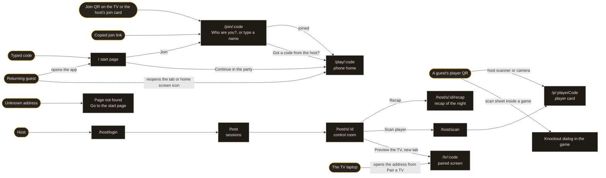

## 2. Guest phone

### 2.1 Start page and joining

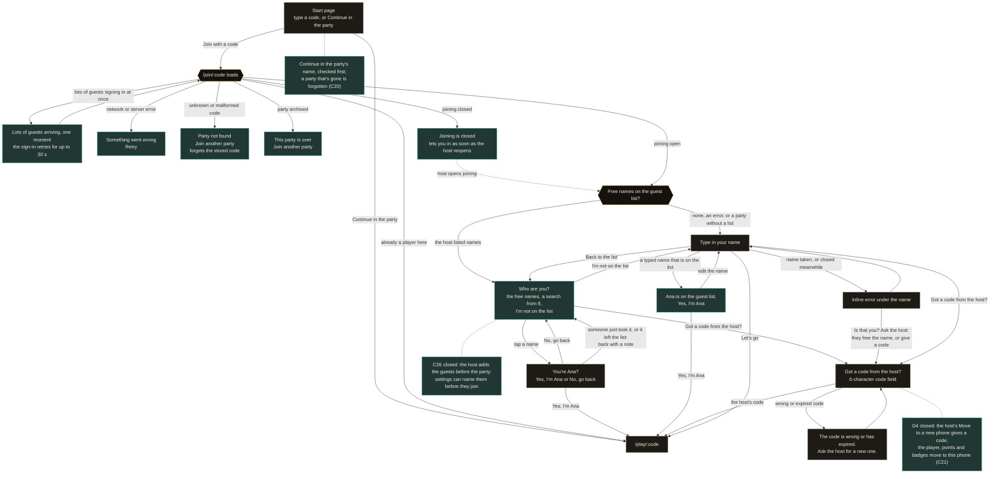

### 2.2 Phone home

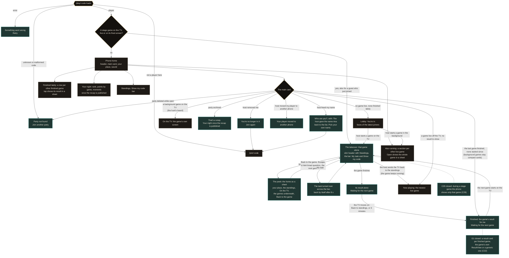

**The takeover** (26 Nov, the owner's ask: "when a game comes on, the
current showcased game on the screen should take over the phone screen, so
there is not too much overload of information on the phone screen"). While
a game made for the stage (the quiz, Participant fusion, Lydspor, an
in-person round) holds the TV, from its start to the end of its final
screen, the phone shows only that game under a slim header: the logo, the
party, Standings and the sound. Standings opens the rest of the home as the
peek, a sheet with your place and the standings first. The bar stays at the
foot with Show my code and, while the hunt runs underneath, a quiet
face-down "My task" that turns over to show the task and back by itself, so
a guest can try their task at any moment. Both step aside while a timed
question or a text field needs the screen. The hunt's moments still reach
the phone as toasts with their sounds, and a camera scan still opens its
sheet over the game. When the TV moves on, the home is back as it was, with
the game's result card on top. The rules are `phoneFocus`, `barSecret` and
`peekOpen` in [running.ts](../src/components/phone/running.ts); the look is
in [identity.md](identity.md#the-phone).

A guest in a team sees it under their place and on their code, and over a
game played in teams a line says how the team answers and who answered for it
(3.6).

Announcements from games show as toasts on every phone. Ones aimed at one player
replace the room-wide one and play one sound (the strongest of the batch). A
refused answer or move is a toast with the server's own words, from the game's
view.

### 2.3 Last one standing on the phone

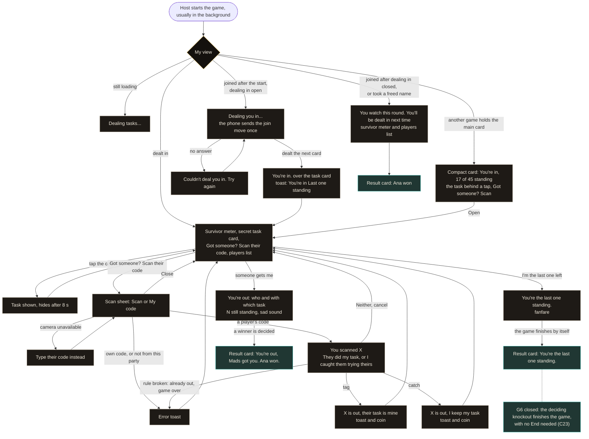

### 2.4 Player QR codes (/p/:playerCode)

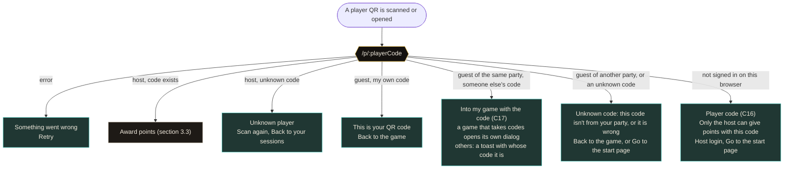

### 2.5 Lydspor on the phone

The flow as built from `.design/lydspor/spec.md`, section 4.

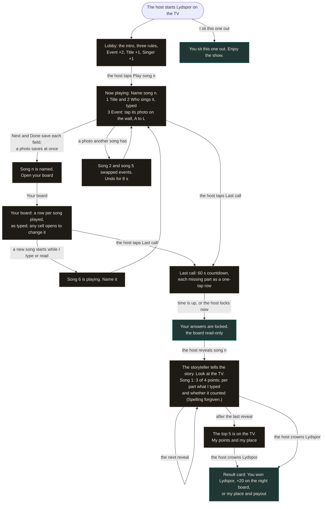

Everyone playing scores every song the same way, whoever is in its photo (the
in-photo rule and its own average are gone since 26 November). A guest sits
out when their name is on the host's "Doesn't play this game" list, matched
by name (case, accents and spaces never matter), not by the guest list.

Typed answers are saved when a field is left (Next, Done, another field, a
photo, the page going hidden, or the last call changing the screen under it),
never per letter. Spelling is forgiven on the
server at the lock, never judged on the phone, and nobody's typed answer ever
reaches another phone or the TV.

## 3. Host

The host pages are the same on a laptop and a phone. On a phone the header
buttons wrap under the title, a game's Start goes on top of its Settings when
they don't fit one line, and the join card moves to the bottom. The host pages load on
demand, so guests' phones never download them.

### 3.1 Login, sessions and the control room

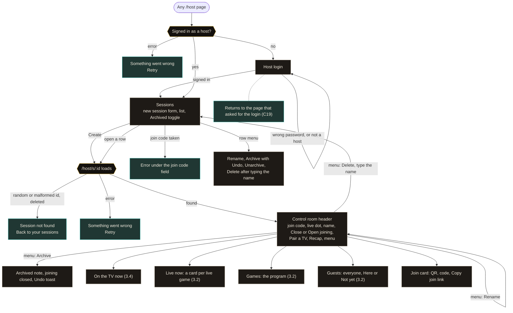

The live dot is teal while the page hears changes as they happen, and grey
("Catching up") while it reads every few seconds instead. A game's timer that
keeps failing to get through shows a warning above the live games: "Quiz's
timer isn't getting through. Use its buttons to move on by hand." The host
page sends each timer's sync 1.5 s after the TV would, as a backup.

### 3.2 Live games, the program and the guests

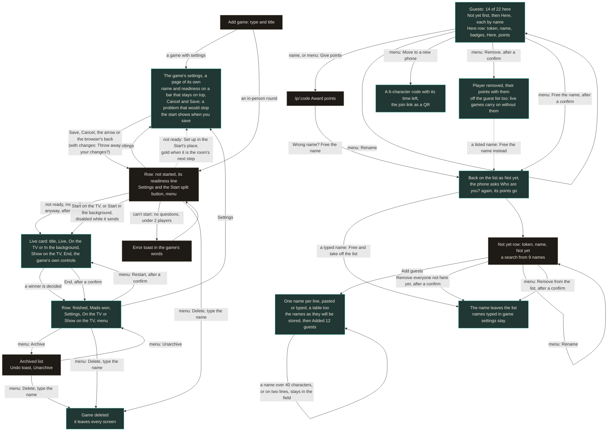

Every game's row says under its name whether the game is ready, from the
game's own rules (its `setupStatus` hook): "8 pictures, all with two
names", "6 of 8 songs ready: 2 need a photo", "12 tasks for 16 guests, so
some get the same task", "10 questions ready, 20 s each"; an in-person round
has nothing to set up. Settings sits on every row that has settings, beside
the Start (on a finished game, beside Show on the TV). A game that isn't
ready shows Set up in its Start's place, and that is the room's one gold
step when it is the next game, or, while no TV is paired, the first game
not ready: setting the games up comes before pairing the TV. Its start is
still in the menu as Start anyway, when the game's own check would start it
(fusion starts with pictures still without their two names, to be typed
with Show who). Fusion's row also counts the typed names that match nobody
here or on the guest list ("1 name matches nobody here or on the guest
list"), as its settings flag them, without making it not ready: a picture
may be of someone who never joins. A game added from the Games panel opens its settings at once.
Last one standing's default list has 60 tasks (it had 30): a game whose
saved list is shorter says so on its row ("30 tasks, enough for all 24
guests; the default list has 60"), and its settings open on a note, "This
game has 30 saved tasks. The default list has 60 party moments, so every
guest gets a task of their own, latecomers too.", with a `secondary`
**Reset to the 60 default tasks** in place of the small link beside the
count; then Save keeps them.

The settings are a page of their own (`?settings=<game id>`): the game's
name and its readiness, which changes as the host types, on a bar that
stays at the top with Cancel and Save, and the editor below it, full width
on a laptop and the whole screen on a phone. Save is gold once there is
something to save. Cancel, the arrow and the browser's back button (a
phone's back gesture) go back to the room at the place the host left it,
with the focus on the button that opened the page; with changes they ask
first, and a reload or a closed tab asks the browser's own question. A game
that starts from another device while its page is open closes it and says
so. Live games keep only what they change on the night in their own
controls (fusion's Show who, Lydspor's people and accepted answers): a
round's settings are frozen when it starts.

The Guests list sits under the join card on a laptop (on a phone, before
it): everyone on the guest list and anyone who joined without being on it,
"14 of 22 here" on top, and each name marked Here (a quiet check) or Not
yet (dimmer). Not yet comes first and Here after, each by name: the order
never jumps as guests arrive, the guests the host is waiting for stay on
top, and later only the few who never came are there. It follows the party
live, so a guest moves to Here as they tap their name. A guest who typed a
name that wasn't on the list says "Typed their name", often another
spelling of a name still Not yet. Before the party the host adds every
guest's name; a guest who joins taps theirs under Who are you?. The list
is a join helper and the attendance list, nothing more: game settings that
name people (fusion's "Who is in it?", Lydspor's "Doesn't play this game")
take typed names, with the list and the guests here only as suggestions so
the spelling matches. Free the name is for a guest who tapped the
wrong name, from their menu or the award page; for another spelling (Ulle
for Ulrik), Free and take off the list on Ulle. Remove also takes a guest
off the list, and its confirm offers Free the name for a listed name.
Remove everyone not here yet undoes a paste that went wrong. A name on the
list that never joins appears nowhere else; a fusion picture may still be of
them (or of anyone), since its people are typed names. The words of each
screen are in
[guest-list.md](guest-list.md), section 7.

Each live game has its own card, so its controls sit with its title and its End
(P2-4). The card of the game on the TV starts open, since its next
step is in it; a game in the background (Last one standing) starts closed.
The caret opens or closes a card, and a reload keeps it as the host left it,
in that browser. The game's own controls are its `HostView`: the quiz's one big button
for the next step and its answered count; fusion's one gold step (Ask the
next picture, Ask #1 from the lobby, Reveal now, Back to the wall, Crown the
face detective), its locked-in count, an Ask on every picture and who is in each
picture; Last one standing's who is still in and Deal in latecomers (on
until the time the settings give, 105 minutes after the start by default;
Close dealing in, and Open dealing in, which deals in everyone waiting);
Lydspor's Play song n, Last
call, Reveal song n with the close answers to accept (one tap counts an
answer for everyone who typed it, Undo takes it back) and Crown Lydspor.
Secrets (the quiz's
answers, fusion's people, the tasks) stay behind a Show toggle, because the
host's phone is out in the room. A game whose controls crash shows a note in
its card; Show on the TV and End keep working.

The split button starts a game the way it presents itself: the quiz,
Participant fusion, Lydspor and in-person rounds take the TV, Last one
standing runs in the background. The caret offers the other way.

Participant fusion on the stage, from the host's side:

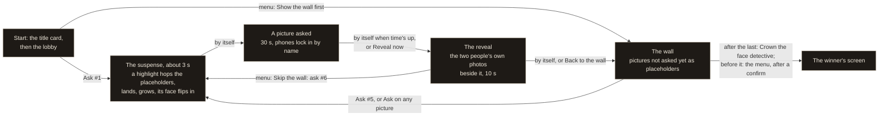

Changed on 26 November, after the owner played the demo: there is no
showing. A picture not asked yet is a placeholder on the wall (a drawn head
and shoulders with a "?"), and its image reaches no phone or TV until it is
asked. Asking it plays the suspense on the TV: a highlight hops across the
placeholders still to come, slowing with soft ticks, lands on the picture
asked, it grows to the middle, its "?" pulses and its face flips in with a
whoosh; the countdown starts after that, so nobody loses guessing time.
Phones say "Look at the TV." until then, then show the picker: names only,
no photos (everyone who joined and every name in the pictures, A to Z, never
their own), with a search over 16 names. Everyone guesses every picture and
scores on it, the two in it too.

A picture without its two people can't be asked: type them with Show who
first. Who is in a picture is two typed names (the guest list and the guests
here are suggestions, and each field says whether the name is here, on the
list but not here yet, or neither, so a misspelling shows); a picture may be
of someone who never joins. In the settings each person can have their own
photo; it stays secret until the reveal, where the TV and the phones show it
beside the picture, so the host types each name beside its photo. Without
one, the reveal shows the profile photo of the guest with that name, or a
token. Settings saved with guests' ids still start, as those guests' names.
A round started before the update (when fusion ran in the background) can't
go on: End it, then restart it, and its pictures and people are kept.

### 3.3 Scanning and points

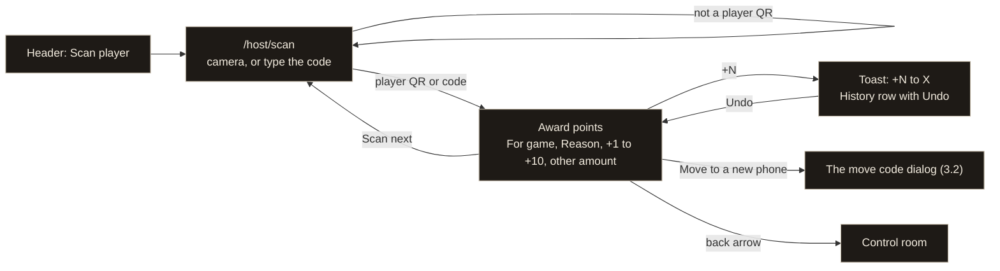

"For game" picks the game the host came from (`?game=<id>`, which Scan player
and Scan next carry along), else the game on the TV if it is live, else the
newest live game. The award page runs its own live session, so it works from
any player QR.

### 3.4 The TV from the host page

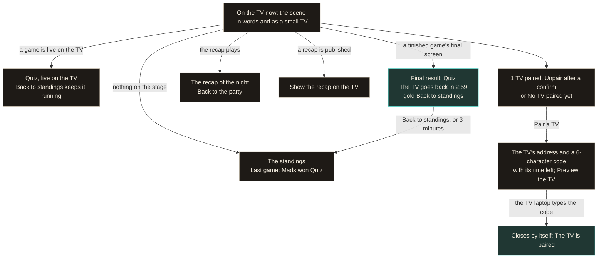

The TV is a paired screen, never a host: it reads exactly what a guest reads,
so nothing in the room can open the control room or read a secret. Show on the
TV on a finished game shows its final screen again for 3 minutes.

### 3.5 The recap of the night

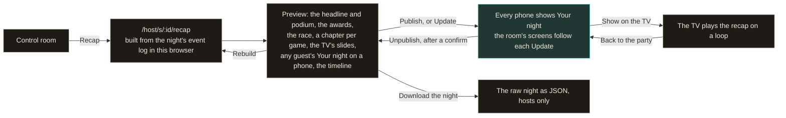

The recap can be built any time, also mid-party: a game still running gets a
chapter with only who leads, so publishing early never gives away a live task
or an answer. When more has happened since the last Publish, the page says so.
The page holds the loader until the night is in, then shows it whole; pressing
Recap in a control room opened before a deploy loads the new app straight onto
the recap.

### 3.6 Teams

A party can have teams. A team follows its guests all night, and some games
can be played in teams: then one answer from any member counts for the whole
team, so every member gets the points. The core does it, so games stay as
they are: each game opts in with `GameModule.teamPlay` (the quiz, Participant
fusion and Lydspor do; Last one standing and in-person rounds don't).

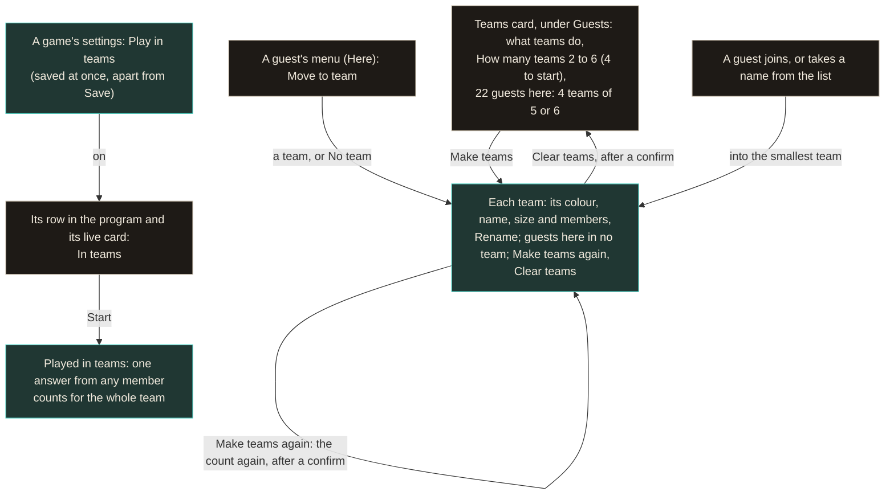

**The host.** Make teams splits the guests who are here at random into
balanced teams (sizes differ by one at most); guests still on the list go
into a team as they join. The teams are Team Gold, Team Pink, Team Teal, Team
Violet, Team Sky and Team Lime, in that order, and the host can rename each.
Make teams again shuffles everyone again: teams up to the new count keep
their names and colours. A guest who joins later, or takes their name from
the guest list, goes into the team with the fewest guests here (a tie goes to
the first team). Move to team in a guest's menu moves one guest, any time;
from their next answer they answer with their new team. A freed name comes
back on the list with no team. Making and clearing teams wait while a game
played in teams is live.

Play in teams is on a game's settings page, for games that can be played in
teams. It changes only while the game isn't live (before it starts, or
between rounds), so a round is played one way all through; while it is live
the switch says how it is played. Without teams it may still be switched on,
and says to make teams in Guests first: until there are teams, the game is
played alone.

**The phones.** A guest in a team sees it under their place on the phone
home and on their full-screen code: its colour and its name. Over a game
played in teams, a line says so: "Team Gold answers together. Any of you can
answer: the first answer counts for all of you." (the quiz and fusion, whose
answers lock), or "and the latest answer counts" (Lydspor, whose answers
change until the lock); under it, "Ana answered for your team." When a
teammate answers, every phone in the team shows the team's answer as its own:
locked in, or the typed title and the photo. A teammate who taps something
else after a final answer gets "Your team already answered", and the phone
shows the team's answer at once.

**The TV.** The standings stay each guest's own. While the game on the stage
is played in teams, the strap says so ("Question 3 of 10, played in teams"),
and the band has a Teams line with each team's points in this game (the most
any member has), when it has a line to spare.

**How it works.** `submit_answer` writes the same answer, with the same time,
for every member of the answering guest's team who is here
([engine-v2.md](engine-v2.md), 2.7, and the teams file
`supabase/migrations/20261127000000_teams.sql`). Each member's write keeps the
prompt's rules: open and before its deadline, a final prompt's first answer
locked for the whole team, at most 20 changes, and a prompt's `exclude_self`
checked for each member. Each member's phone gets its own ping. Scoring is
unchanged: each member simply has the answer, so the game scores each of them
as always, the quiz's speed points included. With team play off, or for a
guest in no team, nothing changes. One rule of a game still holds in teams:
in fusion a guest's own name never counts for them, so a member whose name
the team locks in scores less for that picture.

## 4. The TV

The TV laptop opens `/tv/:code`, a public page. It signs in anonymously and asks
to be paired; the host's own browser skips that with a small Host preview label.

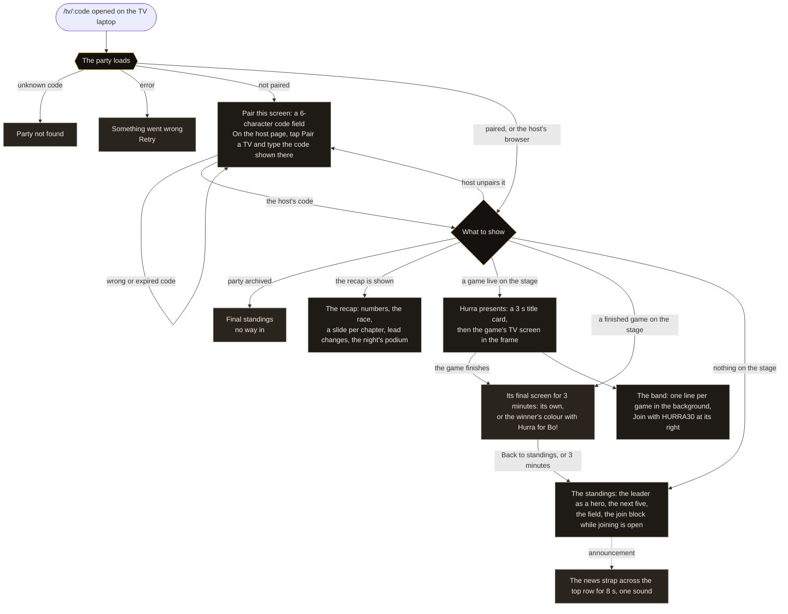

Every TV screen but the recap and the pairing screen stands in one on-air
frame ([identity.md, The TV's frame](identity.md#the-tvs-frame)) inside the 5
percent safe area: the programme strap at the top left (a tilted tab with
what is on, the hunt's in pink, and a paper strap with where it is, "Question
3 of 10"), the bug at the top right (the party's name, the time of night and
the logo), the stage at full width, and the band along the bottom with one
line per game running in the background, at most two (newer ones share "Also
running"), with "Join with HURRA30" at its right while a game holds the
stage.

Big news is a strap across the whole top row for 8 seconds, over the
programme strap and the bug, so it never covers the stage or the band; a
game's own news on its final screen only plays its sound. While a game holds
the stage, news from a game in the background is the band's event line, with
its time and no sound, except a winner, which gets the strap and its sound.
A strap that came up while the standings showed comes down when the host
starts a game on the TV (a knockout then moves to the band's Last one
standing line, without a second sound), so it never lies over the game's
title card and programme strap (26 Nov). Nothing crawls, there is no red, and the TV says a game's news without its
exclamation marks. Phones show the same news as a toast (the shared callout,
`src/components/Callout.tsx`): a square icon chip by its job, the title and
an optional detail line.

The corner, under the band outside the safe area, holds the full screen
button, the sound toggle ("Click for sound" while the browser blocks audio),
the picture toggle and the connection as a word, Live or Reconnecting. The
picture is Standard until someone picks Brighter picture there, for a TV
that shows the dark ground, its panels and the secondary text as black; the
TV then remembers it. The host can set it from the link too:
`/tv/HURRA30?picture=bright` on the TV laptop, or on Show the TV here's tab.

The standings fit any party: the leader's column (the hero, the next five
places and a line on how the last game moved the places) beside the field of
rows, measured in fit.ts (before anyone has scored the hero is the party's
name and "Nobody has scored yet", no guest, and everyone stands in A to Z
without a rank), with the join block under the field (the QR code on
paper, the code and the page's own address) or its short form, the code over
the address, when the rows need the room.

A game played in teams says so on the strap, and the band shows each team's
points in it (3.6).

Lydspor on the TV is silent from Play song 1 to the crown: while a song plays
it shows the wall of photos A to L and how many have typed a title, a singer
and a photo (never what); at each reveal the photo, the title, the singer and
the room's counts, which follow the host's accepts in place. A typed answer
never shows on the TV.

## 5. Errors, not found and the ways back

| Case | Phone | Host page | TV |
| --- | --- | --- | --- |
| Unknown or malformed code or id | Party not found, Join another party (forgets the stored code) | Session not found, Back to your sessions | Party not found |
| Party deleted while open | Party not found, Join another party | Session not found (or back to the list after deleting it there) | Party not found |
| Party archived | That's a wrap., with Your night once published; the join link says This party is over | Archived note | Final standings, or the recap if shown |
| Joining closed | Joining is closed, opens by itself when the host reopens | Joining is closed card, faded QR | No join card |
| Player removed | You're no longer in X, Join again | Row gone | Row gone |
| Player moved to another phone | Your player moved to another phone | Row stays, with its points | Row stays |
| Name freed by the host | Who are you?, with "The host gave the name Ana back to the list. Pick your own name." | Ana moves from Here to Not yet in the guests | Row gone |
| Name taken a moment before (Yes, I'm Ana) | Back to Who are you?, with "Someone just took Ana. If that's you, ask the host to free your name." | Not applicable | Not applicable |
| Game deleted (End it first if it is live) | It leaves the lists, its result card too | Row gone | Back to the standings if it was on the stage |
| A game's timer can't get through | Not applicable | A warning above the live games | Keeps trying, with backoff |
| Unknown player code | Unknown code, Back to the game | Unknown player, Scan again, Back to your sessions | Not applicable |
| Pairing code wrong or expired | Not applicable | Get a new code in Pair a TV | The code field says so |
| TV unpaired by the host | Not applicable | No TV paired yet | Back to its pairing screen by itself |
| First load fails | Something went wrong, Retry (friendly text when offline) | Same | Same |
| A reload fails while data is shown | Data stays; retries after 1 s, 2 s, 5 s, then every 10 s, and on coming back online | Same | Same |
| Pings stop arriving | Reads every 5 s until they come back | Live dot grey (Catching up), reads every 5 s | Live dot grey, reads every 5 s |
| Nothing answers for 15 s | This is taking longer than usual, Retry | Same | Same |
| Session refresh fails after sleep | Error with Retry; never a new anonymous player | Error with Retry | Error with Retry |
| Unknown address | Page not found, Go to the start page | Same | Same |

## 6. Gaps and dead ends

### Closed

| ID | Was | Now |
| --- | --- | --- |
| C1 | A wrong or malformed party code was a dead end | Party not found with Join another party |
| C2 | Joining is closed was a dead end and never updated | Updates live when the host reopens; Join another party |
| C3 | Continue in session X looped into a deleted party | The stored code is forgotten on Party not found |
| C4 | Archived party: phones said the next game starts soon; newcomers were told to ask the host to open it | That's a wrap., This party is over, and Final standings on the TV |
| C5 | A removed player kept a working phone home | You're no longer in X, Join again |
| C6 | A deleted game vanished silently | Toast on the phone, back to the lobby |
| C7 | Random, malformed or deleted ids showed the loader forever (host, TV) | Session not found with a way back |
| C8 | Errors had no way out | Something went wrong with Retry, friendly offline text |
| C9 | A failed reload replaced good data with an error | Data stays, retries with backoff and on coming back online |
| C10 | A stuck load spun forever | 15 s safety net with Retry |
| C11 | A failed session refresh signed the phone in as a new anonymous player (player and points lost) | Treated as an error with Retry |
| C12 | A double tap on Start dealt the game twice | Start, End and Restart are disabled while they send, and every call carries one request id, so a resent tap counts once |
| C13 | Host's unknown player code had only a text link | Scan again and Back to your sessions |
| C14 | My own QR code page had only a text link | Back to the game button |
| C15 | Two sounds at once (TV coin over the knockout sound, winner's phone) | One sound at a time with priorities |
| C16 | A browser that isn't signed in saw "Unknown code" for a real player code | "Player code" with Host login and Go to the start page |
| C17 | A camera scan of another player's QR during Last one standing was a dead end | A player of the same party goes into their game with the code; games that take codes (declared with `acceptsScans`) open their own dialog, others show whose code it is |
| C18 | Last one standing's TV tiles ran off the screen with 24 or more players, under the sound pill | Tiles pick the largest of four sizes that fits (checked with 8, 24 and 45 players at 1920x1080 and 1440x900); a gutter keeps the corner controls clear |
| C19 | Host login always landed on /host, not the TV or award link that asked for it | The login returns to the page that asked (same site only) |
| C20 | The start page offered Continue with a bare code, even for a party that was gone | It looks the party up first: "Continue in Nicolai's 30th", and forgets a party that's gone |
| C21 | G4: a guest on a new phone or browser couldn't get their player back | The host's Move to a new phone (player menu or award page) shows a 6-character code for 5 minutes (closing the dialog cancels it); on the new phone, Got a code from the host moves the player there with their points and badges, and the old phone says so |
| C22 | G1: no result on the phones or the TV once a game finished | A result card on every phone until the next game starts (the game's own `ResultView` or a generic one), a final screen on the TV for 3 minutes, and Finished lately rows for the others |
| C23 | G6: a decided game stayed Live until the host pressed End | A game finishes itself (`isFinished`) in the same save as the deciding move; End is still there for ending early |
| C24 | G9: with two in-person rounds live, a round's Scan a player opened the award page with the stage game or the newest live game picked | The round's Scan a player sends its own game id (`?game=<id>`), which the scanner carries to the award page |
| C25 | An old phone that slept through its player's move woke to "You're no longer in X" | The snapshot says the player moved, so it shows "Your player moved to another phone" with Join with a new name |
| C26 | Fusion's pictures could only name guests who had joined, so the host couldn't set the game up before the party | The guest list ([guest-list.md](guest-list.md)): the host adds every name before the party, a guest taps theirs under Who are you?, and settings can name guests still expected |
| C27 | A game's settings, where the host spends most of the time before the party, opened only from its row's menu, inline in the Games panel | Settings on every row, a readiness line from each game's own rules (`setupStatus`), Set up as the room's next step while a game isn't ready, and the settings as a page of their own with Cancel and Save always in reach (3.2) |
| C28 | The host couldn't see at a glance who had signed in: joined guests were in Players and the rest in the Guest list card under Still expected | One Guests list with "14 of 22 here" on top and every name marked Here or Not yet, live as guests join (3.2) |
| C29 | During a stage game the phone stacked the game, your place, On the TV, every background game, what finished lately and the standings: too much to read while watching the TV | The takeover: the stage game alone under a slim header, Standings opens the rest as a sheet, and the bar keeps Show my code and the hunt's task one tap away (section 2.2) |

### Open, in priority order

None. What is left is in section 8.

## 7. Winner decided, then finished

Built in engine v2. The core only knows a game's lifecycle (not started, live,
finished) and who finished it: the game itself or the host. A finished game
comes with a final screen for the TV and a result for each phone, both drawn by
the game. The core decides when they show, never what is in them. Several games
can be live at once: one on the TV stage, the others in the background.

### 7.1 Game lifecycle

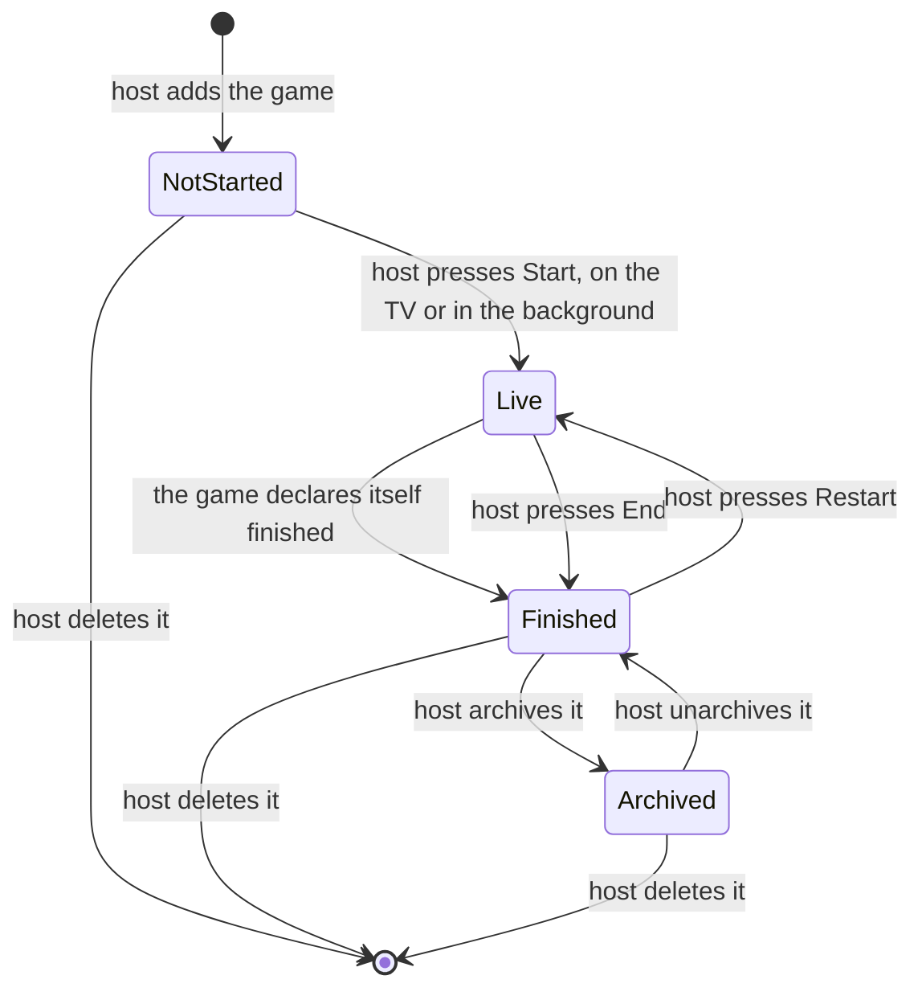

### 7.2 What the TV shows

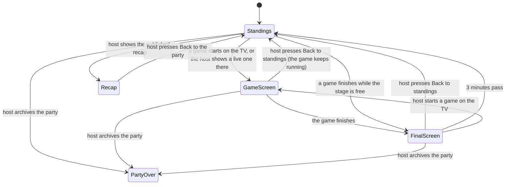

A game that finishes takes the stage when it is free (nothing on it, or a
finished game whose 3 minutes are over) or already its own. When another game
is live on the stage, the TV's rail shows a Finished chip instead, and the host
can put it on the TV.

### 7.3 The winning move

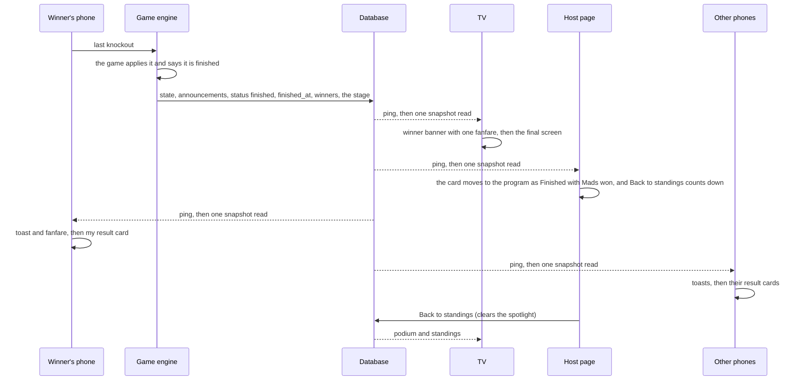

### 7.4 Each screen, from the winning move to the next game

| Moment | Host page | TV | Phones that played | Others |
| --- | --- | --- | --- | --- |
| The winning move | The card shows the winner | The game's screen shows the winner and one fanfare; a game in the background gets the news strap | Winner: toast and fanfare. Last one out: out state, sad sound | Toast |
| Finished, a moment later | The card moves to Games as Finished, with Mads won and On the TV (or Show on the TV). On the TV now says Final result with a gold Back to standings and "The TV goes back in 2:59" | If it held the stage or the stage was free: the final screen. If another game holds the stage: the news strap, and a Finished chip beside the standings later | The main card turns into the result card; games live in the background stay compact cards. A stage game's takeover shows its result alone while the TV shows the final screen. If another game is live on the TV: a Finished lately row | The generic result card or row |
| Back to standings, or 3 minutes | The countdown goes away | The standings with "Last game: Mads won X" | The takeover ends with the TV and the home comes back, the result card on top until the next game | No change |
| The host starts a game on the TV | That game is live and on the TV | The title card, then its screen | A stage game takes the phone over (section 2.2); a background game's card becomes main. Whatever the guest had open in the game that had the main card, or in a section of the home (such as a knockout being confirmed), stays on top until they finish | Same |
| The host restarts the finished game | Live again, a new round | Its screen if it takes the TV | Dealt in again | Dealt in |
| The host archives the party | Archived note | Final standings, or the recap if shown | That's a wrap., Your night when published | Same |

Why 3 minutes: long enough for the room to cheer, read the top hunters and take
photos, short enough that a forgotten final screen never hides the standings for
the rest of the night. The host's next action always wins straight away. The 3
minutes count from when the game finished or was put on the TV, whichever is
later, so Show on the TV on a finished game shows its final screen again.

Ending early works the same way: when the host presses End, the game is finished
by the host. The final screen shows how it stood (for example "3 still
standing") together with the game's End announcement.

### 7.5 How the core does it

- **Finishing.** After every change the engine asks the game whether it is
  finished (`isFinished`). If it is, the same save runs `onEnd(..., 'game')`
  and sets status `finished`, `finished_at`, `finished_by = 'game'` and the
  winners (by default the top of this round's points, nobody when the top is
  0). End sets `finished_by = 'host'`.
- **The stage.** `sessions.spotlight_game_id` and `spotlight_at` (set by the
  database whenever the spotlight changes). Starting a game on the TV takes the
  stage; finishing takes it when it is free; Back to standings clears it;
  archiving or deleting the spotlit game clears it. Clients compute the 3
  minutes from `max(finished_at, spotlight_at)` by the database clock, so every
  screen agrees without a server timer.
- **Game screens.** A game may bring a `FinalTvView` for the TV (else its
  `TvView` with `finished`, else a generic winners screen) and a `ResultView`
  for phones (else "Mads won X" and my points).
- **Edge cases.** A TV opened later shows the final screen only inside the 3
  minutes. Several TVs agree, since they read the same data. Restart starts a
  new round and its points start over; points the host gave by hand stay.

## 8. Remaining work

Effort: XS under 30 minutes, S 1 to 2 hours, M half a day, L a day or more.
Every item is frontend only unless it says otherwise.

### P1

| # | Problem | Proposed fix | Files | Effort |
| --- | --- | --- | --- | --- |
| P1-1 (done) | G3: a browser that isn't signed in (a fresh phone, or a host whose login expired) sees "Unknown code" for a real player code, with no way to log in. Introduced in the checkpoint batch | With no user, show "X's player code" or "Player code", "Only the host can give points with this code", with Host login (returning here after login, see P2-1) and Go to the start page | `src/pages/PlayerCard.tsx` | XS |
| P1-2 (done) | G5: Last one standing's TV tiles have two fixed sizes and no fit logic. 24 players at 1440x900 run off the bottom, and the sound pill covers the last row. 45 players on a 1080p TV don't fit either | Measure the space left and pick the largest tile size that fits; players still in first; a bottom gutter for the corner controls. Checked with 8, 24 and 45 players at 1920x1080 and 1440x900 | `src/games/elimination/TvView.tsx`, `src/pages/host/Scoreboard.tsx`, `src/lib/useElementSize.ts` | M |
| P1-3 (done) | G1 and G6: a decided game stays Live until End; after End the phones drop to the lobby with no result and the TV jumps straight to the standings | Engine v2: `isFinished`, `finished_at` and `finished_by`, the spotlight with its 3 minutes, `ResultView` and `FinalTvView`, the result card on phones, the final screen on the TV, and On the TV now with Back to standings and its countdown on the host page (section 7) | engine v2 | M |
| P1-4 (done) | G2: during Last one standing, a camera scan of another player's QR lands on "Only the host can give points with this code", but the guest wanted to knock that player out | For a signed-in player of the same party, `/p/:code` sends them to `/play/:joinCode?scanned=CODE`; a game that accepts scans opens its own dialog | `src/pages/PlayerCard.tsx`, `src/pages/Play.tsx`, `src/games/types.ts`, `src/games/elimination/PlayerView.tsx` | S |

### P2

| # | Problem | Proposed fix | Files | Effort |
| --- | --- | --- | --- | --- |
| P2-1 (done) | G7: login always lands on /host, so a TV opening its scoreboard link, or a host scanning a code after the login expired, has to find the page again | Remember where the login was asked for and go back there afterwards | `src/pages/host/RequireHost.tsx`, `src/pages/host/HostLogin.tsx` | XS |
| P2-2 (done) | G4: a guest on a new phone or browser finds their name taken and can't get their player back; the host can only remove them, which loses the points | Move to a new phone on the host page and the award page: a one-time code the guest types on the join page under Got a code from the host. `host_issue_transfer` and `claim_player` in the database | `src/components/host/MovePlayerDialog.tsx`, `src/pages/Join.tsx`, the v2 init file | M |
| P2-3 (done) | Status badges show database words in lower case: pending, active, finished, open, closed, archived; the award page says "(live)" | A shared StatusBadge: Not started, Live, Finished, Open, Closed, Archived | `src/components/StatusBadge.tsx` | S |
| P2-4 (done) | The live game's panel sits above the list, apart from its own row and End button | Each live game has its own card: title, where it shows, Show on the TV, End and its controls together | `src/components/host/LiveGameCard.tsx` | S |
| P2-5 (done) | Restart is gold like Start although it resets the game's points, and its confirm text was wrong for in-person rounds | Restart moved into the finished game's menu, with a confirm: "It starts again and its points start over. Points you gave by hand stay." | `src/components/host/GamesPanel.tsx` | XS |
| P2-6 (done) | Tap targets under 40 px on phones | Dialog actions default to lg; row icon buttons at least 32 px; host navigation lg | `src/components/ui/alert-dialog.tsx`, the host pages | S |
| P2-7 (partly done) | Repeated UI: each game drew its own "Now playing" header; small uppercase labels exist in three styles in several places; the phone's QR overlay re-implements PlayerQr | Done: games draw their content only, and the phone and TV draw the card and its header (engine v2, section 6). Left: a shared Eyebrow label, and the overlay using PlayerQr | new `src/components/Eyebrow.tsx`, `src/components/PlayerQr.tsx` | S |
| P2-8 (done) | Host forms: a taken join code shows a toast instead of an error under the field; the "RANDOM" placeholder looks like a typed value; the add-game title field repeats the select's text and has no label | Inline error on the field; placeholder styling as in the scanner's code field; placeholder "Title (optional)" | `src/pages/host/HostHome.tsx`, `src/components/host/GamesPanel.tsx` | XS |
| P2-9 (done) | G8: the start page says "Continue in session G52513" and only finds out the party is gone after the tap; guest copy mixes "session" and "party" | Look the party up on the start page: "Continue in Nicolai's 30th", forget it if it's gone; say "party" to guests | `src/pages/Home.tsx` | S |
| P2-10 (done) | The host scanner is a black box until the camera starts, and its heading is smaller than on other host pages | "Starting camera" state over the video; same heading size as the other host pages | `src/components/QrScanner.tsx`, `src/pages/host/Scan.tsx` | XS |
| P2-11 (done) | G9: with two in-person rounds live, the award page can't tell which one the host scanned from | The award page and Scan player take `?game=<id>`; the round's Scan a player link sends its own game id | `src/games/in-person/HostView.tsx` | XS |
| P2-12 | On the TV at 1440x900 with 45 guests, Last one standing's final screen beside the rail squeezes its tiles into small chips without avatars, because its own Top hunters column keeps its 24rem | Move that column under the tiles when the game's area is narrower than about 1100 px, or slim the rail on final screens | `src/games/elimination/TvView.tsx` | S |
| P2-13 | Phones download every game's host controls and settings editors with the app: the main chunk is 980 kB (277 kB gzipped) | Load each game's `HostView` and `ConfigEditor` lazily, as the TV views already are, with a Suspense fallback in the host's game card and settings | the four `src/games/*/index.ts`, `src/components/host/LiveGameCard.tsx`, `src/components/host/GameSettings.tsx` | S |

### Smaller polish (P3, done)

- The two confirm dialogs share one layout, and Confirm also opens from a menu.
- Default tasks use curly inner quotes: “Get someone to say ‘ribbit’ like a frog”.
- The host login page has the logo and a "Join the party" link back to the start page.
- Party, game and player names can be changed from their menus.
