# User flows

Every screen of the party app and how people get between them: guests on their
phones, the host on a laptop or phone, and the TV. Each diagram marks the gaps
and dead ends found in the UX audit, and whether they are closed or still open.
Section 7 proposes the flow from "a winner is decided" to "finished", and
section 8 lists the remaining work with fixes, files and effort.

Describes the app as of the checkpoint batch (sound pass, loader, not found and
error states, live query fixes). Routes are listed in the README.

## Legend

- Grey boxes are screens, hexagons are loading or routing decisions.
- **Teal** (`closed`): a gap that is closed, with how.
- **Red** (`open`): a gap or dead end that is still open (see section 6).
- **Gold, dashed** (`proposed`): proposed behavior, not built yet.
- Every page that loads by id or code goes through one shared gate
  (`src/components/QueryGate.tsx`): the loader while it loads, a not-found
  screen with a way back, or "Something went wrong" with Retry. The loader is
  one overlay for the whole app (`src/lib/loader.ts`): at least 1.5 s on first
  open, nothing for quick loads inside the app, at least 600 ms once visible,
  and "This is taking longer than usual" with Retry after 15 s.

## 1. Entry points

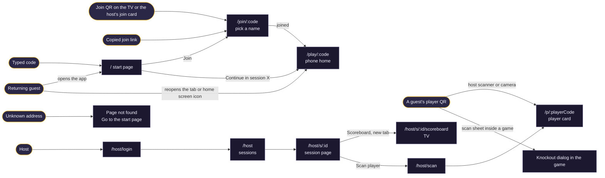

## 2. Guest phone

### 2.1 Start page and joining

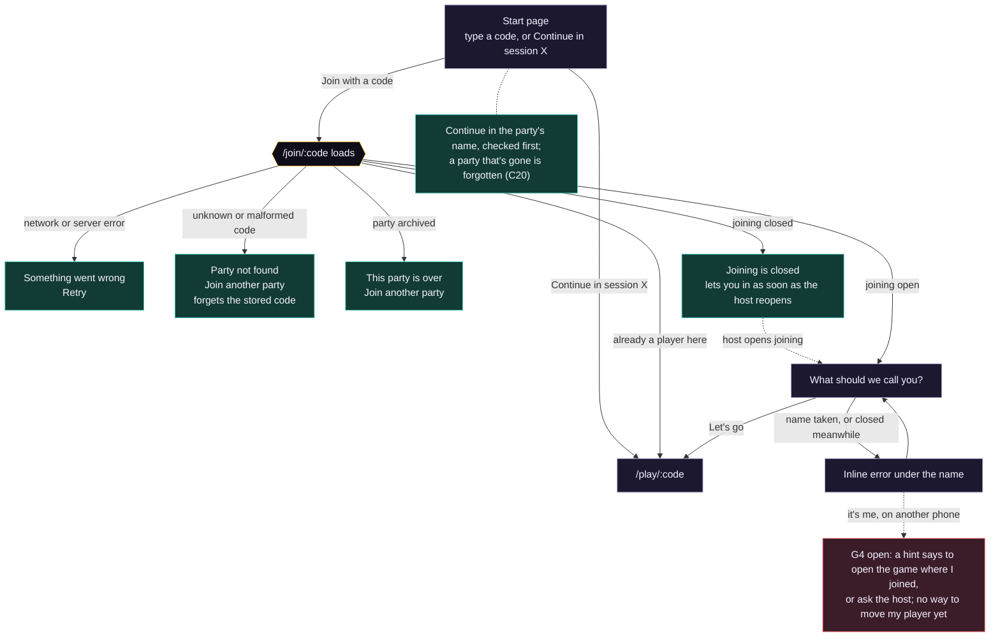

### 2.2 Phone home

```mermaid
flowchart TD
  classDef screen fill:#1b1830,stroke:#a9a3c7,color:#f5f3ff
  classDef gate fill:#0f0d1a,stroke:#f5c542,color:#f5f3ff
  classDef closed fill:#123b36,stroke:#4fd1c5,color:#f5f3ff
  classDef open fill:#3b1d2a,stroke:#ff6b6b,color:#f5f3ff

  P0{{"/play/:code loads"}}:::gate
  P0 -- "unknown or malformed code" --> NF["Party not found<br/>Join another party"]:::closed
  P0 -- "error" --> ER["Something went wrong<br/>Retry"]:::closed
  P0 -- "not a player here" --> JOIN["/join/:code"]:::screen
  P0 -- "player" --> PH["Phone home<br/>avatar, name, badges, sound, points"]:::screen
  PH --> S{"Party and game"}:::gate
  S -- "no live game" --> LOBBY["Lobby: You're in!<br/>standings, Show my code bar"]:::screen
  S -- "game live" --> LIVE["Game card: Now playing<br/>the game's own screen"]:::screen
  S -- "party archived" --> WRAP["That's a wrap!<br/>final standings, no code bar"]:::closed
  S -- "party deleted while open" --> NF
  S -- "host removed me" --> REM["You're no longer in X<br/>Join again"]:::closed
  REM --> JOIN
  LOBBY -- "host starts a game" --> LIVE
  LOBBY -- "Show my code" --> QR["Full-screen QR<br/>tap anywhere to close"]:::screen
  QR --> LOBBY
  LIVE -- "host deletes the game" --> DEL["Toast: The host removed X<br/>back to the lobby"]:::closed
  DEL --> LOBBY
  LIVE -- "game ends" --> ENDED["Lobby again, plus the game's announcement toast"]:::screen
  ENDED -.- G1["G1 open: no result on the phone after a game<br/>(proposal in section 7)"]:::open
```

Announcements from games show as toasts on every phone. Ones aimed at one player
replace the room-wide one and play one sound (the strongest of the batch).

### 2.3 Last one standing on the phone

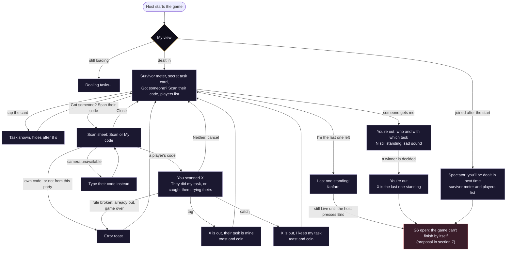

### 2.4 Player QR codes (/p/:playerCode)

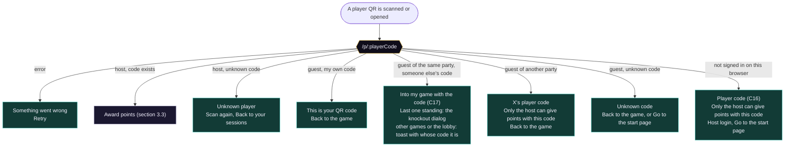

## 3. Host

The host pages are the same on a laptop and a phone. On a phone the header
buttons wrap under the title, the join card moves to the bottom, and rows wrap.

### 3.1 Login, sessions and the session page

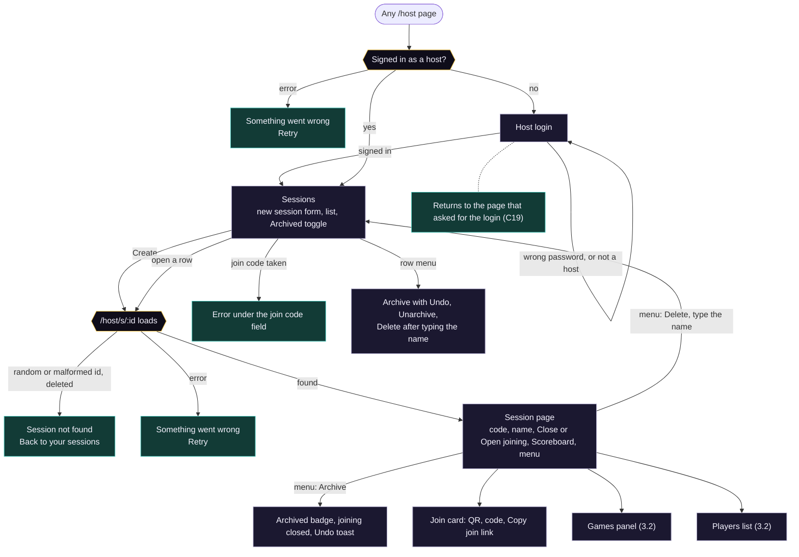

### 3.2 Games panel and players

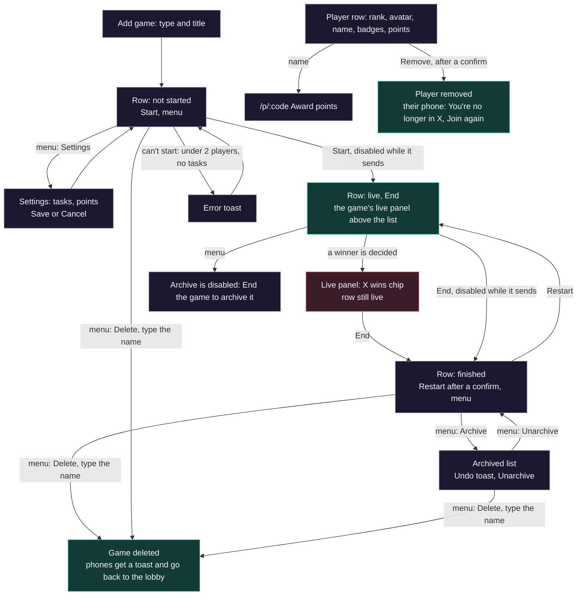

### 3.3 Scanning and points

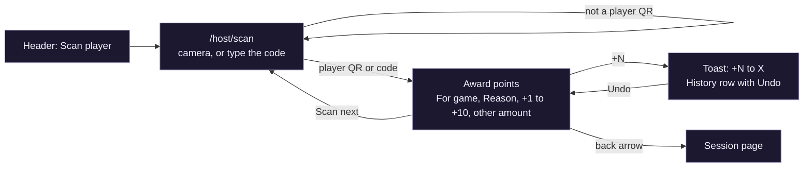

## 4. TV scoreboard

The scoreboard is a host page: the TV's browser has to be signed in as a host.

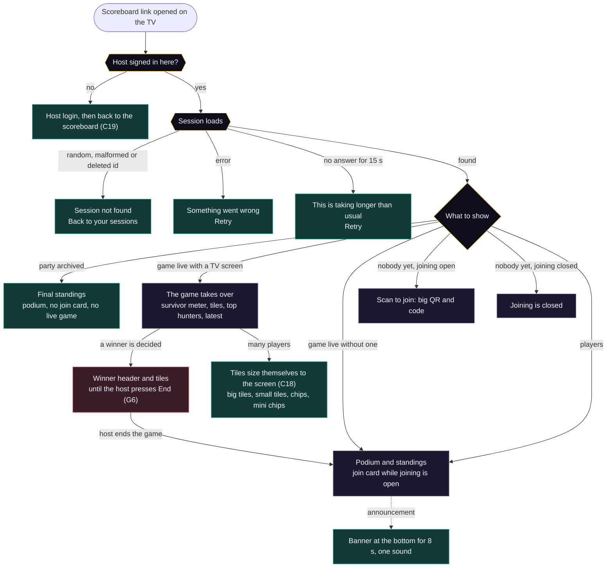

Announcements on the TV and the toasts on phones are one shared callout
(`src/components/Callout.tsx`) at two sizes: a tone border, the icon in a tinted
circle, the game's title as a small eyebrow (TV), the title and an optional
detail line. On the TV it springs up above the corner gutter and a thin bar in
its tone drains over the 8 seconds it shows; with reduced motion it only fades.

The corner holds the full screen button and the sound toggle, in a gutter below
the board so they never cover it. While the browser still blocks audio, the
toggle is a small "Click for sound" pill. The plain standings fit the same way:
three row sizes, and a compact podium once a party has more than 27 players.
During Last one standing the players still in come first, then those who are out,
latest first; each knockout slides one tile from the first group to the second.

## 5. Errors, not found and the ways back

| Case | Phone | Host page | TV |
| --- | --- | --- | --- |
| Unknown or malformed code or id | Party not found, Join another party (forgets the stored code) | Session not found, Back to your sessions | Session not found, Back to your sessions |
| Party deleted while open | Party not found, Join another party | Session not found (or back to the list after deleting it there) | Session not found |
| Party archived | That's a wrap! with final standings; the join link says This party is over | Archived badge | Final standings |
| Joining closed | Joining is closed, opens by itself when the host reopens | Joining is closed card, faded QR | No join card; empty board says Joining is closed |
| Player removed | You're no longer in X, Join again | Row gone | Row gone |
| Game deleted while live | Toast, back to the lobby | Row gone | Back to the standings |
| Unknown player code | Unknown code, Back to the game | Unknown player, Scan again, Back to your sessions | Not applicable |
| First load fails | Something went wrong, Retry (friendly text when offline) | Same | Same |
| A reload fails while data is shown | Data stays; retries after 1 s, 2 s, 5 s, then every 10 s, and on coming back online | Same | Same |
| Nothing answers for 15 s | This is taking longer than usual, Retry | Same | Same |
| Session refresh fails after sleep | Error with Retry; never a new anonymous player | Error with Retry | Error with Retry |
| Unknown address | Page not found, Go to the start page | Same | Same |

## 6. Gaps and dead ends

### Closed

| ID | Was | Now |
| --- | --- | --- |
| C1 | A wrong or malformed party code was a dead end | Party not found with Join another party |
| C2 | Joining is closed was a dead end and never updated | Updates live when the host reopens; Join another party |
| C3 | Continue in session X looped into a deleted party | The stored code is forgotten on Party not found |
| C4 | Archived party: phones said the next game starts soon; newcomers were told to ask the host to open it | That's a wrap!, This party is over, and Final standings on the TV |
| C5 | A removed player kept a working phone home | You're no longer in X, Join again |
| C6 | A deleted game vanished silently | Toast on the phone, back to the lobby |
| C7 | Random, malformed or deleted ids showed the loader forever (host, TV) | Session not found with a way back |
| C8 | Errors had no way out | Something went wrong with Retry, friendly offline text |
| C9 | A failed reload replaced good data with an error | Data stays, retries with backoff and on coming back online |
| C10 | A stuck load spun forever | 15 s safety net with Retry |
| C11 | A failed session refresh signed the phone in as a new anonymous player (player and points lost) | Treated as an error with Retry |
| C12 | A double tap on Start dealt the game twice | Start, End and Restart are disabled while they send |
| C13 | Host's unknown player code had only a text link | Scan again and Back to your sessions |
| C14 | My own QR code page had only a text link | Back to the game button |
| C15 | Two sounds at once (TV coin over the knockout sound, winner's phone) | One sound at a time with priorities |
| C16 | A browser that isn't signed in saw "Unknown code" for a real player code | "Player code" with Host login and Go to the start page |
| C17 | A camera scan of another player's QR during Last one standing was a dead end | A player of the same party goes into their game with the code; games that take codes (declared with `acceptsScans`) open their own dialog, others show whose code it is |
| C18 | Last one standing's TV tiles ran off the screen with 24 or more players, under the sound pill | Tiles pick the largest of four sizes that fits (checked with 8, 24 and 45 players at 1920x1080 and 1440x900); a gutter keeps the corner controls clear |
| C19 | Host login always landed on /host, not the TV or award link that asked for it | The login returns to the page that asked (same site only) |
| C20 | The start page offered Continue with a bare code, even for a party that was gone | It looks the party up first: "Continue in Nicolai's 30th", and forgets a party that's gone |

### Open, in priority order

| ID | Gap | Where | Section 8 item |
| --- | --- | --- | --- |
| G6 | A decided game stays Live until the host presses End | Host, TV, phones | P1-3, section 7 |
| G1 | No result on the phones or the TV once a game is finished | Phones, TV | P1-3, section 7 |
| G4 | A guest on a new phone or browser can't get their player back (the taken-name error now says to open the game where they joined, or ask the host) | /join/:code | P2-2, needs a database function |

## 7. Proposal: winner decided, then finished

The core only knows a game's lifecycle (not started, live, finished) and who
finished it: the game itself or the host. A finished game may come with a final
screen for the TV and a result for each phone, both drawn by the game. The core
decides when they show, never what is in them.

### 7.1 Game lifecycle

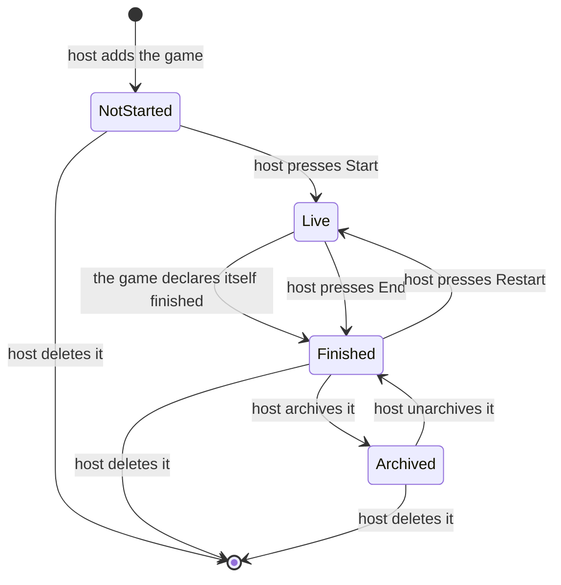

### 7.2 What the TV shows

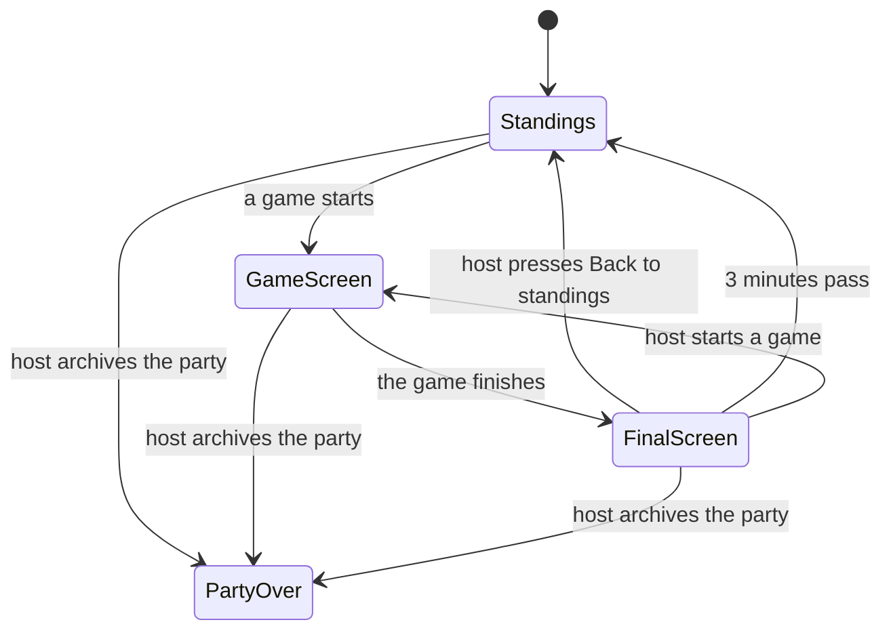

### 7.3 The winning move

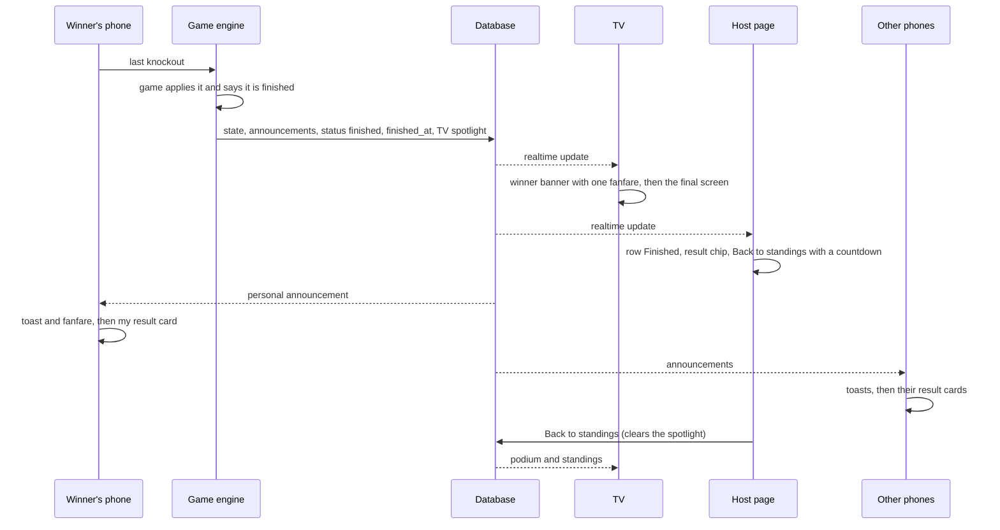

### 7.4 Each screen, from the winning move to the next game

| Moment | Host page | TV | Players who were dealt in | Spectators and late joiners |
| --- | --- | --- | --- | --- |
| The winning move | Live panel shows the winner chip | The game's screen shows the winner; banner with one fanfare | Winner: toast and fanfare. Last one knocked out: out state, sad sound. Others: toast | Toast |
| Finished, a moment later | Row flips to Finished with the result chip. A gold Back to standings button with a countdown (the TV goes back in 2:59). The next game's Start becomes the gold button; Restart moves to the menu | Final screen: header "Final result: Last one standing" instead of Now playing; the game's final screen; a slim strip with the top 5 of the day | The game card turns into a Finished card: the game's own result for me (for example "You won" with the crown badge, or "Mads won. Sofie caught you"), then "Waiting for the next game". Standings show the new points | Finished card with "Mads won Last one standing", no personal result |
| Host presses Back to standings | Button goes away, row stays Finished | Podium and standings. Header line "Last game: Mads won Last one standing" until the next game starts | No change: the result stays until the next game | No change |
| 3 minutes without a host action | Countdown ends, button goes away | Back to the standings by itself, same header line | No change | No change |
| Host starts the next game | That row goes Live | The next game's screen, or the standings, right away | The next game replaces the result | Dealt in |
| Host restarts the same game | Row goes Live | Game screen | Game screen | Dealt in |
| End of the night: host archives the party | Archived badge | Final standings (already built) | That's a wrap! (already built) | Same |

Why 3 minutes: long enough for the room to cheer, read the top hunters and take
photos, short enough that a forgotten final screen never hides the standings for
the rest of the night. The host's next action always wins straight away.

Ending early works the same way: when the host presses End, the game is finished
by the host. The final screen shows how it stood (for example "3 still
standing") together with the game's onEnd announcement.

### 7.5 What the core needs (for the engine design)

- **Finishing.** After each move the engine asks the game whether it is
  finished (for example an optional `isFinished(state, info)`, or a
  `ctx.finish()` effect). If it is, the same save sets status `finished`,
  `finished_at` and `finished_by = 'game'`. Host End sets `finished_by = 'host'`
  and runs `onEnd` as today. No extra announcement at finish: the winning move
  already announced it, and a second sound would clash.
- **`finished_at`.** Today a phone can't tell which finished game is the latest.
  With this column the phone's result card and the TV's "Last game" line use
  the game that finished last.
- **TV spotlight.** A nullable `spotlight_game_id` on the session. It is set
  when a game finishes, cleared by the host's Back to standings, and replaced
  when another game starts, is archived or is deleted. The TV shows the final
  screen while the spotlight is that game and less than 3 minutes have passed
  since `finished_at`. Clients compute the 3 minutes, so no server timer is
  needed and every TV agrees.
- **Game screens (optional).** A `FinalTvView` for the TV (or the existing
  `TvView` with a `finished` prop) and a `ResultView` for phones, both fed the
  final public state and the player's own view. Without them the core shows the
  game's title, "Finished" and its last room-wide announcement.
- **Edge cases.** A TV opened later shows the final screen only inside the
  3 minutes. Several TVs agree, since they all read the same data. Restart,
  archive and delete clear the spotlight. Late joiners only get the generic
  "Mads won" line.

## 8. Remaining work after the deploy

Effort: XS under 30 minutes, S 1 to 2 hours, M half a day, L a day or more.
Every item is frontend only unless it says otherwise.

### P1

| # | Problem | Proposed fix | Files | Effort |
| --- | --- | --- | --- | --- |
| P1-1 (done) | G3: a browser that isn't signed in (a fresh phone, or a host whose login expired) sees "Unknown code" for a real player code, with no way to log in. Introduced in the checkpoint batch | With no user, show "X's player code" or "Player code", "Only the host can give points with this code", with Host login (returning here after login, see P2-1) and Go to the start page | `src/pages/PlayerCard.tsx` | XS |
| P1-2 (done) | G5: Last one standing's TV tiles have two fixed sizes and no fit logic. 24 players at 1440x900 run off the bottom, and the sound pill covers the last row. 45 players on a 1080p TV don't fit either | Measure the space left (the ResizeObserver hook the standings already use, moved to `src/lib`) and pick the largest tile size that fits: big tiles, small tiles, or compact chips (avatar and name in a row, about 48 px, up to 6 columns; 45 players take 8 rows). Order players still in first, so those who are out are the ones cut if it is ever too tight. Give the board a bottom gutter, or move full screen and sound into the header, so the corner never covers content. Check 8, 24 and 45 players at 1920x1080 and 1440x900, and the plain standings with 45 too | `src/games/elimination/TvView.tsx`, `src/pages/host/Scoreboard.tsx`, new `src/lib/useElementSize.ts` | M |
| P1-3 | G1 and G6: a decided game stays Live until End; after End the phones drop to the lobby with no result and the TV jumps straight to the standings | Section 7. Frontend part: optional `ResultView` and `FinalTvView` in the game module, a Finished card on the phone, the TV final screen with the spotlight rules, and the host's Back to standings with a countdown. The engine and database part is yours | `src/games/types.ts`, `src/pages/Play.tsx`, `src/pages/host/Scoreboard.tsx`, `src/pages/host/HostSession.tsx`, new `src/games/elimination/ResultView.tsx`, `src/games/elimination/index.ts`; engine and migration on your side | M frontend, after the engine |
| P1-4 (done) | G2: during Last one standing, a camera scan of another player's QR lands on "Only the host can give points with this code", but the guest wanted to knock that player out | For a signed-in player of the same party, `/p/:code` sends them to `/play/:joinCode?scanned=CODE`. The phone passes the code to the live game if its module declares that it accepts scans; Last one standing opens its knockout dialog, as if scanned in the scan sheet. Otherwise a toast says whose code it is | `src/pages/PlayerCard.tsx`, `src/pages/Play.tsx`, `src/games/types.ts`, `src/games/elimination/PlayerView.tsx`, `src/games/elimination/index.ts` | S |

### P2

| # | Problem | Proposed fix | Files | Effort |
| --- | --- | --- | --- | --- |
| P2-1 (done) | G7: login always lands on /host, so a TV opening its scoreboard link, or a host scanning a code after the login expired, has to find the page again | Remember where the login was asked for and go back there afterwards | `src/pages/host/RequireHost.tsx`, `src/pages/host/HostLogin.tsx` | XS |
| P2-2 (copy done) | G4: a guest on a new phone or browser finds their name taken and can't get their player back; the host can only remove them, which loses the points | Short term: the taken-name error adds "If that's you on another phone, ask the host". Proper fix: the host's award page offers Move to a new phone, which shows a one-time code; the guest types it on the join form to take over the player. Needs a database function | `src/pages/Join.tsx`, `src/pages/host/AwardPoints.tsx`, a migration on your side | XS, then M |
| P2-3 (done) | Status badges show database words in lower case: pending, active, finished, open, closed, archived; the award page says "(live)" | A shared StatusBadge: Not started, Live, Finished, Open, Closed, Archived | new `src/components/StatusBadge.tsx`, `src/pages/host/HostSession.tsx`, `src/pages/host/HostHome.tsx`, `src/pages/host/AwardPoints.tsx` | S |
| P2-4 | The live game's panel sits above the list, apart from its own row and End button | Show the live panel under its own row, like the settings editor | `src/pages/host/HostSession.tsx` | S |
| P2-5 (done) | Restart is gold like Start although it resets the game's points, and its confirm text ("Everyone is dealt in again") is wrong for in-person rounds | Secondary button; text: "It starts again from the beginning. Points the game gave out are reset; points you gave by hand stay." | `src/pages/host/HostSession.tsx` | XS |
| P2-6 (done) | Tap targets under 40 px on phones: dialog buttons 32 px; row menus, remove buttons, Undo, Show tasks and Archived toggles 28 px; host navigation 32 px; task list rows 38 px | Dialog actions default to lg; row icon buttons to `icon` (32 px, compact row actions); `sm` buttons to default; host and award navigation to lg; task rows 40 px | `src/components/ui/alert-dialog.tsx`, `src/pages/host/HostSession.tsx`, `src/pages/host/SessionMenu.tsx`, `src/pages/host/AwardPoints.tsx`, `src/pages/host/HostHome.tsx`, `src/pages/host/HostLayout.tsx`, `src/games/elimination/HostView.tsx`, `src/components/EditableList.tsx` | S |
| P2-7 | Repeated UI: each game draws its own "Now playing" header; small uppercase labels exist in three styles in eight places; the phone's QR overlay re-implements PlayerQr | The phone draws the game card header (label and CardTitle) and games draw only their content; a shared Eyebrow label; the overlay uses PlayerQr | `src/pages/Play.tsx`, `src/games/elimination/PlayerView.tsx`, `src/games/in-person/PlayerView.tsx`, new `src/components/Eyebrow.tsx`, `src/components/SecretCard.tsx`, `src/pages/host/HostSession.tsx`, `src/pages/host/AwardPoints.tsx`, `src/games/elimination/HostView.tsx`, `src/games/elimination/TvView.tsx`, `src/components/PlayerQr.tsx` | S to M |
| P2-8 (done) | Host forms: a taken join code shows a toast instead of an error under the field; the "RANDOM" placeholder looks like a typed value; the add-game title field repeats the select's text and has no label | Inline error on the field; placeholder styling as in the scanner's code field; placeholder "Title (optional)" | `src/pages/host/HostHome.tsx`, `src/pages/host/HostSession.tsx` | XS |
| P2-9 (done) | G8: the start page says "Continue in session G52513" and only finds out the party is gone after the tap; guest copy mixes "session" and "party" | Look the party up on the start page: "Continue in Nicolai's 30th", forget it if it's gone; say "party" to guests | `src/pages/Home.tsx` | S |
| P2-10 (done) | The host scanner is a black box until the camera starts, and its heading is smaller than on other host pages | "Starting camera" state over the video; same heading size as the other host pages | `src/components/QrScanner.tsx`, `src/pages/host/Scan.tsx` | XS |

### Smaller polish (P3, done)

- The two confirm dialogs now share one layout.
- Default tasks use curly inner quotes: “Get someone to say ‘ribbit’ like a frog”.
- The host login page has the logo and a "Join the party" link back to the start page.
